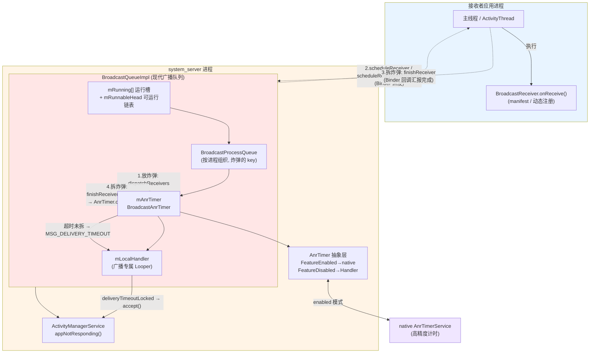
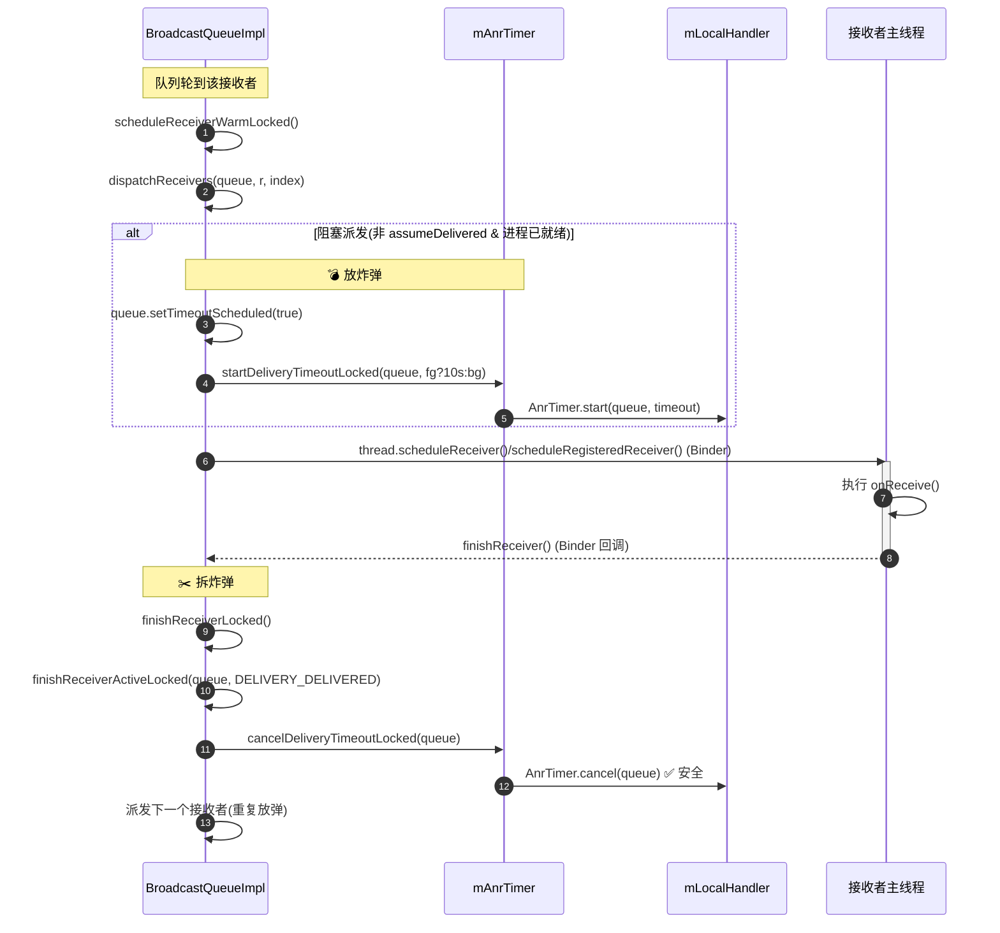
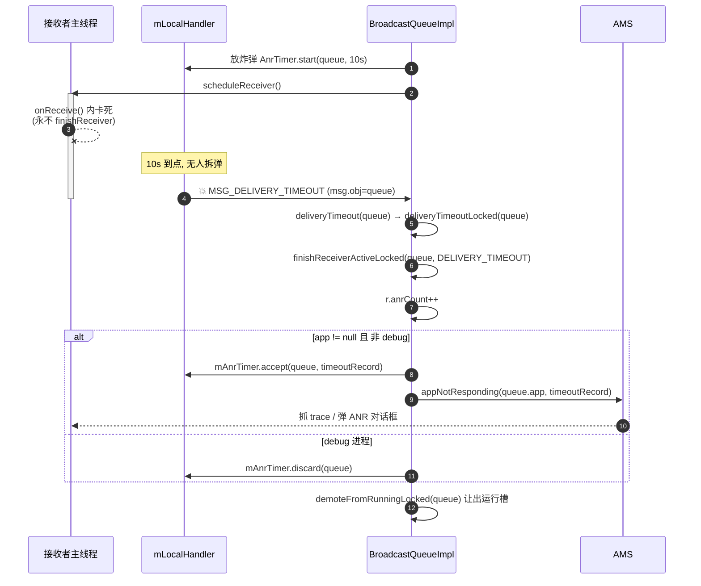
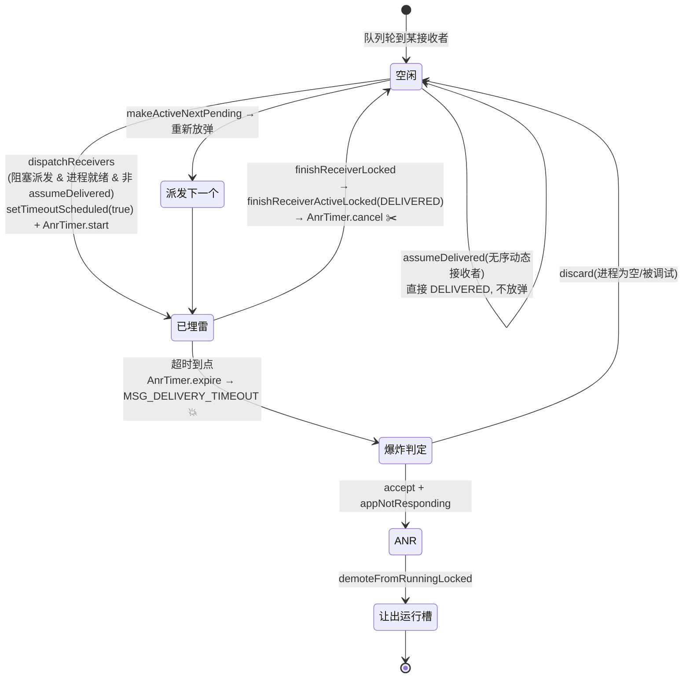

# Broadcast ANR「放炸弹 / 拆炸弹」机制源码深度解析

> 基于本仓库 `base/services/core/java/com/android/server/am/BroadcastQueueImpl.java`（现代广播队列）、
> `BroadcastQueue.java`、`BroadcastConstants.java` 以及
> `base/services/core/java/com/android/server/utils/AnrTimer.java` 的实现。
>
> 本文所有行号均对应当前仓库代码。可与 `Service-ANR放炸弹与拆炸弹机制源码深度解析.md` 对照阅读。

---

## 一、什么是 Broadcast 的「放炸弹 / 拆炸弹」

和 Service ANR 一样，Broadcast ANR 也是一套**超时检测机制**，俗称「放炸弹 / 拆炸弹」：

| 形象说法 | 实际含义 | 代码动作 |
|---------|---------|---------|
| **放炸弹（埋雷）** | 把一个广播派发给某个接收者前，投递一个延时超时消息，约定「接收者必须在 N 毫秒内处理完 `onReceive`」 | `dispatchReceivers` → `startDeliveryTimeoutLocked` → `AnrTimer.start(queue)` |
| **拆炸弹（排雷）** | 接收者按时调用 `finishReceiver` 汇报处理完成，超时消息被取消 | `finishReceiverLocked` → `finishReceiverActiveLocked` → `cancelDeliveryTimeoutLocked` → `AnrTimer.cancel(queue)` |
| **炸弹爆炸** | 接收者没能按时处理完，延时消息到点 → 触发 ANR | `MSG_DELIVERY_TIMEOUT` → `deliveryTimeoutLocked` → `AnrTimer.accept` → `appNotResponding` |

一句话概括：

> **system_server 是裁判，接收者所在的应用进程是选手。每把一个"阻塞型"广播派发给一个接收者前，
> 裁判按下倒计时；接收者执行完 `onReceive` 后调用 `finishReceiver` 拆弹。
> 如果倒计时先到点，判这个接收者 ANR。**

---

## 二、设计意图

### 2.1 为什么需要这套机制

广播接收者的 `onReceive()` 运行在应用主线程。如果开发者在 `onReceive` 里做耗时操作（典型的 ANR 反模式），
主线程被阻塞。system_server 无法直接看到应用主线程，只能用"超时兜底"判定。

但广播 ANR 有一个 Service ANR 没有的特殊性：**有序性与队头阻塞**。

- **有序广播 / manifest 广播**是**串行**的：必须等当前接收者 `finishReceiver` 后才能派发给下一个。
  一个卡死的接收者会**阻塞整条队列**，所以必须用炸弹及时发现并跳过它。
- **无序的动态注册接收者**是**fire-and-forget**：派发后直接 `assumeDelivered`（假定已送达），
  **根本不放炸弹**——因为它们不阻塞队列，即使慢也不影响别人，没必要监控。

### 2.2 现代广播队列的关键设计权衡

本仓库使用的是 **Modern Broadcast Queue**（`BroadcastQueueImpl` 实现 `BroadcastQueue` 抽象，
内部以 `BroadcastProcessQueue` **按进程**组织广播）。与老式 `mHandler` 队列相比，核心设计点：

| 设计点 | 意图 |
|--------|------|
| **炸弹挂在 `BroadcastProcessQueue` 上（按进程）** | 一个进程同一时刻只跑一个"活跃"广播接收者，炸弹 key 用 per-process 队列，天然唯一 |
| **只对"阻塞派发"放炸弹** | `assumeDelivered`（无序动态接收者）不阻塞队列 → 不放炸弹，省开销 |
| **专用 `mLocalHandler`（广播自己的 Looper）** | 计时和派发都跑在广播专属线程，**不受 AMS 主线程拥塞影响**，计时更准 |
| **前台/后台分离的 `BroadcastConstants`** | 前台广播超时严、后台宽，分别用 `mFgConstants` / `mBgConstants` 两套配置 |
| **`AnrTimer` 开启 `.extend(true)`** | 允许超时自动延展（例如目标进程恰好在做正当的长操作时给予宽限） |
| **debug 进程豁免** | 接收者进程被调试时不判 ANR（`app.isDebugging()` → `discard`） |
| **冷启动单独超时** | 接收者进程需冷启动时，用 `PENDING_COLD_START_ABANDON_TIMEOUT` 等机制兜底，与 onReceive 超时区分 |

---

## 三、关键超时常量

定义在 `BroadcastConstants.java`：

```java
// BroadcastConstants.java:61
private static final long DEFAULT_TIMEOUT = 10_000 * Build.HW_TIMEOUT_MULTIPLIER;   // 默认 10s
// BroadcastConstants.java:109
public long TIMEOUT = DEFAULT_TIMEOUT;
// BroadcastConstants.java:62-63  （后台活动启动特权的撤销超时，非 ANR）
private static final long DEFAULT_ALLOW_BG_ACTIVITY_START_TIMEOUT = 10_000 * Build.HW_TIMEOUT_MULTIPLIER;
```

广播队列在 `BroadcastQueueImpl` 里持有**两套**常量（`BroadcastQueueImpl.java:262-263`）：

```java
private final BroadcastConstants mFgConstants;   // 前台广播超时配置
private final BroadcastConstants mBgConstants;   // 后台广播超时配置
```

> - `mFgConstants.TIMEOUT` / `mBgConstants.TIMEOUT` 各自默认 **10s**，但它们是**两个独立的 DeviceConfig 命名空间**，
>   可分别覆盖。历史经验值通常为：**前台 10s，后台 60s**（设备/版本可配）。
> - `Build.HW_TIMEOUT_MULTIPLIER`：低性能/模拟器设备整体放大超时，避免硬件慢导致误判。

---

## 四、架构图



**分层职责**：

- **`BroadcastQueueImpl`**：广播调度核心。`mRunning[]` 是并发运行槽，`BroadcastProcessQueue` 按进程组织广播。
  决定**何时放/何时拆**炸弹（业务逻辑层）。
- **`mLocalHandler`**：广播专属 Handler，承载 `MSG_DELIVERY_TIMEOUT`（爆炸消息），与 AMS 主线程解耦。
- **`BroadcastAnrTimer`**：`AnrTimer<BroadcastProcessQueue>`，把放/拆/爆炸抽象为 `start/cancel/accept/discard`。
- **`ActivityManagerService.appNotResponding`**：真正生成 ANR、抓 trace、弹窗（执行层）。

---

## 五、核心流程图

### 5.1 放炸弹 → 拆炸弹（正常路径，以一个有序/manifest 接收者为例）



### 5.2 炸弹爆炸（ANR 路径）



---

## 六、放炸弹：逐行精度解析

### 6.1 派发循环：`scheduleReceiverWarmLocked`

> 位置：`BroadcastQueueImpl.java:1050-1087`
>
> 当一个进程被提升到运行态（`promoteToRunningLocked`）或上一个接收者 finish 后，会进入这个派发循环。

```java
private boolean scheduleReceiverWarmLocked(@NonNull BroadcastProcessQueue queue)
        throws BroadcastRetryException {
    checkState(queue.isActive(), "isActive");
    ...
    while (queue.isActive()) {
        final BroadcastRecord r = queue.getActive();
        final int index = queue.getActiveIndex();
        if (r.terminalCount == 0) {
            r.dispatchTime = SystemClock.uptimeMillis();        // 记录派发时刻
            ...
        }
        final String skipReason = shouldSkipReceiver(queue, r, index);
        if (skipReason == null) {
            final boolean isBlockingDispatch = dispatchReceivers(queue, r, index);  // ← 进入放弹逻辑
            if (isBlockingDispatch) {
                traceEnd(cookie);
                return false;       // 阻塞派发：已放炸弹，停下来等 finishReceiver 拆弹
            }
        } else {
            finishReceiverActiveLocked(queue, BroadcastRecord.DELIVERY_SKIPPED, skipReason);
        }
        if (shouldRetire(queue)) break;
        queue.makeActiveNextPending();   // 非阻塞派发：直接处理下一个
    }
    return true;
}
```

> 关键点：`dispatchReceivers` 返回 `true` 表示**阻塞派发**——已经放了炸弹，循环立即 `return false` 停住，
> 等接收者回 `finishReceiver` 才继续。返回 `false`（如 `assumeDelivered`）表示**非阻塞**——继续派发下一个。

### 6.2 放炸弹核心：`dispatchReceivers`

> 位置：`BroadcastQueueImpl.java:1136-1244`（聚焦放弹部分）

```java
private boolean dispatchReceivers(@NonNull BroadcastProcessQueue queue,
        @NonNull BroadcastRecord r, int index) throws BroadcastRetryException {
    final ProcessRecord app = queue.app;
    final Object receiver = r.receivers.get(index);

    // Skip ANR tracking early during boot, when requested, or when we
    // immediately assume delivery success
    final boolean assumeDelivered = r.isAssumedDelivered(index);
    if (mService.mProcessesReady && !r.timeoutExempt && !assumeDelivered) {
        queue.setTimeoutScheduled(true);                                  // ① 标记"已放弹"
        final int softTimeoutMillis = (int) (r.isForeground() ? mFgConstants.TIMEOUT
                : mBgConstants.TIMEOUT);                                  // ② 前台/后台不同超时
        startDeliveryTimeoutLocked(queue, softTimeoutMillis);            // 💣 ③ 真正放炸弹
    } else {
        queue.setTimeoutScheduled(false);                                // 不放弹的三种情况
    }
    ...
```

> **第 1143-1151 行——放弹的"准入条件"**，三选一不放弹：
>
> 1. `!mService.mProcessesReady`：开机早期，系统没准备好，不放弹（避免误爆）。
> 2. `r.timeoutExempt`：该广播被显式标记"超时豁免"（某些系统广播），不放弹。
> 3. `assumeDelivered`：**假定已送达**——无序动态注册接收者就是这种，派发即认为完成，不阻塞、不放弹。
>
> 只有"会阻塞队列的派发"（有序广播、manifest 接收者、需要 finishReceiver 的接收者）才放炸弹。
> `softTimeoutMillis` 按广播前台/后台属性从两套常量里取（第 1146-1147 行）。

```java
    // ... 中间是后台活动启动特权、临时白名单等逻辑（与 ANR 无关）...

    setDeliveryState(queue, app, r, index, receiver, BroadcastRecord.DELIVERY_SCHEDULED,
            "scheduleReceiverWarmLocked");                                // ④ 状态机：已调度

    final Intent receiverIntent = r.getReceiverIntent(receiver);
    final IApplicationThread thread = app.getOnewayThread();
    if (thread != null) {
        try {
            ...
            if (receiver instanceof BroadcastFilter) {                    // 动态注册接收者
                thread.scheduleRegisteredReceiver(...);                   // ⑤ Binder 派发
                if (assumeDelivered) {
                    finishReceiverActiveLocked(queue, BroadcastRecord.DELIVERY_DELIVERED,
                            "assuming delivered");                        // 无序的直接完成, 不等
                    return false;                                        // 非阻塞
                }
            } else {                                                      // manifest 接收者
                thread.scheduleReceiver(...);                            // ⑤ Binder 派发
            }
            return true;                                                  // 阻塞派发: 等 finishReceiver
        } catch (RemoteException e) {
            ...
            app.killLocked("Can't deliver broadcast", ...);
            if (receiver instanceof ResolveInfo) {
                cancelDeliveryTimeoutLocked(queue);                       // 派发失败立即拆弹
                throw new BroadcastRetryException(e);
            }
            finishReceiverActiveLocked(queue, BroadcastRecord.DELIVERY_FAILURE, "remote app");
            return false;
        }
    } else {
        finishReceiverActiveLocked(queue, BroadcastRecord.DELIVERY_FAILURE,
                "missing IApplicationThread");                           // 没有线程, 直接失败
        return false;
    }
}
```

> 注意 **第 1208-1212 行**：动态注册的无序接收者 `assumeDelivered=true` 时，派发后立刻
> `finishReceiverActiveLocked(..., DELIVERY_DELIVERED, ...)` 并 `return false`，
> **从头到尾没放炸弹**，这正是无序广播不监控 ANR 的体现。

### 6.3 放弹的物理动作：`startDeliveryTimeoutLocked`

> 位置：`BroadcastQueueImpl.java:1285-1288`

```java
private void startDeliveryTimeoutLocked(@NonNull BroadcastProcessQueue queue,
        int softTimeoutMillis) {
    mAnrTimer.start(queue, softTimeoutMillis);     // 💣 以 per-process 队列为 key 启动倒计时
}
```

> 一旦 `softTimeoutMillis` 到点且没人 `cancel`，`AnrTimer` 会向 `mLocalHandler` 投递
> `MSG_DELIVERY_TIMEOUT`（`msg.obj == queue`）。

### 6.4 炸弹的定义：`BroadcastAnrTimer`

> 位置：`BroadcastQueueImpl.java:1312-1330`，构造于 `BroadcastQueueImpl.java:163`

```java
private class BroadcastAnrTimer extends AnrTimer<BroadcastProcessQueue> {
    BroadcastAnrTimer(@NonNull Handler handler) {
        super(Objects.requireNonNull(handler),
                MSG_DELIVERY_TIMEOUT, "BROADCAST_TIMEOUT",
                new AnrTimer.Args()
                        .extend(true)                                    // ← 允许超时自动延展
                        .longMethodTracing(Flags.enableLongMethodTracingOnAnrTimer()));
    }
    @Override public int getPid(BroadcastProcessQueue queue) {
        return (queue.app != null) ? queue.app.getPid() : 0;
    }
    @Override public int getUid(BroadcastProcessQueue queue) {
        return (queue.app != null) ? queue.app.uid : 0;
    }
}
```

> 三个关键设计：
> 1. **泛型参数是 `BroadcastProcessQueue`**——炸弹 key 是 per-process 广播队列（不是 `ProcessRecord`）。
> 2. **构造时传入的 `handler` 是 `mLocalHandler`**（`BroadcastQueueImpl.java:163`），
>    即广播专属 Looper，超时消息不走 AMS 主线程。
> 3. **`.extend(true)`**——开启自动延展能力（见第八节 AnrTimer）。

---

## 七、拆炸弹：逐行精度解析

### 7.1 应用回调入口：`finishReceiverLocked`

> 位置：`BroadcastQueueImpl.java:1334-1388`
>
> 接收者执行完 `onReceive`（有序广播需显式 `finishReceiver()`；阻塞型派发由框架在 `onReceive` 返回后回调）后，
> 经 Binder 调回 AMS，最终进到这里。

```java
public boolean finishReceiverLocked(@NonNull ProcessRecord app, int resultCode,
        @Nullable String resultData, @Nullable Bundle resultExtras, boolean resultAbort,
        boolean waitForServices) {
    final BroadcastProcessQueue queue = getProcessQueue(app);            // 按进程取队列
    if ((queue == null) || !queue.isActive()) {
        logw("Ignoring finishReceiverLocked; no active broadcast for " + queue);
        return false;                                                    // 没有活跃广播, 忽略
    }
    final BroadcastRecord r = queue.getActive();
    final int index = queue.getActiveIndex();
    if (r.ordered) {                                                      // 有序广播: 记录结果传给下一个
        r.resultCode = resultCode;
        r.resultData = resultData;
        r.resultExtras = resultExtras;
        if (!r.isNoAbort()) r.resultAbort = resultAbort;
    }

    // ✂️ 拆炸弹 + 推进状态机
    finishReceiverActiveLocked(queue, BroadcastRecord.DELIVERY_DELIVERED, "remote app");

    if (r.resultAbort) {                                                  // 有序广播被 abort: 跳过剩余接收者
        for (int i = index + 1; i < r.receivers.size(); i++) {
            setDeliveryState(null, null, r, i, r.receivers.get(i),
                    BroadcastRecord.DELIVERY_SKIPPED, "resultAbort");
        }
    }

    if (shouldRetire(queue)) {                                           // 该进程跑够了, 让出运行槽
        demoteFromRunningLocked(queue);
        return true;
    }
    queue.makeActiveNextPending();                                       // 推进到下一个广播
    try {
        if (scheduleReceiverWarmLocked(queue)) {                         // 继续派发(会给下一个重新放弹)
            demoteFromRunningLocked(queue);
            return true;
        }
    } catch (BroadcastRetryException e) {
        finishOrReEnqueueActiveBroadcast(queue);
        demoteFromRunningLocked(queue);
        return true;
    }
    return false;
}
```

> 拆弹之后立即"接着干"：要么让出运行槽（`demoteFromRunningLocked`），要么 `makeActiveNextPending` +
> `scheduleReceiverWarmLocked` 给下一个接收者派发并**重新放一颗炸弹**。

### 7.2 拆弹核心：`finishReceiverActiveLocked`

> 位置：`BroadcastQueueImpl.java:1418-1453`
>
> **放/拆/爆炸三态在这里汇合**——它根据 `deliveryState` 决定是拆弹、爆炸还是普通收尾。

```java
private void finishReceiverActiveLocked(@NonNull BroadcastProcessQueue queue,
        @DeliveryState int deliveryState, @NonNull String reason) {
    if (!queue.isActive()) {
        logw("Ignoring finishReceiverActiveLocked; no active broadcast for " + queue);
        return;
    }
    final int cookie = traceBegin("finishReceiver");
    final ProcessRecord app = queue.app;
    final BroadcastRecord r = queue.getActive();
    final int index = queue.getActiveIndex();
    final Object receiver = r.receivers.get(index);

    setDeliveryState(queue, app, r, index, receiver, deliveryState, reason);  // 更新状态机

    if (deliveryState == BroadcastRecord.DELIVERY_TIMEOUT) {            // ═══ 爆炸路径 ═══
        r.anrCount++;
        if (app != null && !app.isDebugging()) {
            final String packageName = getReceiverPackageName(receiver);
            final String className = getReceiverClassName(receiver);
            TimeoutRecord tr = TimeoutRecord.forBroadcastReceiver(r.intent, packageName, className);
            mAnrTimer.accept(queue, tr);                                // ① 确认引爆
            mService.appNotResponding(queue.app, tr);                   // ② 触发 ANR
        } else {
            mAnrTimer.discard(queue);                                   // 调试进程: 丢弃, 不 ANR
        }
    } else if (queue.timeoutScheduled()) {                             // ═══ 拆弹路径 ═══
        cancelDeliveryTimeoutLocked(queue);                            // ✂️ 取消未爆的炸弹
    }

    // 接收者结束后, 检查 "waitingFor" 条件
    checkAndRemoveWaitingFor();
    traceEnd(cookie);
}
```

> **拆弹的精髓在第 1445-1447 行**：
> - 只要本次完成**不是**超时（即正常 `DELIVERED` / `SKIPPED` / `FAILURE`），
>   且 `queue.timeoutScheduled()` 为真（说明之前放过弹），就调用
>   `cancelDeliveryTimeoutLocked(queue)` → `mAnrTimer.cancel(queue)` **拆弹**。
> - `timeoutScheduled()` 这个标志位（在放弹时 `setTimeoutScheduled(true)`）保证了"放过弹才需要拆"，
>   对没放弹的 `assumeDelivered` 路径不做无谓的 cancel。

### 7.3 拆弹物理动作：`cancelDeliveryTimeoutLocked`

> 位置：`BroadcastQueueImpl.java:1293-1295`

```java
private void cancelDeliveryTimeoutLocked(@NonNull BroadcastProcessQueue queue) {
    mAnrTimer.cancel(queue);     // 取消计时器并移除在途的 MSG_DELIVERY_TIMEOUT
}
```

### 7.4 其它拆弹/收尾现场

- **派发时远端进程死亡**：`dispatchReceivers` catch 块（`1232`）对 manifest 接收者
  `cancelDeliveryTimeoutLocked` 后抛 `BroadcastRetryException` 重试。
- **接收者被跳过**：`shouldSkipReceiver` 返回非 null → `finishReceiverActiveLocked(..., DELIVERY_SKIPPED, ...)`
  走拆弹分支（`1075`）。
- **进程清理**：`onApplicationCleanupLocked` / `onApplicationTimeoutLocked`（`695-730`）清理该进程相关广播。

---

## 八、炸弹爆炸：`deliveryTimeout` 逐行解析

> 当 `softTimeoutMillis` 到点且无人拆弹，`AnrTimer` 向 `mLocalHandler` 投递 `MSG_DELIVERY_TIMEOUT`。

### 8.1 消息分发

> 位置：`BroadcastQueueImpl.java:292-301`

```java
private final Handler.Callback mLocalCallback = (msg) -> {
    switch (msg.what) {
        ...
        case MSG_DELIVERY_TIMEOUT: {
            deliveryTimeout((BroadcastProcessQueue) msg.obj);   // msg.obj 就是放弹时的 queue
            return true;
        }
        ...
    }
};
```

### 8.2 `deliveryTimeout` → `deliveryTimeoutLocked`

> 位置：`BroadcastQueueImpl.java:1297-1310`

```java
private void deliveryTimeout(@NonNull BroadcastProcessQueue queue) {
    final int cookie = traceBegin("deliveryTimeout");
    synchronized (mService) {                                   // 拿 AMS 全局锁
        deliveryTimeoutLocked(queue);
    }
    traceEnd(cookie);
}

private void deliveryTimeoutLocked(@NonNull BroadcastProcessQueue queue) {
    finishReceiverActiveLocked(queue, BroadcastRecord.DELIVERY_TIMEOUT,   // ← 用 TIMEOUT 状态进入"爆炸分支"
            "deliveryTimeoutLocked");
    demoteFromRunningLocked(queue);                             // 让出运行槽, 不再阻塞其它进程
}
```

> 爆炸只是用 `DELIVERY_TIMEOUT` 这个特殊 `deliveryState` 再次调用 `finishReceiverActiveLocked`，
> 复用第 7.2 节里的爆炸分支：`r.anrCount++` → `accept` → `appNotResponding`。
> 随后 `demoteFromRunningLocked` 把这个卡死的进程队列从运行槽撤下，**避免它继续阻塞整个广播系统**。

### 8.3 `accept` vs `discard`（爆炸的最终裁决）

回看 `finishReceiverActiveLocked` 的爆炸分支（`1433-1444`）：

| 条件 | 动作 | 结果 |
|------|------|------|
| `app != null && !app.isDebugging()` | `mAnrTimer.accept(queue, tr)` + `mService.appNotResponding(...)` | **真 ANR**：抓 trace、弹窗 |
| 进程为空 / 被调试 | `mAnrTimer.discard(queue)` | 静默清账，**不** ANR |

> - `TimeoutRecord.forBroadcastReceiver(r.intent, packageName, className)` 携带广播 intent、
>   接收者包名/类名，供 ANR 报告展示"是哪个广播、哪个接收者超时"。
> - `accept` 会从 `AnrTimer` 取出该计时器的真实 `elapsedMs`（可能因 `.extend` 而 > 名义 10s）。

---

## 九、底层引信：`AnrTimer` 抽象层

> 位置：`base/services/core/java/com/android/server/utils/AnrTimer.java`
>
> `AnrTimer` 把放/拆/爆炸抽象为 5 个动作（类文档 `AnrTimer.java:56-76`）。广播与 Service 共用这套机制。

| 动作 | 方法 | 广播侧调用点 |
|------|------|-------------|
| 放炸弹 | `start(queue, timeoutMs)` | `startDeliveryTimeoutLocked` (`1287`) |
| 拆炸弹 | `cancel(queue)` | `cancelDeliveryTimeoutLocked` (`1294`) |
| 确认引爆 | `accept(queue, record)` | `finishReceiverActiveLocked` 爆炸分支 (`1440`) |
| 取消引爆 | `discard(queue)` | 调试进程分支 (`1443`) |
| 内部到点 | `expire(...)` | native/Handler 到点回调，投递 `MSG_DELIVERY_TIMEOUT` |

### 9.1 两种实现模式

`AnrTimer` 内部用策略模式切换两种实现：

**① `FeatureDisabled`（降级 / 兼容，`AnrTimer.java:530-585`）**

```java
void start(V arg, int pid, int uid, long timeoutMs) {
    cancel(arg);
    final Message msg = mHandler.obtainMessage(mWhat, arg);
    mHandler.sendMessageDelayed(msg, timeoutMs);     // 等价于老式 sendMessageDelayed
}
boolean cancel(V arg) {
    mHandler.removeMessages(mWhat, arg);             // 等价于老式 removeMessages
    return true;
}
```
> 这正是老式广播队列的写法：放弹=`sendMessageDelayed(MSG, queue, timeout)`，拆弹=`removeMessages(MSG, queue)`。

**② `FeatureEnabled`（现代，`AnrTimer.java:599-715`）**

```java
void start(V arg, int pid, int uid, long timeoutMs) {
    synchronized (mLock) {
        if (cancel(arg)) mTotalRestarted++;                          // 同 key 已有 → 先取消(实现重放)
        final int timerId = nativeAnrTimerStart(mNative, pid, uid, timeoutMs);  // 下沉到 native 计时
        if (timerId > 0) { mTimerIdMap.put(arg, timerId); mTimerArgMap.put(timerId, arg); ... }
    }
}
```
> 计时下沉到 native 的 `AnrTimerService`，到点回调 `expire()`（`AnrTimer.java:888-909`）**零延时**投递消息，
> 把"计时精度"与"消息处理延时"解耦——即使 system_server 繁忙也能准时引爆。

### 9.2 `.extend(true)` 的意义

广播 `AnrTimer` 构造时开了 `.extend(true)`（`BroadcastQueueImpl.java:1317`），
意味着 native 计时器到点时若满足延展条件，会**自动重排一次延展超时**而非立即引爆，
给"正当的慢操作"一个宽限窗口（类文档 `AnrTimer.java:73-76`）。
`accept` 返回的 `elapsedMs` 因此可能大于名义的 10s。

---

## 十、完整状态总览（放→拆→爆 三态）



---

## 十一、与 Service ANR 的关键对比

| 维度 | **Service ANR** | **Broadcast ANR** |
|------|----------------|-------------------|
| 炸弹 key | `ProcessRecord`（进程级） | `BroadcastProcessQueue`（per-process 广播队列） |
| 计时器载体 Handler | **AMS 主 Handler**（`AMS.MainHandler`） | **广播专属 `mLocalHandler`**（解耦主线程） |
| 超时常量 | 前台 20s / 后台 200s | 前台/后台各 10s（`mFgConstants`/`mBgConstants`，可配，后台常配 60s） |
| 放弹时机 | 每段生命周期回调前 `bumpServiceExecutingLocked` | 每个**阻塞型**接收者派发前 `dispatchReceivers` |
| 不放弹的情况 | 开机早期 / 进程冻结 | 开机早期 / `timeoutExempt` / `assumeDelivered`（无序动态接收者） |
| 拆弹时机 | `serviceDoneExecutingLocked`（nesting→0 且进程无执行中 Service） | `finishReceiverActiveLocked`（非超时完成 + `timeoutScheduled`） |
| 引用计数 | `executeNesting`（create/bind/start 各 +1） | 无；同一进程同一时刻只有一个活跃接收者 |
| 爆炸入口 | `serviceTimeout(proc)` 需遍历定位真凶 | `deliveryTimeoutLocked(queue)` 直接对当前活跃接收者 |
| `.extend` | 仅 FGS 炸弹开启 | 默认开启（`.extend(true)`） |
| ANR 后处理 | `appNotResponding` 生成 ANR | `appNotResponding` + `demoteFromRunningLocked` 撤下卡死队列 |

> 共同点：都基于统一的 `AnrTimer` 抽象（`start/cancel/accept/discard/expire`），
> 都对 debug 进程豁免，都在现代模式把计时下沉 native。

---

## 十二、总结：一图记住核心设计

```
        ┌──────────────────────────────────────────────────────────────┐
        │ 铁律：阻塞型接收者派发前放弹，finishReceiver 拆弹，超时则 ANR │
        │   无序动态接收者 = assumeDelivered = 不放弹（fire-and-forget） │
        └──────────────────────────────────────────────────────────────┘

  放炸弹 (dispatchReceivers)         应用执行              拆炸弹 (finishReceiver)
 ┌───────────────────────┐ Binder派发 ┌────────────┐ Binder回调 ┌────────────────────┐
 │ setTimeoutScheduled    │ ─────────▶ │ onReceive()│ ─────────▶ │ finishReceiverActive│
 │ AnrTimer.start(queue,  │ schedule   │            │ finish     │  (DELIVERED)        │
 │   fg?10s:bg)           │ Receiver   │            │ Receiver   │ AnrTimer.cancel     │
 └──────────┬────────────┘            └─────┬──────┘            └────────────────────┘
            │ 10s 无人拆                     │ 卡死(永不 finish)
            ▼                                ▼
   MSG_DELIVERY_TIMEOUT ──────────▶ deliveryTimeoutLocked
        (mLocalHandler)                     │
                                            ├─ finishReceiverActive(DELIVERY_TIMEOUT)
                                            │     r.anrCount++
                                            │     ├─ accept + appNotResponding ▶ ANR
                                            │     └─ discard (调试进程, 不 ANR)
                                            └─ demoteFromRunningLocked (撤下卡死队列)
```

**三句话记住本质：**

1. **放炸弹** ＝ `dispatchReceivers` 对**阻塞型**接收者 `setTimeoutScheduled(true)` +
   `startDeliveryTimeoutLocked` → `AnrTimer.start(queue, fg?10s:bg)`；无序动态接收者 `assumeDelivered` **不放弹**。
2. **拆炸弹** ＝ 接收者回 `finishReceiver`，`finishReceiverActiveLocked` 在非超时分支
   `cancelDeliveryTimeoutLocked` → `AnrTimer.cancel(queue)`。
3. **爆炸** ＝ 超时无人拆 → `MSG_DELIVERY_TIMEOUT` → `deliveryTimeoutLocked` →
   `finishReceiverActiveLocked(DELIVERY_TIMEOUT)` → `accept` + `appNotResponding`，并 `demoteFromRunningLocked` 撤下卡死队列。

---

## 附录：关键代码位置索引

| 功能 | 文件:行号 |
|------|----------|
| BroadcastAnrTimer 创建 | `BroadcastQueueImpl.java:163` |
| 本地 Handler 与消息分发 | `BroadcastQueueImpl.java:290-309` |
| 派发循环 | `BroadcastQueueImpl.java:1050-1087` (`scheduleReceiverWarmLocked`) |
| 放弹核心 + 准入条件 | `BroadcastQueueImpl.java:1136-1244` (`dispatchReceivers`) |
| 放弹物理动作 | `BroadcastQueueImpl.java:1285-1288` (`startDeliveryTimeoutLocked`) |
| 拆弹物理动作 | `BroadcastQueueImpl.java:1290-1295` (`cancelDeliveryTimeoutLocked`) |
| 爆炸消息处理 | `BroadcastQueueImpl.java:1297-1310` (`deliveryTimeout` / `deliveryTimeoutLocked`) |
| BroadcastAnrTimer 定义 | `BroadcastQueueImpl.java:1312-1330` |
| 拆弹入口 | `BroadcastQueueImpl.java:1334-1388` (`finishReceiverLocked`) |
| 放/拆/爆 三态汇合 | `BroadcastQueueImpl.java:1418-1453` (`finishReceiverActiveLocked`) |
| 跳过接收者(拆弹分支) | `BroadcastQueueImpl.java:1093-1124` (`shouldSkipReceiver`) |
| 超时常量 | `BroadcastConstants.java:61-63, 109-112` |
| 前台/后台常量持有 | `BroadcastQueueImpl.java:154-155, 262-263` |
| AnrTimer 五动作语义 | `AnrTimer.java:56-76` |
| FeatureDisabled(老式) | `AnrTimer.java:530-585` |
| FeatureEnabled(native) | `AnrTimer.java:599-715` |
| expire 引爆 | `AnrTimer.java:888-909` |
