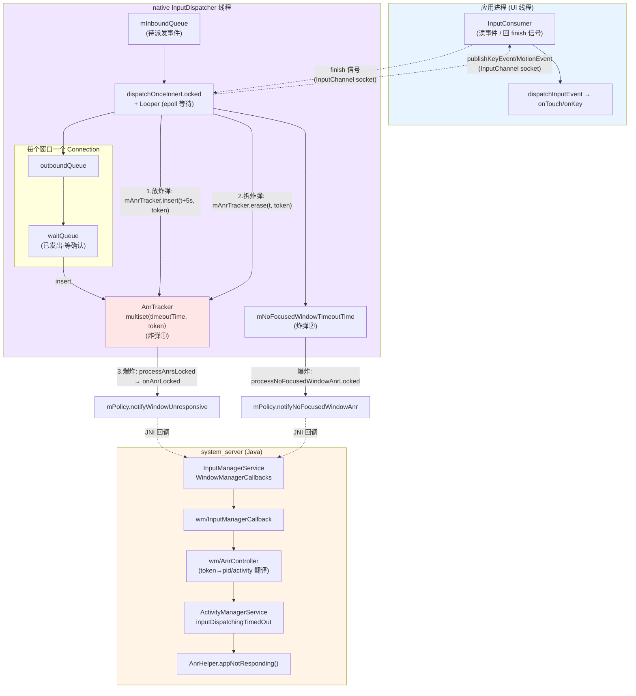
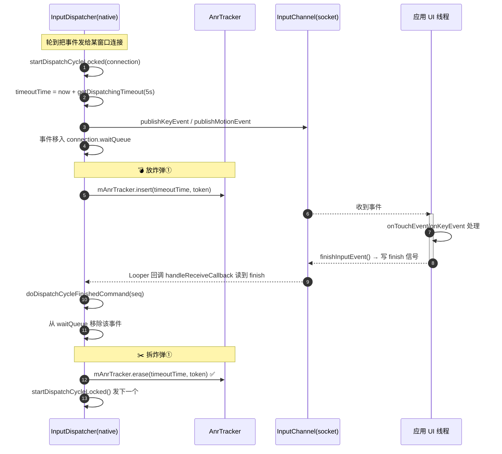
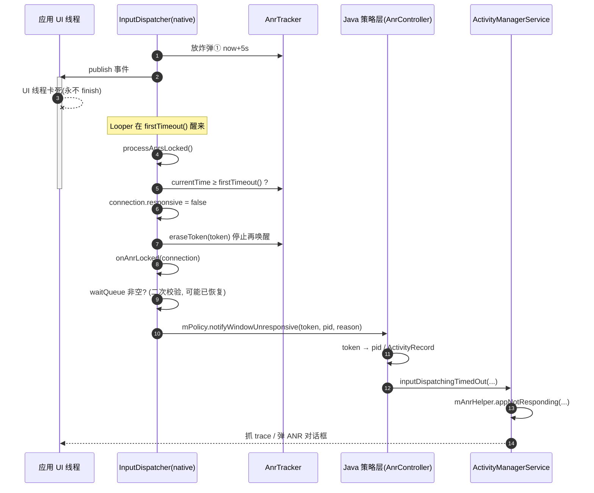
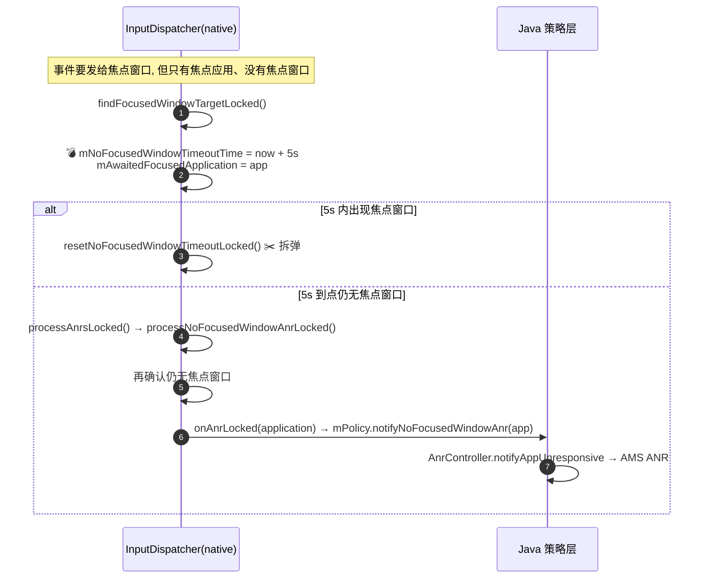
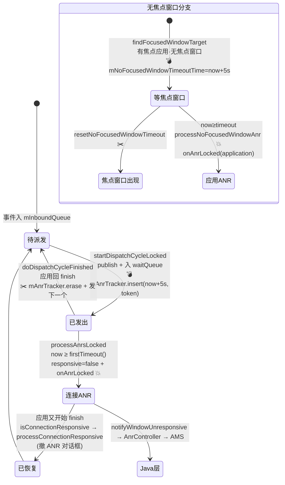

# Input ANR「放炸弹 / 拆炸弹」机制源码深度解析

> 基于本仓库 native 输入派发层
> `native/services/inputflinger/dispatcher/InputDispatcher.cpp`、`AnrTracker.{h,cpp}`、`Connection.h`
> 以及 Java 策略层 `InputManagerService.java`、`wm/InputManagerCallback.java`、`wm/AnrController.java`、
> `am/ActivityManagerService.java`、`native/libs/input/android/os/IInputConstants.aidl` 的实现。
>
> 本文所有行号均对应当前仓库代码。可与
> `Service-ANR…`、`Broadcast-ANR…`、`Provider-ANR放炸弹与拆炸弹机制源码深度解析.md` 对照阅读。

---

## 一、Input ANR 的根本不同：炸弹在 native，不在 Java Handler

前三类 ANR（Service / Broadcast / Provider）的炸弹都埋在 **system_server 的 Java 层**
（`AnrTimer` 或 `mHandler` 延时消息）。**Input ANR 完全不同**：

- 输入事件的派发由 **native 的 `InputDispatcher`**（一个独立的 native 线程）负责，它和应用之间通过
  **InputChannel（socket pair）** 直接通信，**根本不经过 system_server 的 Java Handler**。
- 因此 Input 的「炸弹」是一套**自包含的 native 计时机制**：用一个按超时时刻排序的
  `std::multiset`（`AnrTracker`）记录"每个已派发但未确认的事件何时该 ANR"，
  靠 `InputDispatcher` 自己的 `Looper` 在最早超时点醒来检查。
- ANR 真正"爆炸"时，native 通过 **policy 回调** 一路上抛到 Java 层
  （`InputManagerService` → `WindowManagerService/AnrController` → `ActivityManagerService`），
  最后由 AMS 弹出我们熟悉的 ANR 对话框。

一句话概括：

> **native `InputDispatcher` 是裁判，应用的 UI 线程是选手。每把一个输入事件投递进某个窗口连接的
> 等待队列（waitQueue），裁判就在 `AnrTracker` 里登记一个"该事件 5 秒后 ANR"的时刻（放炸弹）；
> 应用消费完事件后通过 InputChannel 回 `finish` 信号，裁判把该时刻擦掉（拆炸弹）。
> 若裁判在 `Looper` 醒来时发现最早的超时时刻已过且事件仍未确认，就判这个窗口 ANR。**

---

## 二、设计意图

### 2.1 为什么 Input ANR 必须自成体系

1. **输入是最延迟敏感的路径**：用户点一下，5 秒内必须有响应，否则就是肉眼可见的卡死。
   超时阈值是四类 ANR 里最短的（**5s**）。
2. **派发在 native 独立线程**：`InputDispatcher` 不依赖 Java 主线程，自己跑 `Looper`，
   所以计时也必须 native 自包含——不能用 system_server 的 Handler（那会引入额外抖动甚至死锁）。
3. **必须精确定位"是哪个窗口卡了"**：一个事件可能投给多个窗口连接，必须**按连接、按事件**粒度追踪，
   谁的等待队列里有"过期未确认"的事件，就判谁。
4. **token 解耦**：native 只认 `IBinder` token（窗口的 input token），不知道 `ProcessRecord`/`pid`。
   翻译 token→pid→activity 的脏活交给 Java 的 `AnrController`，native 保持纯粹。

### 2.2 关键设计权衡

| 设计点 | 意图 |
|--------|------|
| **`AnrTracker` 用 `std::multiset<pair<timeoutTime, token>>`** | 按超时时刻排序，O(log n) 取最早超时，`Looper` 只需在 `firstTimeout()` 醒来 |
| **炸弹粒度 = 每连接每事件** | 一个事件进 waitQueue 就 insert 一个超时，确认就 erase，精确到单个事件 |
| **`connection->responsive` 标志** | 一个连接 ANR 后置 `responsive=false`，**停止为它的新事件放炸弹**，避免 ANR 刷屏 |
| **`onAnrLocked` 二次校验 waitQueue** | policy 可能延长了超时、或事件已被消费，爆炸前再确认 waitQueue 非空才真 ANR |
| **多设备超时倍数 `HwTimeoutMultiplier`** | 低性能/调试设备整体放大 5s，避免误判 |
| **两类炸弹分开** | "窗口不响应"和"有焦点应用但无焦点窗口"是两种病因，用两套独立计时 |
| **恢复即拆 ANR（responsive 回调）** | 卡死的窗口后来又开始确认事件 → 通知 policy 撤掉 ANR 对话框 |

---

## 三、两颗炸弹与关键常量

Input 场景有**两颗**性质不同的炸弹：

| 炸弹 | 监控对象 | 状态变量 | 放弹位置 | 爆炸 |
|------|---------|---------|---------|------|
| **① 连接无响应弹** | 窗口/监视器连接 | `AnrTracker mAnrTracker` | `startDispatchCycleLocked`（事件入 waitQueue 时） | `onAnrLocked(connection)` → 窗口 ANR |
| **② 无焦点窗口弹** | 有焦点应用但无焦点窗口 | `mNoFocusedWindowTimeoutTime` | `findFocusedWindowTargetLocked` | `onAnrLocked(application)` → 应用 ANR |

超时常量（`IInputConstants.aidl:26`）：

```aidl
// native/libs/input/android/os/IInputConstants.aidl:26
const int UNMULTIPLIED_DEFAULT_DISPATCHING_TIMEOUT_MILLIS = 5000; // 5 seconds
```

在 `InputDispatcher.cpp:123` 乘以硬件倍数得到默认派发超时：

```cpp
// InputDispatcher.cpp:123-125
const std::chrono::duration DEFAULT_INPUT_DISPATCHING_TIMEOUT = std::chrono::milliseconds(
        android::os::IInputConstants::UNMULTIPLIED_DEFAULT_DISPATCHING_TIMEOUT_MILLIS *
        HwTimeoutMultiplier());
```

> **5 秒**是默认值；单个窗口可以通过 `WindowInfo.dispatchingTimeoutMillis` 覆盖
> （见 `getDispatchingTimeoutLocked`，第六节）。

---

## 四、架构图



**分层职责**：

- **`InputDispatcher`（native）**：事件派发 + 计时。`AnrTracker` 持有所有"在飞"事件的超时时刻。
- **`Connection`（native）**：每个窗口/监视器一个，含 `outboundQueue`（待发）和 `waitQueue`（已发等确认）。
- **`AnrController`（Java/WMS）**：把 native 给的 `IBinder` token 翻译成 `pid`/`ActivityRecord`，并预 dump 状态。
- **`ActivityManagerService` + `AnrHelper`**：真正生成 ANR、抓 trace、弹窗。

---

## 五、核心流程图

### 5.1 炸弹①：放弹 → 拆弹（正常路径）



### 5.2 炸弹①爆炸（窗口 ANR）



### 5.3 炸弹②：无焦点窗口 ANR



---

## 六、炸弹①放弹：逐行精度解析

### 6.1 计算超时：`getDispatchingTimeoutLocked`

> 位置：`InputDispatcher.cpp:1084-1094`

```cpp
std::chrono::nanoseconds InputDispatcher::getDispatchingTimeoutLocked(
        const std::shared_ptr<Connection>& connection) {
    if (connection->isFocusMonitor) {
        return mMonitorDispatchingTimeout;                                  // 监视器用专门超时
    }
    const sp<WindowInfoHandle> window = mWindowInfos.findWindowHandle(connection->getToken());
    if (window != nullptr) {
        return window->getDispatchingTimeout(DEFAULT_INPUT_DISPATCHING_TIMEOUT);  // 窗口可自定义, 默认 5s
    }
    return DEFAULT_INPUT_DISPATCHING_TIMEOUT;                                // 兜底 5s
}
```

> 超时优先级：监视器超时 > 窗口自定义超时 > 默认 5s。

### 6.2 放弹核心：`startDispatchCycleLocked`

> 位置：`InputDispatcher.cpp:3758-3900`（聚焦放弹部分）
>
> 每当要把 `outboundQueue` 里的事件真正发给应用时调用它：发布事件 → 移入 `waitQueue` → 登记超时。

```cpp
void InputDispatcher::startDispatchCycleLocked(nsecs_t currentTime,
                                               const std::shared_ptr<Connection>& connection) {
    while (connection->status == Connection::Status::NORMAL && !connection->outboundQueue.empty()) {
        std::unique_ptr<DispatchEntry>& dispatchEntry = connection->outboundQueue.front();
        dispatchEntry->deliveryTime = currentTime;                                  // ① 记录发出时刻
        const std::chrono::nanoseconds timeout = getDispatchingTimeoutLocked(connection);
        dispatchEntry->timeoutTime = currentTime + timeout.count();                 // ② 该事件的 ANR 时刻 = now+5s

        // ... 根据事件类型 publishKeyEvent / publishMotionEvent / ... 经 InputChannel 发给应用 ...
        status_t status;
        switch (eventEntry.type) { /* KEY/MOTION/FOCUS/... 各自 publish */ }

        if (status) {
            // 发布失败处理（管道满则等待，其它错误 abortBrokenDispatchCycle）
            if (status == WOULD_BLOCK) { /* 管道满, 等应用消费 */ }
            else { abortBrokenDispatchCycleLocked(connection, /*notify=*/true); }
            return;
        }

        // ★★★ 放炸弹的关键三步 ★★★
        const nsecs_t timeoutTime = dispatchEntry->timeoutTime;
        connection->waitQueue.emplace_back(std::move(dispatchEntry));               // ③ 事件移入 waitQueue(已发·等确认)
        connection->outboundQueue.erase(connection->outboundQueue.begin());
        traceOutboundQueueLength(*connection);
        if (connection->responsive) {                                              // ④ 仅当连接"健康"才放弹
            mAnrTracker.insert(timeoutTime, connection->getToken());               // 💣 登记超时时刻
        }
        traceWaitQueueLength(*connection);
    }
}
```

> **放弹精髓在第 3890-3897 行**：
> 1. `deliveryTime` / `timeoutTime`（第 3768-3770 行）：事件发出时刻 + 5s = 它的"ANR 时刻"。
> 2. 事件从 `outboundQueue`（待发）移到 `waitQueue`（已发·等应用确认）。
> 3. **`if (connection->responsive)`**：只有连接当前"健康"才 `mAnrTracker.insert`。
>    一个已经 ANR（`responsive=false`）的连接，后续事件**不再放炸弹**——避免对同一个卡死窗口反复判 ANR。
> 4. `mAnrTracker.insert(timeoutTime, token)`：往 multiset 里塞一对 `<超时时刻, 窗口token>`。
>    multiset 按超时时刻自动排序，`firstTimeout()` 即最早该爆的弹。

### 6.3 计时载体：`AnrTracker` 与 `Looper` 唤醒

> 位置：`AnrTracker.cpp:26-67`
>
> Input 没有"延时消息"，它的"引信"就是 multiset + dispatcher 的 `Looper` 唤醒时机。

```cpp
void AnrTracker::insert(nsecs_t timeoutTime, sp<IBinder> token) {       // 放弹
    mAnrTimeouts.insert(std::make_pair(timeoutTime, std::move(token)));
}
void AnrTracker::erase(nsecs_t timeoutTime, const sp<IBinder>& token) { // 拆弹(单个)
    auto it = mAnrTimeouts.find(std::make_pair(timeoutTime, token));
    if (it != mAnrTimeouts.end()) mAnrTimeouts.erase(it);
}
nsecs_t AnrTracker::firstTimeout() const {                             // 最早该爆的时刻
    if (mAnrTimeouts.empty()) return std::numeric_limits<nsecs_t>::max();
    return mAnrTimeouts.begin()->first;
}
const sp<IBinder>& AnrTracker::firstToken() const {                    // 最早该爆的窗口
    return mAnrTimeouts.begin()->second;
}
```

> 派发主循环每跑一轮，都会调用 `processAnrsLocked()`（见 6.5），它返回 `firstTimeout()`，
> 主循环用它设置 `nextWakeupTime`，让 `Looper` 在"最早该爆的时刻"精确醒来检查——
> 这相当于 Java 侧 `sendMessageDelayed` 的等价物，只是用 multiset + epoll 实现。

---

## 七、炸弹①拆弹：逐行精度解析

### 7.1 应用确认事件的回路

应用消费完事件后，`InputConsumer.finishInputEvent()` 经 **InputChannel（socket）** 向 dispatcher 写一个
`finish` 信号。dispatcher 的 `Looper` 在该 fd 上注册了回调（`handleReceiveCallback`），读到 finish 后
调用 `doDispatchCycleFinishedCommand`——这就是拆弹入口。

### 7.2 拆弹核心：`doDispatchCycleFinishedCommand`

> 位置：`InputDispatcher.cpp:6529-6601`（聚焦拆弹部分）

```cpp
void InputDispatcher::doDispatchCycleFinishedCommand(nsecs_t finishTime,
        const std::shared_ptr<Connection>& connection, uint32_t seq, bool handled,
        nsecs_t consumeTime) {
    // ... 前半段：找到 waitQueue 里 seq 对应的 dispatchEntry, 统计耗时、上报延迟、处理按键 fallback ...

    // 后半段：从 waitQueue 摘除该事件并拆弹
    auto entryIt = std::find_if(connection->waitQueue.begin(), connection->waitQueue.end(),
                                [seq](auto& e) { return e->seq == seq; });
    if (entryIt != connection->waitQueue.end()) {
        std::unique_ptr<DispatchEntry> dispatchEntry = std::move(*entryIt);
        connection->waitQueue.erase(entryIt);                                  // ① 从等待队列移除

        const sp<IBinder>& connectionToken = connection->getToken();
        mAnrTracker.erase(dispatchEntry->timeoutTime, connectionToken);        // ✂️ ② 拆炸弹①
        if (!connection->responsive) {                                         // ③ 若之前 ANR 过
            connection->responsive = isConnectionResponsive(*connection);      //    重新判断是否已恢复
            if (connection->responsive) {
                processConnectionResponsiveLocked(*connection);               // ④ 已恢复 → 通知 policy 撤 ANR
            }
        }
        traceWaitQueueLength(*connection);
        // ... 处理 fallback key ...
        releaseDispatchEntry(std::move(dispatchEntry));
    }

    // 应用确认了一个事件 → 立刻给它发下一个(并为下一个重新放弹)
    startDispatchCycleLocked(now(), connection);                              // ⑤ 继续派发
}
```

> **拆弹精髓在第 6566-6580 行**：
> 1. 用 `seq`（序列号）在 `waitQueue` 里找到刚被应用确认的那个事件并移除。
> 2. **`mAnrTracker.erase(dispatchEntry->timeoutTime, connectionToken)`**：用放弹时记的
>    `<timeoutTime, token>` 精确擦掉那一颗炸弹。
> 3-4. 如果这个连接之前已 ANR（`responsive==false`），现在它又开始确认事件了，
>    用 `isConnectionResponsive` 判断 waitQueue 里是否还有"过老"的事件；若没有则认为**已恢复**，
>    调 `processConnectionResponsiveLocked` 通知 policy **撤掉 ANR 对话框**。
> 5. `startDispatchCycleLocked` 继续发下一个事件——这又会为下一个事件**重新放弹**，形成"放-拆-放-拆"的稳态。

### 7.3 `isConnectionResponsive`：恢复判定

> 位置：`InputDispatcher.cpp:532-545` 附近

```cpp
// Connection is responsive if it has no events in the waitQueue that are older than the timeout.
static bool isConnectionResponsive(const Connection& connection) {
    const nsecs_t currentTime = now();
    for (const auto& dispatchEntry : connection.waitQueue) {
        if (dispatchEntry->timeoutTime <= currentTime) {     // 还有过期未确认的事件 → 仍不健康
            return false;
        }
    }
    return true;
}
```

> 只要 waitQueue 里还有任何"已过 ANR 时刻"的事件，连接就仍算不健康。

---

## 八、炸弹①爆炸：逐行精度解析

### 8.1 周期检查 + 引爆：`processAnrsLocked`

> 位置：`InputDispatcher.cpp:1032-1069`
>
> 派发主循环每轮都调它。它既负责"算出下次该何时醒"，也负责"发现过期就引爆"。

```cpp
nsecs_t InputDispatcher::processAnrsLocked() {
    const nsecs_t currentTime = now();
    nsecs_t nextAnrCheck = LLONG_MAX;

    // ── 炸弹②：无焦点窗口超时（见第十节）──
    if (mNoFocusedWindowTimeoutTime.has_value() && mAwaitedFocusedApplication != nullptr) {
        if (currentTime >= *mNoFocusedWindowTimeoutTime) {
            processNoFocusedWindowAnrLocked();                    // 💥 炸弹②爆炸
            mAwaitedFocusedApplication.reset();
            mNoFocusedWindowTimeoutTime = std::nullopt;
            return LLONG_MIN;                                     // 立刻让主循环重跑一轮
        } else {
            nextAnrCheck = *mNoFocusedWindowTimeoutTime;          // 还没到, 记下唤醒时刻
        }
    }

    // ── 炸弹①：连接无响应 ──
    nextAnrCheck = std::min(nextAnrCheck, mAnrTracker.firstTimeout());   // 取最早该爆的弹
    if (currentTime < nextAnrCheck) {        // 绝大多数情况：还没到点
        return nextAnrCheck;                 // 一切正常, 告诉主循环"下次在这个时刻再检查"
    }

    // 到这里说明：最早那颗弹已经过期 → 有连接无响应
    std::shared_ptr<Connection> connection =
            mConnectionManager.getConnection(mAnrTracker.firstToken());
    if (connection == nullptr) {
        ALOGE("Could not find connection for entry %" PRId64, mAnrTracker.firstTimeout());
        mAnrTracker.eraseToken(mAnrTracker.firstToken());        // 找不到连接, 清掉防止反复报错
        return nextAnrCheck;
    }
    connection->responsive = false;                              // ① 标记该连接不健康
    mAnrTracker.eraseToken(connection->getToken());              // ② 擦掉它所有炸弹, 不再为它醒
    onAnrLocked(connection);                                     // ③ 引爆
    return LLONG_MIN;                                            // 立刻重跑一轮主循环
}
```

> **引爆三步（第 1064-1067 行）**：
> 1. `connection->responsive = false`：标记连接不健康——之后 `startDispatchCycleLocked` 不再为它放弹。
> 2. `mAnrTracker.eraseToken(token)`：擦掉这个连接在 multiset 里的**所有**炸弹，
>    `Looper` 不再为它反复醒来（否则每轮都会重复引爆）。
> 3. `onAnrLocked(connection)`：真正抛 ANR。

### 8.2 引爆处理：`onAnrLocked`

> 位置：`InputDispatcher.cpp:6620-6657`

```cpp
void InputDispatcher::onAnrLocked(const std::shared_ptr<Connection>& connection) {
    // policy 可能延长过超时, 等待队列也许已经健康了, 这种情况别误报
    if (connection->waitQueue.empty()) {                                       // ① 二次校验
        ALOGI("Not raising ANR because the connection %s has recovered", ...);
        return;
    }
    // 最老的那个事件最能代表"卡了多久"
    DispatchEntry& oldestEntry = *connection->waitQueue.front();
    const nsecs_t currentWait = now() - oldestEntry.deliveryTime;
    std::string reason =
            android::base::StringPrintf("%s is not responding. Waited %" PRId64 "ms for %s",
                                        connection->getInputChannelName().c_str(),
                                        ns2ms(currentWait),
                                        oldestEntry.eventEntry->getDescription().c_str());
    sp<IBinder> connectionToken = connection->getToken();
    updateLastAnrStateLocked(mWindowInfos.findWindowHandle(connectionToken), reason);  // ② dump 现场存档

    processConnectionUnresponsiveLocked(*connection, std::move(reason));               // ③ 上抛 policy
    cancelEventsForAnrLocked(connection);                                              // ④ 取消该连接在飞事件
}
```

> **第 6626-6630 行的二次校验是关键**：因为 policy 允许"延长超时"，到了引爆点时
> 应用也许刚好把事件都确认完了（`waitQueue` 空），此时**不报 ANR**。这避免了竞态误判。
> `reason` 字符串就是 ANR 报告里那句经典的 `"... is not responding. Waited 5000ms for MotionEvent"`。

### 8.3 上抛 policy：`processConnectionUnresponsiveLocked`

> 位置：`InputDispatcher.cpp:6751-6769`

```cpp
void InputDispatcher::processConnectionUnresponsiveLocked(const Connection& connection,
                                                          std::string reason) {
    const sp<IBinder>& connectionToken = connection.getToken();
    std::optional<gui::Pid> pid;
    if (connection.isFocusMonitor) {
        pid = mConnectionManager.findMonitorPidByToken(connectionToken);   // 监视器: 查 pid
    } else {
        const sp<WindowInfoHandle> handle = mWindowInfos.findWindowHandle(connectionToken);
        if (handle != nullptr) pid = handle->getInfo()->ownerPid;          // 窗口: 取 ownerPid
    }
    sendWindowUnresponsiveCommandLocked(connectionToken, pid, std::move(reason));  // 投递 policy 命令
}
```

`sendWindowUnresponsiveCommandLocked`（`InputDispatcher.cpp:6727-6735`）把回调放进命令队列，
释放锁后调用 `mPolicy.notifyWindowUnresponsive(token, pid, reason)` —— 经 JNI 进入 Java 层。

---

## 九、Java 策略层：从 native 回调到 ANR 弹窗

### 9.1 回调链路总览

```
native: mPolicy.notifyWindowUnresponsive(token, pid, reason)
   │  (JNI)
   ▼
InputManagerService.WindowManagerCallbacks.notifyWindowUnresponsive()
   ▼
wm/InputManagerCallback.notifyWindowUnresponsive()           // InputManagerCallback.java:115-119
   ▼
wm/AnrController.notifyWindowUnresponsive(token, pid, timeoutRecord)   // AnrController.java:143
   ▼
   ├─ token 能解析到窗口 → ActivityRecord.inputDispatchingTimedOut()
   └─ 否则按 pid → AMS.mAmInternal.inputDispatchingTimedOut(pid, aboveSystem, ...)
   ▼
ActivityManagerService.inputDispatchingTimedOut()            // AMS.java:18350 / 18374
   ▼
mAnrHelper.appNotResponding(proc, ...)                       // 抓 trace / 弹 ANR 对话框
```

### 9.2 `InputManagerCallback`（WMS 侧入口）

> 位置：`base/services/core/java/com/android/server/wm/InputManagerCallback.java:108-124`

```java
@Override
public void notifyNoFocusedWindowAnr(@NonNull InputApplicationHandle applicationHandle) {
    TimeoutRecord timeoutRecord = TimeoutRecord.forInputDispatchNoFocusedWindow(...);
    mService.mAnrController.notifyAppUnresponsive(applicationHandle, timeoutRecord);   // 炸弹②
}

@Override
public void notifyWindowUnresponsive(@NonNull IBinder token, @NonNull OptionalInt pid,
        @NonNull String reason) {
    TimeoutRecord timeoutRecord = TimeoutRecord.forInputDispatchWindowUnresponsive(reason);
    mService.mAnrController.notifyWindowUnresponsive(token, pid, timeoutRecord);        // 炸弹①
}

@Override
public void notifyWindowResponsive(@NonNull IBinder token, @NonNull OptionalInt pid) {
    mService.mAnrController.notifyWindowResponsive(token, pid);                         // 恢复 → 撤 ANR
}
```

### 9.3 `AnrController.notifyWindowUnresponsive`：token→pid/activity 翻译

> 位置：`base/services/core/java/com/android/server/wm/AnrController.java:143-206`

```java
void notifyWindowUnresponsive(@NonNull IBinder token, @NonNull OptionalInt pid,
        @NonNull TimeoutRecord timeoutRecord) {
    try {
        timeoutRecord.mLatencyTracker.notifyWindowUnresponsiveStarted();
        if (notifyWindowUnresponsive(token, timeoutRecord)) {      // ① 先按 input token 找窗口
            return;
        }
        if (!pid.isPresent()) {                                    // ② token 找不到且无 pid → 放弃
            Slog.w(TAG_WM, "Failed to notify that window token=" + token + " was unresponsive.");
            return;
        }
        notifyWindowUnresponsive(pid.getAsInt(), timeoutRecord);   // ③ 退而按 pid 归责
    } finally {
        timeoutRecord.mLatencyTracker.notifyWindowUnresponsiveEnded();
    }
}

private boolean notifyWindowUnresponsive(@NonNull IBinder inputToken, TimeoutRecord timeoutRecord) {
    preDumpIfLockTooSlow(timeoutRecord);                           // 预 dump(防 WMS 锁太慢丢现场)
    final int pid; final boolean aboveSystem;
    final ActivityRecord activity; final WindowState windowState;
    synchronized (mService.mGlobalLock) {
        InputTarget target = mService.getInputTargetFromToken(inputToken);   // token → InputTarget
        if (target == null) return false;
        windowState = target.getWindowState();
        pid = target.getPid();
        activity = (windowState != null && windowState.mInputChannelToken == inputToken)
                ? windowState.mActivityRecord : null;             // 归责到 Activity
        aboveSystem = (windowState != null) ? isWindowAboveSystem(windowState) : true;
        Slog.i(TAG_WM, "ANR in " + target + ". Reason:" + timeoutRecord.mReason);
    }
    if (activity != null) {
        activity.inputDispatchingTimedOut(timeoutRecord, pid);    // ④a 有 Activity: 走 ATMS/AMS
    } else {
        mService.mAmInternal.inputDispatchingTimedOut(pid, aboveSystem, timeoutRecord);  // ④b 仅 pid
    }
    dumpAnrStateAsync(activity, windowState, timeoutRecord.mReason);   // 异步 dump WMS 状态
    return true;
}
```

> `AnrController` 的核心价值：**把 native 的 `IBinder` token 翻译成 AMS 能用来"归责"的 `pid`/`ActivityRecord`**，
> 并在抓 ANR 前预 dump WMS 状态（`preDumpIfLockTooSlow`），防止 WMS 全局锁被卡时丢失现场。
> 最终经 `AMS.inputDispatchingTimedOut` → `mAnrHelper.appNotResponding` 弹出 ANR 对话框。

---

## 十、炸弹②：无焦点窗口 ANR

### 10.1 放弹：`findFocusedWindowTargetLocked`

> 位置：`InputDispatcher.cpp:2337-2359`
>
> 有焦点应用、但它还没添加焦点窗口（典型：应用启动中、Activity 还没 attach 窗口）时放弹。

```cpp
if (focusedWindowHandle == nullptr && focusedApplicationHandle != nullptr) {
    if (!mNoFocusedWindowTimeoutTime.has_value()) {
        // 刚发现没有焦点窗口, 启动 ANR 计时
        std::chrono::nanoseconds timeout = focusedApplicationHandle->getDispatchingTimeout(
                DEFAULT_INPUT_DISPATCHING_TIMEOUT);
        mNoFocusedWindowTimeoutTime = currentTime + timeout.count();   // 💣 放炸弹② now+5s
        mAwaitedFocusedApplication = focusedApplicationHandle;          // 记住在等谁
        mAwaitedApplicationDisplayId = displayId;
        nextWakeupTime = std::min(nextWakeupTime, *mNoFocusedWindowTimeoutTime);
        return injectionError(InputEventInjectionResult::PENDING);     // 事件挂起等待
    } else if (currentTime > *mNoFocusedWindowTimeoutTime) {
        ALOGE("Dropping %s event because there is no focused window", ...);  // 已 ANR, 丢事件
        return injectionError(InputEventInjectionResult::FAILED);
    } else {
        return injectionError(InputEventInjectionResult::PENDING);     // 还在等
    }
}
// 有合法焦点窗口
resetNoFocusedWindowTimeoutLocked();                                   // ✂️ 拆炸弹②
```

### 10.2 拆弹：`resetNoFocusedWindowTimeoutLocked`

> 位置：`InputDispatcher.cpp:2239-2245`

```cpp
void InputDispatcher::resetNoFocusedWindowTimeoutLocked() {
    mNoFocusedWindowTimeoutTime = std::nullopt;     // ✂️ 清空计时
    mAwaitedFocusedApplication.reset();
}
```

> 只要焦点窗口出现（应用窗口 attach 完成），就清空计时，炸弹②失效。

### 10.3 爆炸：`processNoFocusedWindowAnrLocked`

> 位置：`InputDispatcher.cpp:1006-1025`

```cpp
void InputDispatcher::processNoFocusedWindowAnrLocked() {
    // 再确认我们等的那个应用还是焦点应用
    std::shared_ptr<InputApplicationHandle> focusedApplication =
            getValueByKey(mFocusedApplicationHandlesByDisplay, mAwaitedApplicationDisplayId);
    if (focusedApplication == nullptr ||
        focusedApplication->getApplicationToken()
                != mAwaitedFocusedApplication->getApplicationToken()) {
        return;     // 焦点应用已变, 不报
    }
    const sp<WindowInfoHandle>& focusedWindowHandle =
            getFocusedWindowHandleLocked(mAwaitedApplicationDisplayId);
    if (focusedWindowHandle != nullptr) {
        return;     // 已经有焦点窗口了, 不报
    }
    onAnrLocked(mAwaitedFocusedApplication);     // 💥 引爆: 应用级 ANR
}
```

`onAnrLocked(application)`（`InputDispatcher.cpp:6659-6669`）→ `mPolicy.notifyNoFocusedWindowAnr(app)`
→ Java `AnrController.notifyAppUnresponsive` → AMS ANR。

> 炸弹②与炸弹①的区别：炸弹①归责到**具体窗口连接**，炸弹②归责到**整个焦点应用**
> （因为压根没有窗口可归责）。两者最终都汇入 `onAnrLocked` → policy → AMS 同一条 ANR 出口。

---

## 十一、完整状态总览



---

## 十二、与前三类 ANR 的关键对比

| 维度 | Service | Broadcast | Provider | **Input** |
|------|---------|-----------|----------|-----------|
| 炸弹所在层 | Java(system_server) | Java(system_server) | Java(system_server) | **native(InputDispatcher)** |
| 计时实现 | `AnrTimer` | `AnrTimer` | `mHandler` 延时消息 | **`multiset` + Looper 唤醒** |
| 炸弹 key | `ProcessRecord` | `BroadcastProcessQueue` | 进程 / `ContentProviderRecord` | **`<timeoutTime, IBinder token>`** |
| 放弹粒度 | 每段生命周期 | 每个阻塞接收者 | 每次发布/等待 | **每连接每事件** |
| 拆弹回调 | `serviceDoneExecuting` | `finishReceiver` | `publishContentProviders` | **InputChannel finish 信号** |
| 超时 | 前台 20s/后台 200s | 10s(可配) | 发布 10s/就绪 20s | **5s(可配)** |
| 与 system_server 通信 | Binder | Binder | Binder | **InputChannel(socket) + JNI policy 回调** |
| 归责翻译 | 直接持 `ProcessRecord` | 直接持 queue.app | 直接持 host 进程 | **token→pid/activity 由 `AnrController` 翻译** |
| 恢复机制 | 无（完成即拆） | 无 | 无 | **`responsive` 标志 + 撤 ANR 对话框** |
| 最终出口 | `AnrHelper.appNotResponding` | 同左 | 同左 | **同左**（殊途同归） |

> **Input 最独特的三点**：① 炸弹在 native、用 multiset+Looper 而非 Handler；② 计时与确认走 InputChannel socket
> 而非 Binder；③ 有完整的"恢复→撤销 ANR"闭环（`responsive` 标志）。

---

## 十三、总结：一图记住核心设计

```
            事件 → mInboundQueue → 选定目标窗口连接
                              │
        startDispatchCycleLocked: publishEvent → 入 waitQueue
                              │  💣 mAnrTracker.insert(now+5s, token)   [仅 responsive 连接]
                              ▼
        InputChannel(socket) ──发──▶ 应用 InputConsumer → onTouch/onKey
                              ◀─finish── 应用消费完
                              │
        ┌─────────────────────┴──────────────────────┐
   应用按时 finish                            应用 UI 卡死(不 finish)
        │                                            │
 doDispatchCycleFinished                   Looper 在 firstTimeout() 醒来
 ✂️ mAnrTracker.erase(t, token)            processAnrsLocked: now ≥ firstTimeout()
 发下一个事件(重新放弹)                       responsive=false; eraseToken; onAnrLocked
        │                                            │ waitQueue 非空?(二次校验)
        ▼                                            ▼
   稳态 放-拆-放-拆              processConnectionUnresponsive → mPolicy.notifyWindowUnresponsive
                                                     │ (JNI)
                              InputManagerService → AnrController(token→pid/activity)
                                                     │
                              AMS.inputDispatchingTimedOut → AnrHelper.appNotResponding
                                                     ▼
                                   💥「Input dispatching timed out」ANR 对话框

  另一颗弹: 有焦点应用·无焦点窗口 → mNoFocusedWindowTimeoutTime=now+5s
           焦点窗口出现→reset ✂️ / 5s 到点→processNoFocusedWindowAnr 💥→应用级 ANR
```

**三句话记住本质：**

1. **放炸弹** ＝ `startDispatchCycleLocked` 把事件 publish 进 InputChannel 并移入 `waitQueue` 后，
   对 `responsive` 连接 `mAnrTracker.insert(now+5s, token)`；另有"无焦点窗口"弹 `mNoFocusedWindowTimeoutTime`。
2. **拆炸弹** ＝ 应用经 InputChannel 回 `finish` 信号 → `doDispatchCycleFinishedCommand` →
   `mAnrTracker.erase(timeoutTime, token)`；焦点窗口出现则 `resetNoFocusedWindowTimeoutLocked`。
3. **爆炸** ＝ dispatcher 的 `Looper` 在 `firstTimeout()` 醒来，`processAnrsLocked` 发现已过期 →
   `onAnrLocked`（二次校验 waitQueue 非空）→ `mPolicy.notifyWindowUnresponsive` → 经
   `AnrController` 翻译 token→pid → `AMS.inputDispatchingTimedOut` → `appNotResponding` 弹 ANR。

---

## 附录：关键代码位置索引

| 功能 | 文件:行号 |
|------|----------|
| 默认派发超时 5s | `IInputConstants.aidl:26`、`InputDispatcher.cpp:123-125` |
| 计算窗口超时 | `InputDispatcher.cpp:1084-1094` (`getDispatchingTimeoutLocked`) |
| 放炸弹①(事件入 waitQueue) | `InputDispatcher.cpp:3890-3897` (`startDispatchCycleLocked`) |
| AnrTracker(炸弹载体) | `AnrTracker.cpp:26-71` / `AnrTracker.h` |
| 拆炸弹①(应用 finish) | `InputDispatcher.cpp:6566-6580` (`doDispatchCycleFinishedCommand`) |
| 恢复判定 | `InputDispatcher.cpp:532-545` (`isConnectionResponsive`) |
| 周期检查+引爆 | `InputDispatcher.cpp:1032-1069` (`processAnrsLocked`) |
| 引爆处理(二次校验) | `InputDispatcher.cpp:6620-6657` (`onAnrLocked` connection) |
| 上抛 policy | `InputDispatcher.cpp:6751-6769` (`processConnectionUnresponsiveLocked`) |
| 恢复→撤 ANR | `InputDispatcher.cpp:6774-6787` (`processConnectionResponsiveLocked`) |
| 放炸弹②(无焦点窗口) | `InputDispatcher.cpp:2337-2359` (`findFocusedWindowTargetLocked`) |
| 拆炸弹② | `InputDispatcher.cpp:2239-2245` (`resetNoFocusedWindowTimeoutLocked`) |
| 引爆炸弹② | `InputDispatcher.cpp:1006-1025` (`processNoFocusedWindowAnrLocked`) |
| Java 回调入口 | `wm/InputManagerCallback.java:108-124` |
| token→pid/activity 翻译 | `wm/AnrController.java:143-206` |
| AMS ANR 出口 | `am/ActivityManagerService.java:18350-18420` (`inputDispatchingTimedOut`) |
