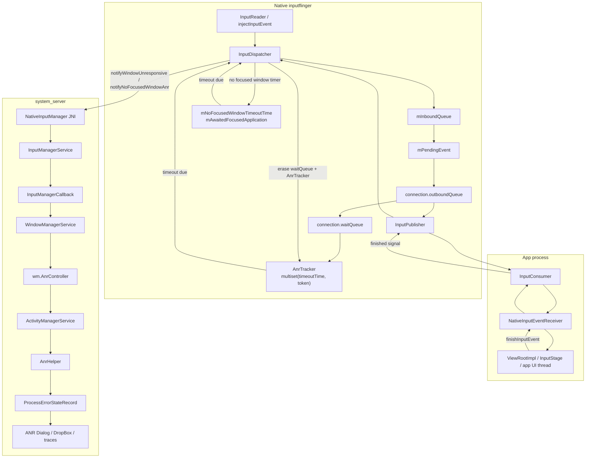
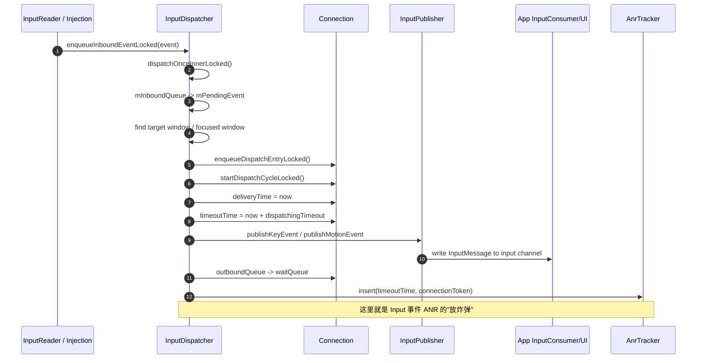
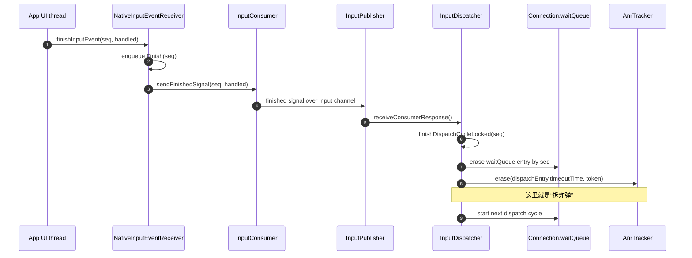
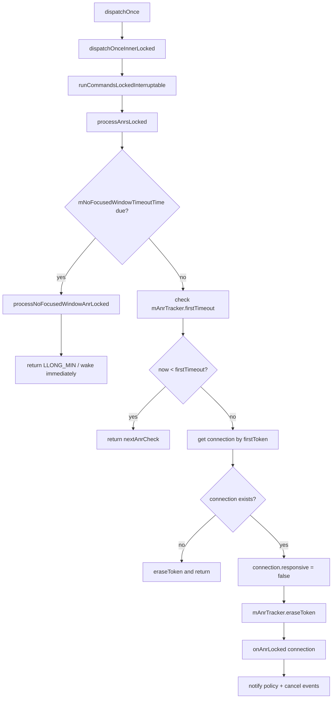
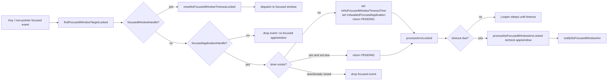
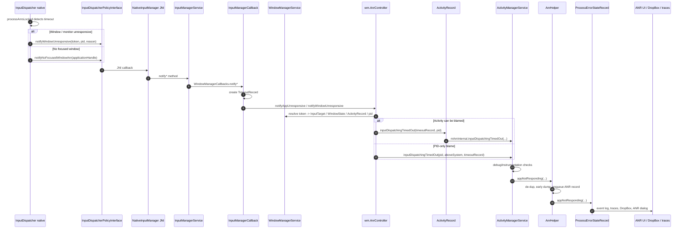

# Input ANR 放炸弹 / 拆炸弹机制与完整 ANR 流程源码解析

> 基于当前目录源码静态分析。本文聚焦 `InputDispatcher` 中 Input ANR 的两条主路径：
>
> 1. **窗口连接已收到 input 事件但迟迟未 finish/ack**：`waitQueue + AnrTracker`。
> 2. **已有 focused application 但没有 focused window**：`mNoFocusedWindowTimeoutTime + mAwaitedFocusedApplication`。
>
> 文中的“放炸弹 / 拆炸弹”是便于理解的工程化比喻：源码中没有名为 bomb 的对象；对应实现分别是 timeout 记录、到期检查、ack 删除和 reset 清理。

---

## 目录

- [1. 总览：Input ANR 的两类炸弹](#1-总览input-anr-的两类炸弹)
- [2. 设计意图](#2-设计意图)
- [3. 总体架构图](#3-总体架构图)
- [4. Input 事件 ANR：放炸弹流程](#4-input-事件-anr放炸弹流程)
- [5. Input 事件 ANR：拆炸弹流程](#5-input-事件-anr拆炸弹流程)
- [6. Input 事件 ANR：爆炸与上报流程](#6-input-事件-anr爆炸与上报流程)
- [7. 无 focused window ANR：放炸弹 / 拆炸弹 / 爆炸](#7-无-focused-window-anr放炸弹--拆炸弹--爆炸)
- [8. Native 到 Java / WMS / AMS 的完整 ANR 处理链路](#8-native-到-java--wms--ams-的完整-anr-处理链路)
- [9. 关键代码逐行精度解析](#9-关键代码逐行精度解析)
- [10. 日志与排查锚点](#10-日志与排查锚点)
- [11. 结论与当前代码证据边界](#11-结论与当前代码证据边界)

---

## 1. 总览：Input ANR 的两类炸弹

`native/services/inputflinger/docs/anr.md:5-8` 明确说明 InputDispatcher 中 ANR 有两类：

1. 事件已经发给某个 connection，但在 timeout 内没有收到响应。
2. 应用没有 focused window，但用户产生了一个需要焦点窗口承接的 input 事件。

把它们映射为“放炸弹 / 拆炸弹”：

| ANR 类型 | 放炸弹 | 炸弹载体 | 拆炸弹 | 爆炸条件 |
|---|---|---|---|---|
| Window / monitor connection unresponsive | 事件 publish 成功后进入 `connection.waitQueue`，并插入 `mAnrTracker` | `DispatchEntry.timeoutTime` + `connection.waitQueue` + `AnrTracker` | app 调 `finishInputEvent()`，InputDispatcher 删除 waitQueue 项并 `mAnrTracker.erase()` | `processAnrsLocked()` 发现 `mAnrTracker.firstTimeout() <= now()` |
| No focused window | focused app 存在、focused window 不存在、来了 key / 非 pointer motion 等焦点事件 | `mNoFocusedWindowTimeoutTime` + `mAwaitedFocusedApplication` | focused window 出现、focused app 改变、dispatch reset/drop everything 等 | `processAnrsLocked()` 发现 `mNoFocusedWindowTimeoutTime <= now()` 且最终复查仍无 focused window |

---

## 2. 设计意图

### 2.1 为什么要用 waitQueue？

InputDispatcher 把事件发给 app 之后，不能立即认为事件已经处理完成。事件只有在 app 侧 `InputEventReceiver.finishInputEvent()` 返回 finished signal 后，才算真正处理完。

因此需要一个“已发出但未确认”的队列：

```text
mInboundQueue -> mPendingEvent -> connection.outboundQueue -> connection.waitQueue
```

`connection.waitQueue` 的语义是：

- 事件已经通过 `InputPublisher` 写入 app 的 input channel；
- app 还没有通过 finished signal ack；
- 这些事件仍可能触发 ANR。

### 2.2 为什么要用 AnrTracker？

如果每轮 dispatch 都遍历所有 connection 的 waitQueue，成本会随窗口数量和 pending event 数增长。`AnrTracker` 用 `multiset<timeoutTime, token>` 保存所有待检查的超时时间：

- 快速拿到最早到期时间：`firstTimeout()`；
- 快速决定 Looper 下次应该睡到什么时候；
- ack 后删除对应条目；
- connection 已经不响应后整 token 删除，避免重复唤醒。

源码证据：

- `native/services/inputflinger/dispatcher/AnrTracker.h:25-28`：说明 `AnrTracker` 用于快速找到下一个会 ANR 的 connection。
- `AnrTracker.h:45-54`：内部使用 `multiset` 存储 `(timeoutTime, connectionToken)`。

### 2.3 为什么 no focused window 单独一套计时器？

无焦点窗口 ANR 发生在事件尚未真正 dispatch 到 app 之前：

- 此时没有目标 window connection；
- 因此没有 `waitQueue`；
- 也无法用 `AnrTracker` 跟踪某个 connection 的 ack。

所以 InputDispatcher 使用单独字段：

- `mNoFocusedWindowTimeoutTime`：等待 focused window 的截止时间；
- `mAwaitedFocusedApplication`：当时等待的 focused app；
- `mAwaitedApplicationDisplayId`：对应 display。

源码证据：

- `InputDispatcher.h:752-759`：字段注释明确说明没有 focused window 时等待到 timeout，然后 drop event 并为 app raise ANR。
- `InputDispatcher.h:774-783`：记录 awaited focused application 和 display id。

### 2.4 为什么爆炸前要复查？

Input 系统高度异步：在 timeout 到期前后，focused app/window 可能已经改变。no focused window ANR 爆炸前，代码会复查：

1. 当前 focused app 是否仍是当初等待的 app；
2. 当前是否仍然没有 focused window。

这样避免把已经恢复或已经切走的 app 错误上报 ANR。

源码证据：`InputDispatcher.cpp:1006-1024`。

---

## 3. 总体架构图



---

## 4. Input 事件 ANR：放炸弹流程

### 4.1 流程图



### 4.2 关键路径

```text
dispatchOnce()
  -> dispatchOnceInnerLocked()
    -> dispatchKeyLocked() / dispatchMotionLocked()
      -> findFocusedWindowTargetLocked() 或 findTouchedWindowTargets()
      -> dispatchEventLocked()
        -> prepareDispatchCycleLocked()
          -> enqueueDispatchEntryAndStartDispatchCycleLocked()
            -> enqueueDispatchEntryLocked()
            -> startDispatchCycleLocked()
              -> publishKeyEvent()/publishMotionEvent()
              -> waitQueue.emplace_back()
              -> mAnrTracker.insert(timeoutTime, token)
```

### 4.3 放炸弹源码锚点

| 文件 | 行号 | 作用 |
|---|---:|---|
| `InputDispatcher.cpp` | `1096-1134` | dispatch loop 从 inbound queue 取事件到 `mPendingEvent` |
| `InputDispatcher.cpp` | `1157-1230` | 根据事件类型进入 key/motion 分发 |
| `InputDispatcher.cpp` | `1893-1930` | key 找 focused window 并分发 |
| `InputDispatcher.cpp` | `2064-2087` | pointer motion 找 touched window targets |
| `InputDispatcher.cpp` | `3377-3392` | enqueue dispatch entry，并在 outboundQueue 原为空时启动 dispatch cycle |
| `InputDispatcher.cpp` | `3758-3770` | 记录 `deliveryTime` 和 `timeoutTime` |
| `InputDispatcher.cpp` | `3783-3804` | publish key/motion 到 app input channel |
| `InputDispatcher.cpp` | `3890-3897` | 事件进入 `waitQueue`，并插入 `mAnrTracker` |

---

## 5. Input 事件 ANR：拆炸弹流程

### 5.1 流程图



### 5.2 关键路径

```text
App / ViewRootImpl
  -> InputEventReceiver.finishInputEvent()
    -> nativeFinishInputEvent()
      -> NativeInputEventReceiver::finishInputEvent()
        -> processOutboundEvents()
          -> InputConsumer::sendFinishedSignal()
            -> InputDispatcher::handleReceiveCallback()
              -> receiveConsumerResponse()
              -> finishDispatchCycleLocked()
                -> doDispatchCycleFinishedCommand()
                  -> waitQueue.erase(seq)
                  -> mAnrTracker.erase(timeoutTime, token)
```

### 5.3 拆炸弹源码锚点

| 文件 | 行号 | 作用 |
|---|---:|---|
| `android_view_InputEventReceiver.cpp` | `272-282` | native receiver 记录 finish 请求 |
| `android_view_InputEventReceiver.cpp` | `359-374` | 通过 `InputConsumer::sendFinishedSignal()` 发出 finished signal |
| `InputConsumer.cpp` | `727-752` | 发送 finished signal |
| `InputDispatcher.cpp` | `4002-4035` | InputDispatcher 收到 finished response |
| `InputDispatcher.cpp` | `6529-6573` | 从 waitQueue 移除对应 seq，并从 `AnrTracker` 删除 timeout 项 |
| `InputDispatcher.cpp` | `6574-6579` | 如果 connection 曾不响应，ack 后恢复则通知 responsive |

---

## 6. Input 事件 ANR：爆炸与上报流程

### 6.1 爆炸检查流程图



### 6.2 爆炸源码锚点

| 文件 | 行号 | 作用 |
|---|---:|---|
| `InputDispatcher.cpp` | `960-981` | 每轮 dispatch 结束后调用 `processAnrsLocked()`，并把返回值纳入 Looper 下次唤醒时间 |
| `InputDispatcher.cpp` | `1032-1049` | 先检查 no focused window，再检查 `mAnrTracker.firstTimeout()` |
| `InputDispatcher.cpp` | `1050-1068` | timeout 到期后找到 connection，置为 unresponsive，删除 tracker token，调用 `onAnrLocked()` |
| `InputDispatcher.cpp` | `6620-6657` | 构造 input ANR reason，更新 last ANR state，通知 unresponsive，发送 cancel |
| `InputDispatcher.cpp` | `6751-6768` | 根据 connection 类型找 pid，并发出 window unresponsive command |
| `InputDispatcher.cpp` | `6727-6734` | post command 调 policy `notifyWindowUnresponsive()` |

---

## 7. 无 focused window ANR：放炸弹 / 拆炸弹 / 爆炸

### 7.1 架构图



### 7.2 放炸弹

触发条件：

1. 有 focused application；
2. 没有 focused window；
3. 来了需要 focused window 承接的 input 事件，例如 key 或非 pointer motion。

源码：

- `InputDispatcher.cpp:2310-2316`：获取 display、focused window、focused application。
- `InputDispatcher.cpp:2332-2349`：如果 focused app 存在但 focused window 为空，设置 `mNoFocusedWindowTimeoutTime`、`mAwaitedFocusedApplication`、`mAwaitedApplicationDisplayId`。

### 7.3 拆炸弹

主要通过 `resetNoFocusedWindowTimeoutLocked()`：

- `InputDispatcher.cpp:2239-2245`：清空 `mNoFocusedWindowTimeoutTime` 和 `mAwaitedFocusedApplication`。

调用点：

| 文件 | 行号 | 场景 |
|---|---:|---|
| `InputDispatcher.cpp` | `2361-2363` | 找到有效 focused window，说明等待结束 |
| `InputDispatcher.cpp` | `5689-5723` | focused application 改变，旧 app 不再应被等待 |
| `InputDispatcher.cpp` | `5788-5799` | dispatch 从 frozen 恢复时 reset |
| `InputDispatcher.cpp` | `6098-6112` | reset/drop everything 时清空 no focused window timer 和 `AnrTracker` |
| `InputDispatcher.cpp` | `7082-7100` | focus changed 且出现 new focus 时 reset |

### 7.4 爆炸

- `InputDispatcher.cpp:1035-1041`：`processAnrsLocked()` 检查 no focused window timeout 到期。
- `InputDispatcher.cpp:1006-1024`：爆炸前复查 focused app 和 focused window。
- `InputDispatcher.cpp:6659-6668`：构造 reason 并调用 policy `notifyNoFocusedWindowAnr()`。

### 7.5 触摸其他 app 为什么会影响 no focused window ANR？

`InputDispatcher.cpp:1278-1297` 说明：如果等待某 focused app 加窗口期间，用户触摸了另一个 app，InputDispatcher 会 prune input queue。这体现了设计意图：用户已经切换交互目标，旧 focused app 的 pending focused event 不应无限阻塞后续触摸交互。

---

## 8. Native 到 Java / WMS / AMS 的完整 ANR 处理链路

### 8.1 完整时序图



### 8.2 Java 层关键锚点

| 层 | 文件 | 行号 | 作用 |
|---|---|---:|---|
| JNI | `com_android_server_input_InputManagerService.cpp` | `1197-1212` | no focused window native callback 到 Java |
| JNI | `com_android_server_input_InputManagerService.cpp` | `1215-1231` | window unresponsive native callback 到 Java |
| IMS | `InputManagerService.java` | `2583-2601` | native callback 转发到 `mWindowManagerCallbacks` |
| WMS callback | `InputManagerCallback.java` | `108-119` | 构造 `TimeoutRecord` 并调用 `AnrController` |
| Timeout model | `TimeoutRecord.java` | `151-160` | 两类 Input timeout record 工厂方法 |
| WMS ANR | `AnrController.java` | `68-128` | no focused window app ANR 处理 |
| WMS ANR | `AnrController.java` | `143-205` | window unresponsive 处理，解析 token/pid/activity |
| Activity | `ActivityRecord.java` | `6749-6776` | activity input dispatch timeout 转 AMS |
| AMS | `ActivityManagerService.java` | `18350-18405` | `inputDispatchingTimedOut()` 进入 ANR helper |
| ANR helper | `AnrHelper.java` | `123-179` | 去重、early dump、ANR record 入队 |
| Error state | `ProcessErrorStateRecord.java` | `293-377` | 标记、EventLog、统计前置 |
| Error state | `ProcessErrorStateRecord.java` | `647-706` | DropBox、not responding、发 ANR dialog 消息 |

---

## 9. 关键代码逐行精度解析

> 本节按“代码行号 -> 精确语义”的方式解析关键代码。为避免复制过大段源码，主要使用行号和行为说明；必要时只摘取短片段名称。

### 9.1 `AnrTracker` 数据结构

文件：`native/services/inputflinger/dispatcher/AnrTracker.h`

| 行号 | 解析 |
|---:|---|
| `25-28` | 类注释：`AnrTracker` 跟踪每个 connection 将在何时 ANR，并快速找到下一个会 ANR 的 connection。 |
| `31` | `insert(timeoutTime, token)`：放入一个 ANR 到期点。对应“放炸弹”。 |
| `32` | `erase(timeoutTime, token)`：删除一个具体事件的 timeout。对应正常 ack 后“拆炸弹”。 |
| `33` | `eraseToken(token)`：删除某个 connection 的所有 timeout，常用于 connection 已经 unresponsive 后避免重复唤醒。 |
| `36-42` | 提供 `empty()`、`firstTimeout()`、`firstToken()`，用于 O(最早项) 决定下次检查时间和目标 connection。 |
| `45-54` | 使用 `multiset<pair<timeoutTime, token>>`。允许重复 timeout，因为高频输入或相同时钟粒度可能产生相同超时时间。 |

文件：`native/services/inputflinger/dispatcher/AnrTracker.cpp`

| 行号 | 解析 |
|---:|---|
| `26-28` | `insert()` 将 `(timeoutTime, token)` 插入 multiset。 |
| `34-39` | `erase()` 只删除一个匹配项；相同 token/time 的重复项只移除一个，避免误删其他未 ack 事件。 |
| `42-50` | `eraseToken()` 删除该 token 的全部 timeout，用于 connection 级别状态变化。 |
| `58-63` | `firstTimeout()` 返回最早 timeout；如果为空返回 `LLONG_MAX`。 |
| `65-67` | `firstToken()` 返回最早 timeout 对应的 token。 |
| `69-70` | `clear()` 清空全部炸弹，例如 reset/drop everything。 |

---

#### 相关代码原文

#### `native/services/inputflinger/dispatcher/AnrTracker.h:25-55`

```cpp
/**
 * Keeps track of the times when each connection is going to ANR.
 * Provides the ability to quickly find the connection that is going to cause ANR next.
 */
class AnrTracker {
public:
    void insert(nsecs_t timeoutTime, sp<IBinder> token);
    void erase(nsecs_t timeoutTime, const sp<IBinder>& token);
    void eraseToken(const sp<IBinder>& token);
    void clear();

    bool empty() const;
    // If empty() is false, return the time at which the next connection should cause an ANR
    // If empty() is true, return LLONG_MAX
    nsecs_t firstTimeout() const;
    // Return the token of the next connection that should cause an ANR.
    // Do not call this unless empty() is false, you will encounter undefined behaviour.
    const sp<IBinder>& firstToken() const;

private:
    // Optimization: use a multiset to keep track of the event timeouts. When an event is sent
    // to the InputConsumer, we add an entry to this structure. We look at the smallest value to
    // determine if any of the connections is unresponsive, and to determine when we should wake
    // next for the future ANR check.
    // Using a multiset helps quickly look up the next timeout due.
    //
    // We must use a multi-set, because it is plausible (although highly unlikely) to have entries
    // from the same connection and same timestamp, but different sequence numbers.
    // We are not tracking sequence numbers, and just allow duplicates to exist.
    std::multiset<std::pair<nsecs_t /*timeoutTime*/, sp<IBinder> /*connectionToken*/>> mAnrTimeouts;
};
```

#### `native/services/inputflinger/dispatcher/AnrTracker.cpp:26-70`

```cpp
void AnrTracker::insert(nsecs_t timeoutTime, sp<IBinder> token) {
    mAnrTimeouts.insert(std::make_pair(timeoutTime, std::move(token)));
}

/**
 * Erase a single entry only. If there are multiple duplicate entries
 * (same time, same connection), then only remove one of them.
 */
void AnrTracker::erase(nsecs_t timeoutTime, const sp<IBinder>& token) {
    auto pair = std::make_pair(timeoutTime, token);
    auto it = mAnrTimeouts.find(pair);
    if (it != mAnrTimeouts.end()) {
        mAnrTimeouts.erase(it);
    }
}

void AnrTracker::eraseToken(const sp<IBinder>& token) {
    for (auto it = mAnrTimeouts.begin(); it != mAnrTimeouts.end();) {
        if (it->second == token) {
            it = mAnrTimeouts.erase(it);
        } else {
            ++it;
        }
    }
}

bool AnrTracker::empty() const {
    return mAnrTimeouts.empty();
}

// If empty() is false, return the time at which the next connection should cause an ANR
// If empty() is true, return LLONG_MAX
nsecs_t AnrTracker::firstTimeout() const {
    if (mAnrTimeouts.empty()) {
        return std::numeric_limits<nsecs_t>::max();
    }
    return mAnrTimeouts.begin()->first;
}

const sp<IBinder>& AnrTracker::firstToken() const {
    return mAnrTimeouts.begin()->second;
}

void AnrTracker::clear() {
    mAnrTimeouts.clear();
```

### 9.2 `dispatchOnce()` 与 ANR 检查调度

文件：`native/services/inputflinger/dispatcher/InputDispatcher.cpp`

| 行号 | 解析 |
|---:|---|
| `960` | `dispatchOnce()` 是 InputDispatcher 线程每轮循环入口。 |
| `961` | 初始 `nextWakeupTime = LLONG_MAX`，表示没有明确唤醒时间。 |
| `963-970` | 持锁；如果没有 pending commands，则先执行一次正常分发 `dispatchOnceInnerLocked()`。 |
| `972-976` | 执行命令队列；如果命令运行过，立即唤醒下一轮。 |
| `978-981` | 无论是否刚刚分发事件，都会调用 `processAnrsLocked()`；它返回下一次 ANR 检查时间，并参与计算 Looper sleep timeout。 |
| `994-997` | 根据 `nextWakeupTime` 计算 poll timeout，`mLooper->pollOnce(timeoutMillis)`。这说明“炸弹”不是 Java Handler delayed message，而是 native looper 按最早 timeout 醒来检查。 |

---

#### 相关代码原文

#### `native/services/inputflinger/dispatcher/InputDispatcher.cpp:960-997`

```cpp
void InputDispatcher::dispatchOnce() {
    nsecs_t nextWakeupTime = LLONG_MAX;
    { // acquire lock
        std::scoped_lock _l(mLock);
        mDispatcherIsAlive.notify_all();

        // Run a dispatch loop if there are no pending commands.
        // The dispatch loop might enqueue commands to run afterwards.
        if (!haveCommandsLocked()) {
            dispatchOnceInnerLocked(/*byref*/ nextWakeupTime);
        }

        // Run all pending commands if there are any.
        // If any commands were run then force the next poll to wake up immediately.
        if (runCommandsLockedInterruptable()) {
            nextWakeupTime = LLONG_MIN;
        }

        // If we are still waiting for ack on some events,
        // we might have to wake up earlier to check if an app is anr'ing.
        const nsecs_t nextAnrCheck = processAnrsLocked();
        nextWakeupTime = std::min(nextWakeupTime, nextAnrCheck);

        if (mPerDeviceInputLatencyMetricsFlag) {
            processLatencyStatisticsLocked();
        }

        // We are about to enter an infinitely long sleep, because we have no commands or
        // pending or queued events
        if (nextWakeupTime == LLONG_MAX) {
            mDispatcherEnteredIdle.notify_all();
        }
    } // release lock

    // Wait for callback or timeout or wake.  (make sure we round up, not down)
    nsecs_t currentTime = now();
    int timeoutMillis = toMillisecondTimeoutDelay(currentTime, nextWakeupTime);
    mLooper->pollOnce(timeoutMillis);
```

### 9.3 `dispatchOnceInnerLocked()`：从 inbound 到 pending

文件：`native/services/inputflinger/dispatcher/InputDispatcher.cpp`

| 行号 | 解析 |
|---:|---|
| `1096-1097` | 进入一次内部 dispatch，记录当前时间。 |
| `1106-1110` | 如果 dispatch frozen，直接返回；冻结期间不处理 timeout 或新事件。 |
| `1112-1134` | 如果没有 `mPendingEvent`，从 `mInboundQueue` 取队首作为 pending event。 |
| `1136-1139` | 如果事件会传给用户，poke user activity。 |
| `1142-1147` | 确认存在 pending event，并根据 policy/dispatch 状态决定是否 drop。 |
| `1157-1230` | 按事件类型分发：focus、touch mode、key、motion、sensor 等。Key 进入 `dispatchKeyLocked()`，Motion 进入 `dispatchMotionLocked()`。 |
| `1249-1262` | 如果事件处理完成，记录 drop reason、完成 tracing、释放 pending event，并强制下一轮立即醒来。 |

---

#### 相关代码原文

#### `native/services/inputflinger/dispatcher/InputDispatcher.cpp:1096-1263`

```cpp
void InputDispatcher::dispatchOnceInnerLocked(nsecs_t& nextWakeupTime) {
    nsecs_t currentTime = now();

    // Reset the key repeat timer whenever normal dispatch is suspended while the
    // device is in a non-interactive state.  This is to ensure that we abort a key
    // repeat if the device is just coming out of sleep.
    if (!mDispatchEnabled) {
        resetKeyRepeatLocked();
    }

    // If dispatching is frozen, do not process timeouts or try to deliver any new events.
    if (mDispatchFrozen) {
        LOG_IF(INFO, DEBUG_FOCUS) << "Dispatch frozen.  Waiting some more.";
        return;
    }

    // Ready to start a new event.
    // If we don't already have a pending event, go grab one.
    if (!mPendingEvent) {
        if (mInboundQueue.empty()) {
            // Synthesize a key repeat if appropriate.
            if (mKeyRepeatState.lastKeyEntry) {
                if (currentTime >= mKeyRepeatState.nextRepeatTime) {
                    mPendingEvent = synthesizeKeyRepeatLocked(currentTime);
                } else {
                    nextWakeupTime = std::min(nextWakeupTime, mKeyRepeatState.nextRepeatTime);
                }
            }

            // Nothing to do if there is no pending event.
            if (!mPendingEvent) {
                return;
            }
        } else {
            // Inbound queue has at least one entry.
            mPendingEvent = mInboundQueue.front();
            mInboundQueue.pop_front();
            traceInboundQueueLengthLocked();
        }

        // Poke user activity for this event.
        if (mPendingEvent->policyFlags & POLICY_FLAG_PASS_TO_USER) {
            pokeUserActivityLocked(*mPendingEvent);
        }
    }

    // Now we have an event to dispatch.
    // All events are eventually dequeued and processed this way, even if we intend to drop them.
    ALOG_ASSERT(mPendingEvent != nullptr);
    bool done = false;
    DropReason dropReason = DropReason::NOT_DROPPED;
    if (!(mPendingEvent->policyFlags & POLICY_FLAG_PASS_TO_USER)) {
        dropReason = DropReason::POLICY;
    } else if (!mDispatchEnabled) {
        dropReason = DropReason::DISABLED;
    }

    if (mNextUnblockedEvent == mPendingEvent) {
        mNextUnblockedEvent = nullptr;
    }

    switch (mPendingEvent->type) {
        case EventEntry::Type::DEVICE_RESET: {
            const DeviceResetEntry& typedEntry =
                    static_cast<const DeviceResetEntry&>(*mPendingEvent);
            done = dispatchDeviceResetLocked(currentTime, typedEntry);
            dropReason = DropReason::NOT_DROPPED; // device resets are never dropped
            break;
        }

        case EventEntry::Type::FOCUS: {
            std::shared_ptr<const FocusEntry> typedEntry =
                    std::static_pointer_cast<const FocusEntry>(mPendingEvent);
            dispatchFocusLocked(currentTime, typedEntry);
            done = true;
            dropReason = DropReason::NOT_DROPPED; // focus events are never dropped
            break;
        }

        case EventEntry::Type::TOUCH_MODE_CHANGED: {
            const auto typedEntry = std::static_pointer_cast<const TouchModeEntry>(mPendingEvent);
            dispatchTouchModeChangeLocked(currentTime, typedEntry);
            done = true;
            dropReason = DropReason::NOT_DROPPED; // touch mode events are never dropped
            break;
        }

        case EventEntry::Type::POINTER_CAPTURE_CHANGED: {
            const auto typedEntry =
                    std::static_pointer_cast<const PointerCaptureChangedEntry>(mPendingEvent);
            dispatchPointerCaptureChangedLocked(currentTime, typedEntry, dropReason);
            done = true;
            break;
        }

        case EventEntry::Type::DRAG: {
            std::shared_ptr<const DragEntry> typedEntry =
                    std::static_pointer_cast<const DragEntry>(mPendingEvent);
            dispatchDragLocked(currentTime, typedEntry);
            done = true;
            break;
        }

        case EventEntry::Type::KEY: {
            std::shared_ptr<const KeyEntry> keyEntry =
                    std::static_pointer_cast<const KeyEntry>(mPendingEvent);
            if (dropReason == DropReason::NOT_DROPPED && isStaleEvent(currentTime, *keyEntry)) {
                dropReason = DropReason::STALE;
            }
            if (dropReason == DropReason::NOT_DROPPED && mNextUnblockedEvent) {
                dropReason = DropReason::BLOCKED;
            }
            done = dispatchKeyLocked(currentTime, keyEntry, &dropReason, nextWakeupTime);
            break;
        }

        case EventEntry::Type::MOTION: {
            std::shared_ptr<const MotionEntry> motionEntry =
                    std::static_pointer_cast<const MotionEntry>(mPendingEvent);
            if (dropReason == DropReason::NOT_DROPPED && isStaleEvent(currentTime, *motionEntry)) {
                // The event is stale. However, only drop stale events if there isn't an ongoing
                // gesture. That would allow us to complete the processing of the current stroke.
                if (!mTouchStates.hasTouchingOrHoveringPointers(motionEntry->displayId,
                                                                motionEntry->deviceId)) {
                    dropReason = DropReason::STALE;
                }
            }
            if (dropReason == DropReason::NOT_DROPPED && mNextUnblockedEvent) {
                if (!isFromSource(motionEntry->source, AINPUT_SOURCE_CLASS_POINTER)) {
                    // Only drop events that are focus-dispatched.
                    dropReason = DropReason::BLOCKED;
                }
            }
            done = dispatchMotionLocked(currentTime, motionEntry, &dropReason, nextWakeupTime);
            break;
        }

        case EventEntry::Type::SENSOR: {
            std::shared_ptr<const SensorEntry> sensorEntry =
                    std::static_pointer_cast<const SensorEntry>(mPendingEvent);

            //  Sensor timestamps use SYSTEM_TIME_BOOTTIME time base, so we can't use
            // 'currentTime' here, get SYSTEM_TIME_BOOTTIME instead.
            nsecs_t bootTime = systemTime(SYSTEM_TIME_BOOTTIME);
            if (dropReason == DropReason::NOT_DROPPED && isStaleEvent(bootTime, *sensorEntry)) {
                dropReason = DropReason::STALE;
            }
            dispatchSensorLocked(currentTime, sensorEntry, &dropReason, nextWakeupTime);
            done = true;
            break;
        }
    }

    if (done) {
        if (dropReason != DropReason::NOT_DROPPED) {
            dropInboundEventLocked(*mPendingEvent, dropReason);
        }
        mLastDropReason = dropReason;

        if (mTracer) {
            if (auto& traceTracker = getTraceTracker(*mPendingEvent); traceTracker != nullptr) {
                mTracer->eventProcessingComplete(*traceTracker, currentTime);
            }
        }

        releasePendingEventLocked();
        nextWakeupTime = LLONG_MIN; // force next poll to wake up immediately
    }
```

### 9.4 Key 事件如何走到 focused window

文件：`native/services/inputflinger/dispatcher/InputDispatcher.cpp`

| 行号 | 解析 |
|---:|---|
| `1800-1846` | `dispatchKeyLocked()` 前处理 key repeat、long press、设置 `dispatchInProgress`。 |
| `1848-1871` | policy 有机会 intercept key；如果需要异步等待 policy，当前轮返回 false。 |
| `1878-1891` | 如果被 policy/drop reason 丢弃，设置 injection result 并结束。 |
| `1893-1895` | 调 `findFocusedWindowTargetLocked()` 查找 focused window。 |
| `1897-1902` | 如果结果是 `PENDING`，说明当前事件还不能完成，例如 no focused window 正在等待；返回 false 保持 pending。 |
| `1907-1915` | 成功找到目标后设置 injection result，添加 focused window 和 focus monitor targets。 |
| `1929-1930` | 调 `dispatchEventLocked()` 真正发送给目标 connection。 |

---

#### 相关代码原文

#### `native/services/inputflinger/dispatcher/InputDispatcher.cpp:1800-1931`

```cpp
bool InputDispatcher::dispatchKeyLocked(nsecs_t currentTime, std::shared_ptr<const KeyEntry> entry,
                                        DropReason* dropReason, nsecs_t& nextWakeupTime) {
    // Preprocessing.
    if (!entry->dispatchInProgress) {
        if (!entry->syntheticRepeat && entry->action == AKEY_EVENT_ACTION_DOWN &&
            (entry->policyFlags & POLICY_FLAG_TRUSTED) &&
            (!(entry->policyFlags & POLICY_FLAG_DISABLE_KEY_REPEAT))) {
            if (mKeyRepeatState.lastKeyEntry &&
                mKeyRepeatState.lastKeyEntry->keyCode == entry->keyCode &&
                // We have seen two identical key downs in a row which indicates that the device
                // driver is automatically generating key repeats itself.  We take note of the
                // repeat here, but we disable our own next key repeat timer since it is clear that
                // we will not need to synthesize key repeats ourselves.
                mKeyRepeatState.lastKeyEntry->deviceId == entry->deviceId) {
                // Make sure we don't get key down from a different device. If a different
                // device Id has same key pressed down, the new device Id will replace the
                // current one to hold the key repeat with repeat count reset.
                // In the future when got a KEY_UP on the device id, drop it and do not
                // stop the key repeat on current device.
                entry->repeatCount = mKeyRepeatState.lastKeyEntry->repeatCount + 1;
                resetKeyRepeatLocked();
                mKeyRepeatState.nextRepeatTime = LLONG_MAX; // don't generate repeats ourselves
            } else {
                // Not a repeat.  Save key down state in case we do see a repeat later.
                resetKeyRepeatLocked();
                mKeyRepeatState.nextRepeatTime = entry->eventTime + mConfig.keyRepeatTimeout;
            }
            mKeyRepeatState.lastKeyEntry = entry;
        } else if (entry->action == AKEY_EVENT_ACTION_UP && mKeyRepeatState.lastKeyEntry &&
                   mKeyRepeatState.lastKeyEntry->deviceId != entry->deviceId) {
            // The key on device 'deviceId' is still down, do not stop key repeat
            LOG_IF(INFO, debugInboundEventDetails())
                    << "deviceId=" << entry->deviceId << " got KEY_UP as stale";
        } else if (!entry->syntheticRepeat) {
            resetKeyRepeatLocked();
        }

        if (entry->repeatCount == 1) {
            entry->flags |= AKEY_EVENT_FLAG_LONG_PRESS;
        } else {
            entry->flags &= ~AKEY_EVENT_FLAG_LONG_PRESS;
        }

        entry->dispatchInProgress = true;

        logOutboundKeyDetails("dispatchKey - ", *entry);
    }

    // Handle case where the policy asked us to try again later last time.
    if (entry->interceptKeyResult == KeyEntry::InterceptKeyResult::TRY_AGAIN_LATER) {
        if (currentTime < entry->interceptKeyWakeupTime) {
            nextWakeupTime = std::min(nextWakeupTime, entry->interceptKeyWakeupTime);
            return false; // wait until next wakeup
        }
        entry->interceptKeyResult = KeyEntry::InterceptKeyResult::UNKNOWN;
        entry->interceptKeyWakeupTime = 0;
    }

    const ui::LogicalDisplayId displayId = getTargetDisplayId(*entry);
    // Give the policy a chance to intercept the key.
    if (entry->interceptKeyResult == KeyEntry::InterceptKeyResult::UNKNOWN) {
        if (entry->policyFlags & POLICY_FLAG_PASS_TO_USER) {
            sp<IBinder> focusedWindowToken = mFocusResolver.getFocusedWindowToken(displayId);

            auto command = [this, focusedWindowToken, displayId, entry]() REQUIRES(mLock) {
                doInterceptKeyBeforeDispatchingCommand(focusedWindowToken, displayId, *entry);
            };
            postCommandLocked(std::move(command));
            return false; // wait for the command to run
        } else {
            entry->interceptKeyResult = KeyEntry::InterceptKeyResult::CONTINUE;
        }
    } else if (entry->interceptKeyResult == KeyEntry::InterceptKeyResult::SKIP) {
        if (*dropReason == DropReason::NOT_DROPPED) {
            *dropReason = DropReason::POLICY;
        }
    }

    // Clean up if dropping the event.
    if (*dropReason != DropReason::NOT_DROPPED) {
        setInjectionResult(*entry,
                           *dropReason == DropReason::POLICY ? InputEventInjectionResult::SUCCEEDED
                                                             : InputEventInjectionResult::FAILED);
        mReporter->reportDroppedKey(entry->id);
        // Poke user activity for consumed keys, as it may have not been reported due to
        // the focused window requesting user activity to be disabled
        if (*dropReason == DropReason::POLICY &&
            mPendingEvent->policyFlags & POLICY_FLAG_PASS_TO_USER) {
            pokeUserActivityLocked(*entry);
        }
        return true;
    }

    // Identify targets.
    Result<sp<WindowInfoHandle>, InputEventInjectionResult> result =
            findFocusedWindowTargetLocked(currentTime, *entry, nextWakeupTime);

    if (!result.ok()) {
        if (result.error().code() == InputEventInjectionResult::PENDING) {
            return false;
        }
        setInjectionResult(*entry, result.error().code());
        return true;
    }
    sp<WindowInfoHandle>& focusedWindow = *result;
    LOG_ALWAYS_FATAL_IF(focusedWindow == nullptr);

    setInjectionResult(*entry, InputEventInjectionResult::SUCCEEDED);

    std::vector<InputTarget> inputTargets;
    addWindowTargetLocked(focusedWindow, InputTarget::DispatchMode::AS_IS,
                          InputTarget::Flags::FOREGROUND, getDownTime(*entry), inputTargets);

    // Add monitor channels from event's or focused display.
    addFocusInputMonitoringTargetsLocked(inputTargets, displayId);

    if (mTracer) {
        ensureEventTraced(*entry);
        for (const auto& target : inputTargets) {
            mTracer->dispatchToTargetHint(*entry->traceTracker, target);
        }
    }

    if (entry->interceptKeyResult == KeyEntry::InterceptKeyResult::FALLBACK) {
        findAndDispatchFallbackEvent(currentTime, entry, inputTargets);
        // Drop the key.
        return true;
    }

    // Dispatch the key.
    dispatchEventLocked(currentTime, entry, inputTargets);
    return true;
```

### 9.5 Motion 事件如何决定目标

文件：`native/services/inputflinger/dispatcher/InputDispatcher.cpp`

| 行号 | 解析 |
|---:|---|
| `2059` | 判断是否 pointer event。触摸屏等 pointer event 不依赖 focused window，而是触摸命中。 |
| `2064-2087` | pointer event 通过 `mTouchStates.findTouchedWindowTargets()` 找 touched windows。 |
| `2091-2104` | 非 pointer motion，如 trackball，走 `findFocusedWindowTargetLocked()`。 |
| `2106-2107` | 如果目标查找结果为 `PENDING`，当前事件继续 pending。 |
| `2124-2127` | 非 pointer event 添加 focus input monitors。 |
| `2136-2137` | 调 `dispatchEventLocked()` 发送 motion。 |

---

#### 相关代码原文

#### `native/services/inputflinger/dispatcher/InputDispatcher.cpp:2059-2137`

```cpp
    const bool isPointerEvent = isFromSource(entry->source, AINPUT_SOURCE_CLASS_POINTER);

    // Identify targets.
    std::vector<InputTarget> inputTargets;

    InputEventInjectionResult injectionResult;
    if (isPointerEvent) {
        // Pointer event.  (eg. touchscreen)

        if (mDragState &&
            (entry->action & AMOTION_EVENT_ACTION_MASK) == AMOTION_EVENT_ACTION_POINTER_DOWN) {
            // If drag and drop ongoing and pointer down occur: pilfer drag window pointers
            pilferPointersLocked(mDragState->dragWindow->getToken());
        }

        Result<std::vector<InputTarget>, InputEventInjectionResult> result =
                mTouchStates
                        .findTouchedWindowTargets(currentTime, *entry,
                                                  mDragState ? mDragState->dragWindow : nullptr,
                                                  std::bind_front(&InputDispatcher::
                                                                          addDragEventLocked,
                                                                  this),
                                                  std::bind_front(&InputDispatcher::
                                                                          logDispatchStateLocked,
                                                                  this));

        if (result.ok()) {
            inputTargets = std::move(*result);
            injectionResult = InputEventInjectionResult::SUCCEEDED;
        } else {
            injectionResult = result.error().code();
        }
    } else {
        // Non touch event.  (eg. trackball)
        Result<sp<WindowInfoHandle>, InputEventInjectionResult> result =
                findFocusedWindowTargetLocked(currentTime, *entry, nextWakeupTime);
        if (result.ok()) {
            sp<WindowInfoHandle>& focusedWindow = *result;
            LOG_ALWAYS_FATAL_IF(focusedWindow == nullptr);
            addWindowTargetLocked(focusedWindow, InputTarget::DispatchMode::AS_IS,
                                  InputTarget::Flags::FOREGROUND, getDownTime(*entry),
                                  inputTargets);
            injectionResult = InputEventInjectionResult::SUCCEEDED;
        } else {
            injectionResult = result.error().code();
        }
    }
    if (injectionResult == InputEventInjectionResult::PENDING) {
        return false;
    }

    setInjectionResult(*entry, injectionResult);
    if (injectionResult == InputEventInjectionResult::TARGET_MISMATCH) {
        return true;
    }
    if (injectionResult != InputEventInjectionResult::SUCCEEDED) {
        CancelationOptions::Mode mode(
                isPointerEvent ? CancelationOptions::Mode::CANCEL_POINTER_EVENTS
                               : CancelationOptions::Mode::CANCEL_NON_POINTER_EVENTS);
        CancelationOptions options(mode, "input event injection failed", entry->traceTracker);
        options.displayId = entry->displayId;
        synthesizeCancelationEventsForMonitorsLocked(options);
        return true;
    }

    if (!isPointerEvent) {
        // Add monitor channels from event's or focused display.
        addFocusInputMonitoringTargetsLocked(inputTargets, getTargetDisplayId(*entry));
    }

    if (mTracer) {
        ensureEventTraced(*entry);
        for (const auto& target : inputTargets) {
            mTracer->dispatchToTargetHint(*entry->traceTracker, target);
        }
    }

    // Dispatch the motion.
    dispatchEventLocked(currentTime, entry, inputTargets);
```

### 9.6 `dispatchEventLocked()` 到放炸弹入口

文件：`native/services/inputflinger/dispatcher/InputDispatcher.cpp`

| 行号 | 解析 |
|---:|---|
| `2193-2199` | `dispatchEventLocked()` 开始处理事件和 inputTargets 的交互。 |
| `2201` | 断言事件已进入 dispatch。 |
| `2203` | poke user activity。 |
| `2205-2208` | 对每个 input target 调 `prepareDispatchCycleLocked()`。后续会进入 enqueue/start dispatch cycle。 |
| `3377-3387` | `enqueueDispatchEntryAndStartDispatchCycleLocked()` 创建 dispatch entry 并加入 outbound queue。 |
| `3385` | 记录 outboundQueue 是否为空；只有原来为空才立即启动发送。 |
| `3389-3392` | 如果 outboundQueue 原为空，调用 `startDispatchCycleLocked()`。 |
| `3395-3409` | `enqueueDispatchEntryLocked()` 创建新的 `DispatchEntry`，带 event、target flags、trace 信息等。 |

---

#### 相关代码原文

#### `native/services/inputflinger/dispatcher/InputDispatcher.cpp:2193-2208`

```cpp
void InputDispatcher::dispatchEventLocked(nsecs_t currentTime,
                                          std::shared_ptr<const EventEntry> eventEntry,
                                          const std::vector<InputTarget>& inputTargets) {
    ATRACE_CALL();
    LOG_IF(INFO, DEBUG_DISPATCH_CYCLE) << "dispatchEventToCurrentInputTargets";

    processInteractionsLocked(*eventEntry, inputTargets);

    ALOG_ASSERT(eventEntry->dispatchInProgress); // should already have been set to true

    pokeUserActivityLocked(*eventEntry);

    for (const InputTarget& inputTarget : inputTargets) {
        std::shared_ptr<Connection> connection = inputTarget.connection;
        prepareDispatchCycleLocked(currentTime, connection, eventEntry, inputTarget);
    }
```

#### `native/services/inputflinger/dispatcher/InputDispatcher.cpp:3377-3409`

```cpp
void InputDispatcher::enqueueDispatchEntryAndStartDispatchCycleLocked(
        nsecs_t currentTime, const std::shared_ptr<Connection>& connection,
        std::shared_ptr<const EventEntry> eventEntry, const InputTarget& inputTarget) {
    ATRACE_NAME_IF(ATRACE_ENABLED(),
                   StringPrintf("enqueueDispatchEntryAndStartDispatchCycleLocked(inputChannel=%s, "
                                "id=0x%" PRIx32 ")",
                                connection->getInputChannelName().c_str(), eventEntry->id));

    const bool wasEmpty = connection->outboundQueue.empty();

    enqueueDispatchEntryLocked(connection, eventEntry, inputTarget);

    // If the outbound queue was previously empty, start the dispatch cycle going.
    if (wasEmpty && !connection->outboundQueue.empty()) {
        startDispatchCycleLocked(currentTime, connection);
    }
}

void InputDispatcher::enqueueDispatchEntryLocked(const std::shared_ptr<Connection>& connection,
                                                 std::shared_ptr<const EventEntry> eventEntry,
                                                 const InputTarget& inputTarget) {
    const bool isKeyOrMotion = eventEntry->type == EventEntry::Type::KEY ||
            eventEntry->type == EventEntry::Type::MOTION;
    if (isKeyOrMotion && !inputTarget.windowHandle && !connection->isFocusMonitor) {
        LOG(FATAL) << "All InputTargets for non-monitors must be associated with a window; target: "
                   << inputTarget << " connection: " << connection->getInputChannelName()
                   << " entry: " << eventEntry->getDescription();
    }
    // This is a new event.
    // Enqueue a new dispatch entry onto the outbound queue for this connection.
    std::unique_ptr<DispatchEntry> dispatchEntry =
            createDispatchEntry(mIdGenerator, inputTarget, eventEntry, inputTarget.flags,
                                mWindowInfosVsyncId, mTracer.get());
```

### 9.7 `startDispatchCycleLocked()`：事件 ANR 放炸弹核心

文件：`native/services/inputflinger/dispatcher/InputDispatcher.cpp`

| 行号 | 解析 |
|---:|---|
| `3758-3766` | 开始 dispatch cycle，只要 connection 正常且 outboundQueue 非空就尝试发送。 |
| `3767` | 取 outboundQueue 队首 dispatchEntry。 |
| `3768` | 设置 `deliveryTime = currentTime`，表示事件交付给 app 的时间点。 |
| `3769` | 调 `getDispatchingTimeoutLocked(connection)` 获取该 connection/window 的超时时长。 |
| `3770` | 设置 `timeoutTime = currentTime + timeout`。这就是单个事件的“炸弹到期时间”。 |
| `3772-3859` | 根据事件类型通过 `InputPublisher` publish 到 app。Key 走 `publishKeyEvent()`，Motion 走 `publishMotionEvent()`。 |
| `3861-3887` | 处理 publish 失败。如果 pipe 满且 waitQueue 非空，表示 app 还没处理完，暂时等待；其他错误可能 abort dispatch cycle。 |
| `3890-3893` | publish 成功后，把 dispatchEntry 从 outboundQueue 移入 `connection.waitQueue`。此时事件已发出但未 ack。 |
| `3895-3897` | 如果 connection 当前 responsive，把 `(timeoutTime, token)` 插入 `mAnrTracker`。这是事件 ANR 的“放炸弹”落点。 |

---

#### 相关代码原文

#### `native/services/inputflinger/dispatcher/InputDispatcher.cpp:3758-3898`

```cpp
void InputDispatcher::startDispatchCycleLocked(nsecs_t currentTime,
                                               const std::shared_ptr<Connection>& connection) {
    ATRACE_NAME_IF(ATRACE_ENABLED(),
                   StringPrintf("startDispatchCycleLocked(inputChannel=%s)",
                                connection->getInputChannelName().c_str()));
    LOG_IF(INFO, DEBUG_DISPATCH_CYCLE)
            << "channel '" << connection->getInputChannelName() << "' ~ startDispatchCycle";

    while (connection->status == Connection::Status::NORMAL && !connection->outboundQueue.empty()) {
        std::unique_ptr<DispatchEntry>& dispatchEntry = connection->outboundQueue.front();
        dispatchEntry->deliveryTime = currentTime;
        const std::chrono::nanoseconds timeout = getDispatchingTimeoutLocked(connection);
        dispatchEntry->timeoutTime = currentTime + timeout.count();

        // Publish the event.
        status_t status;
        const EventEntry& eventEntry = *(dispatchEntry->eventEntry);
        switch (eventEntry.type) {
            case EventEntry::Type::KEY: {
                const KeyEntry& keyEntry = static_cast<const KeyEntry&>(eventEntry);
                std::array<uint8_t, 32> hmac = getSignature(keyEntry, *dispatchEntry);
                LOG_IF(INFO, DEBUG_OUTBOUND_EVENT_DETAILS)
                        << "Publishing " << *dispatchEntry << " to "
                        << connection->getInputChannelName();

                // Publish the key event.
                status =
                        connection->inputPublisher
                                .publishKeyEvent(dispatchEntry->seq, keyEntry.id, keyEntry.deviceId,
                                                 keyEntry.source, keyEntry.displayId,
                                                 std::move(hmac), keyEntry.action, keyEntry.flags,
                                                 keyEntry.keyCode, keyEntry.scanCode,
                                                 keyEntry.metaState, keyEntry.repeatCount,
                                                 keyEntry.downTime, keyEntry.eventTime);
                if (mTracer) {
                    ensureEventTraced(keyEntry);
                    mTracer->traceEventDispatch(*dispatchEntry, *keyEntry.traceTracker);
                }
                break;
            }

            case EventEntry::Type::MOTION: {
                LOG_IF(INFO, DEBUG_OUTBOUND_EVENT_DETAILS)
                        << "Publishing " << *dispatchEntry << " to "
                        << connection->getInputChannelName();
                const MotionEntry& motionEntry = static_cast<const MotionEntry&>(eventEntry);
                status = publishMotionEvent(*connection, *dispatchEntry);
                if (status == BAD_VALUE) {
                    logDispatchStateLocked();
                    LOG(FATAL) << "Publisher failed for " << motionEntry;
                }
                if (mTracer) {
                    ensureEventTraced(motionEntry);
                    mTracer->traceEventDispatch(*dispatchEntry, *motionEntry.traceTracker);
                }
                break;
            }

            case EventEntry::Type::FOCUS: {
                const FocusEntry& focusEntry = static_cast<const FocusEntry&>(eventEntry);
                status = connection->inputPublisher.publishFocusEvent(dispatchEntry->seq,
                                                                      focusEntry.id,
                                                                      focusEntry.hasFocus);
                break;
            }

            case EventEntry::Type::TOUCH_MODE_CHANGED: {
                const TouchModeEntry& touchModeEntry =
                        static_cast<const TouchModeEntry&>(eventEntry);
                status = connection->inputPublisher
                                 .publishTouchModeEvent(dispatchEntry->seq, touchModeEntry.id,
                                                        touchModeEntry.inTouchMode);

                break;
            }

            case EventEntry::Type::POINTER_CAPTURE_CHANGED: {
                const auto& captureEntry =
                        static_cast<const PointerCaptureChangedEntry&>(eventEntry);
                status =
                        connection->inputPublisher
                                .publishCaptureEvent(dispatchEntry->seq, captureEntry.id,
                                                     captureEntry.pointerCaptureRequest.isEnable());
                break;
            }

            case EventEntry::Type::DRAG: {
                const DragEntry& dragEntry = static_cast<const DragEntry&>(eventEntry);
                status = connection->inputPublisher.publishDragEvent(dispatchEntry->seq,
                                                                     dragEntry.id, dragEntry.x,
                                                                     dragEntry.y,
                                                                     dragEntry.isExiting);
                break;
            }

            case EventEntry::Type::DEVICE_RESET:
            case EventEntry::Type::SENSOR: {
                LOG_ALWAYS_FATAL("Should never start dispatch cycles for %s events",
                                 ftl::enum_string(eventEntry.type).c_str());
                return;
            }
        }

        // Check the result.
        if (status) {
            if (status == WOULD_BLOCK) {
                if (connection->waitQueue.empty()) {
                    ALOGE("channel '%s' ~ Could not publish event because the pipe is full. "
                          "This is unexpected because the wait queue is empty, so the pipe "
                          "should be empty and we shouldn't have any problems writing an "
                          "event to it, status=%s(%d)",
                          connection->getInputChannelName().c_str(), statusToString(status).c_str(),
                          status);
                    abortBrokenDispatchCycleLocked(connection, /*notify=*/true);
                } else {
                    // Pipe is full and we are waiting for the app to finish process some events
                    // before sending more events to it.
                    LOG_IF(INFO, DEBUG_DISPATCH_CYCLE)
                            << "channel '" << connection->getInputChannelName()
                            << "' ~ Could not publish event because the pipe is full, waiting for "
                               "the application to catch up";
                }
            } else {
                ALOGE("channel '%s' ~ Could not publish event due to an unexpected error, "
                      "status=%s(%d)",
                      connection->getInputChannelName().c_str(), statusToString(status).c_str(),
                      status);
                abortBrokenDispatchCycleLocked(connection, /*notify=*/true);
            }
            return;
        }

        // Re-enqueue the event on the wait queue.
        const nsecs_t timeoutTime = dispatchEntry->timeoutTime;
        connection->waitQueue.emplace_back(std::move(dispatchEntry));
        connection->outboundQueue.erase(connection->outboundQueue.begin());
        traceOutboundQueueLength(*connection);
        if (connection->responsive) {
            mAnrTracker.insert(timeoutTime, connection->getToken());
        }
        traceWaitQueueLength(*connection);
```

### 9.8 `getDispatchingTimeoutLocked()`：timeout 取值

文件：`native/services/inputflinger/dispatcher/InputDispatcher.cpp`

| 行号 | 解析 |
|---:|---|
| `121-125` | 默认 input dispatching timeout 基于 `IInputConstants.UNMULTIPLIED_DEFAULT_DISPATCHING_TIMEOUT_MILLIS * HwTimeoutMultiplier()`。 |
| `1084-1088` | 如果 connection 是 focus monitor，使用 `mMonitorDispatchingTimeout`。 |
| `1089-1092` | 如果能找到 window handle，使用 window 的 dispatching timeout。 |
| `1093` | 找不到 window 时回退默认 timeout。 |

相关 Java 侧来源：

| 文件 | 行号 | 解析 |
|---|---:|---|
| `InputConstants.java` | `20-23` | Java 默认 timeout = framework 常量乘 `Build.HW_TIMEOUT_MULTIPLIER`。 |
| `InputMonitor.java` | `251-258` | WMS 填充 `InputWindowHandle.dispatchingTimeoutMillis`。 |
| `WindowState.java` | `1690-1693` | app window timeout 来自 `ActivityRecord.mInputDispatchingTimeoutMillis`，否则默认值。 |
| `ActivityRecord.java` | `2134-2146` | `InputApplicationHandle` 中也保存 activity 级 dispatch timeout。 |

---

#### 相关代码原文

#### `native/services/inputflinger/dispatcher/InputDispatcher.cpp:121-125`

```cpp
// Default input dispatching timeout if there is no focused application or paused window
// from which to determine an appropriate dispatching timeout.
const std::chrono::duration DEFAULT_INPUT_DISPATCHING_TIMEOUT = std::chrono::milliseconds(
        android::os::IInputConstants::UNMULTIPLIED_DEFAULT_DISPATCHING_TIMEOUT_MILLIS *
        HwTimeoutMultiplier());
```

#### `native/services/inputflinger/dispatcher/InputDispatcher.cpp:1084-1093`

```cpp
std::chrono::nanoseconds InputDispatcher::getDispatchingTimeoutLocked(
        const std::shared_ptr<Connection>& connection) {
    if (connection->isFocusMonitor) {
        return mMonitorDispatchingTimeout;
    }
    const sp<WindowInfoHandle> window = mWindowInfos.findWindowHandle(connection->getToken());
    if (window != nullptr) {
        return window->getDispatchingTimeout(DEFAULT_INPUT_DISPATCHING_TIMEOUT);
    }
    return DEFAULT_INPUT_DISPATCHING_TIMEOUT;
```

#### `base/core/java/android/os/InputConstants.java:20-23`

```java
public class InputConstants {
    public static final int DEFAULT_DISPATCHING_TIMEOUT_MILLIS =
            IInputConstants.UNMULTIPLIED_DEFAULT_DISPATCHING_TIMEOUT_MILLIS
            * Build.HW_TIMEOUT_MULTIPLIER;
```

#### `base/services/core/java/com/android/server/wm/InputMonitor.java:251-258`

```java
    void populateInputWindowHandle(final InputWindowHandleWrapper inputWindowHandle,
            final WindowState w) {
        // Add a window to our list of input windows.
        inputWindowHandle.setInputApplicationHandle(w.mActivityRecord != null
                ? w.mActivityRecord.getInputApplicationHandle(false /* update */) : null);
        inputWindowHandle.setToken(w.mInputChannelToken);
        inputWindowHandle.setDispatchingTimeoutMillis(w.getInputDispatchingTimeoutMillis());
        inputWindowHandle.setTouchOcclusionMode(w.getTouchOcclusionMode());
```

#### `base/services/core/java/com/android/server/wm/WindowState.java:1690-1693`

```java
    public long getInputDispatchingTimeoutMillis() {
        return mActivityRecord != null
                ? mActivityRecord.mInputDispatchingTimeoutMillis
                : DEFAULT_DISPATCHING_TIMEOUT_MILLIS;
```

#### `base/services/core/java/com/android/server/wm/ActivityRecord.java:2134-2146`

```java
    @NonNull InputApplicationHandle getInputApplicationHandle(boolean update) {
        if (mInputApplicationHandle == null) {
            mInputApplicationHandle = new InputApplicationHandle(token, toString(),
                    mInputDispatchingTimeoutMillis);
        } else if (update) {
            final String name = toString();
            if (mInputDispatchingTimeoutMillis != mInputApplicationHandle.dispatchingTimeoutMillis
                    || !name.equals(mInputApplicationHandle.name)) {
                mInputApplicationHandle = new InputApplicationHandle(token, name,
                        mInputDispatchingTimeoutMillis);
            }
        }
        return mInputApplicationHandle;
```

### 9.9 app ack 到拆炸弹

文件：`base/core/jni/android_view_InputEventReceiver.cpp`

| 行号 | 解析 |
|---:|---|
| `272-282` | `NativeInputEventReceiver::finishInputEvent()` 创建 `Finish{seq, handled}` 并入 outbound queue。 |
| `359-367` | `processOutboundEvents()` 取 outbound queue 中待发送的 finish/timeline。 |
| `371-374` | 如果是 Finish，调用 `mInputConsumer->sendFinishedSignal()`。 |
| `755-760` | JNI `nativeFinishInputEvent()` 调 receiver 的 `finishInputEvent()`。 |

文件：`native/services/inputflinger/dispatcher/InputDispatcher.cpp`

| 行号 | 解析 |
|---:|---|
| `4002-4025` | InputDispatcher 的 input channel callback 中调用 `receiveConsumerResponse()`。 |
| `4031-4035` | 如果收到 `Finished`，进入 `finishDispatchCycleLocked()`。 |
| `6529-6539` | `doDispatchCycleFinishedCommand()` 根据 seq 在 `connection.waitQueue` 中查找 dispatchEntry。 |
| `6544-6559` | 记录事件处理耗时、latency，并处理 key fallback。 |
| `6566-6570` | 再次根据 seq 查找并从 waitQueue 删除。 |
| `6572-6573` | 调 `mAnrTracker.erase(dispatchEntry->timeoutTime, connectionToken)`。这是事件 ANR 的“拆炸弹”。 |
| `6574-6579` | 如果 connection 之前 unresponsive，现在重新评估是否恢复；恢复则通知 policy responsive。 |
| `6599-6600` | 继续该 connection 的下一个 dispatch cycle。 |

---

#### 相关代码原文

#### `base/core/jni/android_view_InputEventReceiver.cpp:272-282`

```cpp
status_t NativeInputEventReceiver::finishInputEvent(uint32_t seq, bool handled) {
    if (kDebugDispatchCycle) {
        LOG(INFO) << "channel '" << mName << "' ~ Finished input event, seq=" << seq;
    }

    Finish finish{
            .seq = seq,
            .handled = handled,
    };
    mOutboundQueue.emplace(finish);
    return processOutboundEvents();
```

#### `base/core/jni/android_view_InputEventReceiver.cpp:359-374`

```cpp
status_t NativeInputEventReceiver::processOutboundEvents() {
    if (mInputConsumer == nullptr) {
        return DEAD_OBJECT;
    }

    while (true) {
        std::optional<OutboundEvent> outbound = mOutboundQueue.popWithTimeout(0ms);
        if (!outbound.has_value()) {
            break;
        }

        status_t status;
        if (std::holds_alternative<Finish>(*outbound)) {
            const Finish& finish = std::get<Finish>(*outbound);
            status = mInputConsumer->sendFinishedSignal(finish.seq, finish.handled);
        } else if (std::holds_alternative<Timeline>(*outbound)) {
```

#### `base/core/jni/android_view_InputEventReceiver.cpp:755-760`

```cpp
static void nativeFinishInputEvent(JNIEnv* env, jclass clazz, jlong receiverPtr,
        jint seq, jboolean handled) {
    sp<NativeInputEventReceiver> receiver =
            reinterpret_cast<NativeInputEventReceiver*>(receiverPtr);
    status_t status = receiver->finishInputEvent(seq, handled);
    if (status == OK || status == WOULD_BLOCK) {
```

#### `native/libs/input/InputConsumer.cpp:727-752`

```cpp
status_t InputConsumer::sendFinishedSignal(uint32_t seq, bool handled) {
    ALOGD_IF(DEBUG_TRANSPORT_CONSUMER,
             "channel '%s' consumer ~ sendFinishedSignal: seq=%u, handled=%s",
             mChannel->getName().c_str(), seq, toString(handled));

    if (!seq) {
        ALOGE("Attempted to send a finished signal with sequence number 0.");
        return BAD_VALUE;
    }

    // Send finished signals for the batch sequence chain first.
    size_t seqChainCount = mSeqChains.size();
    if (seqChainCount) {
        uint32_t currentSeq = seq;
        uint32_t chainSeqs[seqChainCount];
        size_t chainIndex = 0;
        for (size_t i = seqChainCount; i > 0;) {
            i--;
            const SeqChain& seqChain = mSeqChains[i];
            if (seqChain.seq == currentSeq) {
                currentSeq = seqChain.chain;
                chainSeqs[chainIndex++] = currentSeq;
                mSeqChains.erase(mSeqChains.begin() + i);
            }
        }
        status_t status = OK;
```

#### `native/services/inputflinger/dispatcher/InputDispatcher.cpp:4002-4035`

```cpp
int InputDispatcher::handleReceiveCallback(int events, sp<IBinder> connectionToken) {
    std::scoped_lock _l(mLock);
    std::shared_ptr<Connection> connection = mConnectionManager.getConnection(connectionToken);
    if (connection == nullptr) {
        ALOGW("Received looper callback for unknown input channel token %p.  events=0x%x",
              connectionToken.get(), events);
        return 0; // remove the callback
    }

    bool notify;
    if (!(events & (ALOOPER_EVENT_ERROR | ALOOPER_EVENT_HANGUP))) {
        if (!(events & ALOOPER_EVENT_INPUT)) {
            ALOGW("channel '%s' ~ Received spurious callback for unhandled poll event.  "
                  "events=0x%x",
                  connection->getInputChannelName().c_str(), events);
            return 1;
        }

        nsecs_t currentTime = now();
        bool gotOne = false;
        status_t status = OK;
        for (;;) {
            Result<InputPublisher::ConsumerResponse> result =
                    connection->inputPublisher.receiveConsumerResponse();
            if (!result.ok()) {
                status = result.error().code();
                break;
            }

            if (std::holds_alternative<InputPublisher::Finished>(*result)) {
                const InputPublisher::Finished& finish =
                        std::get<InputPublisher::Finished>(*result);
                finishDispatchCycleLocked(currentTime, connection, finish.seq, finish.handled,
                                          finish.consumeTime);
```

#### `native/services/inputflinger/dispatcher/InputDispatcher.cpp:6529-6600`

```cpp
void InputDispatcher::doDispatchCycleFinishedCommand(nsecs_t finishTime,
                                                     const std::shared_ptr<Connection>& connection,
                                                     uint32_t seq, bool handled,
                                                     nsecs_t consumeTime) {
    // Handle post-event policy actions.
    std::unique_ptr<const KeyEntry> fallbackKeyEntry;

    { // Start critical section
        auto dispatchEntryIt =
                std::find_if(connection->waitQueue.begin(), connection->waitQueue.end(),
                             [seq](auto& e) { return e->seq == seq; });
        if (dispatchEntryIt == connection->waitQueue.end()) {
            return;
        }

        DispatchEntry& dispatchEntry = **dispatchEntryIt;

        const nsecs_t eventDuration = finishTime - dispatchEntry.deliveryTime;
        if (eventDuration > SLOW_EVENT_PROCESSING_WARNING_TIMEOUT) {
            ALOGI("%s spent %" PRId64 "ms processing %s", connection->getInputChannelName().c_str(),
                  ns2ms(eventDuration), dispatchEntry.eventEntry->getDescription().c_str());
        }
        if (shouldReportFinishedEvent(dispatchEntry, *connection)) {
            mLatencyTracker.trackFinishedEvent(dispatchEntry.eventEntry->id, connection->getToken(),
                                               dispatchEntry.deliveryTime, consumeTime, finishTime);
        }

        if (dispatchEntry.eventEntry->type == EventEntry::Type::KEY) {
            fallbackKeyEntry =
                    afterKeyEventLockedInterruptable(connection, &dispatchEntry, handled);
        }
    } // End critical section: The -LockedInterruptable methods may have released the lock.

    // Dequeue the event and start the next cycle.
    // Because the lock might have been released, it is possible that the
    // contents of the wait queue to have been drained, so we need to double-check
    // a few things.
    auto entryIt = std::find_if(connection->waitQueue.begin(), connection->waitQueue.end(),
                                [seq](auto& e) { return e->seq == seq; });
    if (entryIt != connection->waitQueue.end()) {
        std::unique_ptr<DispatchEntry> dispatchEntry = std::move(*entryIt);
        connection->waitQueue.erase(entryIt);

        const sp<IBinder>& connectionToken = connection->getToken();
        mAnrTracker.erase(dispatchEntry->timeoutTime, connectionToken);
        if (!connection->responsive) {
            connection->responsive = isConnectionResponsive(*connection);
            if (connection->responsive) {
                // The connection was unresponsive, and now it's responsive.
                processConnectionResponsiveLocked(*connection);
            }
        }
        traceWaitQueueLength(*connection);
        if (fallbackKeyEntry && connection->status == Connection::Status::NORMAL) {
            const auto windowHandle = mWindowInfos.findWindowHandle(connection->getToken());
            // Only dispatch fallbacks if there is a window for the connection.
            if (windowHandle != nullptr) {
                nsecs_t downTime = fallbackKeyEntry->downTime;
                enqueueDispatchEntryLocked(connection, std::move(fallbackKeyEntry),
                                           createInputTarget(connection, windowHandle,
                                                             InputTarget::DispatchMode::AS_IS,
                                                             dispatchEntry->targetFlags,
                                                             mWindowInfos.getRawTransform(
                                                                     *windowHandle->getInfo()),
                                                             downTime));
            }
        }
        releaseDispatchEntry(std::move(dispatchEntry));
    }

    // Start the next dispatch cycle for this connection.
    startDispatchCycleLocked(now(), connection);
```

### 9.10 `processAnrsLocked()`：炸弹到期检查

文件：`native/services/inputflinger/dispatcher/InputDispatcher.cpp`

| 行号 | 解析 |
|---:|---|
| `1032-1034` | 开始 ANR 检查，初始化 `nextAnrCheck = LLONG_MAX`。 |
| `1035-1045` | 优先检查 no focused window 计时器；如果未到期，更新下一次唤醒时间。 |
| `1048-1049` | 将 `AnrTracker` 中最早 connection timeout 纳入 `nextAnrCheck`。 |
| `1050-1052` | 如果当前时间还没到最早 timeout，返回该时间，表示无需 ANR。 |
| `1054-1056` | 到期：根据 `mAnrTracker.firstToken()` 找 connection。 |
| `1057-1062` | 如果 connection 已不存在，删除 tracker 中 token，避免重复错误日志。 |
| `1064` | 标记 `connection->responsive = false`。 |
| `1066` | `mAnrTracker.eraseToken(connection->getToken())`，已经 ANR 的 connection 不再靠 tracker 重复唤醒。 |
| `1067` | 调 `onAnrLocked(connection)` 进入爆炸处理。 |
| `1068` | 返回 `LLONG_MIN`，促使 Looper 立即醒来继续处理命令。 |

---

#### 相关代码原文

#### `native/services/inputflinger/dispatcher/InputDispatcher.cpp:1032-1068`

```cpp
nsecs_t InputDispatcher::processAnrsLocked() {
    const nsecs_t currentTime = now();
    nsecs_t nextAnrCheck = LLONG_MAX;
    // Check if we are waiting for a focused window to appear. Raise ANR if waited too long
    if (mNoFocusedWindowTimeoutTime.has_value() && mAwaitedFocusedApplication != nullptr) {
        if (currentTime >= *mNoFocusedWindowTimeoutTime) {
            processNoFocusedWindowAnrLocked();
            mAwaitedFocusedApplication.reset();
            mNoFocusedWindowTimeoutTime = std::nullopt;
            return LLONG_MIN;
        } else {
            // Keep waiting. We will drop the event when mNoFocusedWindowTimeoutTime comes.
            nextAnrCheck = *mNoFocusedWindowTimeoutTime;
        }
    }

    // Check if any connection ANRs are due
    nextAnrCheck = std::min(nextAnrCheck, mAnrTracker.firstTimeout());
    if (currentTime < nextAnrCheck) { // most likely scenario
        return nextAnrCheck;          // everything is normal. Let's check again at nextAnrCheck
    }

    // If we reached here, we have an unresponsive connection.
    std::shared_ptr<Connection> connection =
            mConnectionManager.getConnection(mAnrTracker.firstToken());
    if (connection == nullptr) {
        ALOGE("Could not find connection for entry %" PRId64, mAnrTracker.firstTimeout());
        // As we no longer have entry for this connection, remove it form Anr tracker to prevent
        // samme error being logged multiple times.
        mAnrTracker.eraseToken(mAnrTracker.firstToken());
        return nextAnrCheck;
    }
    connection->responsive = false;
    // Stop waking up for this unresponsive connection
    mAnrTracker.eraseToken(connection->getToken());
    onAnrLocked(connection);
    return LLONG_MIN;
```

### 9.11 `onAnrLocked(connection)`：窗口连接 ANR 爆炸

文件：`native/services/inputflinger/dispatcher/InputDispatcher.cpp`

| 行号 | 解析 |
|---:|---|
| `6620-6623` | connection 不能为空。 |
| `6624-6630` | 如果 waitQueue 已空，说明已经恢复，不 raise ANR。 |
| `6631-6639` | 选 waitQueue 中最老 entry 作为 reason 信息来源。即使真正 timeout 的可能是后续 entry，通常 app 线性处理，最老 entry 最有诊断价值。 |
| `6644-6649` | 计算等待耗时，生成 reason：`xxx is not responding. Waited N ms for event`。 |
| `6650-6651` | 通过 token 找 window，并更新 `mLastAnrState`，供 dumpsys/input dump 使用。 |
| `6653` | 调 `processConnectionUnresponsiveLocked()` 通知上层窗口不响应。 |
| `6655-6656` | 调 `cancelEventsForAnrLocked()`，为该 connection 合成 cancel 事件。 |

---

#### 相关代码原文

#### `native/services/inputflinger/dispatcher/InputDispatcher.cpp:6620-6657`

```cpp
void InputDispatcher::onAnrLocked(const std::shared_ptr<Connection>& connection) {
    if (connection == nullptr) {
        LOG_ALWAYS_FATAL("Caller must check for nullness");
    }
    // Since we are allowing the policy to extend the timeout, maybe the waitQueue
    // is already healthy again. Don't raise ANR in this situation
    if (connection->waitQueue.empty()) {
        ALOGI("Not raising ANR because the connection %s has recovered",
              connection->getInputChannelName().c_str());
        return;
    }
    /**
     * The "oldestEntry" is the entry that was first sent to the application. That entry, however,
     * may not be the one that caused the timeout to occur. One possibility is that window timeout
     * has changed. This could cause newer entries to time out before the already dispatched
     * entries. In that situation, the newest entries caused ANR. But in all likelihood, the app
     * processes the events linearly. So providing information about the oldest entry seems to be
     * most useful.
     */
    DispatchEntry& oldestEntry = *connection->waitQueue.front();
    ATRACE_NAME_IF(ATRACE_ENABLED(),
                   StringPrintf("onAnrLocked(inputChannel=%s, id=0x%" PRIx32 ")",
                                connection->getInputChannelName().c_str(),
                                oldestEntry.eventEntry->id));
    const nsecs_t currentWait = now() - oldestEntry.deliveryTime;
    std::string reason =
            android::base::StringPrintf("%s is not responding. Waited %" PRId64 "ms for %s",
                                        connection->getInputChannelName().c_str(),
                                        ns2ms(currentWait),
                                        oldestEntry.eventEntry->getDescription().c_str());
    sp<IBinder> connectionToken = connection->getToken();
    updateLastAnrStateLocked(mWindowInfos.findWindowHandle(connectionToken), reason);

    processConnectionUnresponsiveLocked(*connection, std::move(reason));

    // Stop waking up for events on this connection, it is already unresponsive
    cancelEventsForAnrLocked(connection);
}
```

### 9.12 `processConnectionUnresponsiveLocked()`：Native 通知 Java 前的归因

文件：`native/services/inputflinger/dispatcher/InputDispatcher.cpp`

| 行号 | 解析 |
|---:|---|
| `6751-6753` | 取 connection token。 |
| `6754` | 准备可选 pid。 |
| `6755-6758` | 如果是 focus monitor，按 monitor token 找 pid。 |
| `6759-6766` | 如果是窗口 connection，通过 `mWindowInfos.findWindowHandle()` 找 owner pid。 |
| `6768` | 调 `sendWindowUnresponsiveCommandLocked()`。 |
| `6727-6734` | post command，释放 lock 后调用 `mPolicy.notifyWindowUnresponsive(token, pid, reason)`。 |

---

#### 相关代码原文

#### `native/services/inputflinger/dispatcher/InputDispatcher.cpp:6727-6768`

```cpp
void InputDispatcher::sendWindowUnresponsiveCommandLocked(const sp<IBinder>& token,
                                                          std::optional<gui::Pid> pid,
                                                          std::string reason) {
    auto command = [this, token, pid, r = std::move(reason)]() REQUIRES(mLock) {
        scoped_unlock unlock(mLock);
        mPolicy.notifyWindowUnresponsive(token, pid, r);
    };
    postCommandLocked(std::move(command));
}

void InputDispatcher::sendWindowResponsiveCommandLocked(const sp<IBinder>& token,
                                                        std::optional<gui::Pid> pid) {
    auto command = [this, token, pid]() REQUIRES(mLock) {
        scoped_unlock unlock(mLock);
        mPolicy.notifyWindowResponsive(token, pid);
    };
    postCommandLocked(std::move(command));
}

/**
 * Tell the policy that a connection has become unresponsive so that it can start ANR.
 * Check whether the connection of interest is a monitor or a window, and add the corresponding
 * command entry to the command queue.
 */
void InputDispatcher::processConnectionUnresponsiveLocked(const Connection& connection,
                                                          std::string reason) {
    const sp<IBinder>& connectionToken = connection.getToken();
    std::optional<gui::Pid> pid;
    if (connection.isFocusMonitor) {
        ALOGW("Monitor %s is unresponsive: %s", connection.getInputChannelName().c_str(),
              reason.c_str());
        pid = mConnectionManager.findMonitorPidByToken(connectionToken);
    } else {
        // The connection is a window
        ALOGW("Window %s is unresponsive: %s", connection.getInputChannelName().c_str(),
              reason.c_str());
        const sp<WindowInfoHandle> handle = mWindowInfos.findWindowHandle(connectionToken);
        if (handle != nullptr) {
            pid = handle->getInfo()->ownerPid;
        }
    }
    sendWindowUnresponsiveCommandLocked(connectionToken, pid, std::move(reason));
```

### 9.13 no focused window 放炸弹：`findFocusedWindowTargetLocked()`

文件：`native/services/inputflinger/dispatcher/InputDispatcher.cpp`

| 行号 | 解析 |
|---:|---|
| `2310-2315` | 获取事件目标 display、该 display 的 focused window、focused application。 |
| `2317-2324` | 如果 focused window 和 focused app 都没有，直接 drop/fail，不启动 no focused window ANR。 |
| `2326-2330` | 如果 focused window 存在但被 input feature 要求 drop，则失败。 |
| `2332-2336` | 注释说明兼容行为：有 focused app 但无 focused window 时，由 InputDispatcher 内部 raise ANR。 |
| `2337` | 命中 no focused window 条件。 |
| `2338-2344` | 如果计时器还没启动，计算 timeout，设置 `mNoFocusedWindowTimeoutTime`、`mAwaitedFocusedApplication`、`mAwaitedApplicationDisplayId`。这是 no focused window ANR 的“放炸弹”。 |
| `2345-2348` | 打印等待日志，并将 `nextWakeupTime` 设置为 no focused window timeout。 |
| `2349` | 返回 `PENDING`，事件留在 `mPendingEvent`，等待窗口出现或 timeout。 |
| `2350-2354` | 如果已经过了 timeout 且 ANR 已 raise，则后续 focused event 直接 drop。 |
| `2355-2357` | 计时中，继续返回 `PENDING`。 |
| `2361-2363` | 找到有效 focused window 后 reset no focused window timeout。 |

---

#### 相关代码原文

#### `native/services/inputflinger/dispatcher/InputDispatcher.cpp:2310-2363`

```cpp
InputDispatcher::findFocusedWindowTargetLocked(nsecs_t currentTime, const EventEntry& entry,
                                               nsecs_t& nextWakeupTime) {
    ui::LogicalDisplayId displayId = getTargetDisplayId(entry);
    sp<WindowInfoHandle> focusedWindowHandle = getFocusedWindowHandleLocked(displayId);
    std::shared_ptr<InputApplicationHandle> focusedApplicationHandle =
            getValueByKey(mFocusedApplicationHandlesByDisplay, displayId);

    // If there is no currently focused window and no focused application
    // then drop the event.
    if (focusedWindowHandle == nullptr && focusedApplicationHandle == nullptr) {
        ALOGI("Dropping %s event because there is no focused window or focused application in "
              "display %s.",
              ftl::enum_string(entry.type).c_str(), displayId.toString().c_str());
        return injectionError(InputEventInjectionResult::FAILED);
    }

    // Drop key events if requested by input feature
    if (focusedWindowHandle != nullptr &&
        shouldDropInput(entry, focusedWindowHandle, mWindowInfos)) {
        return injectionError(InputEventInjectionResult::FAILED);
    }

    // Compatibility behavior: raise ANR if there is a focused application, but no focused window.
    // Only start counting when we have a focused event to dispatch. The ANR is canceled if we
    // start interacting with another application via touch (app switch). This code can be removed
    // if the "no focused window ANR" is moved to the policy. Input doesn't know whether
    // an app is expected to have a focused window.
    if (focusedWindowHandle == nullptr && focusedApplicationHandle != nullptr) {
        if (!mNoFocusedWindowTimeoutTime.has_value()) {
            // We just discovered that there's no focused window. Start the ANR timer
            std::chrono::nanoseconds timeout = focusedApplicationHandle->getDispatchingTimeout(
                    DEFAULT_INPUT_DISPATCHING_TIMEOUT);
            mNoFocusedWindowTimeoutTime = currentTime + timeout.count();
            mAwaitedFocusedApplication = focusedApplicationHandle;
            mAwaitedApplicationDisplayId = displayId;
            ALOGW("Waiting because no window has focus but %s may eventually add a "
                  "window when it finishes starting up. Will wait for %" PRId64 "ms",
                  mAwaitedFocusedApplication->getName().c_str(), millis(timeout));
            nextWakeupTime = std::min(nextWakeupTime, *mNoFocusedWindowTimeoutTime);
            return injectionError(InputEventInjectionResult::PENDING);
        } else if (currentTime > *mNoFocusedWindowTimeoutTime) {
            // Already raised ANR. Drop the event
            ALOGE("Dropping %s event because there is no focused window",
                  ftl::enum_string(entry.type).c_str());
            return injectionError(InputEventInjectionResult::FAILED);
        } else {
            // Still waiting for the focused window
            return injectionError(InputEventInjectionResult::PENDING);
        }
    }

    // we have a valid, non-null focused window
    resetNoFocusedWindowTimeoutLocked();

```

### 9.14 no focused window 拆炸弹：`resetNoFocusedWindowTimeoutLocked()`

文件：`native/services/inputflinger/dispatcher/InputDispatcher.cpp`

| 行号 | 解析 |
|---:|---|
| `2239-2240` | 进入 reset，打印 debug log。 |
| `2242-2244` | 清空 `mNoFocusedWindowTimeoutTime` 和 `mAwaitedFocusedApplication`。这就是 no focused window ANR 的“拆炸弹”。 |
| `5721-5723` | focused application 改变时调用 reset。 |
| `7098-7100` | focus changed 且出现新 focused window 时调用 reset。 |
| `6106-6111` | reset/drop everything 时释放 pending、清空 inbound，并 reset no focused window timeout 和 `mAnrTracker`。 |

---

#### 相关代码原文

#### `native/services/inputflinger/dispatcher/InputDispatcher.cpp:2239-2245`

```cpp
void InputDispatcher::resetNoFocusedWindowTimeoutLocked() {
    LOG_IF(INFO, DEBUG_FOCUS) << "Resetting ANR timeouts.";

    // Reset input target wait timeout.
    mNoFocusedWindowTimeoutTime = std::nullopt;
    mAwaitedFocusedApplication.reset();
}
```

### 9.15 no focused window 爆炸：`processNoFocusedWindowAnrLocked()`

文件：`native/services/inputflinger/dispatcher/InputDispatcher.cpp`

| 行号 | 解析 |
|---:|---|
| `1006` | 进入 no focused window ANR 最终处理。 |
| `1007-1016` | 复查当前 focused app 是否仍是当初等待的 app；如果已经改变，直接返回，不上报。 |
| `1019-1023` | 复查当前是否已有 focused window；如果已有，直接返回，不上报。 |
| `1024` | 仍然没有 focused window，调用 `onAnrLocked(mAwaitedFocusedApplication)`。 |
| `6659-6662` | 构造 reason：`<app> does not have a focused window`，更新 last ANR state。 |
| `6664-6668` | post command，释放 lock 后调用 `mPolicy.notifyNoFocusedWindowAnr(app)`。 |

---

#### 相关代码原文

#### `native/services/inputflinger/dispatcher/InputDispatcher.cpp:1006-1024`

```cpp
void InputDispatcher::processNoFocusedWindowAnrLocked() {
    // Check if the application that we are waiting for is still focused.
    std::shared_ptr<InputApplicationHandle> focusedApplication =
            getValueByKey(mFocusedApplicationHandlesByDisplay, mAwaitedApplicationDisplayId);
    if (focusedApplication == nullptr ||
        focusedApplication->getApplicationToken() !=
                mAwaitedFocusedApplication->getApplicationToken()) {
        // Unexpected because we should have reset the ANR timer when focused application changed
        ALOGE("Waited for a focused window, but focused application has already changed to %s",
              focusedApplication->getName().c_str());
        return; // The focused application has changed.
    }

    const sp<WindowInfoHandle>& focusedWindowHandle =
            getFocusedWindowHandleLocked(mAwaitedApplicationDisplayId);
    if (focusedWindowHandle != nullptr) {
        return; // We now have a focused window. No need for ANR.
    }
    onAnrLocked(mAwaitedFocusedApplication);
```

#### `native/services/inputflinger/dispatcher/InputDispatcher.cpp:6659-6668`

```cpp
void InputDispatcher::onAnrLocked(std::shared_ptr<InputApplicationHandle> application) {
    std::string reason =
            StringPrintf("%s does not have a focused window", application->getName().c_str());
    updateLastAnrStateLocked(*application, reason);

    auto command = [this, app = std::move(application)]() REQUIRES(mLock) {
        scoped_unlock unlock(mLock);
        mPolicy.notifyNoFocusedWindowAnr(app);
    };
    postCommandLocked(std::move(command));
```

### 9.16 JNI：NativeInputManager 把 native ANR 通知打到 Java

文件：`base/services/core/jni/com_android_server_input_InputManagerService.cpp`

| 行号 | 解析 |
|---:|---|
| `1197-1208` | `notifyNoFocusedWindowAnr()` 将 native `InputApplicationHandle` 转 Java object。 |
| `1210-1212` | 调 Java `InputManagerService.notifyNoFocusedWindowAnr()`。 |
| `1215-1227` | `notifyWindowUnresponsive()` 准备 token、pid、reason。 |
| `1229-1231` | 调 Java `InputManagerService.notifyWindowUnresponsive()`。 |
| `1234-1247` | `notifyWindowResponsive()` 调 Java 侧恢复通知。 |
| `3555-3562` | 注册上述 Java method id。 |

---

#### 相关代码原文

#### `base/services/core/jni/com_android_server_input_InputManagerService.cpp:1197-1248`

```cpp
void NativeInputManager::notifyNoFocusedWindowAnr(
        const std::shared_ptr<InputApplicationHandle>& inputApplicationHandle) {
#if DEBUG_INPUT_DISPATCHER_POLICY
    ALOGD("notifyNoFocusedWindowAnr");
#endif
    ATRACE_CALL();

    JNIEnv* env = jniEnv();
    ScopedLocalFrame localFrame(env);

    jobject inputApplicationHandleObj =
            getInputApplicationHandleObjLocalRef(env, inputApplicationHandle);

    env->CallVoidMethod(mServiceObj, gServiceClassInfo.notifyNoFocusedWindowAnr,
                        inputApplicationHandleObj);
    checkAndClearExceptionFromCallback(env, "notifyNoFocusedWindowAnr");
}

void NativeInputManager::notifyWindowUnresponsive(const sp<IBinder>& token,
                                                  std::optional<gui::Pid> pid,
                                                  const std::string& reason) {
#if DEBUG_INPUT_DISPATCHER_POLICY
    ALOGD("notifyWindowUnresponsive");
#endif
    ATRACE_CALL();

    JNIEnv* env = jniEnv();
    ScopedLocalFrame localFrame(env);

    jobject tokenObj = javaObjectForIBinder(env, token);
    ScopedLocalRef<jstring> reasonObj(env, env->NewStringUTF(reason.c_str()));

    env->CallVoidMethod(mServiceObj, gServiceClassInfo.notifyWindowUnresponsive, tokenObj,
                        pid.value_or(gui::Pid{0}).val(), pid.has_value(), reasonObj.get());
    checkAndClearExceptionFromCallback(env, "notifyWindowUnresponsive");
}

void NativeInputManager::notifyWindowResponsive(const sp<IBinder>& token,
                                                std::optional<gui::Pid> pid) {
#if DEBUG_INPUT_DISPATCHER_POLICY
    ALOGD("notifyWindowResponsive");
#endif
    ATRACE_CALL();

    JNIEnv* env = jniEnv();
    ScopedLocalFrame localFrame(env);

    jobject tokenObj = javaObjectForIBinder(env, token);

    env->CallVoidMethod(mServiceObj, gServiceClassInfo.notifyWindowResponsive, tokenObj,
                        pid.value_or(gui::Pid{0}).val(), pid.has_value());
    checkAndClearExceptionFromCallback(env, "notifyWindowResponsive");
```

#### `base/services/core/jni/com_android_server_input_InputManagerService.cpp:3555-3562`

```cpp
    GET_METHOD_ID(gServiceClassInfo.notifyNoFocusedWindowAnr, clazz, "notifyNoFocusedWindowAnr",
                  "(Landroid/view/InputApplicationHandle;)V");

    GET_METHOD_ID(gServiceClassInfo.notifyWindowUnresponsive, clazz, "notifyWindowUnresponsive",
                  "(Landroid/os/IBinder;IZLjava/lang/String;)V");

    GET_METHOD_ID(gServiceClassInfo.notifyWindowResponsive, clazz, "notifyWindowResponsive",
                  "(Landroid/os/IBinder;IZ)V");
```

### 9.17 InputManagerService / InputManagerCallback

文件：`base/services/core/java/com/android/server/input/InputManagerService.java`

| 行号 | 解析 |
|---:|---|
| `2583-2587` | native callback `notifyNoFocusedWindowAnr()` 转发到 `mWindowManagerCallbacks`。 |
| `2589-2595` | native callback `notifyWindowUnresponsive()` 转发 token、pid、reason。 |
| `2597-2601` | native callback `notifyWindowResponsive()` 转发恢复通知。 |
| `3360-3382` | `WindowManagerCallbacks` 接口定义三类 ANR/恢复回调。 |

文件：`base/services/core/java/com/android/server/wm/InputManagerCallback.java`

| 行号 | 解析 |
|---:|---|
| `108-111` | no focused window：构造 `TimeoutRecord.forInputDispatchNoFocusedWindow()` 并调用 `mAnrController.notifyAppUnresponsive()`。 |
| `115-119` | window unresponsive：构造 `TimeoutRecord.forInputDispatchWindowUnresponsive()` 并调用 `mAnrController.notifyWindowUnresponsive()`。 |
| `123-124` | window responsive：调用 `mAnrController.notifyWindowResponsive()`。 |

---

#### 相关代码原文

#### `base/services/core/java/com/android/server/input/InputManagerService.java:2583-2601`

```java
    // Native callback.
    @SuppressWarnings("unused")
    private void notifyNoFocusedWindowAnr(InputApplicationHandle inputApplicationHandle) {
        mWindowManagerCallbacks.notifyNoFocusedWindowAnr(inputApplicationHandle);
    }

    // Native callback
    @SuppressWarnings("unused")
    private void notifyWindowUnresponsive(IBinder token, int pid, boolean isPidValid,
            String reason) {
        mWindowManagerCallbacks.notifyWindowUnresponsive(token,
                isPidValid ? OptionalInt.of(pid) : OptionalInt.empty(), reason);
    }

    // Native callback
    @SuppressWarnings("unused")
    private void notifyWindowResponsive(IBinder token, int pid, boolean isPidValid) {
        mWindowManagerCallbacks.notifyWindowResponsive(token,
                isPidValid ? OptionalInt.of(pid) : OptionalInt.empty());
```

#### `base/services/core/java/com/android/server/input/InputManagerService.java:3360-3382`

```java
        /**
         * Notify the window manager about the focused application that does not have any focused
         * window and is unable to respond to focused input events.
         */
        void notifyNoFocusedWindowAnr(InputApplicationHandle applicationHandle);

        /**
         * Notify the window manager about a window that is unresponsive.
         *
         * @param token the token that can be used to look up the window
         * @param pid the pid of the window owner, if known
         * @param reason the reason why this connection is unresponsive
         */
        void notifyWindowUnresponsive(@NonNull IBinder token, @NonNull OptionalInt pid,
                @NonNull String reason);

        /**
         * Notify the window manager about a window that has become responsive.
         *
         * @param token the token that can be used to look up the window
         * @param pid the pid of the window owner, if known
         */
        void notifyWindowResponsive(@NonNull IBinder token, @NonNull OptionalInt pid);
```

#### `base/services/core/java/com/android/server/wm/InputManagerCallback.java:108-124`

```java
    public void notifyNoFocusedWindowAnr(@NonNull InputApplicationHandle applicationHandle) {
        TimeoutRecord timeoutRecord = TimeoutRecord.forInputDispatchNoFocusedWindow(
                timeoutMessage(OptionalInt.empty(), "Application does not have a focused window"));
        mService.mAnrController.notifyAppUnresponsive(applicationHandle, timeoutRecord);
    }

    @Override
    public void notifyWindowUnresponsive(@NonNull IBinder token, @NonNull OptionalInt pid,
            String reason) {
        TimeoutRecord timeoutRecord = TimeoutRecord.forInputDispatchWindowUnresponsive(
                timeoutMessage(pid, reason));
        mService.mAnrController.notifyWindowUnresponsive(token, pid, timeoutRecord);
    }

    @Override
    public void notifyWindowResponsive(@NonNull IBinder token, @NonNull OptionalInt pid) {
        mService.mAnrController.notifyWindowResponsive(token, pid);
```

### 9.18 WMS `AnrController`：归因和转 AMS

文件：`base/services/core/java/com/android/server/wm/AnrController.java`

#### no focused window app ANR

| 行号 | 解析 |
|---:|---|
| `68-74` | `notifyAppUnresponsive()` 开始，记录 latency，并可能 predump。 |
| `80-91` | 根据 `applicationHandle.token` 找 `ActivityRecord`；找不到或 app stopped 则丢弃请求。 |
| `93-109` | 如果系统正在尝试把焦点给某个 window，可能转而 blame pending focus request 的窗口。 |
| `111-115` | 如果不 blame pending focus request，记录 `ANR in activity`，并记入 `mUnresponsiveAppByDisplay`。 |
| `118-124` | 若需要 blame pending focus window，则走 window unresponsive；否则调用 `activity.inputDispatchingTimedOut()`。 |
| `126-128` | 异步 dump WMS ANR 状态。 |

#### window unresponsive ANR

| 行号 | 解析 |
|---:|---|
| `143-155` | 入口：优先按 token 处理；token 解析失败则按 pid 处理。 |
| `167-180` | 持 WMS global lock，通过 input token 找 `InputTarget`。 |
| `183-190` | 解析 `WindowState`、pid、ActivityRecord，并判断是否 above system。 |
| `197` | 打印 `ANR in <target>. Reason:<reason>`。 |
| `199-203` | 有 activity 则 `activity.inputDispatchingTimedOut()`；否则直接 `mAmInternal.inputDispatchingTimedOut(pid, aboveSystem, timeoutRecord)`。 |
| `204-205` | dump WMS ANR state 并返回处理成功。 |
| `211-217` | pid-only fallback：按 pid 通知 AMS input dispatch timeout。 |

#### responsive 恢复

| 行号 | 解析 |
|---:|---|
| `226-234` | token 优先恢复；解析失败则按 pid 恢复。 |
| `244-254` | token -> target -> pid，然后调用 `inputDispatchingResumed(pid)`。 |
| `260-261` | pid fallback 恢复。 |
| `270-279` | no focused window ANR 后，如果相同 activity 的 window 获得 focus，调用 `inputDispatchingResumed()` 并清表。 |

---

#### 相关代码原文

#### `base/services/core/java/com/android/server/wm/AnrController.java:68-128`

```java
    void notifyAppUnresponsive(InputApplicationHandle applicationHandle,
            TimeoutRecord timeoutRecord) {
        try {
            timeoutRecord.mLatencyTracker.notifyAppUnresponsiveStarted();
            timeoutRecord.mLatencyTracker.preDumpIfLockTooSlowStarted();
            preDumpIfLockTooSlow(timeoutRecord);
            timeoutRecord.mLatencyTracker.preDumpIfLockTooSlowEnded();
            final ActivityRecord activity;
            timeoutRecord.mLatencyTracker.waitingOnGlobalLockStarted();
            boolean blamePendingFocusRequest = false;
            IBinder focusToken = null;
            WindowState targetWindowState = null;
            synchronized (mService.mGlobalLock) {
                timeoutRecord.mLatencyTracker.waitingOnGlobalLockEnded();
                activity = ActivityRecord.forTokenLocked(applicationHandle.token);
                if (activity == null) {
                    Slog.e(TAG_WM, "Unknown app appToken:" + applicationHandle.name
                            + ". Dropping notifyNoFocusedWindowAnr request");
                    return;
                } else if (activity.mAppStopped) {
                    Slog.d(TAG_WM, "App is in stopped state:" + applicationHandle.name
                            + ". Dropping notifyNoFocusedWindowAnr request");
                    return;
                }

                // App is unresponsive, but we are actively trying to give focus to a window.
                // Blame the window if possible since the window may not belong to the app.
                DisplayContent display = mService.mRoot.getDisplayContent(activity.getDisplayId());
                if (display != null) {
                    focusToken = display.getInputMonitor().mInputFocus;
                }
                InputTarget focusTarget = mService.getInputTargetFromToken(focusToken);

                if (focusTarget != null) {
                    // Check if we have a recent focus request, newer than the dispatch timeout,
                    // then ignore the focus request.
                    targetWindowState = focusTarget.getWindowState();
                    blamePendingFocusRequest = SystemClock.uptimeMillis()
                            - display.getInputMonitor().mInputFocusRequestTimeMillis
                            >= getInputDispatchingTimeoutMillisLocked(
                                    targetWindowState.getActivityRecord());
                }

                if (!blamePendingFocusRequest) {
                    Slog.i(TAG_WM, "ANR in " + activity.getName() + ".  Reason: "
                            + timeoutRecord.mReason);
                    mUnresponsiveAppByDisplay.put(activity.getDisplayId(), activity);
                }
            }

            if (blamePendingFocusRequest && notifyWindowUnresponsive(focusToken, timeoutRecord)) {
                Slog.i(TAG_WM, "Blamed " + targetWindowState.getName()
                        + " using pending focus request. Focused activity: "
                        + activity.getName());
            } else {
                activity.inputDispatchingTimedOut(timeoutRecord, INVALID_PID);
            }

            if (!blamePendingFocusRequest) {
                dumpAnrStateAsync(activity, null /* windowState */, timeoutRecord.mReason);
            }
```

#### `base/services/core/java/com/android/server/wm/AnrController.java:143-205`

```java
    void notifyWindowUnresponsive(@NonNull IBinder token, @NonNull OptionalInt pid,
            @NonNull TimeoutRecord timeoutRecord) {
        try {
            timeoutRecord.mLatencyTracker.notifyWindowUnresponsiveStarted();
            if (notifyWindowUnresponsive(token, timeoutRecord)) {
                return;
            }
            if (!pid.isPresent()) {
                Slog.w(TAG_WM, "Failed to notify that window token=" + token
                        + " was unresponsive.");
                return;
            }
            notifyWindowUnresponsive(pid.getAsInt(), timeoutRecord);
        } finally {
            timeoutRecord.mLatencyTracker.notifyWindowUnresponsiveEnded();
        }
    }

    /**
     * Notify a window identified by its input token was unresponsive.
     *
     * @return true if the window was identified by the given input token and the request was
     *         handled, false otherwise.
     */
    private boolean notifyWindowUnresponsive(@NonNull IBinder inputToken,
            TimeoutRecord timeoutRecord) {
        timeoutRecord.mLatencyTracker.preDumpIfLockTooSlowStarted();
        preDumpIfLockTooSlow(timeoutRecord);
        timeoutRecord.mLatencyTracker.preDumpIfLockTooSlowEnded();
        final int pid;
        final boolean aboveSystem;
        final ActivityRecord activity;
        final WindowState windowState;
        timeoutRecord.mLatencyTracker.waitingOnGlobalLockStarted();
        synchronized (mService.mGlobalLock) {
            timeoutRecord.mLatencyTracker.waitingOnGlobalLockEnded();
            InputTarget target = mService.getInputTargetFromToken(inputToken);
            if (target == null) {
                return false;
            }
            windowState = target.getWindowState();
            pid = target.getPid();
            if (windowState != null) {
                // Blame the activity if the input token belongs to the window. If the target is
                // embedded, then we will blame the pid instead.
                activity = (windowState.mInputChannelToken == inputToken)
                        ? windowState.mActivityRecord : null;
                aboveSystem = isWindowAboveSystem(windowState);
            } else {
                // Embedded windows without a host window state are assumed to be above 
                // system layers
                activity = null;
                aboveSystem = true;
            }
            Slog.i(TAG_WM, "ANR in " + target + ". Reason:" + timeoutRecord.mReason);
        }
        if (activity != null) {
            activity.inputDispatchingTimedOut(timeoutRecord, pid);
        } else {
            mService.mAmInternal.inputDispatchingTimedOut(pid, aboveSystem, timeoutRecord);
        }
        dumpAnrStateAsync(activity, windowState, timeoutRecord.mReason);
        return true;
```

#### `base/services/core/java/com/android/server/wm/AnrController.java:226-279`

```java
    void notifyWindowResponsive(@NonNull IBinder token, @NonNull OptionalInt pid) {
        if (notifyWindowResponsive(token)) {
            return;
        }
        if (!pid.isPresent()) {
            Slog.w(TAG_WM, "Failed to notify that window token=" + token + " was responsive.");
            return;
        }
        notifyWindowResponsive(pid.getAsInt());
    }

    /**
     * Notify a window identified by its input token was responsive after previously being
     * unresponsive.
     *
     * @return true if the window was identified by the given input token and the request was
     *         handled, false otherwise.
     */
    private boolean notifyWindowResponsive(@NonNull IBinder inputToken) {
        final int pid;
        synchronized (mService.mGlobalLock) {
            InputTarget target = mService.getInputTargetFromToken(inputToken);
            if (target == null) {
                return false;
            }
            pid = target.getPid();
        }
        mService.mAmInternal.inputDispatchingResumed(pid);
        return true;
    }

    /**
     * Notify a window owned by the provided pid was responsive after previously being unresponsive.
     */
    private void notifyWindowResponsive(int pid) {
        mService.mAmInternal.inputDispatchingResumed(pid);
    }

    /**
     * If we reported an unresponsive apps to AMS, notify AMS that the app is now responsive if a
     * window belonging to the app gets focused.
     * <p>
     * @param newFocus new focused window
     */
    void onFocusChanged(WindowState newFocus) {
        ActivityRecord unresponsiveApp;
        synchronized (mService.mGlobalLock) {
            unresponsiveApp = mUnresponsiveAppByDisplay.get(newFocus.getDisplayId());
            if (unresponsiveApp == null || unresponsiveApp != newFocus.mActivityRecord) {
                return;
            }
        }
        mService.mAmInternal.inputDispatchingResumed(unresponsiveApp.getPid());
        mUnresponsiveAppByDisplay.remove(newFocus.getDisplayId());
```

### 9.19 ActivityRecord / AMS / AnrHelper / ProcessErrorStateRecord

文件：`base/services/core/java/com/android/server/wm/ActivityRecord.java`

| 行号 | 解析 |
|---:|---|
| `6749-6758` | `inputDispatchingTimedOut()` 入口，获取 global lock。 |
| `6759-6763` | 找等待历史 activity、app，并判断是否 blame activity process。 |
| `6765-6768` | blame activity process：调用 AMS internal input timeout，带 activity/app 信息。 |
| `6769-6775` | 否则按 window pid 走 generic AMS input timeout。 |

文件：`base/services/core/java/com/android/server/am/ActivityManagerService.java`

| 行号 | 解析 |
|---:|---|
| `18350-18361` | pid 形式入口：查 `ProcessRecord`，并获取进程 input timeout。 |
| `18363-18367` | 调重载方法；如果应 abort，返回 0，否则返回 timeout。 |
| `18374-18382` | 核心处理入口，检查权限。 |
| `18384-18399` | debug / instrumentation 特殊处理。debugging 时不进入普通 ANR；instrumentation 则结束 instrumentation。 |
| `18400-18402` | 调 `mAnrHelper.appNotResponding()`，进入统一 ANR pipeline。 |
| `18405` | 返回 true，表示 input dispatch should be aborted。 |

文件：`base/services/core/java/com/android/server/am/AnrHelper.java`

| 行号 | 解析 |
|---:|---|
| `123-130` | `appNotResponding()` 记录 latency，读取 pid。 |
| `131-150` | 对 pid=0、正在处理的重复 ANR、predump 中 pid 做去重/跳过。 |
| `151-158` | 如果同 pid 已在 ANR 队列，也跳过。 |
| `159-170` | 早期 dump 主 ANR pid，降低主进程堆栈变 stale 的概率。 |
| `173-176` | 创建 `AnrRecord` 加入队列。 |
| `178` | 启动 ANR consumer。 |
| `314-320` | ANR consumer 最终调用 `mApp.mErrorState.appNotResponding()`。 |

文件：`base/services/core/java/com/android/server/am/ProcessErrorStateRecord.java`

| 行号 | 解析 |
|---:|---|
| `293-299` | `appNotResponding()` 入口，annotation 来自 `timeoutRecord.mReason`。 |
| `306-309` | debugging app 跳过普通 ANR。 |
| `311-324` | 先通知 WindowProcessController early not responding；必要时 kill。 |
| `326-336` | 记录 ANR 时间，必要时更新 CPU stats。 |
| `341-360` | 持 AMS lock/proc lock，检查 skip 条件并设置 not responding。 |
| `375-377` | 写 `AM_ANR` event log。 |
| `647-652` | 将 ANR 信息写 DropBox。 |
| `654-670` | 调 `WindowProcessController.appNotResponding()`，允许控制器处理或拦截。 |
| `673-687` | silent/background ANR 可直接 kill。 |
| `690-694` | 设置 app not responding 状态和 dialog controller。 |
| `697-706` | 发送 `SHOW_NOT_RESPONDING_UI_MSG`，显示 ANR dialog。 |

---

#### 相关代码原文

#### `base/services/core/java/com/android/server/wm/ActivityRecord.java:6749-6776`

```java
    public boolean inputDispatchingTimedOut(TimeoutRecord timeoutRecord, int windowPid) {
        try {
            Trace.traceBegin(Trace.TRACE_TAG_ACTIVITY_MANAGER,
                    "ActivityRecord#inputDispatchingTimedOut()");
            ActivityRecord anrActivity;
            WindowProcessController anrApp;
            boolean blameActivityProcess;
            timeoutRecord.mLatencyTracker.waitingOnGlobalLockStarted();
            synchronized (mAtmService.mGlobalLock) {
                timeoutRecord.mLatencyTracker.waitingOnGlobalLockEnded();
                anrActivity = getWaitingHistoryRecordLocked();
                anrApp = app;
                blameActivityProcess =  hasProcess()
                        && (app.getPid() == windowPid || windowPid == INVALID_PID);
            }

            if (blameActivityProcess) {
                return mAtmService.mAmInternal.inputDispatchingTimedOut(anrApp.mOwner,
                        anrActivity.shortComponentName, anrActivity.info.applicationInfo,
                        shortComponentName, app, false, timeoutRecord);
            } else {
                // In this case another process added windows using this activity token.
                // So, we call the generic service input dispatch timed out method so
                // that the right process is blamed.
                long timeoutMillis = mAtmService.mAmInternal.inputDispatchingTimedOut(
                        windowPid, false /* aboveSystem */, timeoutRecord);
                return timeoutMillis <= 0;
            }
```

#### `base/services/core/java/com/android/server/am/ActivityManagerService.java:18350-18405`

```java
    long inputDispatchingTimedOut(int pid, final boolean aboveSystem, TimeoutRecord timeoutRecord) {
        if (checkCallingPermission(FILTER_EVENTS) != PackageManager.PERMISSION_GRANTED) {
            throw new SecurityException("Requires permission " + FILTER_EVENTS);
        }
        ProcessRecord proc;
        timeoutRecord.mLatencyTracker.waitingOnPidLockStarted();
        synchronized (mPidsSelfLocked) {
            timeoutRecord.mLatencyTracker.waitingOnPidLockEnded();
            proc = mPidsSelfLocked.get(pid);
        }
        final long timeoutMillis = proc != null ? proc.getInputDispatchingTimeoutMillis() :
                DEFAULT_DISPATCHING_TIMEOUT_MILLIS;

        if (inputDispatchingTimedOut(proc, null, null, null, null, aboveSystem, timeoutRecord)) {
            return 0;
        }

        return timeoutMillis;
    }

    /**
     * Handle input dispatching timeouts.
     * @return whether input dispatching should be aborted or not.
     */
    boolean inputDispatchingTimedOut(ProcessRecord proc, String activityShortComponentName,
            ApplicationInfo aInfo, String parentShortComponentName,
            WindowProcessController parentProcess, boolean aboveSystem,
            TimeoutRecord timeoutRecord) {
        try {
            Trace.traceBegin(Trace.TRACE_TAG_ACTIVITY_MANAGER, "inputDispatchingTimedOut()");
            if (checkCallingPermission(FILTER_EVENTS) != PackageManager.PERMISSION_GRANTED) {
                throw new SecurityException("Requires permission " + FILTER_EVENTS);
            }

            if (proc != null) {
                timeoutRecord.mLatencyTracker.waitingOnAMSLockStarted();
                synchronized (this) {
                    timeoutRecord.mLatencyTracker.waitingOnAMSLockEnded();
                    if (proc.isDebugging()) {
                        return false;
                    }

                    if (proc.getActiveInstrumentation() != null) {
                        Bundle info = new Bundle();
                        info.putString("shortMsg", "keyDispatchingTimedOut");
                        info.putString("longMsg", timeoutRecord.mReason);
                        finishInstrumentationLocked(proc, Activity.RESULT_CANCELED, info);
                        return true;
                    }
                }
                mAnrHelper.appNotResponding(proc, activityShortComponentName, aInfo,
                        parentShortComponentName, parentProcess, aboveSystem, timeoutRecord,
                        /*isContinuousAnr*/ true);
            }

            return true;
```

#### `base/services/core/java/com/android/server/am/AnrHelper.java:123-179`

```java
    void appNotResponding(ProcessRecord anrProcess, String activityShortComponentName,
            ApplicationInfo aInfo, String parentShortComponentName,
            WindowProcessController parentProcess, boolean aboveSystem,
            TimeoutRecord timeoutRecord, boolean isContinuousAnr) {
        try {
            timeoutRecord.mLatencyTracker.appNotRespondingStarted();
            final int incomingPid = anrProcess.mPid;
            timeoutRecord.mLatencyTracker.waitingOnAnrRecordLockStarted();
            synchronized (mAnrRecords) {
                timeoutRecord.mLatencyTracker.waitingOnAnrRecordLockEnded();
                if (incomingPid == 0) {
                    // Extreme corner case such as zygote is no response
                    // to return pid for the process.
                    Slog.i(TAG, "Skip zero pid ANR, process=" + anrProcess.processName);
                    return;
                }
                if (mProcessingPid == incomingPid) {
                    Slog.i(TAG,
                            "Skip duplicated ANR, pid=" + incomingPid + " "
                            + timeoutRecord.mReason);
                    return;
                }
                if (!mTempDumpedPids.add(incomingPid)) {
                    Slog.i(TAG,
                            "Skip ANR being predumped, pid=" + incomingPid + " "
                            + timeoutRecord.mReason);
                    return;
                }
                for (int i = mAnrRecords.size() - 1; i >= 0; i--) {
                    if (mAnrRecords.get(i).mPid == incomingPid) {
                        Slog.i(TAG,
                                "Skip queued ANR, pid=" + incomingPid + " "
                                + timeoutRecord.mReason);
                        return;
                    }
                }
                // We dump the main process as soon as we can on a different thread,
                // this is done as the main process's dump can go stale in a few hundred
                // milliseconds and the average full ANR dump takes a few seconds.
                timeoutRecord.mLatencyTracker.earlyDumpRequestSubmittedWithSize(
                        mTempDumpedPids.size());
                Future<File> firstPidDumpPromise = mEarlyDumpExecutor.submit(() -> {
                    // the class AnrLatencyTracker is not generally thread safe but the values
                    // recorded/touched by the Temporary dump thread(s) are all volatile/atomic.
                    File tracesFile = StackTracesDumpHelper.dumpStackTracesTempFile(incomingPid,
                            timeoutRecord.mLatencyTracker);
                    mTempDumpedPids.remove(incomingPid);
                    return tracesFile;
                });

                timeoutRecord.mLatencyTracker.anrRecordPlacingOnQueueWithSize(mAnrRecords.size());
                mAnrRecords.add(new AnrRecord(anrProcess, activityShortComponentName, aInfo,
                        parentShortComponentName, parentProcess, aboveSystem, timeoutRecord,
                        isContinuousAnr, firstPidDumpPromise));
            }
            startAnrConsumerIfNeeded();
        } finally {
```

#### `base/services/core/java/com/android/server/am/AnrHelper.java:314-320`

```java
        void appNotResponding(boolean onlyDumpSelf) {
            try {
                mTimeoutRecord.mLatencyTracker.anrProcessingStarted();
                mApp.mErrorState.appNotResponding(mActivityShortComponentName, mAppInfo,
                        mParentShortComponentName, mParentProcess, mAboveSystem,
                        mTimeoutRecord, mAuxiliaryTaskExecutor, onlyDumpSelf,
                        mIsContinuousAnr, mFirstPidFilePromise);
```

#### `base/services/core/java/com/android/server/am/ProcessErrorStateRecord.java:293-377`

```java
    void appNotResponding(String activityShortComponentName, ApplicationInfo aInfo,
            String parentShortComponentName, WindowProcessController parentProcess,
            boolean aboveSystem, TimeoutRecord timeoutRecord,
            ExecutorService auxiliaryTaskExecutor, boolean onlyDumpSelf,
            boolean isContinuousAnr, Future<File> firstPidFilePromise) {
        String annotation = timeoutRecord.mReason;
        AnrLatencyTracker latencyTracker = timeoutRecord.mLatencyTracker;
        Future<?> updateCpuStatsNowFirstCall = null;

        ArrayList<Integer> firstPids = new ArrayList<>(5);
        SparseBooleanArray lastPids = new SparseBooleanArray(20);
        ActivityManagerService.VolatileDropboxEntryStates volatileDropboxEntriyStates = null;

        if (mApp.isDebugging()) {
            Slog.i(TAG, "Skipping debugged app ANR: " + this + " " + annotation);
            return;
        }

        mApp.getWindowProcessController().appEarlyNotResponding(annotation, () -> {
            latencyTracker.waitingOnAMSLockStarted();
            synchronized (mService) {
                latencyTracker.waitingOnAMSLockEnded();
                // Store annotation here as instance below races with this killLocked.
                setAnrAnnotation(annotation);
                if (android.app.Flags.includeAnrSubreason()) {
                    mApp.killLocked("anr", ApplicationExitInfo.REASON_ANR,
                            timeoutRecord.getAppExitInfoAnrSubreason(), true);
                } else {
                    mApp.killLocked("anr", ApplicationExitInfo.REASON_ANR, true);
                }
            }
        });

        long anrTime = SystemClock.uptimeMillis();

        if (isMonitorCpuUsage()) {
            updateCpuStatsNowFirstCall = auxiliaryTaskExecutor.submit(
                    () -> {
                    latencyTracker.updateCpuStatsNowCalled();
                    mService.updateCpuStatsNow();
                    latencyTracker.updateCpuStatsNowReturned();
                });

        }

        final boolean isSilentAnr;
        final int pid;
        final UUID errorId;
        latencyTracker.waitingOnAMSLockStarted();
        synchronized (mService) {
            latencyTracker.waitingOnAMSLockEnded();
            // Get the process's pid after obtaining the global lock.
            pid = mApp.getPid();
            // Store annotation here as instance above will not be hit on all paths.
            setAnrAnnotation(annotation);

            Counter.logIncrement("stability_anr.value_total_anrs");
            if (skipAnrLocked(annotation)) {
                latencyTracker.anrSkippedProcessErrorStateRecordAppNotResponding();
                Counter.logIncrement("stability_anr.value_skipped_anrs");
                return;
            }
            // In case we come through here for the same app before completing
            // this one, mark as anring now so we will bail out.
            latencyTracker.waitingOnProcLockStarted();
            synchronized (mProcLock) {
                latencyTracker.waitingOnProcLockEnded();
                setNotResponding(true);

                ZonedDateTime timestamp = null;
                if (timeoutRecord != null && timeoutRecord.mEndUptimeMillis > 0) {
                    long millisSinceEndUptimeMs = anrTime - timeoutRecord.mEndUptimeMillis;
                    timestamp = Instant.now().minusMillis(millisSinceEndUptimeMs)
                                    .atZone(ZoneId.systemDefault());
                }

                volatileDropboxEntriyStates =
                        ActivityManagerService.VolatileDropboxEntryStates
                                .withProcessFrozenStateAndTimestamp(
                                        mApp.mOptRecord.isFrozen(), timestamp);
            }

            // Log the ANR to the event log.
            EventLog.writeEvent(EventLogTags.AM_ANR, mApp.userId, pid, mApp.processName,
                    mApp.info.flags, annotation);
```

#### `base/services/core/java/com/android/server/am/ProcessErrorStateRecord.java:647-706`

```java
        final ProcessRecord parentPr = parentProcess != null
                ? (ProcessRecord) parentProcess.mOwner : null;
        mService.addErrorToDropBox("anr", mApp, mApp.processName, activityShortComponentName,
                parentShortComponentName, parentPr, null, report.toString(), tracesFile,
                null, new Float(loadingProgress), incrementalMetrics, errorId,
                volatileDropboxEntriyStates);

        if (mApp.getWindowProcessController().appNotResponding(info.toString(),
                () -> {
                    synchronized (mService) {
                        if (android.app.Flags.includeAnrSubreason()) {
                            mApp.killLocked("anr", ApplicationExitInfo.REASON_ANR,
                                    timeoutRecord.getAppExitInfoAnrSubreason(), true);
                        } else {
                            mApp.killLocked("anr", ApplicationExitInfo.REASON_ANR, true);
                        }
                    }
                },
                () -> {
                    synchronized (mService) {
                        mService.mServices.scheduleServiceTimeoutLocked(mApp);
                    }
                })) {
            return;
        }

        synchronized (mService) {
            // mBatteryStatsService can be null if the AMS is constructed with injector only. This
            // will only happen in tests.
            if (mService.mBatteryStatsService != null) {
                mService.mBatteryStatsService.noteProcessAnr(mApp.processName, mApp.uid);
            }

            if (isSilentAnr() && !mApp.isDebugging()) {
                if (android.app.Flags.includeAnrSubreason()) {
                    mApp.killLocked("bg anr", ApplicationExitInfo.REASON_ANR,
                            timeoutRecord.getAppExitInfoAnrSubreason(), true);
                } else {
                    mApp.killLocked("bg anr", ApplicationExitInfo.REASON_ANR, true);
                }
                return;
            }

            synchronized (mProcLock) {
                // Set the app's notResponding state, and look up the errorReportReceiver
                makeAppNotRespondingLSP(activityShortComponentName,
                        annotation != null ? "ANR " + annotation : "ANR", info.toString());
                mDialogController.setAnrController(anrController);
            }

            // mUiHandler can be null if the AMS is constructed with injector only. This will only
            // happen in tests.
            if (mService.mUiHandler != null) {
                // Bring up the infamous App Not Responding dialog
                Message msg = Message.obtain();
                msg.what = ActivityManagerService.SHOW_NOT_RESPONDING_UI_MSG;
                msg.obj = new AppNotRespondingDialog.Data(mApp, aInfo, aboveSystem,
                        isContinuousAnr);

                mService.mUiHandler.sendMessageDelayed(msg, anrDialogDelayMs);
```

## 10. 日志与排查锚点

### 10.1 Native InputDispatcher 日志

| 现象 | 关键日志 / reason | 代码锚点 |
|---|---|---|
| window/monitor 不响应 | `Window <name> is unresponsive: <reason>` | `InputDispatcher.cpp:6761-6762` |
| monitor 不响应 | `Monitor <name> is unresponsive: <reason>` | `InputDispatcher.cpp:6755-6757` |
| ANR reason | `<channel> is not responding. Waited <N>ms for <event>` | `InputDispatcher.cpp:6644-6649` |
| ANR 后 cancel | `Canceling events for <channel> because it is unresponsive` | `InputDispatcher.cpp:2211-2218` |
| no focused window 等待 | `Waiting because no window has focus but <app> may eventually add a window...` | `InputDispatcher.cpp:2345-2347` |

### 10.2 WMS / AMS 日志

| 现象 | 关键日志 | 代码锚点 |
|---|---|---|
| no focused window app ANR | `ANR in <activity>. Reason: Application does not have a focused window` | `AnrController.java:111-113` + `InputManagerCallback.java:108-110` |
| window token ANR | `ANR in <target>. Reason:<reason>` | `AnrController.java:197` |
| pid-only ANR | `ANR in input window owned by pid=<pid>. Reason: <reason>` | `AnrController.java:211-217` |
| EventLog ANR | `AM_ANR` | `ProcessErrorStateRecord.java:375-377` |

### 10.3 dumpsys 辅助

`InputDispatcher.cpp:6683-6696` 会在 ANR 时记录 `mLastAnrState`，包括：

- Time
- Reason
- Window
- dispatcher state dump

因此排查时应结合：

```bash
adb shell dumpsys input
adb shell dumpsys window
adb shell dumpsys activity processes
adb logcat -b all | grep -E "ANR in|InputDispatcher|WindowManager|am_anr"
adb pull /data/anr/
```

---

## 11. 结论与当前代码证据边界

### 11.1 结论

1. **Input 事件 ANR 的放炸弹点**在 `startDispatchCycleLocked()`：
   - 设置 `deliveryTime`；
   - 计算 `timeoutTime`；
   - publish 事件；
   - 将事件放入 `connection.waitQueue`；
   - 插入 `mAnrTracker`。

2. **Input 事件 ANR 的拆炸弹点**在 app finished signal 回来后：
   - `handleReceiveCallback()` 收到 `Finished`；
   - `doDispatchCycleFinishedCommand()` 删除 waitQueue 项；
   - `mAnrTracker.erase(timeoutTime, token)`。

3. **Input 事件 ANR 的爆炸点**在 `processAnrsLocked()`：
   - `mAnrTracker.firstTimeout()` 到期；
   - connection 置为 `responsive=false`；
   - `onAnrLocked(connection)` 通知上层并 cancel 当前事件流。

4. **无 focused window ANR 是另一套炸弹**：
   - 放炸弹：`mNoFocusedWindowTimeoutTime = now + timeout`；
   - 拆炸弹：focused window 出现 / focused app 改变 / reset；
   - 爆炸：timeout 到期后复查仍无 focused window，通知 `notifyNoFocusedWindowAnr()`。

5. **完整上报链路**：

```text
InputDispatcher native
  -> NativeInputManager JNI
  -> InputManagerService
  -> InputManagerCallback
  -> WMS AnrController
  -> ActivityRecord / AMS inputDispatchingTimedOut
  -> AnrHelper.appNotResponding
  -> ProcessErrorStateRecord.appNotResponding
  -> EventLog / traces / DropBox / ANR dialog
```

### 11.2 当前代码与文档差异提示

`native/services/inputflinger/docs/anr.md:67-71` 提到 policy 可返回正 timeout 来扩展 ANR 等待时间。但当前 checkout 中：

- `InputDispatcherPolicyInterface.h:58-66` 的 `notifyWindowUnresponsive()` / `notifyWindowResponsive()` 返回 `void`；
- `InputDispatcher.cpp:6653-6656` 在 `onAnrLocked(connection)` 中通知 unresponsive 后直接 `cancelEventsForAnrLocked()`。

因此，**在当前代码证据下，InputDispatcher 不再表现为“policy 返回 timeout 扩展当前炸弹”的接口形态**；这段 docs 更像旧行为描述或尚未同步的文档。

---

## 12. 一句话记忆模型

```text
事件已发给 app：
  publish 成功 -> waitQueue + AnrTracker = 放炸弹
  finishInputEvent -> waitQueue erase + AnrTracker erase = 拆炸弹
  firstTimeout 到期 -> onAnrLocked(connection) = 爆炸

有 focused app 但无 focused window：
  focused event 到来 -> mNoFocusedWindowTimeoutTime = 放炸弹
  focused window 出现 / app 切换 -> resetNoFocusedWindowTimeoutLocked = 拆炸弹
  timeout 到期且复查仍无窗口 -> onAnrLocked(application) = 爆炸
```
