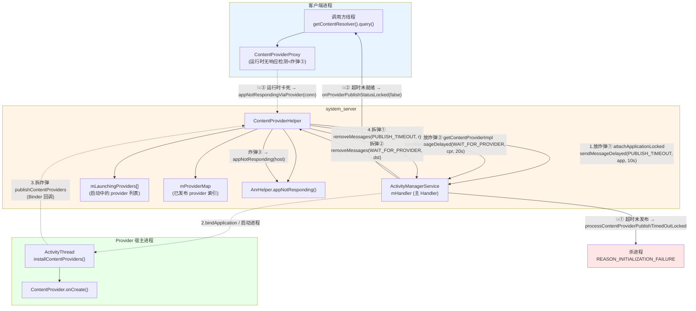
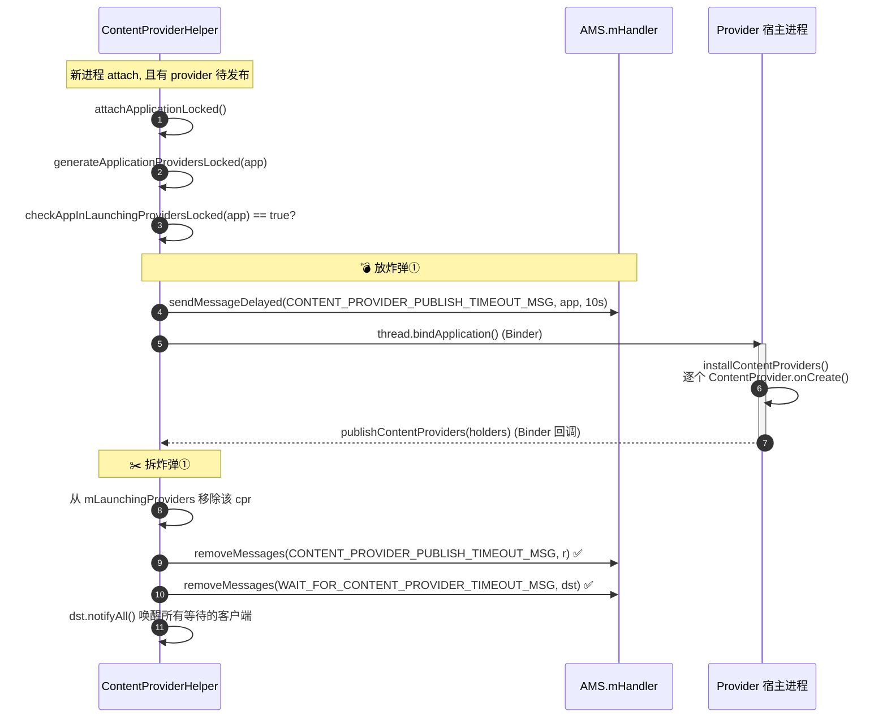
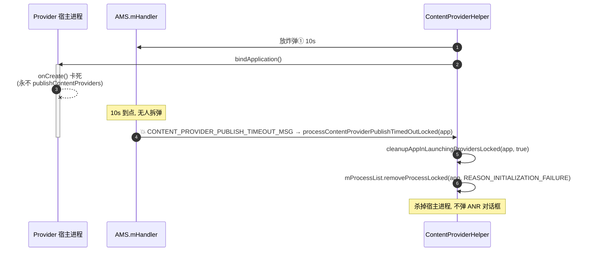
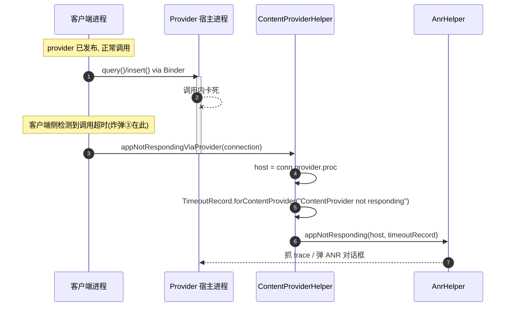
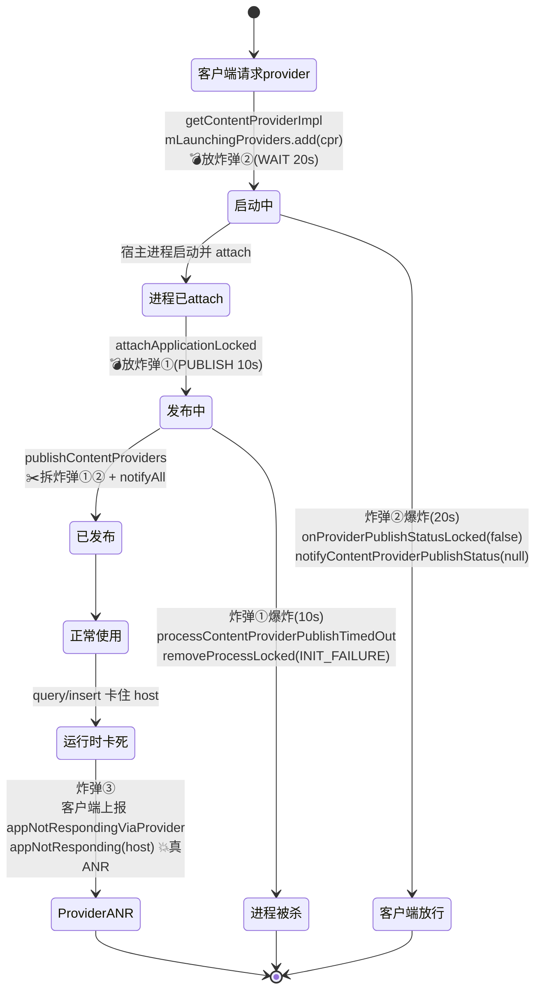

# ContentProvider ANR「放炸弹 / 拆炸弹」机制源码深度解析

> 基于本仓库 `base/services/core/java/com/android/server/am/ContentProviderHelper.java`、
> `ContentProviderRecord.java`、`ActivityManagerService.java` 以及
> `base/core/java/android/content/ContentResolver.java` 的实现。
>
> 本文所有行号均对应当前仓库代码。可与
> `Service-ANR放炸弹与拆炸弹机制源码深度解析.md`、`Broadcast-ANR放炸弹与拆炸弹机制源码深度解析.md` 对照阅读。

---

## 一、Provider 的特殊性：三颗不同的「炸弹」

ContentProvider 的超时机制和 Service / Broadcast **有本质差异**，必须先讲清楚——Provider 场景下其实有**三颗炸弹**，
它们的「爆炸后果」完全不同：

| 炸弹 | 消息 | key | 放弹位置 | 爆炸后果 | 是否弹 ANR |
|------|------|-----|---------|---------|:---------:|
| **① 发布超时弹** | `CONTENT_PROVIDER_PUBLISH_TIMEOUT_MSG` | `ProcessRecord`（进程） | `attachApplicationLocked` | **杀掉进程**（初始化失败） | ❌ 否（直接 kill） |
| **② 客户端等待弹** | `WAIT_FOR_CONTENT_PROVIDER_TIMEOUT_MSG` | `ContentProviderRecord`（provider） | `getContentProviderImpl` | **解除客户端阻塞**（返回 null） | ❌ 否（优雅放行） |
| **③ 运行时无响应** | 无 AMS 定时器，炸弹在**客户端进程** | — | 客户端发起 provider 调用时 | **host 进程 ANR** | ✅ 是（真 ANR 弹窗） |

> **关键认知**：
> - 大家最熟悉的「放炸弹/拆炸弹」模式（system_server 投递延时消息 → 应用回调拆弹）对应 **炸弹①（发布超时弹）**，
>   它是本文的**主线**。但它爆炸时是**杀进程**，不是弹 ANR 对话框。
> - **炸弹②** 是为"等这个 provider 的客户端"准备的兜底，超时后优雅地让客户端别再等。
> - **真正用户看到的「ContentProvider not responding」ANR 弹窗**来自 **炸弹③**
>   （`appNotRespondingViaProvider`），但它的计时器**不在 system_server，而在调用方进程**，
>   system_server 只是被动接收上报。
>
> 与 Service / Broadcast 的另一个重大区别：**Provider 仍用经典的
> `mHandler.sendMessageDelayed` + `removeMessages` 实现炸弹，没有迁移到 `AnrTimer` 抽象。**

---

## 二、设计意图

### 2.1 为什么 Provider 需要这些超时

ContentProvider 是 Android 四大组件里**唯一在进程启动时就必须同步就绪**的组件：

- 一个进程启动后，必须在 `ActivityThread` 里**安装并发布**它声明的所有 provider，然后回调
  `publishContentProviders` 通知 AMS。在此之前，任何想访问该 provider 的客户端都得**阻塞等待**。
- 如果应用的 `ContentProvider.onCreate()` 卡死（典型反模式：在 onCreate 里做 IO/网络），
  进程永远发布不了 provider → **所有等它的客户端都被挂起** → 雪崩。

因此设计者埋了三层保护：

1. **进程侧兜底（炸弹①）**：盯住"进程已 attach 但迟迟不发布 provider"，10s 后判定进程初始化失败并杀掉，
   避免一个 onCreate 卡死的进程长期占着 provider 名分。
2. **客户端侧兜底（炸弹②）**：盯住"客户端在等某个尚未发布的 provider"，20s 后让客户端的
   `getContentProvider` 返回失败而不是无限等待。
3. **运行时兜底（炸弹③）**：provider 发布后正常使用期间，如果某次 query/insert 调用把 host 进程卡死，
   由**调用方**检测并上报，让 host 进程吃 ANR。

### 2.2 几个关键设计权衡

| 设计点 | 意图 |
|--------|------|
| **发布超时炸弹 key 用 `ProcessRecord`** | 一个进程可能托管多个 provider，但"发布"是进程级动作，一颗弹守护整个进程的发布过程 |
| **`mLaunchingProviders` 列表作为"是否需要放弹"的依据** | 只有进程确实有 provider 处于"启动中"才放弹（`checkAppInLaunchingProvidersLocked`） |
| **发布超时 = 杀进程，而非 ANR 弹窗** | onCreate 卡死属于"进程没起来"，没有用户可交互的前台，弹 ANR 无意义，直接回收更干净 |
| **客户端等待超时 > 发布超时（20s > 10s）** | 客户端的等待窗必须比进程发布窗更长，给"杀掉坏进程→重启→重新发布"留缓冲 |
| **运行时 ANR 计时放在客户端** | 只有发起调用的客户端知道"这次 Binder 调用卡了多久"，由它检测最准 |
| **重启重试计数 `mRestartCount`** | provider 进程发布失败可重启有限次（`MAX_RETRY_COUNT`），超限才彻底放弃 |

---

## 三、关键超时常量

定义在 `ContentResolver.java`：

```java
// ContentResolver.java:788-789  —— 炸弹①：进程发布 provider 的超时
public static final int CONTENT_PROVIDER_PUBLISH_TIMEOUT_MILLIS =
        10 * 1000 * Build.HW_TIMEOUT_MULTIPLIER;                          // 10s

// ContentResolver.java:796-797  —— 炸弹②：客户端等待 provider 就绪的超时
public static final int CONTENT_PROVIDER_READY_TIMEOUT_MILLIS =
        CONTENT_PROVIDER_PUBLISH_TIMEOUT_MILLIS + 10 * 1000 * Build.HW_TIMEOUT_MULTIPLIER;  // 20s
```

> - **发布超时 10s**：进程 attach 后必须在 10s 内 `publishContentProviders`。
> - **客户端就绪超时 20s** = 10s + 10s：刻意比发布超时长 10s，保证"先杀坏进程"再"放客户端走"的时序。
> - `Build.HW_TIMEOUT_MULTIPLIER`：低性能/模拟器设备整体放大超时。

---

## 四、架构图



---

## 五、核心流程图

### 5.1 炸弹①（发布超时）：放弹 → 拆弹（正常路径）



### 5.2 炸弹①爆炸（杀进程，非 ANR）



### 5.3 炸弹③（运行时无响应）：真正的 Provider ANR



---

## 六、炸弹①（发布超时）逐行精度解析

### 6.1 放弹现场：`attachApplicationLocked`

> 位置：`ActivityManagerService.java:4690-4700`
>
> 当一个进程完成 attach（`bindApplication` 之前），AMS 检查它是否有 provider 要发布，有则放弹。

```java
boolean normalMode = mProcessesReady || isAllowedWhileBooting(app.info);
List<ProviderInfo> providers = normalMode
                                    ? mCpHelper.generateApplicationProvidersLocked(app)   // ① 收集该进程的 provider
                                    : null;

if (providers != null && mCpHelper.checkAppInLaunchingProvidersLocked(app)) {            // ② 确有 provider 在启动中
    Message msg = mHandler.obtainMessage(CONTENT_PROVIDER_PUBLISH_TIMEOUT_MSG);
    msg.obj = app;                                                                        // ③ key = 进程
    mHandler.sendMessageDelayed(msg,
            ContentResolver.CONTENT_PROVIDER_PUBLISH_TIMEOUT_MILLIS);                     // 💣 ④ 放炸弹 10s
}
```

> **放弹的两个准入条件（第 4695 行）**：
> 1. `providers != null`：进程声明了 ContentProvider（`generateApplicationProvidersLocked` 从 PMS 查到）。
> 2. `checkAppInLaunchingProvidersLocked(app)`：该进程的某个 provider 确实在 `mLaunchingProviders` 里
>    （即"正在为发布它而启动这个进程"）。
>
> 两个都满足才埋雷，`msg.obj = app`（key 是 `ProcessRecord`，进程级一颗弹）。

### 6.2 provider 进入"启动中"的时机：`getContentProviderImpl`

> 位置：`ContentProviderHelper.java:560-590`
>
> 炸弹①的前提是 provider 已被放进 `mLaunchingProviders`。这发生在**有客户端首次请求一个尚未运行的 provider** 时：
> AMS 为它启动宿主进程，并把 provider 标记为"启动中"。

```java
proc = mService.startProcessLocked(cpi.processName, cpr.appInfo, ...);   // 为 provider 启动宿主进程
...
cpr.launchingApp = proc;            // 记录"这个 provider 正在哪个进程里启动"
mLaunchingProviders.add(cpr);       // ★ 加入"启动中"列表 → 后续 attach 时据此放炸弹①
```

> 这一步与炸弹①是"因果对"：先把 provider 放进 `mLaunchingProviders`（6.2），
> 等宿主进程 attach 时才据此放炸弹①（6.1）。

### 6.3 拆弹现场：`publishContentProviders`

> 位置：`ContentProviderHelper.java:728-816`（聚焦拆弹部分）
>
> 宿主进程在 `ActivityThread` 里跑完所有 `ContentProvider.onCreate()` 后，
> 通过 Binder 调回 `publishContentProviders`，把发布好的 provider 交还 AMS——这就是"拆弹"动作。

```java
void publishContentProviders(IApplicationThread caller, List<ContentProviderHolder> providers) {
    if (providers == null) return;
    ...
    synchronized (mService) {
        final ProcessRecord r = mService.getRecordForAppLOSP(caller);   // 发布者进程
        ...
        for (int i = 0, size = providers.size(); i < size; i++) {
            ContentProviderHolder src = providers.get(i);
            if (src == null || src.info == null || src.provider == null) continue;
            ContentProviderRecord dst = r.mProviders.getProvider(src.info.name);
            if (dst == null) continue;
            ...
            // 把已发布的 provider 登记进全局索引 mProviderMap
            ComponentName comp = new ComponentName(dst.info.packageName, dst.info.name);
            mProviderMap.putProviderByClass(comp, dst);
            String[] names = dst.info.authority.split(";");
            for (int j = 0; j < names.length; j++) {
                mProviderMap.putProviderByName(names[j], dst);
            }

            // ★ 从"启动中"列表移除
            boolean wasInLaunchingProviders = false;
            for (int j = 0, numLaunching = mLaunchingProviders.size(); j < numLaunching; j++) {
                if (mLaunchingProviders.get(j) == dst) {
                    mLaunchingProviders.remove(j);
                    wasInLaunchingProviders = true;
                    j--; numLaunching--;
                }
            }
            if (wasInLaunchingProviders) {
                mService.mHandler.removeMessages(
                        ActivityManagerService.WAIT_FOR_CONTENT_PROVIDER_TIMEOUT_MSG, dst);   // ✂️ 拆炸弹②
                mService.mHandler.removeMessages(
                        ActivityManagerService.CONTENT_PROVIDER_PUBLISH_TIMEOUT_MSG, r);       // ✂️ 拆炸弹①
            }
            ...
            synchronized (dst) {
                dst.provider = src.provider;     // 绑定真正的 provider Binder
                dst.setProcess(r);
                dst.notifyAll();                 // ★ 唤醒所有 cpr.wait() 的等待者
                dst.onProviderPublishStatusLocked(true);   // 通知等待的客户端"成功了"
            }
            dst.mRestartCount = 0;               // 发布成功, 重启计数清零
            ...
        }
        ...
    }
}
```

> **拆弹精髓在第 768-782 行**：
> - 只要这个 provider 之前在 `mLaunchingProviders` 里（`wasInLaunchingProviders`），
>   就**一次性拆掉两颗弹**：
>   - `removeMessages(CONTENT_PROVIDER_PUBLISH_TIMEOUT_MSG, r)` —— 拆炸弹①（进程发布超时）。
>   - `removeMessages(WAIT_FOR_CONTENT_PROVIDER_TIMEOUT_MSG, dst)` —— 拆炸弹②（客户端等待超时）。
> - `dst.notifyAll()`（第 793 行）唤醒所有在 `cpr.wait()` 上阻塞的客户端，让它们拿到刚发布的 provider。
>
> 注意拆炸弹①用 key=`r`（进程），拆炸弹②用 key=`dst`（provider 记录），与各自放弹时的 key 严格对应。

### 6.4 炸弹①爆炸：`processContentProviderPublishTimedOutLocked`

> 位置：`ActivityManagerService.java:1826-1831`（分发）、`ContentProviderHelper.java:1239-1245`（处理）

```java
// AMS 主 Handler 分发
case CONTENT_PROVIDER_PUBLISH_TIMEOUT_MSG: {
    ProcessRecord app = (ProcessRecord) msg.obj;
    synchronized (ActivityManagerService.this) {
        mCpHelper.processContentProviderPublishTimedOutLocked(app);
    }
} break;
```

```java
void processContentProviderPublishTimedOutLocked(ProcessRecord app) {
    cleanupAppInLaunchingProvidersLocked(app, true);                  // ① 清理该进程所有"启动中"provider
    mService.mProcessList.removeProcessLocked(app, false, true,
            ApplicationExitInfo.REASON_INITIALIZATION_FAILURE,       // ② 杀进程, 标记"初始化失败"
            ApplicationExitInfo.SUBREASON_UNKNOWN,
            "timeout publishing content providers");
}
```

> **炸弹①爆炸 ≠ ANR 弹窗**：它直接 `removeProcessLocked` **杀掉宿主进程**，理由是
> `REASON_INITIALIZATION_FAILURE`（初始化失败）。
> 设计逻辑：进程连 provider 都发布不出来，说明它根本没正常起来，没有可交互前台，弹 ANR 无意义，回收更干净。

### 6.5 爆炸时的清理：`cleanupAppInLaunchingProvidersLocked`

> 位置：`ContentProviderHelper.java:1892-1915`

```java
boolean cleanupAppInLaunchingProvidersLocked(ProcessRecord app, boolean alwaysBad) {
    boolean restart = false;
    for (int i = mLaunchingProviders.size() - 1; i >= 0; i--) {
        ContentProviderRecord cpr = mLaunchingProviders.get(i);
        if (cpr.launchingApp != app) continue;                       // 只清理本进程的
        if (++cpr.mRestartCount > ContentProviderRecord.MAX_RETRY_COUNT) {
            alwaysBad = true;                                        // 重试超限 → 标记为坏
        }
        if (!alwaysBad && !app.mErrorState.isBad() && cpr.hasConnectionOrHandle()) {
            restart = true;                                         // 还有客户端在用 → 安排重启
        } else {
            removeDyingProviderLocked(app, cpr, true);              // 否则彻底移除
        }
    }
    return restart;
}
```

> 爆炸清理时有**有限重启**逻辑：如果还有客户端连着这个 provider 且没超重试上限，
> 会安排重启宿主进程再试一次（`restart=true`）；否则 `removeDyingProviderLocked` 彻底放弃。

---

## 七、炸弹②（客户端等待超时）逐行精度解析

### 7.1 放弹现场：`getContentProviderImpl`

> 位置：`ContentProviderHelper.java:616-646`
>
> 客户端请求一个尚未发布的 provider 时，AMS 一边启动宿主进程，一边给**客户端的等待**放一颗弹。

```java
if (caller != null) {
    // The client will be waiting, and we'll notify it when the provider is ready.
    synchronized (cpr) {
        if (cpr.provider == null) {                          // provider 还没发布
            if (cpr.launchingApp == null) { ... return null; }
            if (conn != null) conn.waiting = true;           // 标记此连接"正在等待"
            Message msg = mService.mHandler.obtainMessage(
                    ActivityManagerService.WAIT_FOR_CONTENT_PROVIDER_TIMEOUT_MSG);
            msg.obj = cpr;                                   // key = ContentProviderRecord
            mService.mHandler.sendMessageDelayed(msg,
                    ContentResolver.CONTENT_PROVIDER_READY_TIMEOUT_MILLIS);   // 💣 放炸弹② 20s
        }
    }
    // 返回一个 holder, 客户端据 holder.provider 是否为 null 决定是否等待
    return cpr.newHolder(conn, false);
}
```

> 与炸弹①的分工：
> - 炸弹①（key=进程）盯"进程发布动作"，爆炸=杀进程。
> - 炸弹②（key=cpr）盯"客户端等待"，爆炸=通知客户端别等了。
> - 两者同时存在：进程发布失败时，炸弹①先杀进程（10s），随后炸弹②（20s）兜底通知仍在等的客户端。

### 7.2 拆弹

炸弹②的拆除有两条路径，都在 `publishContentProviders`（成功）或 `removeDyingProviderLocked`（失败）里：

```java
// 成功发布 —— ContentProviderHelper.java:778-779
mService.mHandler.removeMessages(
        ActivityManagerService.WAIT_FOR_CONTENT_PROVIDER_TIMEOUT_MSG, dst);   // ✂️ 拆炸弹②

// 进程死亡/放弃 —— ContentProviderHelper.java:1806-1807
mService.mHandler.removeMessages(
        ActivityManagerService.WAIT_FOR_CONTENT_PROVIDER_TIMEOUT_MSG, cpr);   // ✂️ 拆炸弹②
```

### 7.3 炸弹②爆炸：通知客户端"别等了"

> 位置：`ActivityManagerService.java:1923-1927`（分发）、`ContentProviderRecord.java:208`（处理）

```java
// AMS 主 Handler 分发
case WAIT_FOR_CONTENT_PROVIDER_TIMEOUT_MSG: {
    synchronized (ActivityManagerService.this) {
        ((ContentProviderRecord) msg.obj).onProviderPublishStatusLocked(false);   // status=false 表示失败
    }
} break;
```

```java
// ContentProviderRecord.onProviderPublishStatusLocked —— 逐个通知等待的客户端
void onProviderPublishStatusLocked(boolean status) {
    final int numOfConns = connections.size();
    for (int i = 0; i < numOfConns; i++) {
        final ContentProviderConnection conn = connections.get(i);
        if (conn.waiting && conn.client != null) {
            final ProcessRecord client = conn.client;
            if (!status) {
                Slog.wtf(TAG_AM, "Timeout waiting for provider ...");   // 记一笔 wtf
            }
            final IApplicationThread thread = client.getThread();
            if (thread != null) {
                try {
                    thread.notifyContentProviderPublishStatus(           // ★ 回调客户端
                            newHolder(status ? conn : null, false),
                            info.authority, conn.mExpectedUserId, status);
                } catch (RemoteException e) { }
            }
        }
        conn.waiting = false;
    }
}
```

> **炸弹②爆炸 ≠ ANR**：它通过 `notifyContentProviderPublishStatus(holder=null, status=false)`
> 优雅地告诉客户端"provider 没起来"，客户端的 `getContentProvider` 拿到 null holder 后返回失败/重试，
> **而不是无限阻塞**。这是一种"防止客户端被坏 provider 拖死"的兜底。

---

## 八、炸弹③（运行时无响应）：真正的 Provider ANR

> 位置：`ContentProviderHelper.java:993-1018`
>
> provider **发布成功并正常使用后**，如果某次 query/insert/call 把 host 进程卡死，
> 这才是用户看到「ContentProvider not responding」ANR 的来源。
> 注意：**这颗炸弹的计时器不在 system_server，而在发起调用的客户端进程**（`ContentProviderProxy`/
> `ContentProviderClient` 的无响应检测）。system_server 只负责"接报并执行 ANR"。

```java
void appNotRespondingViaProvider(IBinder connection) {
    mService.enforceCallingPermission(android.Manifest.permission.REMOVE_TASKS,
            "appNotRespondingViaProvider()");                            // 需 REMOVE_TASKS 权限

    final ContentProviderConnection conn = (ContentProviderConnection) connection;
    if (conn == null) { Slog.w(TAG, "ContentProviderConnection is null"); return; }

    ActivityManagerService.traceBegin(...);
    try {
        final ProcessRecord host = conn.provider.proc;                   // ① 找到 provider 的宿主进程
        if (host == null) { Slog.w(TAG, "Failed to find hosting ProcessRecord"); return; }

        TimeoutRecord timeoutRecord = TimeoutRecord.forContentProvider(
                "ContentProvider not responding");                       // ② 构造超时记录
        mService.mAnrHelper.appNotResponding(host, timeoutRecord);       // ③ 对 host 进程触发真 ANR
    } finally {
        ActivityManagerService.traceEnd(Trace.TRACE_TAG_ACTIVITY_MANAGER);
    }
}
```

> 流程：客户端检测到 provider 调用超时 → 经 Binder 调 AMS 的 `appNotRespondingViaProvider(conn)` →
> 通过连接找到 host 进程 → `mAnrHelper.appNotResponding(host, ...)` → 抓 trace、弹 ANR 对话框。
> 这是唯一会产生「ContentProvider not responding」用户可见 ANR 的路径。

---

## 九、完整状态总览（三颗炸弹）



---

## 十、与 Service / Broadcast ANR 的关键对比

| 维度 | **Service ANR** | **Broadcast ANR** | **Provider ANR** |
|------|----------------|-------------------|------------------|
| 计时实现 | `AnrTimer`（native） | `AnrTimer`（native） | **经典 `mHandler` 延时消息**（未迁移 AnrTimer） |
| 主炸弹 key | `ProcessRecord` | `BroadcastProcessQueue` | 炸弹①`ProcessRecord` / 炸弹②`ContentProviderRecord` |
| 放弹时机 | 生命周期回调前 | 阻塞型接收者派发前 | 炸弹①进程 attach 时 / 炸弹②客户端请求时 |
| 拆弹动作 | `AnrTimer.cancel` | `AnrTimer.cancel` | `mHandler.removeMessages` |
| 拆弹回调 | `serviceDoneExecuting` | `finishReceiver` | `publishContentProviders` |
| 超时 | 前台 20s / 后台 200s | 前台/后台各 10s | 发布 10s / 客户端就绪 20s |
| **爆炸后果** | **弹 ANR** | **弹 ANR + 撤队列** | 炸弹①**杀进程** / 炸弹②**放行客户端** / 炸弹③**弹 ANR** |
| 真 ANR 计时器位置 | system_server | system_server | **客户端进程**（炸弹③） |
| debug 豁免 | ✅ | ✅ | 炸弹③走通用 AnrHelper 豁免 |

> **最大差异**：Service / Broadcast 的炸弹爆炸"一定"是弹 ANR；而 Provider 的炸弹①爆炸是**杀进程**、
> 炸弹②爆炸是**优雅放行客户端**，唯有炸弹③（运行时无响应，计时在客户端）才是用户可见的 ANR 弹窗。

---

## 十一、总结：一图记住核心设计

```
                       客户端请求一个未运行的 Provider
                                   │
              getContentProviderImpl: startProcess + mLaunchingProviders.add
                                   │  💣放炸弹②(WAIT_FOR_PROVIDER, cpr, 20s)
                                   ▼
                       宿主进程启动 → attachApplicationLocked
                                   │  💣放炸弹①(PUBLISH_TIMEOUT, app, 10s)
                                   ▼
                  宿主进程 installContentProviders → onCreate()
                   ┌───────────────┴────────────────┐
              onCreate 正常返回                  onCreate 卡死
                   │                                  │
       publishContentProviders                  10s 到点
       ✂️ removeMessages(PUBLISH, r)            💥 炸弹①爆炸
       ✂️ removeMessages(WAIT, dst)             processContentProviderPublishTimedOut
       notifyAll() 唤醒客户端                    → removeProcessLocked(INIT_FAILURE) 杀进程
                   │                                  │ (20s 后)
                   ▼                            💥 炸弹②爆炸 → 通知客户端别等(返回 null)
            Provider 可正常使用
                   │
            某次 query/insert 卡死 host
                   │  (计时在客户端进程)
                   ▼
       客户端上报 appNotRespondingViaProvider(conn)
       💥 炸弹③ → appNotResponding(host) → 真正的「ContentProvider not responding」ANR
```

**三句话记住本质：**

1. **放炸弹** ＝ 进程 attach 且有 provider 待发布时 `sendMessageDelayed(CONTENT_PROVIDER_PUBLISH_TIMEOUT_MSG, app, 10s)`
   （炸弹①）；客户端请求未发布 provider 时再放一颗 `WAIT_FOR_CONTENT_PROVIDER_TIMEOUT_MSG`（炸弹②，20s）。
2. **拆炸弹** ＝ 宿主进程 `publishContentProviders` 回调里，对该 provider
   `removeMessages` 同时拆掉炸弹①②，并 `notifyAll` 唤醒等待客户端。
3. **爆炸** ＝ 炸弹①超时 → **杀进程**（初始化失败，非 ANR）；炸弹②超时 → **优雅放行客户端**；
   而用户真正看到的 Provider ANR 来自**运行时**的炸弹③ `appNotRespondingViaProvider` → `appNotResponding(host)`。

---

## 附录：关键代码位置索引

| 功能 | 文件:行号 |
|------|----------|
| provider 进入"启动中" | `ContentProviderHelper.java:589-590` (`getContentProviderImpl`) |
| 放炸弹①(发布超时) | `ActivityManagerService.java:4695-4700` (`attachApplicationLocked`) |
| 放炸弹②(客户端等待) | `ContentProviderHelper.java:635-639` (`getContentProviderImpl`) |
| 拆炸弹①② | `ContentProviderHelper.java:768-782` (`publishContentProviders`) |
| 唤醒等待客户端 | `ContentProviderHelper.java:790-795` (`dst.notifyAll`) |
| 炸弹①分发 | `ActivityManagerService.java:1826-1831` |
| 炸弹①爆炸处理 | `ContentProviderHelper.java:1239-1245` (`processContentProviderPublishTimedOutLocked`) |
| 爆炸清理+重启 | `ContentProviderHelper.java:1892-1915` (`cleanupAppInLaunchingProvidersLocked`) |
| 炸弹②分发 | `ActivityManagerService.java:1923-1927` |
| 炸弹②爆炸处理 | `ContentProviderRecord.java:208` (`onProviderPublishStatusLocked`) |
| 进程死亡拆炸弹② | `ContentProviderHelper.java:1801-1808` (`removeDyingProviderLocked`) |
| 炸弹③(真 ANR) | `ContentProviderHelper.java:993-1018` (`appNotRespondingViaProvider`) |
| 超时常量 | `ContentResolver.java:788-797` |
| 进程清理移除超时消息 | `ActivityManagerService.java:13654, 13665` |
