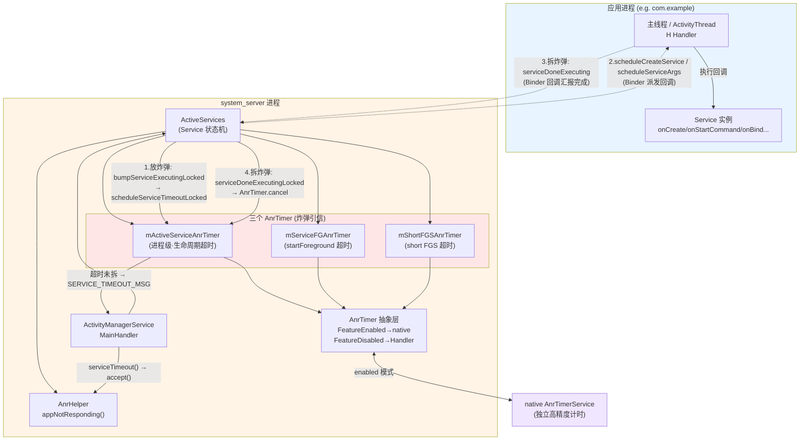
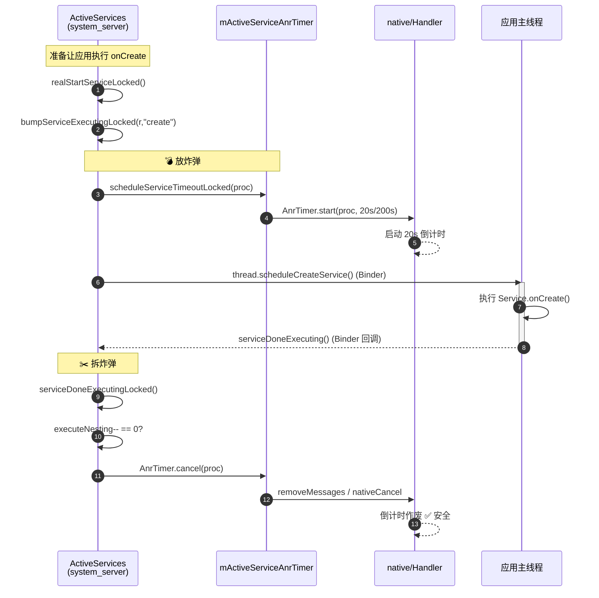
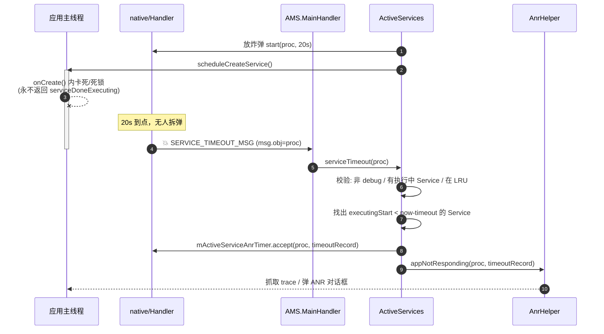
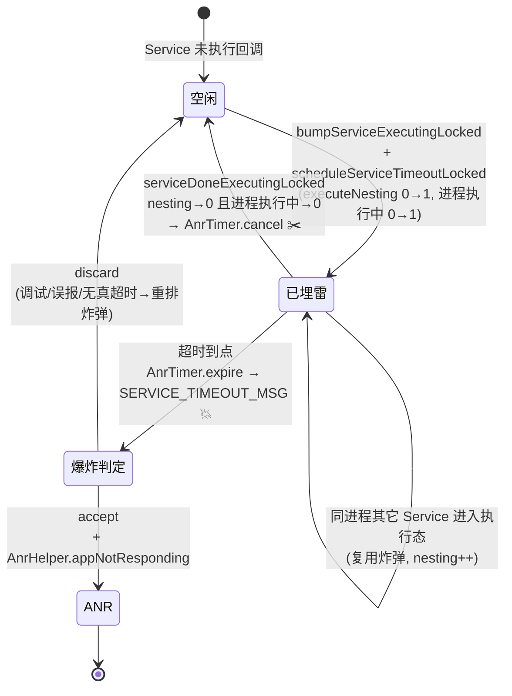

# Service ANR「放炸弹 / 拆炸弹」机制源码深度解析

> 基于本仓库 `base/services/core/java/com/android/server/am/ActiveServices.java`、
> `ActivityManagerService.java`、`ActivityManagerConstants.java` 以及
> `base/services/core/java/com/android/server/utils/AnrTimer.java` 的实现。
>
> 本文所有行号均对应当前仓库代码。

---

## 一、什么是「放炸弹 / 拆炸弹」

「放炸弹 / 拆炸弹」是 AOSP 圈对 **Service ANR 超时检测机制** 的形象说法：

| 形象说法 | 实际含义 | 代码动作 |
|---------|---------|---------|
| **放炸弹（埋雷）** | 在 system_server 侧投递一个**延时超时消息**，约定「应用必须在 N 毫秒内完成某个生命周期回调」 | `scheduleServiceTimeoutLocked()` → `AnrTimer.start()` |
| **拆炸弹（排雷）** | 应用按时完成回调后，把那个延时消息**取消掉**，炸弹失效 | `serviceDoneExecutingLocked()` → `AnrTimer.cancel()` |
| **炸弹爆炸** | 应用没能按时完成，延时消息到点被处理，触发 ANR | `serviceTimeout()` → `AnrHelper.appNotResponding()` |

核心思想就一句话：

> **system_server 是「裁判」，应用进程是「选手」。每次让应用执行一段生命周期回调
> （onCreate / onStartCommand / onBind / onUnbind / onDestroy）之前，裁判先按下一个倒计时；
> 应用执行完会反向通知裁判「我做完了」，裁判随即清掉倒计时。如果倒计时先到点，说明应用卡死，判 ANR。**

---

## 二、设计意图

### 2.1 为什么需要这套机制

Android 的 Service 生命周期回调（`onCreate`、`onStartCommand`、`onBind`…）是**在应用主线程**执行的。
如果开发者在这些回调里写了耗时操作（IO、网络、死锁、死循环），主线程会被阻塞。
但 system_server 无法直接「看见」应用主线程在干什么——它们是两个进程，只能通过 Binder 通信。

因此设计者采用了**「超时兜底」**思路：

1. **不信任应用会主动汇报卡顿**：应用卡死时根本没机会汇报。
2. **用延时消息做「死亡开关（dead-man switch）」**：裁判主动设一个超时，应用必须主动来「续命/拆弹」。
3. **沉默即异常**：只要应用在规定时间内没有回 `serviceDoneExecuting`，就认定它出了问题。

这是一种典型的 **「乐观执行 + 超时回收」** 容错模型：正常情况几乎零开销（拆弹只是 remove 一个 message），
异常情况能可靠兜底。

### 2.2 几个关键设计权衡

| 设计点 | 意图 |
|--------|------|
| **前台/后台不同超时** | 前台 Service 影响用户感知，必须严（20s）；后台不影响交互，放宽（200s）以减少误杀 |
| **按进程聚合计时（`ProcessAnrTimer`）** | 同一进程内多个 Service 共用一个计时器，避免 N 个 Service 起 N 个 timer，降低开销 |
| **`executeNesting` 嵌套计数** | 一个 Service 可能同时处于 create+bind+start 多个执行段，用引用计数保证「全部完成」才拆弹 |
| **`AnrTimer` 抽象层** | 把「延时消息」从 Java Handler 下沉到 native 实现，解决「system_server 自己卡顿导致计时不准」的问题 |
| **debug 进程豁免** | 应用被调试器断点暂停时不应判 ANR（`proc.isDebugging()` 直接 discard） |

---

## 三、三种「炸弹」对比

`ActiveServices` 构造函数（`ActiveServices.java:788-801`）一次性创建了 **3 个独立的计时器**，
对应三种不同的超时场景：

```java
this.mActiveServiceAnrTimer = new ProcessAnrTimer(service,
        ActivityManagerService.SERVICE_TIMEOUT_MSG, "SERVICE_TIMEOUT", ...);      // 炸弹①
this.mShortFGSAnrTimer = new ServiceAnrTimer(service,
        ActivityManagerService.SERVICE_SHORT_FGS_ANR_TIMEOUT_MSG, ...);           // 炸弹③(short FGS)
this.mServiceFGAnrTimer = new ServiceAnrTimer(service,
        ActivityManagerService.SERVICE_FOREGROUND_TIMEOUT_MSG, ...);             // 炸弹②
```

| 炸弹 | 计时器字段 | 监控对象 | 超时常量 | 默认值 | 触发场景 |
|------|-----------|---------|---------|--------|---------|
| **① 生命周期执行超时** | `mActiveServiceAnrTimer` | **进程** `ProcessRecord` | `SERVICE_TIMEOUT` / `SERVICE_BACKGROUND_TIMEOUT` | **前台 20s** / **后台 200s** | onCreate/onStartCommand/onBind/onUnbind/onDestroy 卡死 |
| **② startForeground 超时** | `mServiceFGAnrTimer` | **Service** `ServiceRecord` | `mServiceStartForegroundTimeoutMs` (+ANR delay) | **30s** (+10s) | `startForegroundService()` 后没在 30s 内调 `startForeground()` |
| **③ short FGS 超时** | `mShortFGSAnrTimer` | Service | short-FGS 相关 | — | shortService 类型 FGS 超时未停止 |

> 本文聚焦最经典、最核心的 **炸弹①（生命周期执行超时）**，并在第八节补充炸弹②。

超时常量定义在 `ActivityManagerConstants.java`：

```java
// ActivityManagerConstants.java:317
private static final long DEFAULT_SERVICE_TIMEOUT = 20 * 1000 * Build.HW_TIMEOUT_MULTIPLIER;     // 前台 20s
// ActivityManagerConstants.java:322
private static final long DEFAULT_SERVICE_BACKGROUND_TIMEOUT = DEFAULT_SERVICE_TIMEOUT * 10;     // 后台 200s
// ActivityManagerConstants.java:308
private static final int DEFAULT_SERVICE_START_FOREGROUND_TIMEOUT_MS = 30 * 1000;                // FGS 30s
// ActivityManagerConstants.java:310
private static final int DEFAULT_SERVICE_START_FOREGROUND_ANR_DELAY_MS = 10 * 1000;              // FGS 额外 10s
```

> `Build.HW_TIMEOUT_MULTIPLIER` 用于低性能/模拟器设备整体放大超时，避免硬件慢导致误判。

---

## 四、架构图



**分层职责**：

- **`ActiveServices`**：Service 全生命周期状态机，决定**何时放/何时拆**炸弹（业务逻辑层）。
- **`AnrTimer`**：把「放/拆/爆炸」抽象成 `start / cancel / accept / discard / expire` 五个动作（机制层）。
  - `FeatureEnabled`：走 native 计时器，即使 system_server Handler 积压也能准时引爆。
  - `FeatureDisabled`：退化为普通 `Handler.sendMessageDelayed`（兼容/降级路径）。
- **`AnrHelper`**：真正生成 ANR、抓 trace、弹窗（执行层）。

---

## 五、核心流程图

### 5.1 放炸弹 → 拆炸弹（正常路径）



### 5.2 炸弹爆炸（ANR 路径）



---

## 六、放炸弹：逐行精度解析

### 6.1 入口：`bumpServiceExecutingLocked` —— 进入「执行态」并埋雷

> 位置：`ActiveServices.java:5320-5407`
>
> 每次 system_server 要驱动应用执行一段 Service 回调前，**必定**先调用它。
> `why` 参数标明本次执行段是 `"create"` / `"start"` / `"bind"` / `"unbind"` / `"destroy"`。

```java
private void bumpServiceExecutingLocked(
        ServiceRecord r, boolean fg, String why, @OomAdjReason int oomAdjReason,
        boolean skipTimeoutIfPossible) {
```
- `fg`：本次执行是否处于前台（决定用 20s 还是 200s 超时）。
- `skipTimeoutIfPossible`：是否允许在「进程被冻结」时跳过埋雷（见下）。

```java
    boolean timeoutNeeded = true;
    if ((mAm.mBootPhase < SystemService.PHASE_THIRD_PARTY_APPS_CAN_START)
            && (r.app != null) && (r.app.getPid() == ActivityManagerService.MY_PID)) {
        Slog.w(TAG, "Too early to start/bind service in system_server: ...");
        timeoutNeeded = false;
    }
```
> **第 5337-5344 行**：开机早期，system_server 自己的 Service 还没 `Looper.loop()`，
> 此时埋雷会误爆，所以 `timeoutNeeded=false`（不放炸弹）。对应注释引用的 bug 是 b/34123235。

```java
    final boolean shouldSkipTimeout = skipTimeoutIfPossible && r.app != null
            && (r.app.mOptRecord.isPendingFreeze() || r.app.mOptRecord.isFrozen());
```
> **第 5347-5348 行**：如果进程**已冻结/将冻结**（Cached App Freezer），它根本不会运行，
> 此时也不该放炸弹——否则解冻前必爆。这里记下「应跳过」。

```java
    try (var unused = mAm.mProcessStateController.startServiceBatchSession(oomAdjReason)) {
        ProcessServiceRecord psr;
        if (r.executeNesting == 0) {                       // ← 本 Service 当前没有任何执行段
            r.executeFg = fg;
            ...
            if (r.app != null) {
                psr = r.app.mServices;
                mAm.mProcessStateController.startExecutingService(psr, r);   // 加入「执行中」集合
                mAm.mProcessStateController.setExecServicesFg(psr, psr.isExecServicesFg() || fg);
                if (timeoutNeeded && psr.numberOfExecutingServices() == 1) {  // ← 进程内第一个执行中的 Service
                    if (!shouldSkipTimeout) {
                        scheduleServiceTimeoutLocked(r.app);                  // 💣 真正放炸弹
                    } else {
                        r.app.mServices.noteScheduleServiceTimeoutPending(true);  // 冻结中，标记「待补放」
                    }
                }
            }
        } else if (r.app != null && fg) {                  // ← 已有执行段，但本次升级为前台
            psr = r.app.mServices;
            if (!psr.isExecServicesFg()) {
                mAm.mProcessStateController.setExecServicesFg(psr, true);
                if (timeoutNeeded) {
                    if (!shouldSkipTimeout) {
                        scheduleServiceTimeoutLocked(r.app);  // 后台→前台，重放更短的炸弹
                    } else {
                        r.app.mServices.noteScheduleServiceTimeoutPending(true);
                    }
                }
            }
        }
```

> **关键设计点（第 5352、5366 行）**：
> - 炸弹是 **进程级（`ProcessRecord`）** 的，不是 Service 级。
> - 只有当进程内「执行中 Service 数量从 0 变成 1」时才放炸弹（`numberOfExecutingServices() == 1`）。
>   后续同进程的其它 Service 进入执行态，**复用同一个炸弹**，不重复放。
> - 当一个**后台**执行段升级成**前台**执行段时，会用更短的前台超时**重新放**炸弹
>   （`AnrTimer.start` 内部会先 cancel 旧的，见第七节）。

```java
    r.executeFg |= fg;
    r.executeNesting++;                                    // ← 引用计数 +1
    r.executingStart = SystemClock.uptimeMillis();         // ← 记录本段开始时刻，爆炸时用来判断是谁超时
}
```
> **第 5404-5406 行**：
> - `executeNesting++`：一个 Service 可能同时 create+bind+start，每段 +1，**拆弹时减到 0 才算全部完成**。
> - `executingStart`：本执行段开始的时间戳，`serviceTimeout()` 靠它精确定位「到底哪个 Service 卡了」。

### 6.2 真正放炸弹：`scheduleServiceTimeoutLocked`

> 位置：`ActiveServices.java:8042-8050`

```java
void scheduleServiceTimeoutLocked(ProcessRecord proc) {
    if (proc.mServices.numberOfExecutingServices() == 0 || proc.getThread() == null) {
        return;                                            // 没有执行中 Service / 进程已死 → 不放
    }
    final long delay = proc.mServices.isExecServicesFg()
            ? mAm.mConstants.SERVICE_TIMEOUT                // 前台 20s
            : mAm.mConstants.SERVICE_BACKGROUND_TIMEOUT;    // 后台 200s
    mActiveServiceAnrTimer.start(proc, delay);             // 💣 引信点火
    proc.mServices.noteScheduleServiceTimeoutPending(false);  // 清除「待补放」标记
}
```

> 这里就是「放炸弹」的**物理动作**：以 `proc` 为 key，向 `AnrTimer` 注册一个 `delay` 毫秒后引爆的定时器。
> 一旦 `delay` 到点且没人 `cancel`，`AnrTimer` 会向 `AMS.MainHandler` 投递
> `SERVICE_TIMEOUT_MSG`（`msg.obj == proc`）。

### 6.3 放炸弹的三个典型调用现场

| 现场 | 代码位置 | 含义 |
|------|---------|------|
| **create**（启动 Service） | `realStartServiceLocked` → `bumpServiceExecutingLocked(r, ..., "create", ...)` （`6262`），随后 `thread.scheduleCreateService()`（`6306`） | 让应用执行 `onCreate` 前埋雷 |
| **start**（派发 Intent） | `sendServiceArgsLocked` → `bumpServiceExecutingLocked(r, ..., "start", ...)`（`6409`），随后 `scheduleServiceArgs()`（`6450`） | 让应用执行 `onStartCommand` 前埋雷 |
| **bind**（绑定） | `requestServiceBindingLocked` → `bumpServiceExecutingLocked(r, ..., "bind", ...)`（`5423`） | 让应用执行 `onBind` 前埋雷 |

> 三者都遵循同一个铁律：**先 `bump`（埋雷）+ Binder 派发回调 → 等应用回 `serviceDoneExecuting`（拆雷）**。

---

## 七、拆炸弹：逐行精度解析

### 7.1 应用回调入口：`serviceDoneExecutingLocked`（带 type 的重载）

> 位置：`ActiveServices.java:6948-7041`
>
> 应用主线程执行完 `onCreate/onStartCommand/onDestroy` 后，
> 通过 Binder 调回 `ActivityManagerService.serviceDoneExecuting()`，最终进到这里。
> `type` 表示完成的是哪类执行段：`SERVICE_DONE_EXECUTING_START` / `..._STOP` / `..._ANON`。

```java
void serviceDoneExecutingLocked(ServiceRecord r, int type, int startId, int res,
        boolean enqueueOomAdj) {
    boolean inDestroying = mDestroyingServices.contains(r);
    if (r != null) {
        ...
        if (type == ActivityThread.SERVICE_DONE_EXECUTING_START) {
            r.callStart = true;
            if (res != Service.START_TASK_REMOVED_COMPLETE) {
                r.startCommandResult = res;                // 记录 onStartCommand 的返回值
            }
            switch (res) {
                case Service.START_STICKY: ...             // 处理 START_STICKY/NOT_STICKY/REDELIVER 语义
                ...
            }
        } else if (type == ActivityThread.SERVICE_DONE_EXECUTING_STOP) {
            if (!inDestroying) { ... }
            else if (r.executeNesting != 1) {
                Slog.w(TAG, "Service done with onDestroy, but executeNesting=" + r.executeNesting);
                r.executeNesting = 1;                      // 容错：修正计数，避免「孤儿执行段」永不拆弹
            }
            needOomAdj = true;
        }
        final long origId = mAm.mInjector.clearCallingIdentity();
        serviceDoneExecutingLocked(r, inDestroying, inDestroying, enqueueOomAdj, ...);  // ← 转入核心拆弹
        mAm.mInjector.restoreCallingIdentity(origId);
    }
}
```

> 这一层主要做 `onStartCommand` 返回值（STICKY 语义）的记账，然后转调真正负责拆弹的核心重载。
> 注意第 7026-7027 行的容错：如果 onDestroy 完成时嵌套计数异常，强行修正为 1，防止 Service 永远拆不掉雷而误 ANR。

### 7.2 核心拆弹：`serviceDoneExecutingLocked`（带 inDestroying 的重载）

> 位置：`ActiveServices.java:7057-7101`（核心片段）

```java
private void serviceDoneExecutingLocked(ServiceRecord r, boolean inDestroying,
        boolean finishing, boolean enqueueOomAdj, @OomAdjReason int oomAdjReason) {
    ...
    r.executeNesting--;                                    // ← 引用计数 -1（对应 bump 的 ++）
    if (r.executeNesting <= 0) {                           // ← 本 Service 所有执行段都完成了
        if (r.app != null) {
            final ProcessServiceRecord psr = r.app.mServices;
            mAm.mProcessStateController.setExecServicesFg(psr, false);
            mAm.mProcessStateController.stopExecutingService(psr, r);   // 从「执行中」集合移除
            if (psr.numberOfExecutingServices() == 0) {    // ← 进程内已无任何执行中 Service
                if (r.app.mPid != 0) mActiveServiceAnrTimer.cancel(r.app);   // ✂️ 拆炸弹！
            } else if (r.executeFg) {
                // 还有别的执行中 Service，重新评估进程是否仍需前台
                for (int i = psr.numberOfExecutingServices() - 1; i >= 0; i--) {
                    if (psr.getExecutingServiceAt(i).executeFg) {
                        mAm.mProcessStateController.setExecServicesFg(psr, true);
                        break;
                    }
                }
            }
            if (inDestroying) {
                mDestroyingServices.remove(r);
                r.bindings.clear();
            }
            ...
        }
        r.executeFg = false;
        ...
    }
}
```

> **拆弹的精髓全在第 7064-7075 行**：
>
> 1. `r.executeNesting--`：与 `bump` 时的 `++` 配对。一个 Service 的 create/bind/start 各自独立计数。
> 2. `if (r.executeNesting <= 0)`：**只有当这个 Service 的所有执行段都汇报完成**，才往下走。
> 3. `stopExecutingService(psr, r)`：把 Service 从进程的「执行中」集合移除。
> 4. **`if (psr.numberOfExecutingServices() == 0)`**：
>    炸弹是**进程级**的——只有进程内**最后一个**执行中 Service 也完成了，
>    才调用 `mActiveServiceAnrTimer.cancel(r.app)` **真正拆弹**。
>    只要进程里还有别的 Service 在执行，炸弹保留（继续守护那些 Service）。
>
> 这就解释了为什么放弹用「0→1」判定、拆弹用「→0」判定：**进程级一个炸弹守护多个 Service**。

### 7.3 拆弹的其它现场

除了应用正常回调，以下场景也会触发拆弹（殊途同归到 7.2 的核心逻辑）：

- **进程死亡**：`serviceProcessGoneLocked`（`7043`）→ `serviceDoneExecutingLocked(r, true, true, ...)`。
  进程都没了，自然要拆弹，不能再判 ANR。
- **创建失败**：`realStartServiceLocked` 的 `finally` 块（`6319`），`scheduleCreateService` 抛异常时拆弹并保持计数正确。
- **派发失败**：`sendServiceArgsLocked` 的 catch 块（`6472`），Binder 调用失败时为每个 arg 拆弹。

---

## 八、炸弹爆炸：`serviceTimeout` 逐行解析

> 位置：`ActiveServices.java:7852-7916`
>
> 当 20s/200s 到点且无人拆弹，`AnrTimer` 向 `AMS.MainHandler` 投递 `SERVICE_TIMEOUT_MSG`，
> `AMS` 在 `ActivityManagerService.java:1777` 调用 `mServices.serviceTimeout((ProcessRecord) msg.obj)`。

```java
void serviceTimeout(ProcessRecord proc) {
    try {
        Trace.traceBegin(Trace.TRACE_TAG_ACTIVITY_MANAGER, "serviceTimeout()");
        TimeoutRecord timeoutRecord = null;
        synchronized (mAm) {
            if (proc.isDebugging()) {                      // ① 被调试 → 不算 ANR
                mActiveServiceAnrTimer.discard(proc);
                return;
            }
            final ProcessServiceRecord psr = proc.mServices;
            if (psr.numberOfExecutingServices() == 0 || proc.getThread() == null
                    || proc.isKilled()) {                  // ② 已无执行中 Service / 进程已死 → 误报，丢弃
                mActiveServiceAnrTimer.discard(proc);
                return;
            }
            final long now = SystemClock.uptimeMillis();
            final long maxTime = now
                    - (psr.isExecServicesFg()
                    ? mAm.mConstants.SERVICE_TIMEOUT
                    : mAm.mConstants.SERVICE_BACKGROUND_TIMEOUT);   // 超时分界线
            ServiceRecord timeout = null;
            long nextTime = 0;
            for (int i = psr.numberOfExecutingServices() - 1; i >= 0; i--) {  // ③ 找真正超时的 Service
                ServiceRecord sr = psr.getExecutingServiceAt(i);
                if (sr.executingStart < maxTime) {         // 该 Service 开始执行的时刻已超过分界线
                    timeout = sr;
                    break;
                }
                if (sr.executingStart > nextTime) {
                    nextTime = sr.executingStart;          // 记录最晚开始的，用于重排下一颗炸弹
                }
            }
            if (timeout != null && mAm.mProcessList.isInLruListLOSP(proc)) {  // ④ 确认超时且进程仍被管理
                Slog.w(TAG, "Timeout executing service: " + timeout);
                StringWriter sw = new StringWriter();
                PrintWriter pw = new FastPrintWriter(sw, false, 1024);
                pw.println(timeout);
                timeout.dump(pw, "    ");                   // dump 卡住的 Service 信息
                pw.close();
                mLastAnrDump = sw.toString();
                mAm.mHandler.removeCallbacks(mLastAnrDumpClearer);
                mAm.mHandler.postDelayed(mLastAnrDumpClearer, LAST_ANR_LIFETIME_DURATION_MSECS);
                long waitedMillis = now - timeout.executingStart;
                timeoutRecord = TimeoutRecord.forServiceExec(timeout.shortInstanceName, waitedMillis);
                mActiveServiceAnrTimer.accept(proc, timeoutRecord);   // ⑤ 确认引爆：accept
            } else {
                mActiveServiceAnrTimer.discard(proc);       // ⑥ 没找到真超时的 → 丢弃并重排炸弹
                final long delay = psr.isExecServicesFg()
                        ? (nextTime + mAm.mConstants.SERVICE_TIMEOUT)
                        : (nextTime + mAm.mConstants.SERVICE_BACKGROUND_TIMEOUT)
                        - SystemClock.uptimeMillis();
                mActiveServiceAnrTimer.start(proc, delay);  // 为「还没到点」的 Service 重新放弹
            }
        }
        if (timeoutRecord != null) {
            mAm.mAnrHelper.appNotResponding(proc, timeoutRecord);   // ⑦ 真正触发 ANR
        }
    } finally {
        Trace.traceEnd(Trace.TRACE_TAG_ACTIVITY_MANAGER);
    }
}
```

> **爆炸时的 7 个关键判断**：
> 1. **调试豁免**（`isDebugging`）：断点暂停不是 ANR → `discard`。
> 2. **误报过滤**：进程已无执行中 Service / 已死 → `discard`（炸弹已失效但消息在途）。
> 3. **精确定位**：遍历执行中 Service，用 `executingStart < maxTime` 找出**真正**超时的那个
>    （因为进程级炸弹守护多个 Service，不能盲目把进程里随便一个 Service 判刑）。
> 4. **LRU 校验**：进程必须仍在被管理列表里。
> 5. **`accept`**：确认这是一次真 ANR，把超时信息封装进 `TimeoutRecord`。
> 6. **`discard` + 重排**：如果遍历下来没有谁真超时（说明剩下的 Service 都是后来才进执行态的），
>    丢弃当前炸弹，并按「最晚开始的 Service」重新计算延时、**重放一颗炸弹**继续守护。
> 7. **`appNotResponding`**：脱离锁后调用 `AnrHelper`，抓 trace、生成 ANR、弹窗。

> `accept` / `discard` 的区别（见 `AnrTimer.java:65-69` 文档）：
> - **`accept`** = 「确认这颗炸弹该炸」→ 生成 ANR。
> - **`discard`** = 「这颗炸弹炸错了/不该炸」→ 静默清账，不生成 ANR。

---

## 九、底层引信：`AnrTimer` 抽象层

> 位置：`base/services/core/java/com/android/server/utils/AnrTimer.java`

`AnrTimer` 把「放/拆/爆炸」抽象成 5 个动作（类文档 `AnrTimer.java:56-76`）：

| 动作 | 方法 | 语义 |
|------|------|------|
| 放炸弹 | `start(arg, timeoutMs)` | 启动计时器，key=arg（proc 或 service） |
| 拆炸弹 | `cancel(arg)` | 停止计时器并移除在途消息 |
| 确认引爆 | `accept(arg, record)` | 承认超时，应生成 ANR |
| 取消引爆 | `discard(arg)` | 超时了但不生成 ANR（误报/调试） |
| 内部到点 | `expire(...)` | native/Handler 到点后回调，投递超时消息 |

### 9.1 两种实现模式

`AnrTimer` 内部用策略模式在两种实现间切换（`AnrTimer.java:507`）：

**① `FeatureDisabled`（降级 / 兼容模式，`AnrTimer.java:530-585`）**

```java
void start(@NonNull V arg, int pid, int uid, long timeoutMs) {
    cancel(arg);
    final Message msg = mHandler.obtainMessage(mWhat, arg);
    mHandler.sendMessageDelayed(msg, timeoutMs);           // 就是传统的延时消息
}
boolean cancel(@NonNull V arg) {
    mHandler.removeMessages(mWhat, arg);                   // 就是传统的 removeMessages
    return true;
}
```
> 这正是**老版本 AOSP 的经典实现**：放炸弹 = `sendMessageDelayed`，拆炸弹 = `removeMessages`。
> 简单，但有个致命缺陷：如果 system_server 的 MainHandler **自己积压**了，
> 延时消息的实际触发时间会被推迟，导致**计时不准**（误判或漏判）。

**② `FeatureEnabled`（现代模式，`AnrTimer.java:599-643`）**

```java
void start(@NonNull V arg, int pid, int uid, long timeoutMs) {
    synchronized (mLock) {
        if (cancel(arg)) mTotalRestarted++;                // 同 key 已有计时器 → 先取消（实现「重放」）
        final int timerId = nativeAnrTimerStart(mNative, pid, uid, timeoutMs);  // 下沉到 native 计时
        if (timerId > 0) {
            mTimerIdMap.put(arg, timerId);
            mTimerArgMap.put(timerId, arg);
            ...
        }
    }
}
```
> 现代模式把计时**下沉到 native 的 `AnrTimerService`**（独立计时，不受 Java Handler 积压影响）。
> 到点时 native 回调 `expire()`（`AnrTimer.java:888-909`），此时才向 Handler 投递超时消息——
> **消息是「零延时」投递的**，从而把「计时精度」和「消息处理延时」解耦。

### 9.2 `expire`：native 到点后如何引爆

```java
private boolean expire(int timerId, int pid, int uid, long startMs, long elapsedMs) {
    final V arg;
    synchronized (mLock) {
        arg = mTimerArgMap.get(timerId);
        if (arg == null) { ...; return false; }
        mExpiredTimers.put(timerId, new ExpiredTimer(timerId, startMs, elapsedMs));
        mTotalExpired++;
    }
    final Message msg = Message.obtain(mHandler, mWhat, arg);
    msg.arg1 = TOKEN_EXPIRATION;
    mHandler.sendMessage(msg);                             // 零延时投递 → AMS 收到 SERVICE_TIMEOUT_MSG
    return true;
}
```
> native 计到点 → 找回 key（proc）→ 记录到 `mExpiredTimers`（供 ANR 报告取 `elapsedMs` 真实耗时）→
> 立刻 `sendMessage`。AMS 主线程随即调用 `serviceTimeout(proc)`（第八节）。

### 9.3 `accept` vs `discard` 的 native 配合

- `accept`（`AnrTimer.java:673-694`）：从 `mExpiredTimers` 取出该 timer，调 `nativeAnrTimerAccept`，
  返回 `ExpiredTimer` 给上层（其中含真实 `elapsedMs`，可能 ≠ 名义超时，因为可能被 extend 过）。
- `discard`（`AnrTimer.java:701-715`）：调 `nativeAnrTimerDiscard`，静默清账，不产出 ANR。

---

## 十、完整时序总览（放→拆→爆 三态）



---

## 十一、补充：炸弹②——startForeground 超时

`startForegroundService()` 要求应用必须在 **30s** 内调用 `Service.startForeground()` 显示通知，
否则判 ANR。这是独立的一颗炸弹：

**放弹**：`sendServiceArgsLocked`（`ActiveServices.java:6412-6419`）

```java
if (r.fgRequired && !r.fgWaiting) {
    if (!r.isForeground()) {
        scheduleServiceForegroundTransitionTimeoutLocked(r);   // 💣 放 30s FGS 炸弹
    } else {
        r.fgRequired = false;                                  // 已经是前台了，无需炸弹
    }
}
```

`scheduleServiceForegroundTransitionTimeoutLocked`（`ActiveServices.java:8052-8058`）：

```java
void scheduleServiceForegroundTransitionTimeoutLocked(ServiceRecord r) {
    if (r.app.mServices.numberOfExecutingServices() == 0 || r.app.getThread() == null) return;
    r.fgWaiting = true;
    mServiceFGAnrTimer.start(r, mAm.mConstants.mServiceStartForegroundTimeoutMs);  // key 是 Service 不是 proc
}
```

**拆弹**：应用调用 `startForeground()` 后，`setServiceForegroundInnerLocked` 内
`r.fgWaiting = false` 并 `mServiceFGAnrTimer.cancel/discard(r)`（搜索 `SERVICE_FOREGROUND_TIMEOUT_MSG`
的 `removeMessages` 路径，`ActiveServices.java:3864` 附近）。

**爆炸**：`serviceForegroundTimeout`（`ActiveServices.java:7918-7966`）

```java
void serviceForegroundTimeout(ServiceRecord r) {
    ...
    if (!r.fgRequired || !r.fgWaiting || r.destroying) {
        mServiceFGAnrTimer.discard(r); return;                 // 状态已变 → 丢弃
    }
    if (app != null && app.isDebugging()) {
        mServiceFGAnrTimer.discard(r); return;                 // 调试豁免
    }
    mServiceFGAnrTimer.accept(r, timeoutRecord);               // 确认引爆
    r.fgWaiting = false;
    stopServiceLocked(r, false);                               // 先把这个违规 Service 停掉
    ...
    // 注意：不是立刻弹 ANR，而是再延时 mServiceStartForegroundAnrDelayMs(10s) 后才 ANR
    mAm.mHandler.sendMessageDelayed(msg /*SERVICE_FOREGROUND_TIMEOUT_ANR_MSG*/,
            mAm.mConstants.mServiceStartForegroundAnrDelayMs);
}
```

> 与炸弹①的区别：
> - **key 是 `ServiceRecord`**（用 `mServiceFGAnrTimer = ServiceAnrTimer`），不是进程级。
> - 这颗炸弹的 `AnrTimer` 构造时开了 `.extend(true)`（`ActiveServices.java:800`），允许自动延展。
> - 引爆后先 `stopServiceLocked` 停掉违规 Service，再**额外延时 10s** 才真正 ANR，给系统缓冲。

---

## 十二、总结：一图记住核心设计

```
                  ┌─────────────────────────────────────────────────────┐
                  │  铁律：每段 Service 回调执行 = 先埋雷，回调完 = 拆雷  │
                  └─────────────────────────────────────────────────────┘

  放炸弹 (bump)                    应用执行                     拆炸弹 (done)
 ┌──────────────┐   Binder派发   ┌──────────────┐   Binder回调  ┌──────────────┐
 │executeNesting│ ────────────▶  │  onCreate    │ ───────────▶  │executeNesting│
 │    0 → 1     │ scheduleCreate │ onStartCommand│ serviceDone  │    1 → 0     │
 │ Timer.start  │   ServiceArgs  │   onBind ...  │  Executing   │ Timer.cancel │
 └──────┬───────┘                └──────┬───────┘               └──────────────┘
        │                               │ 卡死(永不返回)
        │ 20s/200s 无人拆               ▼
        ▼                        ┌──────────────┐
 SERVICE_TIMEOUT_MSG ──────────▶ │ serviceTimeout│──accept──▶ AnrHelper.appNotResponding ▶ ANR
                                 │  定位真超时   │──discard─▶ 误报/调试，重排炸弹
                                 └──────────────┘
```

**三句话记住本质：**

1. **放炸弹**＝执行回调前 `bumpServiceExecutingLocked` → `scheduleServiceTimeoutLocked` →
   `AnrTimer.start`（进程级，前台 20s / 后台 200s）。
2. **拆炸弹**＝应用回 `serviceDoneExecutingLocked`，`executeNesting` 减到 0 且进程内
   无执行中 Service → `AnrTimer.cancel`。
3. **爆炸**＝超时无人拆 → `SERVICE_TIMEOUT_MSG` → `serviceTimeout` 精确定位卡住的 Service →
   `accept` → `appNotResponding` 生成 ANR；若是误报则 `discard` 并重排。

---

## 附录：关键代码位置索引

| 功能 | 文件:行号 |
|------|----------|
| 三个 AnrTimer 创建 | `ActiveServices.java:788-801` |
| 进入执行态/放弹判定 | `ActiveServices.java:5320-5407` (`bumpServiceExecutingLocked`) |
| 放弹物理动作 | `ActiveServices.java:8042-8050` (`scheduleServiceTimeoutLocked`) |
| create 现场 | `ActiveServices.java:6242-6357` (`realStartServiceLocked`) |
| start 现场 | `ActiveServices.java:6376-6435` (`sendServiceArgsLocked`) |
| bind 现场 | `ActiveServices.java:5409-5448` (`requestServiceBindingLocked`) |
| 拆弹入口(带type) | `ActiveServices.java:6948-7041` |
| 拆弹核心 | `ActiveServices.java:7057-7101` |
| 爆炸处理 | `ActiveServices.java:7852-7916` (`serviceTimeout`) |
| FGS 放弹 | `ActiveServices.java:8052-8058` |
| FGS 爆炸 | `ActiveServices.java:7918-7966` (`serviceForegroundTimeout`) |
| AMS 消息分发 | `ActivityManagerService.java:1777-1788` |
| 超时常量 | `ActivityManagerConstants.java:308-322, 593-596` |
| AnrTimer 五动作语义 | `AnrTimer.java:56-76` |
| FeatureDisabled(老式) | `AnrTimer.java:530-585` |
| FeatureEnabled(native) | `AnrTimer.java:599-715` |
| expire 引爆 | `AnrTimer.java:888-909` |
