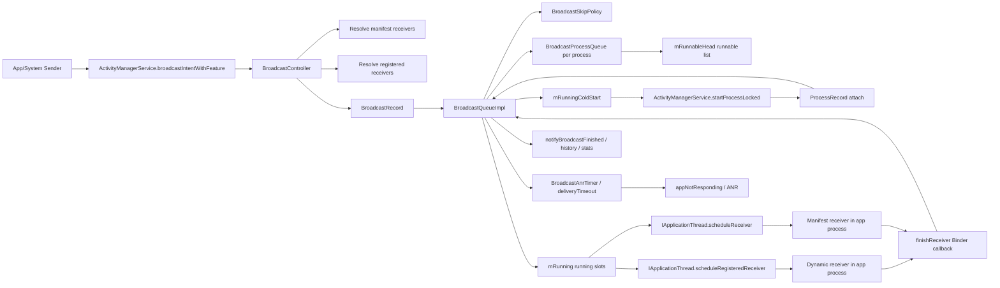
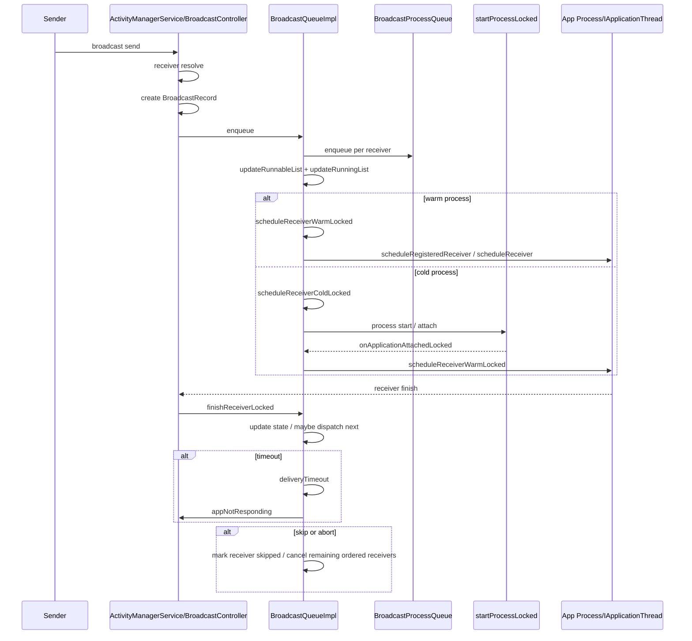

# AMS Broadcast Dispatch 源码分析

基于源码树：`/Users/yuchuan.gu/Workspace/MX/AOSP_Frameworks`

## 版本前提与结论边界

这棵源码树中不存在单独命名的 `BroadcastQueueModernImpl.java`，但从实现结构看，当前 AMS 广播队列已经是 modern broadcast queue 设计：

- 入口与 receiver 解析在 `BroadcastController`
- 调度中枢在 `BroadcastQueueImpl`
- per-process 队列与 runnable/running 状态在 `BroadcastProcessQueue`

因此，下文中提到的"modern queue / modern broadcast queue"，都对应这棵树里的 `BroadcastQueueImpl + BroadcastProcessQueue` 组合，而不是另一个缺失的文件名。

## 1. AMS Broadcast 主调用链

### 1.1 发送入口

1. App 或 system 进程通过 Binder 调 `ActivityManagerService.broadcastIntentWithFeature()`。
2. `ActivityManagerService` 直接把调用转发给 `BroadcastController.broadcastIntentWithFeature()`。
3. `BroadcastController` 在 `synchronized (mService)` 下做发送合法性校验、sticky 处理、user 处理、权限/受保护广播校验。

关键入口：

- `ActivityManagerService.broadcastIntentWithFeature()` -> `BroadcastController.broadcastIntentWithFeature()`
- `BroadcastController.broadcastIntentLocked()` -> `broadcastIntentLockedTraced()`

进程/线程/锁：

- 发送端通常在 caller 进程 Binder 线程发起
- 进入 `system_server`
- AMS 主锁：`synchronized (mService)`
- 这里没有切到单独 Handler 才做解析，receiver resolve 和 `BroadcastRecord` 创建都在 AMS 锁内完成

### 1.2 AMS 接收与 BroadcastRecord 创建

`BroadcastController.broadcastIntentLockedTraced()` 做几件核心事：

1. 规范化 Intent flags
2. 查询静态 receiver（manifest）
3. 查询动态 receiver（`BroadcastFilter`）
4. 合并并按 priority 插入 registered receiver
5. 构造 `BroadcastRecord`
6. 调 `mBroadcastQueue.enqueueBroadcastLocked(r)`

关键点：

- 广播在 AMS 中首先被建模为一个 `BroadcastRecord`
- `BroadcastRecord.receivers` 是"目标接收者列表"
- ordered / sticky / resultTo / timeoutExempt / background start privileges 等调度语义都编码进 `BroadcastRecord`

### 1.3 接收者解析与分发准备

解析和预过滤主要分两层：

1. `BroadcastController` 层：resolve 动态/静态 receiver，并做 component 可见性、系统广播检查、用户过滤。
2. `BroadcastSkipPolicy` 层：在 enqueue 时和 dispatch 前都可再次决定某个 receiver 是否应被跳过。

这意味着 skip policy 不是一次性静态筛选，而是"两阶段"：

- enqueue 前预筛：避免无意义入队
- dispatch 前复检：基于更晚的进程/权限/运行态做最终裁决

### 1.4 parallel / ordered dispatch 主路径

这棵树不再维护一个"全局串行队列 + 全局并行队列"的旧模型，而是改成：

- 每个目标进程一个 `BroadcastProcessQueue`
- 每个队列内部有 `pending / pendingUrgent / pendingOffload / active`
- AMS 维护全局 `mRunnableHead` 和 `mRunning[]`

真正的 parallel / ordered 差异体现在两个层次：

1. **跨进程层面**  
   多个 `BroadcastProcessQueue` 可以并行进入 `mRunning[]`，所以广播整体是"按进程并发"推进的。

2. **单 receiver 层面**  
   `BroadcastRecord` 若为 ordered，则当前 receiver finish 后才会推进同一 `BroadcastRecord` 后续 receiver；abort 也只对 ordered 语义生效。

因此，modern queue 的 parallel / serial 差异不是"两个完全独立的总队列"，而是：

- 并行性由 per-process queue + `updateRunningListLocked()` 控制
- 有序性由 `BroadcastRecord` 的 receiver 状态推进控制

### 1.5 cold-start / process attach / receiver schedule 路径

冷启动是这条链最显著的分叉：

1. `updateRunningListLocked()` 发现 queue runnable，但目标进程不 warm。
2. 仅允许一个 `mRunningColdStart` 挂起中的冷启动。
3. `scheduleReceiverColdLocked()` 调 `mService.startProcessLocked(...)`。
4. 进程 attach 后，AMS 回调 `onApplicationAttachedLocked(app)`。
5. 如果 attach 的正是 `mRunningColdStart`，则继续 `scheduleReceiverWarmLocked(queue)` 投递 receiver。

这里的关键含义：

- 冷启动 receiver 并不是"直接 scheduleReceiver"
- 它先把 queue 提升为 running，再挂起等待进程 attach
- attach 回调才把同一个 active broadcast 接上 warm dispatch 主线

### 1.6 finish / timeout / skip / abort 收敛路径

receiver 收敛主要有四条：

1. **正常 finish**  
   app 调 `ActivityManagerService.finishReceiver()` -> `BroadcastController.finishReceiver()` -> `BroadcastQueueImpl.finishReceiverLocked()`

2. **skip**  
   enqueue 阶段被 `BroadcastSkipPolicy.shouldSkipAtEnqueueMessage()` 过滤，或 dispatch 前被 `shouldSkipReceiver()` 过滤

3. **timeout / ANR**  
   `dispatchReceivers()` 启动 `BroadcastAnrTimer`，超时走 `deliveryTimeoutLocked()` -> `finishReceiverActiveLocked(... DELIVERY_TIMEOUT ...)` -> `appNotResponding()`

4. **abort（ordered only）**  
   `finishReceiverLocked()` 写回 `resultAbort` 后，把后续 receiver 全部标记为 `DELIVERY_SKIPPED`

## 2. BroadcastQueueImpl 在整条链中的角色

`BroadcastQueueImpl` 不是简单队列容器，而是显式状态机 + 调度中枢：

- 它负责把 `BroadcastRecord` 拆成"每个 receiver 对应一个 per-process entry"
- 它维护 runnable/running/cold-start 三套状态
- 它决定何时 promote、何时冷启动、何时 warm dispatch、何时 timeout、何时 demote
- 它把 receiver 完成、进程 attach、进程异常这些异步事件重新收敛回统一状态推进函数

`BroadcastProcessQueue` 则是这个状态机的局部载体：

- 记录某个 `(processName, uid)` 的所有待投递 receiver
- 维护 active receiver、pending receiver、runnableAt、defer 状态与统计计数

## 3. 模块架构图



说明：

- AMS 必须作为统一调度中心，因为广播同时涉及权限、用户态、后台限制、进程生命周期、冷启动、ANR 和结果回传；这些状态只有 AMS 能集中收敛。
- modern queue 选择显式状态推进，而不是线性"for 循环直接发完"，因为广播分发中间会跨 Binder、跨进程启动、跨 Handler 定时器，并且随时可能被 skip、abort、retry、timeout 打断。
- 这种设计提升了正确性和可控性：receiver 何时 active、何时 timeout、何时重排、何时退让给其他进程都可被显式表达。代价是实现复杂度明显高于旧式线性队列。

## 4. 关键时序图



阶段说明：

- `broadcast send`：`ActivityManagerService.broadcastIntentWithFeature()` / `BroadcastController.broadcastIntentWithFeature()`
- `enqueue`：`BroadcastController.broadcastIntentLockedTraced()` 创建 `BroadcastRecord` 后进入 `BroadcastQueueImpl.enqueueBroadcastLocked()`
- `receiver resolve`：发生在 `BroadcastController` 内部，manifest 与 registered receiver 都在这里合并
- `dispatch`：AMS 内部状态推进由 `updateRunnableList()` / `updateRunningListLocked()` / `scheduleReceiverWarmLocked()` 完成
- `process start / attach`：跨进程启动由 `startProcessLocked()` 发起，attach 回调再返回 AMS
- `receiver finish`：跨进程 Binder 回调 `finishReceiver()`
- `timeout / skip / abort handling`：完全由 AMS 内部 `BroadcastQueueImpl` 收敛

其中：

- `BroadcastRecord` 的发送参数在 enqueue 阶段写入
- receiver 的 delivery state 在 enqueue、schedule、finish、timeout 阶段持续写入/收敛
- 跨进程步骤主要是 `scheduleReceiver*()` 和 `finishReceiver()`
- runnable/running/cold-start 切换都属于 AMS 内部状态机

## 5. 关键代码分析

### 5.1 入口点：BroadcastRecord 创建并进入队列

#### （1）代码标题

发送入口把解析后的 receiver 列表封装成 `BroadcastRecord`，并交给 AMS 广播队列。

#### （2）源码位置

- 文件：`base/services/core/java/com/android/server/am/BroadcastController.java`
- 类：`BroadcastController`
- 方法：`broadcastIntentLockedTraced`
- 行号：约 859-1158

#### （3）源码片段

```java
final int broadcastIntentLockedTraced(ProcessRecord callerApp, String callerPackage,
        @Nullable String callerFeatureId, Intent intent, String resolvedType,
        ProcessRecord resultToApp, IIntentReceiver resultTo, int resultCode, String resultData,
        Bundle resultExtras, String[] requiredPermissions,
        String[] excludedPermissions, String[] excludedPackages, int appOp,
        BroadcastOptions brOptions, boolean ordered, boolean sticky, int callingPid,
        int callingUid, int realCallingUid, int realCallingPid,
        @CanBeALL @CanBeCURRENT @UserIdInt int userId,
        BackgroundStartPrivileges backgroundStartPrivileges,
        @Nullable int[] broadcastAllowList,
        @Nullable BiFunction<Integer, Bundle, Bundle> filterExtrasForReceiver,
        @NonNull BroadcastSentEventRecord broadcastSentEventRecord) {
    // Ensure all internal loopers are registered for idle checks
    BroadcastLoopers.addMyLooper();

    // ... 权限校验、用户校验、protected broadcast 检查 ...

    // 规范化 Intent flags
    intent = new Intent(intent);
    
    // By default broadcasts do not go to stopped apps.
    intent.addFlags(Intent.FLAG_EXCLUDE_STOPPED_PACKAGES);

    // ... receiver 解析逻辑 ...

    // 创建 BroadcastRecord 并入队
    if ((receivers != null && receivers.size() > 0)
            || resultTo != null) {
        BroadcastQueue queue = mBroadcastQueue;
        BroadcastRecord r = new BroadcastRecord(queue, intent, callerApp, callerPackage,
                callerFeatureId, callingPid, callingUid, callerInstantApp, resolvedType,
                requiredPermissions, excludedPermissions, excludedPackages, appOp, brOptions,
                receivers, resultToApp, resultTo, resultCode, resultData, resultExtras, ordered,
                sticky, false, userId, -1 /* originalStickyCallingUid */, realCallingUid,
                backgroundStartPrivileges, timeoutExempt, filterExtrasForReceiver,
                callerAppProcessState, mService.mPlatformCompat);
        
        if (DEBUG_BROADCAST || r.debugLog()) {
            Slog.v(TAG_BROADCAST, "Enqueueing broadcast " + r);
        }
        queue.enqueueBroadcastLocked(r);
    }
}
```

#### （4）详细解释

- **阶段**：这段代码位于"receiver resolve 完成后，正式入队"阶段。
- **线程/进程**：运行在 `system_server` 的 Binder 调用路径上，持有 `mService` 锁。
- **输入**：`intent`、调用者身份、解析出的 `receivers`、ordered/sticky/resultTo 等广播语义。
- **输出/副作用**：创建一个完整的 `BroadcastRecord`，并把它交给 `BroadcastQueueImpl`。
- **关键状态对象**：
  - `BroadcastRecord`：一次广播投递的中心数据结构
  - `receivers`：后续会被拆分成多个 per-process 投递项
- **与前后调用链衔接**：
  - 前面是 `BroadcastController` 完成 resolve、权限和用户过滤
  - 后面是 `BroadcastQueueImpl.enqueueBroadcastLocked()` 把 record 拆到具体进程队列
- **关键性**：
  - 广播是否 ordered、是否 sticky、是否 timeoutExempt、是否带 resultTo，都在此时被冻结进记录对象
  - 从这里开始，后续所有状态推进都围绕 `BroadcastRecord` 展开

源码参考：[BroadcastController.java](base/services/core/java/com/android/server/am/BroadcastController.java#L859)

### 5.2 状态推进点：按 receiver 拆分到 per-process queue

#### （1）代码标题

`BroadcastQueueImpl` 把一个 `BroadcastRecord` 拆成多个"receiver -> process queue"项，并在 enqueue 阶段先做一次 skip policy。

#### （2）源码位置

- 文件：`base/services/core/java/com/android/server/am/BroadcastQueueImpl.java`
- 类：`BroadcastQueueImpl`
- 方法：`enqueueBroadcastLocked`
- 行号：约 778-927

#### （3）源码片段

```java
public void enqueueBroadcastLocked(@NonNull BroadcastRecord r) {
    if (DEBUG_BROADCAST || r.debugLog()) {
        logv("Enqueuing " + r + " for " + r.receivers.size() + " receivers");
    }

    final int cookie = traceBegin("enqueueBroadcast");
    r.applySingletonPolicy(mService);
    applyDeliveryGroupPolicy(r);

    r.enqueueTime = SystemClock.uptimeMillis();
    r.enqueueRealTime = SystemClock.elapsedRealtime();
    r.enqueueClockTime = System.currentTimeMillis();
    mHistory.onBroadcastEnqueuedLocked(r);

    boolean enqueuedBroadcast = false;

    for (int i = 0; i < r.receivers.size(); i++) {
        final Object receiver = r.receivers.get(i);
        final BroadcastProcessQueue queue = getOrCreateProcessQueue(
                getReceiverProcessName(receiver), getReceiverUid(receiver));

        // If this receiver is going to be skipped, skip it now itself and don't even enqueue
        // it.
        final String skipReason = mSkipPolicy.shouldSkipAtEnqueueMessage(r, receiver);
        if (skipReason != null) {
            setDeliveryState(null, null, r, i, receiver, BroadcastRecord.DELIVERY_SKIPPED,
                    "skipped by policy at enqueue: " + skipReason);
            continue;
        }

        enqueuedBroadcast = true;
        final BroadcastRecord replacedBroadcast = queue.enqueueOrReplaceBroadcast(
                r, i, mBroadcastConsumerDeferApply);
        if (replacedBroadcast != null) {
            replacedBroadcasts.add(replacedBroadcast);
        }
        updateRunnableList(queue);
        enqueueUpdateRunningList();
    }

    // If nothing to dispatch, send any pending result immediately
    if (r.receivers.isEmpty() || !enqueuedBroadcast) {
        scheduleResultTo(r);
        notifyFinishBroadcast(r);
    }

    traceEnd(cookie);
}
```

#### （4）详细解释

- **阶段**：这是 AMS 内部从"全局广播记录"转成"按进程可调度实体"的关键步骤。
- **线程/进程**：`system_server`，持有 `mService` 锁。
- **输入**：一个 `BroadcastRecord`，其中包含完整 receiver 列表。
- **输出/副作用**：
  - 为每个 receiver 找到对应 `BroadcastProcessQueue`
  - 在 enqueue 阶段应用一次 `BroadcastSkipPolicy`
  - 把 receiver 项插入 per-process pending 队列
  - 触发 `updateRunnableList(queue)` 与异步 `updateRunningList`
- **修改的关键状态**：
  - `BroadcastRecord` 的 per-receiver delivery state
  - `BroadcastProcessQueue` 的 pending/urgent/offload 队列
  - 全局 runnable list
- **与前后调用链衔接**：
  - 前面是 `BroadcastController` 完成 `BroadcastRecord` 创建
  - 后面是 `updateRunningListLocked()` 从 runnable list 里选队列真正开始 dispatch
- **关键性**：
  - 旧模型更像"把 broadcast 放入几个总队列"；这里是"按 receiver 拆到目标进程"
  - 这正是 modern queue 的核心转变：广播调度以 process 为粒度，而不是以单个 record 为唯一队列单位

源码参考：[BroadcastQueueImpl.java](base/services/core/java/com/android/server/am/BroadcastQueueImpl.java#L778)

### 5.3 关键分支：冷启动 receiver 如何接入主线

#### （1）代码标题

目标进程不在运行时，广播不会直接投递，而是先把当前 active receiver 挂到冷启动流程上。

#### （2）源码位置

- 文件：`base/services/core/java/com/android/server/am/BroadcastQueueImpl.java`
- 类：`BroadcastQueueImpl`
- 方法：`scheduleReceiverColdLocked`
- 行号：约 978-1027

#### （3）源码片段

```java
private boolean scheduleReceiverColdLocked(@NonNull BroadcastProcessQueue queue) {
    checkState(queue.isActive(), "isActive");

    // Remember that active broadcast was scheduled via a cold start
    queue.setActiveViaColdStart(true);

    final BroadcastRecord r = queue.getActive();
    final int index = queue.getActiveIndex();
    final Object receiver = r.receivers.get(index);

    // Ignore registered receivers from a previous PID
    if (receiver instanceof BroadcastFilter) {
        mRunningColdStart = null;
        finishReceiverActiveLocked(queue, BroadcastRecord.DELIVERY_SKIPPED,
                "BroadcastFilter for cold app");
        return true;
    }

    final String skipReason = shouldSkipReceiver(queue, r, index);
    if (skipReason != null) {
        mRunningColdStart = null;
        finishReceiverActiveLocked(queue, BroadcastRecord.DELIVERY_SKIPPED, skipReason);
        return true;
    }

    final ApplicationInfo info = ((ResolveInfo) receiver).activityInfo.applicationInfo;
    final ComponentName component = ((ResolveInfo) receiver).activityInfo.getComponentName();

    queue.setActiveWasStopped(info.isStopped());
    queue.setActiveFirstLaunch(info.isNotLaunched());

    final int intentFlags = r.intent.getFlags() | Intent.FLAG_FROM_BACKGROUND;
    final HostingRecord hostingRecord = new HostingRecord(HostingRecord.HOSTING_TYPE_BROADCAST,
            component, r.intent.getAction(), r.getHostingRecordTriggerType());
    final int zygotePolicyFlags = isActivityCapable ? ZYGOTE_POLICY_FLAG_LATENCY_SENSITIVE
            : ZYGOTE_POLICY_FLAG_EMPTY;
    final boolean allowWhileBooting = (r.intent.getFlags()
            & Intent.FLAG_RECEIVER_BOOT_UPGRADE) != 0;

    queue.app = mService.startProcessLocked(queue.processName, info, true, intentFlags,
            hostingRecord, zygotePolicyFlags, allowWhileBooting, false);
    if (queue.app == null) {
        mRunningColdStart = null;
        finishReceiverActiveLocked(queue, BroadcastRecord.DELIVERY_FAILURE,
                "startProcessLocked failed");
        return true;
    }
    queue.setProcessStartInitiatedTimestampMillis(SystemClock.uptimeMillis());
    return false;
}
```

#### （4）详细解释

- **阶段**：位于 `updateRunningListLocked()` 已经把 queue 提升为 running，但发现进程不 warm 之后。
- **线程/进程**：`system_server`，AMS 锁内。
- **输入**：
  - `queue.getActive()`：当前要投递的 active receiver
  - receiver 必须是 manifest receiver（`ResolveInfo`），动态 receiver 不可能合法走冷启动
- **输出/副作用**：
  - 标记 `mActiveViaColdStart`
  - 构建 `HostingRecord(HOSTING_TYPE_BROADCAST)`
  - 调 `startProcessLocked()` 拉起目标进程
  - 记录 `ProcessStartInitiatedTimestamp`
- **修改的关键状态**：
  - `mRunningColdStart`
  - `BroadcastProcessQueue` 中 active receiver 的 cold-start 语义
  - `queue.app`
- **与前后调用链衔接**：
  - 前面：`updateRunningListLocked()` 选择该 runnable queue
  - 后面：等待 `onApplicationAttachedLocked(app)` 回来后进入 `scheduleReceiverWarmLocked()`
- **关键性**：
  - 冷启动把广播 dispatch 从同步路径切成"两段式"
  - 这就是为什么冷启动 receiver 会显著改变广播时序，并引入 attach、pending cold start validity、重试/失败清理等额外状态

源码参考：[BroadcastQueueImpl.java](base/services/core/java/com/android/server/am/BroadcastQueueImpl.java#L978)

### 5.4 收敛点：warm dispatch、finish、timeout 统一回流到队列状态机

#### （1）代码标题

真正的 receiver 投递、ANR 计时与完成回收都收敛在 `dispatchReceivers()` / `finishReceiverLocked()` / `finishReceiverActiveLocked()`。

#### （2）源码位置

- 文件：`base/services/core/java/com/android/server/am/BroadcastQueueImpl.java`
- 类：`BroadcastQueueImpl`
- 方法：`dispatchReceivers`、`finishReceiverLocked`、`finishReceiverActiveLocked`
- 行号：约 1136-1251、1334-1483

#### （3）源码片段

**dispatchReceivers - 启动ANR计时并投递**

```java
private boolean dispatchReceivers(@NonNull BroadcastProcessQueue queue,
        @NonNull BroadcastRecord r, int index) throws BroadcastRetryException {
    final ProcessRecord app = queue.app;
    final Object receiver = r.receivers.get(index);

    // Skip ANR tracking early during boot, when requested, or when we
    // immediately assume delivery success
    final boolean assumeDelivered = r.isAssumedDelivered(index);
    if (mService.mProcessesReady && !r.timeoutExempt && !assumeDelivered) {
        queue.setTimeoutScheduled(true);
        final int softTimeoutMillis = (int) (r.isForeground() ? mFgConstants.TIMEOUT
                : mBgConstants.TIMEOUT);
        startDeliveryTimeoutLocked(queue, softTimeoutMillis);
    }

    setDeliveryState(queue, app, r, index, receiver, BroadcastRecord.DELIVERY_SCHEDULED,
            "scheduleReceiverWarmLocked");

    final Intent receiverIntent = r.getReceiverIntent(receiver);
    final IApplicationThread thread = app.getOnewayThread();
    if (thread != null) {
        try {
            if (receiver instanceof BroadcastFilter) {
                thread.scheduleRegisteredReceiver(
                        ((BroadcastFilter) receiver).receiverList.receiver,
                        receiverIntent, r.resultCode, r.resultData, r.resultExtras,
                        r.ordered, r.initialSticky, assumeDelivered, r.userId,
                        app.getReportedProcState(),
                        r.shareIdentity ? r.callingUid : Process.INVALID_UID,
                        r.shareIdentity ? r.callerPackage : null);
                if (assumeDelivered) {
                    finishReceiverActiveLocked(queue, BroadcastRecord.DELIVERY_DELIVERED,
                            "assuming delivered");
                    return false;
                }
            } else {
                thread.scheduleReceiver(receiverIntent, ((ResolveInfo) receiver).activityInfo,
                        null, r.resultCode, r.resultData, r.resultExtras, r.ordered,
                        assumeDelivered, r.userId,
                        app.getReportedProcState(),
                        r.shareIdentity ? r.callingUid : Process.INVALID_UID,
                        r.shareIdentity ? r.callerPackage : null);
            }
            return true;
        } catch (RemoteException e) {
            app.killLocked("Can't deliver broadcast", ApplicationExitInfo.REASON_OTHER,
                    ApplicationExitInfo.SUBREASON_UNDELIVERED_BROADCAST, true);
            finishReceiverActiveLocked(queue, BroadcastRecord.DELIVERY_FAILURE,
                    "remote app");
            return false;
        }
    }
}
```

**finishReceiverLocked - 处理ordered broadcast结果**

```java
public boolean finishReceiverLocked(@NonNull ProcessRecord app, int resultCode,
        @Nullable String resultData, @Nullable Bundle resultExtras, boolean resultAbort,
        boolean waitForServices) {
    final BroadcastProcessQueue queue = getProcessQueue(app);
    if ((queue == null) || !queue.isActive()) {
        logw("Ignoring finishReceiverLocked; no active broadcast for " + queue);
        return false;
    }

    final BroadcastRecord r = queue.getActive();
    final int index = queue.getActiveIndex();
    if (r.ordered) {
        r.resultCode = resultCode;
        r.resultData = resultData;
        r.resultExtras = resultExtras;
        if (!r.isNoAbort()) {
            r.resultAbort = resultAbort;
        }
    }

    finishReceiverActiveLocked(queue,
            BroadcastRecord.DELIVERY_DELIVERED, "remote app");

    // When the caller aborted an ordered broadcast, we mark all
    // remaining receivers as skipped
    if (r.resultAbort) {
        for (int i = index + 1; i < r.receivers.size(); i++) {
            setDeliveryState(null, null, r, i, r.receivers.get(i),
                    BroadcastRecord.DELIVERY_SKIPPED, "resultAbort");
        }
    }

    if (shouldRetire(queue)) {
        demoteFromRunningLocked(queue);
        return true;
    }

    queue.makeActiveNextPending();
    try {
        if (scheduleReceiverWarmLocked(queue)) {
            demoteFromRunningLocked(queue);
            return true;
        }
    } catch (BroadcastRetryException e) {
        finishOrReEnqueueActiveBroadcast(queue);
        demoteFromRunningLocked(queue);
        return true;
    }

    return false;
}
```

**finishReceiverActiveLocked - 处理timeout**

```java
private void finishReceiverActiveLocked(@NonNull BroadcastProcessQueue queue,
        @DeliveryState int deliveryState, @NonNull String reason) {
    if (!queue.isActive()) {
        logw("Ignoring finishReceiverActiveLocked; no active broadcast for " + queue);
        return;
    }

    final int cookie = traceBegin("finishReceiver");
    final ProcessRecord app = queue.app;
    final BroadcastRecord r = queue.getActive();
    final int index = queue.getActiveIndex();
    final Object receiver = r.receivers.get(index);

    setDeliveryState(queue, app, r, index, receiver, deliveryState, reason);

    if (deliveryState == BroadcastRecord.DELIVERY_TIMEOUT) {
        r.anrCount++;
        if (app != null && !app.isDebugging()) {
            final String packageName = getReceiverPackageName(receiver);
            final String className = getReceiverClassName(receiver);
            TimeoutRecord tr = TimeoutRecord.forBroadcastReceiver(r.intent, packageName,
                    className);
            mAnrTimer.accept(queue, tr);
            mService.appNotResponding(queue.app, tr);
        } else {
            mAnrTimer.discard(queue);
        }
    } else if (queue.timeoutScheduled()) {
        cancelDeliveryTimeoutLocked(queue);
    }

    checkAndRemoveWaitingFor();

    traceEnd(cookie);
}
```

#### （4）详细解释

- **阶段**：
  - `dispatchReceivers()`：warm dispatch 之前/之中
  - `finishReceiverLocked()`：app 侧 `finishReceiver()` Binder 回调后
  - `finishReceiverActiveLocked()`：统一终态收敛点
- **线程/进程**：
  - 状态推进都在 `system_server` 内、AMS 锁下
  - 真正执行 receiver 的动作发生在目标 app 进程
- **输入**：
  - `dispatchReceivers()` 输入是 active `queue/r/index`
  - `finishReceiverLocked()` 输入是目标 app 回传的 resultCode/resultData/resultExtras/resultAbort
- **输出/副作用**：
  - 启动或取消 ANR timer
  - 更新 per-receiver delivery state
  - 对 ordered broadcast 写回结果并传播 abort
  - 必要时触发 `appNotResponding`
- **修改的关键状态**：
  - `BroadcastRecord` 的 `dispatchTime`、result 字段、`resultAbort`、delivery state、`anrCount`
  - `BroadcastProcessQueue` 的 active 状态与 timeoutScheduled
- **与前后调用链衔接**：
  - 前面是 warm dispatch 或 attach 之后的投递
  - 后面是继续下一个 pending receiver、demote queue，或触发 ANR/cleanup
- **关键性**：
  - 这一组三个方法把"正常完成、assume delivered、abort、timeout、remote exception"统一折叠回队列状态机
  - 它们是整个 AMS broadcast dispatch 主线真正的收敛中心

源码参考：

- [BroadcastQueueImpl.java](base/services/core/java/com/android/server/am/BroadcastQueueImpl.java#L1136)
- [BroadcastQueueImpl.java](base/services/core/java/com/android/server/am/BroadcastQueueImpl.java#L1334)
- [BroadcastQueueImpl.java](base/services/core/java/com/android/server/am/BroadcastQueueImpl.java#L1418)

### 5.5 调度核心：updateRunningListLocked 状态推进

#### （1）代码标题

`updateRunningListLocked()` 是 modern broadcast queue 的核心调度函数，负责从 runnable list 中选择队列并提升为 running 状态。

#### （2）源码位置

- 文件：`base/services/core/java/com/android/server/am/BroadcastQueueImpl.java`
- 类：`BroadcastQueueImpl`
- 方法：`updateRunningListLocked`
- 行号：约 449-598

#### （3）源码片段

```java
private void updateRunningListLocked() {
    // Allocated size here implicitly includes the extra reservation for urgent
    // dispatches beyond the MAX_RUNNING_QUEUES soft limit for normal
    // parallelism.
    final int usedExtra = Math.min(getRunningUrgentCount(),
            mConstants.EXTRA_RUNNING_URGENT_PROCESS_QUEUES);
    int avail = mRunning.length - getRunningSize() - usedExtra;
    if (avail == 0) return;

    final int cookie = traceBegin("updateRunningList");
    final long now = SystemClock.uptimeMillis();

    // If someone is waiting for a state, everything is runnable now
    final boolean waitingFor = !mWaitingFor.isEmpty();

    // We're doing an update now, so remove any future update requests;
    // we'll repost below if needed
    mLocalHandler.removeMessages(MSG_UPDATE_RUNNING_LIST);

    boolean updateOomAdj = false;
    BroadcastProcessQueue queue = mRunnableHead;
    while (queue != null && avail > 0) {
        BroadcastProcessQueue nextQueue = queue.runnableAtNext;
        final long runnableAt = queue.getRunnableAt();

        // When broadcasts are skipped or failed during list traversal, we
        // might encounter a queue that is no longer runnable; skip it
        if (!queue.isRunnable()) {
            queue = nextQueue;
            continue;
        }

        // If we've hit the soft limit for non-urgent dispatch parallelism,
        // only consider delivering from queues whose ready broadcast is urgent
        if (getRunningSize() >= mConstants.MAX_RUNNING_PROCESS_QUEUES) {
            if (!queue.isPendingUrgent()) {
                queue = nextQueue;
                continue;
            }
        }

        // If queues beyond this point aren't ready to run yet, schedule
        // another pass when they'll be runnable
        if (runnableAt > now && !waitingFor) {
            mLocalHandler.sendEmptyMessageAtTime(MSG_UPDATE_RUNNING_LIST, runnableAt);
            break;
        }

        // Clear the deferred state of broadcasts in this queue
        queue.clearDeferredStates(mBroadcastConsumerDeferClear);

        // We might not have heard about a newly running process yet, so
        // consider refreshing if we think we're cold
        updateWarmProcess(queue);

        final boolean processWarm = queue.isProcessWarm();
        if (processWarm) {
            mService.unfreezeTemporarily(queue.app,
                    CachedAppOptimizer.UNFREEZE_REASON_START_RECEIVER);
        } else {
            // We only offer to run one cold-start at a time to preserve
            // system resources
            if (mRunningColdStart == null) {
                mRunningColdStart = queue;
                mRunningColdStart.clearProcessStartInitiatedTimestampMillis();
            } else if (isPendingColdStartValid()) {
                // Move to considering next runnable queue
                queue = nextQueue;
                continue;
            } else {
                // Pending cold start is not valid, so clear it and move on.
                clearInvalidPendingColdStart();
                mRunningColdStart = queue;
                mRunningColdStart.clearProcessStartInitiatedTimestampMillis();
            }
        }

        promoteToRunningLocked(queue);
        boolean completed;
        if (processWarm) {
            updateOomAdj |= queue.runningOomAdjusted;
            try {
                completed = scheduleReceiverWarmLocked(queue);
            } catch (BroadcastRetryException e) {
                finishOrReEnqueueActiveBroadcast(queue);
                completed = true;
            }
        } else {
            completed = scheduleReceiverColdLocked(queue);
        }
        if (completed) {
            demoteFromRunningLocked(queue);
        }
        avail--;

        queue = nextQueue;
    }

    if (updateOomAdj) {
        mService.updateOomAdjPendingTargetsLocked(OOM_ADJ_REASON_START_RECEIVER);
    }

    checkPendingColdStartValidityLocked();
    checkAndRemoveWaitingFor();

    traceEnd(cookie);
}
```

#### （4）详细解释

- **阶段**：这是从 runnable list 到 running list 的核心调度阶段。
- **线程/进程**：`system_server`，AMS 锁内，运行在 Handler 线程。
- **输入**：`mRunnableHead` 链表头，包含所有 runnable 的 per-process queue。
- **输出/副作用**：
  - 选择合适的 queue 提升到 `mRunning[]`
  - 调用 `scheduleReceiverWarmLocked()` 或 `scheduleReceiverColdLocked()`
  - 更新 OOM adj
  - 处理 cold start 有效性检查
- **修改的关键状态**：
  - `mRunning[]` 数组
  - `mRunnableHead` 链表
  - `mRunningColdStart`
  - `BroadcastProcessQueue` 的 running/runnable 状态
- **与前后调用链衔接**：
  - 前面：`enqueueBroadcastLocked()` 触发 `enqueueUpdateRunningList()`
  - 后面：`scheduleReceiverWarmLocked()` / `scheduleReceiverColdLocked()` 进行实际投递
- **关键性**：
  - 这是 modern queue 调度公平性的核心实现
  - 通过 `runnableAt` 排序保证公平性
  - 通过 `MAX_RUNNING_PROCESS_QUEUES` 控制并行度
  - 通过 urgent 优先级保证关键广播的响应速度
  - 通过单 cold start 限制保护系统资源

源码参考：[BroadcastQueueImpl.java](base/services/core/java/com/android/server/am/BroadcastQueueImpl.java#L449)

## 6. 补充观察

### 6.1 per-process queue 才是 modern queue 的核心结构

`BroadcastProcessQueue.enqueueOrReplaceBroadcast()` 与 `makeActiveNextPending()` 说明，AMS 不再把"一个广播"当成唯一推进单位，而是把"某广播发给某 receiver"拆散后按进程调度：

- 同一进程的多个 receiver 可以局部串行推进
- 不同进程则通过 `mRunning[]` 并发
- `runnableAt` 决定公平性、延迟与优先级

源码参考：

- [BroadcastProcessQueue.java](base/services/core/java/com/android/server/am/BroadcastProcessQueue.java#L305)
- [BroadcastProcessQueue.java](base/services/core/java/com/android/server/am/BroadcastProcessQueue.java#L703)
- [BroadcastProcessQueue.java](base/services/core/java/com/android/server/am/BroadcastProcessQueue.java#L1109)

### 6.2 调度公平性来自 runnable/running 分离

`updateRunningListLocked()` 明确体现：

- runnable list 按 `runnableAt` 排序
- running slot 数量受上限控制
- warm process 优先于等待中的额外 cold start
- urgent broadcast 可以突破正常 soft limit 的一小部分并行度

这说明当前实现不是简单 FIFO，而是兼顾公平性、响应性和系统负载的调度器。

源码参考：[BroadcastQueueImpl.java](base/services/core/java/com/android/server/am/BroadcastQueueImpl.java#L449)

### 6.3 可观测性挂点

这条主线上的关键观测点包括：

- Trace：`traceBegin/traceEnd` 包住 enqueue、updateRunningList、scheduleReceiverWarmLocked、deliveryTimeout、finishReceiver
- Stats/history：`BroadcastSentEventRecord`、`BroadcastHistory`
- dumpsys：`BroadcastQueue.dumpLocked()` / `describeStateLocked()`
- ANR：`TimeoutRecord.forBroadcastReceiver()` + `appNotResponding()`

这些观测点能够把 logcat、trace、dumpsys activity broadcasts 重新映射回上述状态机节点。

## 7. 关键类与文件索引

| 类名 | 文件路径 | 职责 |
|------|----------|------|
| `BroadcastController` | `base/services/core/java/com/android/server/am/BroadcastController.java` | 广播入口，receiver解析，权限校验 |
| `BroadcastQueueImpl` | `base/services/core/java/com/android/server/am/BroadcastQueueImpl.java` | 广播队列核心实现，状态机管理 |
| `BroadcastProcessQueue` | `base/services/core/java/com/android/server/am/BroadcastProcessQueue.java` | 每个目标进程的广播队列 |
| `BroadcastRecord` | `base/services/core/java/com/android/server/am/BroadcastRecord.java` | 广播记录，包含所有receiver信息 |
| `BroadcastSkipPolicy` | `base/services/core/java/com/android/server/am/BroadcastSkipPolicy.java` | 广播跳过策略 |
| `BroadcastHistory` | `base/services/core/java/com/android/server/am/BroadcastHistory.java` | 广播历史记录 |
| `BroadcastConstants` | `base/services/core/java/com/android/server/am/BroadcastConstants.java` | 广播常量配置 |

---

**最后更新**: 2026年3月29日  
**适用项目**: AOSP Frameworks源码分析  
**源码版本**: AOSP 16
