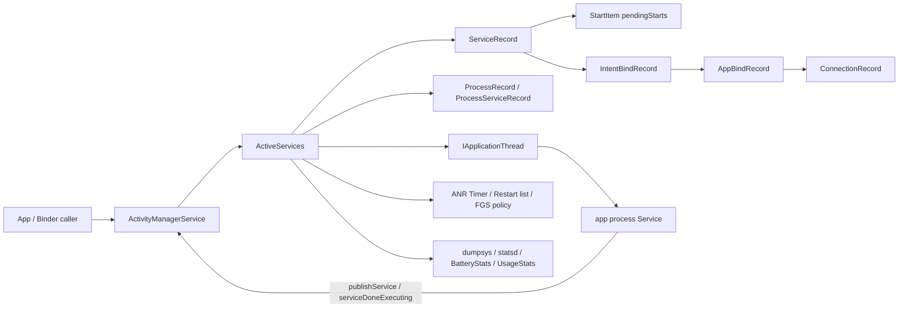
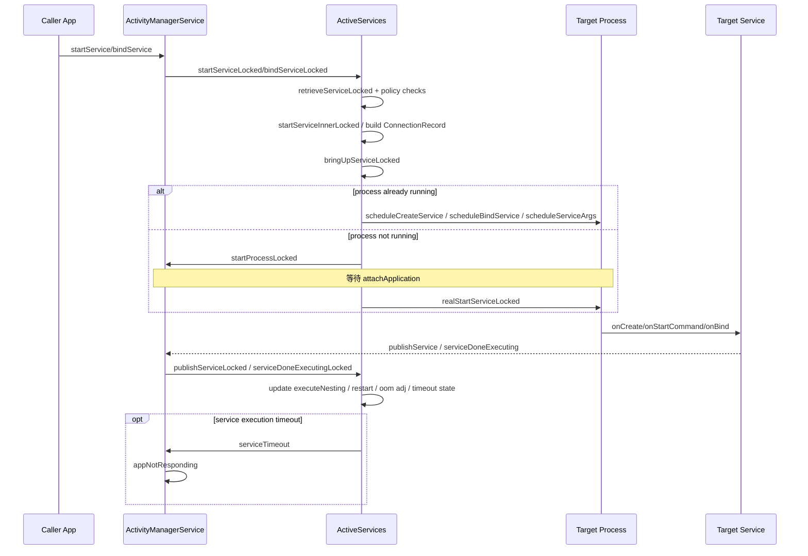

# AOSP AMS Service 源码分析

## 0. 分析范围

- 分析目录：`Workspace/MX/AOSP_Frameworks`
- 主题：AMS 中 Service 的启动、绑定、创建、执行、超时、重启、前台服务管理
- 这棵源码树里 Service 主线核心类：
  - `ActivityManagerService`
  - `ActiveServices`
  - `ServiceRecord`
  - `IntentBindRecord`
  - `AppBindRecord`
  - `ConnectionRecord`

## 1. 主调用链

### 1.1 startService / bindService / stopService 入口

1. 应用经 Binder 调用 `ActivityManagerService.startService()` / `bindService()` / `stopService()`
2. `ActivityManagerService` 做调用者校验、FD 泄漏保护、trace 包裹，然后在 `synchronized (this)` 下转发给 `mServices`
3. `mServices` 即 `ActiveServices`

源码入口：

- `ActivityManagerService.startService()`：`base/services/core/java/com/android/server/am/ActivityManagerService.java:13757-13823`
- `ActivityManagerService.stopService()`：`base/services/core/java/com/android/server/am/ActivityManagerService.java:13836-13863`
- `ActivityManagerService.bindServiceInstance()`：`base/services/core/java/com/android/server/am/ActivityManagerService.java:13989-14052`
- `ActivityManagerService.publishService()` / `serviceDoneExecuting()`：`base/services/core/java/com/android/server/am/ActivityManagerService.java:14096-14133`

### 1.2 startService 主线

1. `ActiveServices.startServiceLocked()` 通过 `retrieveServiceLocked()` 找到或创建 `ServiceRecord`
2. 执行：
   - 后台启动/FGS 启动限制
   - app-op 检查
   - permission review 检查
   - package frozen 延迟启动
3. `startServiceInnerLocked()` 将 `StartItem` 放入 `ServiceRecord.pendingStarts`
4. `bringUpServiceLocked()` 决定：
   - 若进程已存活：直接 `realStartServiceLocked()` 或 `sendServiceArgsLocked()`
   - 若进程未存活：`startProcessLocked()`，把 `ServiceRecord` 放入 `mPendingServices`
5. app 进程 attach 后，AMS 会继续 `realStartServiceLocked()`
6. `realStartServiceLocked()` 调 `IApplicationThread.scheduleCreateService()`
7. 然后 `sendServiceArgsLocked()` 调 `scheduleServiceArgs()` 触发 `onStartCommand()`
8. app 端完成后回调 `serviceDoneExecuting()`
9. AMS 在 `serviceDoneExecutingLocked()` 中根据返回值决定：
   - 是否移除 delivered start
   - 是否 redelivery
   - 是否 `stopIfKilled`
   - 是否继续保活 / 可重启

### 1.3 bindService 主线

1. `bindServiceLocked()` 解析目标 service，建立 `ConnectionRecord`
2. 按 `Intent.FilterComparison` 找到或创建 `IntentBindRecord`
3. 为每个 client 维护 `AppBindRecord`
4. 如果目标 service 尚未运行，也走 `bringUpServiceLocked()`
5. `requestServiceBindingLocked()` 调 `IApplicationThread.scheduleBindService()`
6. service 端 `onBind()` 结果经 `publishService()` 回到 AMS
7. AMS 把 binder 分发给所有 waiting 的连接方

### 1.4 超时 / 重启 / 前台服务主线

1. 任何 create/start/bind/unbind/destroy 进入 app 前，`bumpServiceExecutingLocked()` 增加 `executeNesting`
2. 若这是该进程第一个 executing service，则调度 `scheduleServiceTimeoutLocked()`
3. 超时触发 `serviceTimeout(proc)`，遍历 `ProcessServiceRecord` 找到超时的 `ServiceRecord`
4. 构造 `TimeoutRecord.forServiceExec()`，最终交给 `mAm.mAnrHelper.appNotResponding()`
5. 若 service 进程死亡或创建失败，可进入 `scheduleServiceRestartLocked()` / `performServiceRestartLocked()`
6. 若 service 通过 `startForeground()` 进入 FGS，则经过 `setServiceForegroundInnerLocked()` 完成权限、type、app-op、BFSL、notification 以及短时 FGS 规则检查

### 1.5 线程/进程/等待点

- 主控线程：`system_server` 中 AMS 锁内
- 跨进程边界：
  - `IApplicationThread.scheduleCreateService()`
  - `IApplicationThread.scheduleServiceArgs()`
  - `IApplicationThread.scheduleBindService()`
- 等待点：
  - 目标进程启动与 attach
  - app 回调 `publishService()` / `serviceDoneExecuting()`
  - ANR 定时器等待
  - FGS `startForegroundService() -> startForeground()` 转换超时等待

## 2. 架构图



### 架构设计意图

- `ActivityManagerService` 只保留 Binder 对外入口与系统级锁边界。
- `ActiveServices` 集中管理 Service 语义，是整个 Service 子系统的状态机中心。
- `ServiceRecord` 是单个 service 实例的总状态容器，既覆盖 started service，也覆盖 bound service。
- `IntentBindRecord -> AppBindRecord -> ConnectionRecord` 把“某个绑定 intent”“某个 client”“某条连接”拆成三层，避免把绑定状态揉成一个平面结构。
- `ProcessServiceRecord` 负责从宿主进程角度统计 executing/bound/fg service，对 ANR 与 OOM 调整有直接影响。

### 设计收益与代价

- 正确性：start 与 bind 两条路径最终都收敛到 `bringUpServiceLocked()` / `realStartServiceLocked()`
- 性能：同一个已存活进程可直接发送 args/bind，避免重复拉起
- 可恢复性：失败和进程死亡统一走 restart 机制
- 稳定性：所有跨进程执行点都配套 `executeNesting + timeout`
- 代价：前台服务限制、后台启动限制、绑定优先级、重启策略都叠在 `ActiveServices`，复杂度很高

## 3. 时序图



## 4. 关键源码逐段分析

### 4.1 Binder 入口统一收敛到 `ActiveServices`

源码文件：`base/services/core/java/com/android/server/am/ActivityManagerService.java`  
行号：`13765-13817`、`14008-14049`、`14125-14133`

```java
// ActivityManagerService.java:13765-13817
private ComponentName startService(IApplicationThread caller, Intent service,
        String resolvedType, boolean requireForeground, String callingPackage,
        String callingFeatureId, int userId, ...) throws TransactionTooLargeException {
    enforceNotIsolatedCaller("startService");
    addCreatorToken(service, callingPackage);
    final int callingPid = Binder.getCallingPid();
    final int callingUid = Binder.getCallingUid();
    final long origId = Binder.clearCallingIdentity();
    try {
        synchronized (this) {
            return mServices.startServiceLocked(caller, service,
                    resolvedType, callingPid, callingUid,
                    requireForeground, callingPackage, callingFeatureId, userId, ...);
        }
    } finally {
        Binder.restoreCallingIdentity(origId);
    }
}

// ActivityManagerService.java:14008-14049
private int bindServiceInstance(IApplicationThread caller, IBinder token, Intent service,
        String resolvedType, IServiceConnection connection, long flags, String instanceName, ...)
        throws TransactionTooLargeException {
    enforceNotIsolatedCaller("bindService");
    addCreatorToken(service, callingPackage);
    synchronized (this) {
        return mServices.bindServiceLocked(caller, token, service, resolvedType, connection,
                flags, instanceName, ..., callingPackage, userId);
    }
}

// ActivityManagerService.java:14125-14133
public void serviceDoneExecuting(IBinder token, int type, int startId, int res) {
    synchronized(this) {
        mServices.serviceDoneExecutingLocked((ServiceRecord) token, type, startId, res, false);
    }
}
```

解释：

- 这是所有 Service 行为的系统入口与收敛入口。
- `AMS` 本身不处理细节，而是把 Service 语义委托给 `ActiveServices`。
- 调用边界十分明确：
  - 入口：`startService` / `bindService`
  - 回流：`publishService` / `serviceDoneExecuting`
- 这也解释了为什么 Service 分析必须以 `ActiveServices` 为核心，而不是只看 `AMS`。

### 4.2 started service 的排队与启动控制

源码文件：`base/services/core/java/com/android/server/am/ActiveServices.java`  
行号：`1207-1329`

```java
// ActiveServices.java:1207-1329
private ComponentName startServiceInnerLocked(ServiceRecord r, Intent service,
        int callingUid, int callingPid, String callingProcessName,
        int callingProcessState, boolean fgRequired, boolean callerFg,
        BackgroundStartPrivileges backgroundStartPrivileges, String callingPackage)
        throws TransactionTooLargeException {
    NeededUriGrants neededGrants = mAm.mUgmInternal.checkGrantUriPermissionFromIntent(
            service, callingUid, r.packageName, r.userId);
    final boolean wasStartRequested = r.isStartRequested();
    mAm.mProcessStateController.setServiceLastActivityTime(r, SystemClock.uptimeMillis());
    mAm.mProcessStateController.setStartRequested(r, true);
    r.delayedStop = false;
    r.fgRequired = fgRequired;
    r.pendingStarts.add(new ServiceRecord.StartItem(r, false, r.makeNextStartId(),
            service, neededGrants, callingUid, callingProcessName, callingPackage,
            callingProcessState));

    // 非前台 caller 且目标进程没起来时，可能进入 delayed-start 节流
    if (!callerFg && !fgRequired && r.app == null
            && mAm.mUserController.hasStartedUserState(r.userId)) {
        ProcessRecord proc = mAm.getProcessRecordLocked(r.processName, r.appInfo.uid);
        if (proc == null || proc.getCurProcState() > PROCESS_STATE_RECEIVER) {
            if (smap.mStartingBackground.size() >= mMaxStartingBackground) {
                smap.mDelayedStartList.add(r);
                r.delayed = true;
                return r.name;
            }
            addToStarting = true;
        }
    }

    ComponentName cmp = startServiceInnerLocked(smap, service, r, callerFg, addToStarting,
            callingUid, callingProcessName, callingProcessState,
            wasStartRequested, callingPackage);
    return cmp;
}
```

解释：

- 这段处在 `startServiceLocked()` 通过各类策略校验之后，是 started service 进入状态机的真正写点。
- 关键状态写入：
  - `setStartRequested(r, true)`
  - `r.fgRequired = fgRequired`
  - `r.pendingStarts.add(StartItem)`
- 这里还包含一个非常重要的系统健康策略：`mDelayedStartList` 背景 service 启动节流。
- 因此，started service 并不是“立刻执行”，而是先转成 `ServiceRecord` 上的待执行状态，再进入 bring-up 阶段。

### 4.3 `bringUpServiceLocked`：已运行进程直接投递，否则拉起进程

源码文件：`base/services/core/java/com/android/server/am/ActiveServices.java`  
行号：`5942-6153`

```java
// ActiveServices.java:5942-6153
private String bringUpServiceInnerLocked(ServiceRecord r, int intentFlags, boolean execInFg,
        boolean whileRestarting, boolean permissionsReviewRequired, boolean packageFrozen,
        boolean enqueueOomAdj, int serviceBindingOomAdjPolicy)
        throws TransactionTooLargeException {
    if (r.app != null && r.app.isThreadReady()) {
        r.updateOomAdjSeq();
        sendServiceArgsLocked(r, execInFg, false);  // 进程已好，直接投递 start args
        return null;
    }

    if (!whileRestarting && mRestartingServices.contains(r)) {
        return null;  // 还在等待 restart，先不重复 bring up
    }

    if (!mAm.mUserController.hasStartedUserState(r.userId)) {
        bringDownServiceLocked(r, enqueueOomAdj);
        return "... user is stopped";
    }

    ProcessRecord app;
    if (!isolated) {
        app = mAm.getProcessRecordLocked(procName, r.appInfo.uid);
        if (app != null && app.isThreadReady()) {
            realStartServiceLocked(r, app, thread, pid, uidRecord, execInFg,
                    enqueueOomAdj, serviceBindingOomAdjPolicy);
            return null;  // 已有 warm 进程，直接 scheduleCreateService
        }
    }

    // 进程不在，真正拉起目标进程
    if (app == null && !permissionsReviewRequired && !packageFrozen) {
        app = mAm.startProcessLocked(procName, r.appInfo, true, intentFlags, hostingRecord,
                policy, false, isolated);
        if (app == null) {
            bringDownServiceLocked(r, enqueueOomAdj);
            return "... process is bad";
        }
    }

    if (r.fgRequired) {
        mAm.tempAllowlistUidLocked(r.appInfo.uid,
                mAm.mConstants.mServiceStartForegroundTimeoutMs, REASON_SERVICE_LAUNCH,
                "fg-service-launch",
                TEMPORARY_ALLOW_LIST_TYPE_FOREGROUND_SERVICE_ALLOWED,
                r.mRecentCallingUid);
    }

    if (!mPendingServices.contains(r)) {
        mPendingServices.add(r);  // 等待进程 attach 后继续
    }
    return null;
}
```

解释：

- 这是 Service 生命周期里最关键的分叉点。
- 其核心判断不是“有没有 ServiceRecord”，而是“宿主进程是不是已经 thread-ready”。
- 三条典型分支：
  - `r.app != null && threadReady`：进程已存活，直接发起后续事务
  - `mRestartingServices.contains(r)`：还在 restart backoff，暂不重复启动
  - `app == null`：需要 `startProcessLocked()`
- `mPendingServices` 是冷启动场景的挂起点，表示 service 已经被请求，但要等 app 进程 attach 后才能真正 create/start/bind。

### 4.4 `realStartServiceLocked`：创建 service、绑定、发送 start args 的统一收敛点

源码文件：`base/services/core/java/com/android/server/am/ActiveServices.java`  
行号：`6242-6357`

```java
// ActiveServices.java:6242-6357
private void realStartServiceLocked(ServiceRecord r, ProcessRecord app,
        IApplicationThread thread, int pid, UidRecord uidRecord, boolean execInFg,
        boolean enqueueOomAdj, int serviceBindingOomAdjPolicy) throws RemoteException {
    r.setProcess(app, thread, pid, uidRecord);
    final long now = SystemClock.uptimeMillis();
    r.restartTime = now;
    mAm.mProcessStateController.setServiceLastActivityTime(r, now);

    final ProcessServiceRecord psr = app.mServices;
    final boolean newService = mAm.mProcessStateController.startService(psr, r);
    bumpServiceExecutingLocked(r, execInFg, "create",
            OOM_ADJ_REASON_NONE, skipOomAdj);

    if (!skipOomAdj) {
        mAm.enqueueOomAdjTargetLocked(app);
        r.updateOomAdjSeq();
        mAm.updateOomAdjPendingTargetsLocked(OOM_ADJ_REASON_START_SERVICE);
    }

    boolean created = false;
    try {
        thread.scheduleCreateService(r, r.serviceInfo, null, app.getReportedProcState());
        r.postNotification(false);
        created = true;
    } finally {
        if (!created) {
            final boolean inDestroying = mDestroyingServices.contains(r);
            serviceDoneExecutingLocked(r, inDestroying, inDestroying, false,
                    r.wasOomAdjUpdated() ? OOM_ADJ_REASON_STOP_SERVICE : OOM_ADJ_REASON_NONE);
            if (newService) {
                mAm.mProcessStateController.stopService(psr, r);
                r.setProcess(null, null, 0, null);
            }
            if (!inDestroying) {
                scheduleServiceRestartLocked(r, false);
            }
        }
    }

    requestServiceBindingsLocked(r, execInFg, serviceBindingOomAdjPolicy);
    if (r.isStartRequested() && r.callStart && r.pendingStarts.size() == 0) {
        r.pendingStarts.add(new ServiceRecord.StartItem(...)); // 补一个 dummy start
    }
    sendServiceArgsLocked(r, execInFg, r.wasOomAdjUpdated());
}
```

解释：

- 这段是 started 与 bound 两条路径真正汇合的地方。
- 核心顺序非常明确：
  1. `r.setProcess()` 把 `ServiceRecord` 绑定到宿主进程
  2. `bumpServiceExecutingLocked(... "create")` 进入 executing 状态并挂超时
  3. `scheduleCreateService()` 让 app 执行 `onCreate()`
  4. `requestServiceBindingsLocked()` 处理 bind 侧事务
  5. `sendServiceArgsLocked()` 处理 start 侧事务
- 如果 `scheduleCreateService()` 失败，会立即：
  - 回滚 executing 计数
  - 从 `ProcessStateController` 移除该 service
  - 清空 `r.process`
  - 进入 restart 调度

### 4.5 绑定状态与执行超时：`requestServiceBindingLocked` + `serviceDoneExecutingLocked` + `serviceTimeout`

源码文件：`base/services/core/java/com/android/server/am/ActiveServices.java`  
行号：`5409-5436`、`6948-7100`、`7852-7912`

```java
// ActiveServices.java:5409-5436
private final boolean requestServiceBindingLocked(ServiceRecord r, IntentBindRecord b,
        boolean execInFg, boolean rebind, int serviceBindingOomAdjPolicy)
        throws TransactionTooLargeException {
    if (r.app == null || r.app.getThread() == null) {
        return false;
    }
    if ((!b.requested || rebind) && b.apps.size() > 0) {
        bumpServiceExecutingLocked(r, execInFg, "bind",
                skipOomAdj ? OOM_ADJ_REASON_NONE : OOM_ADJ_REASON_BIND_SERVICE,
                skipOomAdj);
        r.app.getThread().scheduleBindService(r, b, b.intent.getIntent(), rebind,
                r.app.getReportedProcState(), mBindServiceSeqCounter++);
        if (!rebind) {
            b.requested = true;
        }
        b.hasBound = true;
        b.doRebind = false;
    }
    return true;
}

// ActiveServices.java:6948-7035,7057-7100
void serviceDoneExecutingLocked(ServiceRecord r, int type, int startId, int res,
        boolean enqueueOomAdj) {
    if (type == ActivityThread.SERVICE_DONE_EXECUTING_START) {
        r.callStart = true;
        switch (res) {
            case Service.START_STICKY:
                r.findDeliveredStart(startId, false, true);
                r.stopIfKilled = false;
                break;
            case Service.START_NOT_STICKY:
                r.findDeliveredStart(startId, false, true);
                if (r.getLastStartId() == startId) {
                    r.stopIfKilled = true;
                }
                break;
            case Service.START_REDELIVER_INTENT:
                ServiceRecord.StartItem si = r.findDeliveredStart(startId, false, false);
                if (si != null) {
                    si.deliveryCount = 0;
                    si.doneExecutingCount++;
                    r.stopIfKilled = true;
                }
                break;
        }
    }
    serviceDoneExecutingLocked(r, inDestroying, inDestroying, enqueueOomAdj,
            r.wasOomAdjUpdated() || needOomAdj ? OOM_ADJ_REASON_EXECUTING_SERVICE
                    : OOM_ADJ_REASON_NONE);
}

private void serviceDoneExecutingLocked(ServiceRecord r, boolean inDestroying,
        boolean finishing, boolean enqueueOomAdj, int oomAdjReason) {
    r.executeNesting--;
    if (r.executeNesting <= 0) {
        final ProcessServiceRecord psr = r.app.mServices;
        mAm.mProcessStateController.stopExecutingService(psr, r);
        if (psr.numberOfExecutingServices() == 0) {
            mActiveServiceAnrTimer.cancel(r.app);  // 最后一个 executing service 完成，取消超时
        }
        if (inDestroying) {
            mDestroyingServices.remove(r);
            r.bindings.clear();
        }
        if (oomAdjReason != OOM_ADJ_REASON_NONE) {
            mAm.mProcessStateController.runUpdate(r.app, oomAdjReason);
        }
    }
}

// ActiveServices.java:7852-7912
void serviceTimeout(ProcessRecord proc) {
    synchronized (mAm) {
        final ProcessServiceRecord psr = proc.mServices;
        if (psr.numberOfExecutingServices() == 0 || proc.getThread() == null || proc.isKilled()) {
            mActiveServiceAnrTimer.discard(proc);
            return;
        }
        final long now = SystemClock.uptimeMillis();
        final long maxTime = now - (psr.isExecServicesFg()
                ? mAm.mConstants.SERVICE_TIMEOUT
                : mAm.mConstants.SERVICE_BACKGROUND_TIMEOUT);
        ServiceRecord timeout = null;
        for (int i = psr.numberOfExecutingServices() - 1; i >= 0; i--) {
            ServiceRecord sr = psr.getExecutingServiceAt(i);
            if (sr.executingStart < maxTime) {
                timeout = sr;
                break;
            }
        }
        if (timeout != null && mAm.mProcessList.isInLruListLOSP(proc)) {
            TimeoutRecord timeoutRecord = TimeoutRecord.forServiceExec(
                    timeout.shortInstanceName, now - timeout.executingStart);
            mActiveServiceAnrTimer.accept(proc, timeoutRecord);
        } else {
            mActiveServiceAnrTimer.start(proc, delay);
        }
    }
    if (timeoutRecord != null) {
        mAm.mAnrHelper.appNotResponding(proc, timeoutRecord);
    }
}
```

解释：

- `requestServiceBindingLocked()` 说明 bind 也是“执行中的 service 事务”，不是轻量旁路。
- `bumpServiceExecutingLocked()` / `serviceDoneExecutingLocked()` 把 create/start/bind/unbind/destroy 全部纳入统一 executing 计数。
- `serviceDoneExecutingLocked()` 根据 `onStartCommand()` 返回值修改：
  - `deliveredStarts`
  - `deliveryCount` / `doneExecutingCount`
  - `stopIfKilled`
- `serviceTimeout()` 的超时判断并不是看单个 service 的 timer，而是看宿主进程 `ProcessServiceRecord` 中所有 executing service 的 `executingStart`。
- 最终超时路径收敛到 `mAm.mAnrHelper.appNotResponding()`，也就是 service 超时本质上仍是 app 级 ANR。

### 4.6 前台服务状态机：`setServiceForegroundInnerLocked`

源码文件：`base/services/core/java/com/android/server/am/ActiveServices.java`  
行号：`2213-2305`

```java
// ActiveServices.java:2213-2305
private void setServiceForegroundInnerLocked(final ServiceRecord r, int id,
        Notification notification, int flags, int foregroundServiceType,
        int callingUidIfStart, boolean systemRequestedTransition) {
    if (id != 0) {
        if (notification == null) {
            throw new IllegalArgumentException("null notification");
        }
        if (r.appInfo.isInstantApp()) {
            // instant app 的 FGS 权限检查
            ...
        } else if (r.appInfo.targetSdkVersion >= Build.VERSION_CODES.P) {
            mAm.enforcePermission(android.Manifest.permission.FOREGROUND_SERVICE,
                    r.app.getPid(), r.appInfo.uid, "startForeground");
        }

        final int manifestType = r.serviceInfo.getForegroundServiceType();
        if (foregroundServiceType == FOREGROUND_SERVICE_TYPE_MANIFEST) {
            foregroundServiceType = manifestType;
        }
        if (((foregroundServiceType & manifestType) != foregroundServiceType) && ...) {
            throw new IllegalArgumentException("foregroundServiceType ... is not a subset ...");
        }

        if (r.fgRequired) {
            r.fgRequired = false;
            r.fgWaiting = false;
            mServiceFGAnrTimer.cancel(r); // fulfill startForegroundService contract
        }

        if (!shouldAllowBootCompletedStart(r, foregroundServiceType)) {
            throw new ForegroundServiceStartNotAllowedException(...);
        }

        final int mode = mAm.getAppOpsManager().checkOpNoThrow(
                AppOpsManager.OP_START_FOREGROUND, r.appInfo.uid, r.packageName);
        switch (mode) {
            case AppOpsManager.MODE_IGNORED:
                ignoreForeground = true;
                break;
            default:
                ...
        }

        if (!ignoreForeground
                && !isForegroundServiceAllowedInBackgroundRestricted(r.app)
                && !isTempAllowedByAlarmClock(r.app.uid)) {
            updateServiceForegroundLocked(psr, false);
            ignoreForeground = true;
        }
        ...
    }
}
```

解释：

- 这段是 FGS 管理的核心控制器。
- 它不仅是简单的“挂 notification”，还承载：
  - `FOREGROUND_SERVICE` 权限校验
  - manifest type 子集校验
  - BFSL / background restriction 校验
  - `startForegroundService() -> startForeground()` 契约兑现与超时取消
  - short FGS 特殊规则
- 因而 FGS 并不是普通 service 上再加一个布尔位，而是另一套强约束状态机。

## 5. 关键数据结构与状态组织

### 5.1 `ServiceRecord`

`ServiceRecord` 是 Service 总状态容器，核心字段集中在 `ServiceRecord.java:120-183`：

- 身份：
  - `name`
  - `serviceInfo`
  - `packageName`
  - `processName`
- 宿主进程：
  - `app`
  - `isolationHostProc`
- started service：
  - `pendingStarts`
  - `deliveredStarts`
  - `startCommandResult`
  - `stopIfKilled`
  - `callStart`
- executing：
  - `executeNesting`
  - `executeFg`
  - `executingStart`
- restart：
  - `restartCount`
  - `restartDelay`
  - `nextRestartTime`
- FGS：
  - `fgRequired`
  - `fgWaiting`
  - `foregroundId`
  - `foregroundNoti`
  - `mAllowStart_noBinding`
  - `mAllowWiu_noBinding`
- bind：
  - `bindings`
  - `connections`

### 5.2 绑定三层结构

- `IntentBindRecord`：某个绑定 intent 的整体状态
- `AppBindRecord`：某个 client process 对这个 intent 的绑定
- `ConnectionRecord`：一条具体连接及其 flags / activity / client 信息

这三层拆分的好处是：

- 一个 service 可有多个 bind intent
- 一个 bind intent 可被多个 client 绑定
- 一个 client 对同一 service 可持有多条 connection

## 6. 源码流程解释

### 6.1 这个主题解决的核心问题是什么

AMS Service 管理要解决的是：如何在多进程环境下正确维护 started service、bound service 和 foreground service 的生命周期，同时保证：

- 启动/绑定语义正确
- 进程优先级与 OOM 调整正确
- 超时能检测
- 崩溃后能重启
- 前台服务不被滥用

### 6.2 涉及哪些核心模块

- `ActivityManagerService`
- `ActiveServices`
- `ServiceRecord`
- `ProcessServiceRecord`
- `IntentBindRecord`
- `AppBindRecord`
- `ConnectionRecord`
- `TimeoutRecord` / `AnrHelper`
- `ProcessStateController`

### 6.3 主流程如何进入、推进、分支并收敛

1. AMS Binder 入口进入 `ActiveServices`
2. `retrieveServiceLocked()` 找到 `ServiceRecord`
3. 根据 start/bind/FGS/background restriction 规则决定是否允许
4. `startServiceInnerLocked()` 或绑定建模更新状态
5. `bringUpServiceLocked()` 判断 warm/cold
6. `realStartServiceLocked()` 让 app `onCreate()`
7. `requestServiceBindingLocked()` / `sendServiceArgsLocked()` 发起 bind/start 回调
8. `publishService()` / `serviceDoneExecuting()` 回流
9. `serviceDoneExecutingLocked()` 收敛 executing、重投、保活、oomAdj
10. 如失败则 restart，如超时则 ANR

### 6.4 正常路径与异常路径

- 正常路径：
  - start -> create -> args -> done
  - bind -> create -> bind -> publish -> connected
- 异常路径：
  - 后台启动被拒
  - FGS 启动被拒
  - package frozen 延迟
  - permission review 挂起
  - create/bind 远端异常
  - service 执行超时
  - process 死亡导致 restart

### 6.5 timeout / error / retry / recovery 如何接入

- `bumpServiceExecutingLocked()` 启动执行中的 timeout 机制
- `serviceTimeout()` 找出超时 service，并触发 `appNotResponding`
- `scheduleCreateService()` / `scheduleServiceArgs()` / `scheduleBindService()` 异常时，进入 `serviceDoneExecutingLocked()` 清理后可安排重启
- `performServiceRestartLocked()` 是 restart list 的统一收敛点

### 6.6 观测点如何映射

- trace：
  - `bringUpServiceLocked`
  - `realStartServiceLocked`
  - `serviceTimeout`
  - `startService` / `bindService` / `stopService`
- statsd：
  - `SERVICE_REQUEST_EVENT_REPORTED`
  - `SERVICE_LAUNCH_REPORTED`
  - `FOREGROUND_SERVICE_STATE_CHANGED`
- dumpsys：
  - `ServiceRecord.dump()`
  - `IntentBindRecord.dump()`
  - `ConnectionRecord.dump()`
- 其它：
  - `BatteryStatsService.noteServiceStartRunning/noteServiceStartLaunch`
  - `UsageStatsService.reportEvent`

### 6.7 为什么最适合按状态机理解

因为 Service 子系统不是一条直线流程，而是叠加了几套状态机：

- started state
- bound state
- executing state
- foreground service state
- restarting state
- process-attached / pending state

其中 `ServiceRecord` 是中心状态容器，`ActiveServices` 是状态推进器。

### 6.8 当前设计想解决什么问题

- 正确性：统一收敛 start 与 bind 路径
- 性能：warm 进程直接投递，减少冷启动
- 隔离性：以 `ServiceRecord` 和 `ProcessServiceRecord` 区分“service 自身状态”和“宿主进程状态”
- 可恢复性：create/start/bind 失败都可走重启
- 可维护性：把前台服务、超时、restart、binding 规则集中在 `ActiveServices`

### 6.9 关键写点 / 读点 / 激活点 / 收敛点

- 写点：
  - `startServiceInnerLocked()` 写 `pendingStarts`
  - `r.setProcess()` 绑定宿主进程
  - `bumpServiceExecutingLocked()` 写 executing 状态
  - `setServiceForegroundInnerLocked()` 写 FGS 状态
- 读点：
  - `bringUpServiceLocked()` 读 `r.app`, `mRestartingServices`, `mPendingServices`
  - `serviceTimeout()` 读 `ProcessServiceRecord.executingServices`
- 激活点：
  - `realStartServiceLocked()`
  - `requestServiceBindingLocked()`
  - `sendServiceArgsLocked()`
- 收敛点：
  - `publishServiceLocked()`
  - `serviceDoneExecutingLocked()`
  - `performServiceRestartLocked()`
  - `serviceTimeout()`

## 7. 结论

AMS Service 管理的核心不是单一“启动服务”接口，而是 `ActiveServices` 驱动的一套多阶段状态机。  
`ServiceRecord` 持有 started/bound/fgs/restart/executing 全部关键状态；`bringUpServiceLocked` 决定 warm/cold 分支；`realStartServiceLocked` 是创建、绑定、发送 start 参数的统一收敛点；`bumpServiceExecutingLocked + serviceDoneExecutingLocked + serviceTimeout` 则把所有跨进程执行动作纳入统一的超时与回收机制。

## 8. 关键源码位置索引

- `base/services/core/java/com/android/server/am/ActivityManagerService.java:13757-14133`
- `base/services/core/java/com/android/server/am/ActiveServices.java:987-1581`
- `base/services/core/java/com/android/server/am/ActiveServices.java:2213-2405`
- `base/services/core/java/com/android/server/am/ActiveServices.java:5320-5455`
- `base/services/core/java/com/android/server/am/ActiveServices.java:5806-5850`
- `base/services/core/java/com/android/server/am/ActiveServices.java:5925-6485`
- `base/services/core/java/com/android/server/am/ActiveServices.java:6948-7108`
- `base/services/core/java/com/android/server/am/ActiveServices.java:7852-7958`
- `base/services/core/java/com/android/server/am/ServiceRecord.java:83-183`
- `base/services/core/java/com/android/server/am/IntentBindRecord.java:32-49`
- `base/services/core/java/com/android/server/am/AppBindRecord.java:27-35`
- `base/services/core/java/com/android/server/am/ConnectionRecord.java:45-64`
