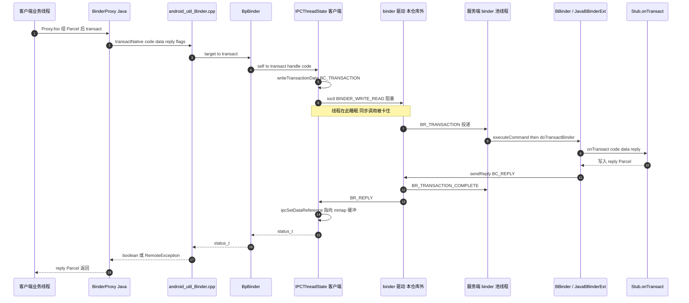
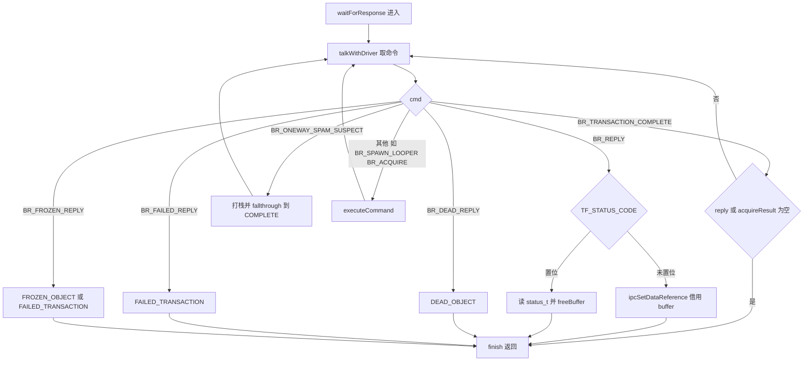

# Binder IPC 全链路：Java Proxy → libbinder → 内核 → 对端 Stub

> 状态：draft · 适用版本：android17-release · 校验日期：2026-11-24
> 关联：[[architecture-overview]] · [[ams-activity-broadcast]] · 相关长文：../BinderAnalysis.md、../BinderLearningGuide.md

## 1. 作用与边界

本页只回答一件事：一次跨进程调用，从 Java 侧 `transact` 的第一条指令，到对端 `Stub.onTransact` 里第一行业务代码，中间经过了哪些函数、在哪个线程上、拿了哪把锁、失败退化成什么返回值。

全链路由四段拼成，缺一不可：

| 段 | 内容 | 是否在本仓库 |
| --- | --- | --- |
| Java 段 | `IBinder`/`Binder`/`BinderProxy`、AIDL 生成的 `Stub`/`Proxy`、`Parcel` | 是，`base/core/java/android/os/` |
| JNI 段 | `android_util_Binder.cpp` 把 Java 对象映射成 `IBinder*`/`Parcel*` | 是，`base/core/jni/android_util_Binder.cpp` |
| libbinder 段 | `ProcessState`/`IPCThreadState`/`BpBinder`/`BBinder` 的请求-应答状态机 | 是，`native/libs/binder/` |
| 驱动段 | `/dev/binder` 的 `BINDER_WRITE_READ` 语义、`BR_*`/`BC_*` 命令、`binder_transaction` 拷贝、`TF_*` 标志定义 | **本仓库外，仅有接口假设** |

边界必须说清：

- `TF_ONE_WAY`/`TF_ACCEPT_FDS`/`BR_SPAWN_LOOPER` 等在 libbinder 里只被**引用**，定义在 bionic 的 uapi 头与 kernel 的 `drivers/android/binder.c`，本仓库没有这两个文件，所以「驱动怎么排队、怎么唤醒、怎么回收 buffer」一律按接口契约描述，不编造实现。
- SELinux 策略（`servicemanager` 的 `canAdd`/`canFind` 究竟查哪条规则）在 kernel 与 policy 侧，本仓库只到 `native/cmds/servicemanager/Access.cpp` 的调用点为止。
- `adb shell service list`、`dumpsys`、`/sys/kernel/debug/binder/*` 的命令实现在本仓库内**不可查**（见第 7 节），只能给接口假设。

## 2. 模块与文件地图

Java 侧：

| 文件:行 | 符号 | 职责 |
| --- | --- | --- |
| `base/core/java/android/os/IBinder.java:177` | `FLAG_ONEWAY` | oneway 唯一编码位，一路透传到驱动 |
| `base/core/java/android/os/Binder.java:1223` | `Binder.transact` | **同进程**直通：`data.setDataPosition(0)` 后直接调 `onTransact`，不碰驱动 |
| `base/core/java/android/os/Binder.java:1304` | `Binder.execTransact` | 从 JNI 进入 Java 服务实现的唯一入口 |
| `base/core/java/android/os/Binder.java:915` | `Binder.onTransact` | 默认实现：`INTERFACE_TRANSACTION`、`DUMP_TRANSACTION`（:919） |
| `base/core/java/android/os/Binder.java:301` | `private final long mObject` | 指向 native `JavaBBinderHolder`，构造时由 :1273 `getNativeBBinderHolder()` 填充（:726） |
| `base/core/java/android/os/BinderProxy.java:568` | `BinderProxy.transact` | 跨进程客户端入口，前置检查后调 `transactNative`（:626，声明在 :658） |
| `base/core/java/android/os/Parcel.java:1400` | `writeStrongBinder` | 写 binder 引用（native 在 :444 `nativeWriteStrongBinder`） |
| `base/core/java/android/os/Parcel.java:1172` | `enforceInterface` | AIDL Stub 校验 descriptor，不匹配抛 SecurityException |
| `base/core/java/android/os/ServiceManager.java:130` | `getIServiceManager` | 用 `BinderInternal.getContextObject()`（handle 0）造 `IServiceManager`（:137） |

JNI 侧：

| 文件:行 | 符号 | 职责 |
| --- | --- | --- |
| `base/core/jni/android_util_Binder.cpp:1644` | `android_os_BinderProxy_transact` | client 方向唯一桥，:1671 调 `target->transact` |
| `base/core/jni/android_util_Binder.cpp:415` | `JavaBBinderExt::onTransact` | server 方向唯一桥，:431 回调 Java `execTransact` |
| `base/core/jni/android_util_Binder.cpp:1013` | `javaObjectForIBinder` | `IBinder*` → Java `BinderProxy`，走 :476 `BinderProxy.getInstance` |
| `base/core/jni/android_util_Binder.cpp:1051` | `ibinderForJavaObject` | Java `Binder`/`BinderProxy` → `IBinder*` |
| `base/core/jni/android_util_Binder.cpp:794` | `JavaDeathRecipient::binderDied` | 死亡通知落地，:823 调 `BinderProxy.sendDeathNotice` |

libbinder 侧：

| 文件:行 | 符号 | 职责 |
| --- | --- | --- |
| `native/libs/binder/BpBinder.cpp:394` | `BpBinder::transact` | 客户端代理，查 `mAlive`（:398），:430 转 `IPCThreadState` |
| `native/libs/binder/IPCThreadState.cpp:921` | `IPCThreadState::transact` | 请求-应答状态机入口，:941 写 `BC_TRANSACTION` |
| `native/libs/binder/IPCThreadState.cpp:1153` | `waitForResponse` | client 收包循环，处理 `BR_REPLY`/`BR_DEAD_REPLY` 等 |
| `native/libs/binder/IPCThreadState.cpp:1246` | `talkWithDriver` | 唯一 ioctl 点（:1304 `BINDER_WRITE_READ`） |
| `native/libs/binder/IPCThreadState.cpp:1408` | `executeCommand` | 命令分派；`BR_TRANSACTION` 在 :1489 |
| `native/libs/binder/IPCThreadState.cpp:841` | `joinThreadPool` | 服务端线程池常驻循环 |
| `native/libs/binder/ProcessState.cpp:106` | `ProcessState::self` | 进程单例，:625 `mmap` 事务缓冲 |
| `native/libs/binder/ProcessState.cpp:435` | `spawnPooledThread` | 起 `PoolThread`，:97 `threadLoop` 进 `joinThreadPool` |
| `native/libs/binder/Binder.cpp:490` | `BBinder::transact` | 服务端本地分发，:541 `onTransact` |
| `native/libs/binder/IServiceManager.cpp:333` | `defaultServiceManager` | 取 handle 0 的 `IServiceManager` shim |

servicemanager 侧：`native/cmds/servicemanager/main.cpp:146` 的 `main`、`native/cmds/servicemanager/ServiceManager.cpp:512` 的 `addService`、`native/cmds/servicemanager/Access.cpp:113` 的 `getCallingContext`。

### 2.1 AIDL 生成代码与手写类的对应关系

生成文件不在本仓库（aidl 编译期产出），但其结构与仓库内可查的手写等价物一一对应：

| AIDL 元素 | 生成的 Java | 落到哪个真实类 |
| --- | --- | --- |
| `interface IFoo` | `IFoo.Stub extends Binder implements IFoo` | `Binder` 子类，`mObject` 持有 native `JavaBBinderHolder`（`base/core/java/android/os/Binder.java:301`） |
| `Stub.asInterface(IBinder)` | 本进程 `queryLocalInterface` 命中→返回实现，否则 `new Proxy(binder)` | 命中时走 `Binder.transact`（:1223）本地直通；否则走 `BinderProxy` |
| `Proxy.foo()` | 组 `Parcel` + `mRemote.transact(TRANSACTION_foo, data, reply, 0)` | `base/core/java/android/os/BinderProxy.java:568` |
| `Stub.onTransact(code, ...)` | `switch (code)` 调实现 | 由 `base/core/java/android/os/Binder.java:1364`/`:1369` 调用 |
| `oneway void foo()` | 传 `IBinder.FLAG_ONEWAY` | `base/core/java/android/os/IBinder.java:177` → `native/libs/binder/IPCThreadState.cpp:948` 走无回复分支 |

仓库内可对照的最小样例：`base/core/java/android/os/ICancellationSignal.aidl:22` 声明 `oneway void cancel()`，实现是 `base/core/java/android/os/CancellationSignal.java:207` 的 `Transport extends ICancellationSignal.Stub`。

## 3. 核心流程

以下每一步标注「线程上下文」，默认整条同步链**不切线程**——除了服务端那一段是另一个进程的 binder 池线程。

1. **客户端组包（业务线程）**：AIDL `Proxy.foo()` 把参数写进 `Parcel`（`base/core/java/android/os/Parcel.java:1400` 写 binder 引用、`base/core/java/android/os/Parcel.java:772` 读大小），同步方法以 `flags=0`、oneway 方法以 `FLAG_ONEWAY` 调 `mRemote.transact(...)`。生成的 `Proxy` 不在仓库内，结构见 2.1。
2. **`BinderProxy.transact`（同一业务线程）**：`base/core/java/android/os/BinderProxy.java:568`。这里做三件事：`Binder.checkParcel` 拦超大包、非 oneway 且 AppOps 在监听时补 `FLAG_COLLECT_NOTED_APP_OPS`（:621），然后 :626 调 `transactNative(code, data, reply, flags)`。同步调用时这个线程从这行开始被阻塞，直到第 16 步。
3. **JNI client 桥（同一线程，JNI 调用不切线程）**：`base/core/jni/android_util_Binder.cpp:1644` 的 `android_os_BinderProxy_transact`。取 native `Parcel*` 与 `getBPNativeData(env, obj)->mObject.get()`，:1671 调 `target->transact(code, *data, reply, flags)`。
4. **`BpBinder::transact`（同一线程）**：`native/libs/binder/BpBinder.cpp:394`。`mAlive` 为 0 直接返回 `DEAD_OBJECT`（:398、:445）；用户 code 还要过 stability 检查（:404-418），跨 stability 级别返回 `BAD_TYPE`。:430 调 `IPCThreadState::self()->transact(binderHandle(), ...)`。此后 `status == DEAD_OBJECT` 会把 `mAlive` 清零（:440），**同一个代理不会复活**。
5. **取线程私有状态机**：`IPCThreadState::self()`（`native/libs/binder/IPCThreadState.cpp:377`）用 `pthread_getspecific` 取本线程实例，没有就 new（构造 `:1117`，`mIn`/`mOut` 各 256 字节初始容量 `:1132`）。**这是整条链上唯一「无锁」的原因**：每个线程一套 `mIn`/`mOut`。
6. **写请求命令**：`IPCThreadState::transact`（:921）。先 `flags |= TF_ACCEPT_FDS`（:929），再 `writeTransactionData(BC_TRANSACTION, flags, handle, code, data, nullptr)`（:1365），把 `binder_transaction_data` 追加到 `mOut`（:1395）。若 `data.errorCheck()` 失败且无 `statusBuffer`，直接 `return (mLastError = err)`（:1392），请求根本不发出。
7. **分支：等回复 vs 只等投递确认**：同步走 :967 `waitForResponse(reply)`；oneway 走 :992 `waitForResponse(nullptr, nullptr)`，语义退化为「等一个 `BR_TRANSACTION_COMPLETE` 就返回」。
8. **进内核（同一线程，阻塞）**：`waitForResponse` 循环里调 `talkWithDriver`（:1159 → :1246）。组 `binder_write_read` 后 :1304 `ioctl(mProcess->mDriverFD, BINDER_WRITE_READ, &bwr)`。`-EINTR` 重试（:1320）；`mDriverFD < 0` 直接 `-EBADF`（:1248）。线程在此进入不可中断/可中断睡眠，**这是 ANR 里 binder 等待的物理位置**。
9. **驱动段（本仓库外，仅有接口假设）**：把 `tr.data.ptr.buffer` 指向的用户页 copy 进内核 buffer，按 `handle` 找到目标 `binder_node`，把该 buffer 映射进接收进程 `mmap` 出来的虚拟区间，给接收方空闲的 looper 线程投递 `BR_TRANSACTION`；接收方线程池不够时发 `BR_SPAWN_LOOPER`。
10. **服务端线程池入口（binder 池线程）**：`PoolThread::threadLoop`（`native/libs/binder/ProcessState.cpp:97`）→ `IPCThreadState::self()->joinThreadPool(mIsMain)`（`native/libs/binder/IPCThreadState.cpp:841`），先写 `BC_ENTER_LOOPER`/`BC_REGISTER_LOOPER`（:847）。线程名 `binder:<pid>_<seq>`（`native/libs/binder/ProcessState.cpp:422` `makeBinderThreadName`）。
11. **取命令（binder 池线程）**：`getAndExecuteCommand`（:734），`talkWithDriver` 读回命令（:739）、读 4 字节 cmd（:743）、`executeCommand(cmd)`（:758）。执行期间 `mExecutingThreadsCount` 加减（:751、:761），用于线程池饥饿判断。
12. **解 `BR_TRANSACTION`（binder 池线程）**：`IPCThreadState::executeCommand`（:1489）。`buffer.ipcSetDataReference(...)`（:1506）让 `Parcel` 直接指向驱动映射过来的那块内存——**这就是「一次拷贝」的落点：没有第二份用户态副本**。随后把 `mCallingPid/mCallingSid/mCallingUid` 换成 `tr.sender_pid/tr.sender_euid`（:1529-1531），旧值先存到 `origPid/origUid/...`（:1515-1522），收尾在 :1611-1618 还原——**嵌套调用能拿到正确调用者的原因**。
13. **落到本地对象（binder 池线程）**：`tr.target.ptr` 非空时 `attemptIncStrong` 后 `doTransactBinder(...)`（:1557），失败则 `UNKNOWN_TRANSACTION`；为空时落到 `the_context_object`（:1563，servicemanager 用它接 handle 0）。然后 `BBinder::transact`（`native/libs/binder/Binder.cpp:490`）→ :541 `onTransact` → :1102 默认实现。
14. **Java 服务端（仍是 binder 池线程，JNI 回调）**：`JavaBBinderExt::onTransact`（`base/core/jni/android_util_Binder.cpp:415`）→ :431 `CallBooleanMethod(mObject, mExecTransact, ...)` → `Binder.execTransact`（`base/core/java/android/os/Binder.java:1304`）→ `execTransactInternal`（:1334）→ `onTransact`（:1364/:1369）→ 生成的 `Stub.onTransact` 里 `switch(code)`。返回 false 时 JNI 侧变成 `UNKNOWN_TRANSACTION`（`base/core/jni/android_util_Binder.cpp:470`），Java 抛的异常在 :434-444 被记录后**丢弃**——oneway 调用里异常就消失了（`base/core/java/android/os/Binder.java:1347` 注释同义）。
15. **回包（binder 池线程）**：若 `(tr.flags & TF_ONE_WAY) == 0`，`sendReply(reply, flags)`（`native/libs/binder/IPCThreadState.cpp:1585` → :1143）写 `BC_REPLY`（`handle = -1`，:1147），再 `waitForResponse(nullptr, nullptr)` 只等 `BR_TRANSACTION_COMPLETE`。oneway 分支（:1590-1609）只打日志不回包。
16. **客户端收包（回到业务线程）**：`waitForResponse` 收到 `BR_REPLY`（:1208）：`TF_STATUS_CODE` 未置位则 `reply->ipcSetDataReference(...)` 指向同一块 mmap 缓冲（:1215），置位则把前 4 字节当 `status_t` 并立刻 `freeBuffer`（:1221-1224）。`freeBuffer`（:1855）在 `Parcel` 析构时写 `BC_FREE_BUFFER`（:1864）把 buffer 还给驱动，**不还就无法继续接收**。

### 3.1 oneway 与异步事务

- flags 只有一位决定语义：`base/core/java/android/os/IBinder.java:177` 的 `FLAG_ONEWAY`，到 native 后是 `TF_ONE_WAY`（定义在仓库外）。
- 客户端：`IPCThreadState::transact` 的 :948 判断走哪条路；oneway 在 :992 传 `nullptr`，收到 `BR_TRANSACTION_COMPLETE` 就 `goto finish`（:1180），**不等对端执行完**。
- 服务端：`executeCommand` 的 :1570 判断是否回包；oneway 只记日志（:1591-1607）。
- 代价与约束：`servicemanager` 把整个进程限制成只能发 oneway（`native/cmds/servicemanager/main.cpp:163` 的 `CallRestriction::FATAL_IF_NOT_ONEWAY`），libbinder 侧在 :949-957 检测到非 oneway 会 `LOG_ALWAYS_FATAL`。oneway 发太多会收到 `BR_ONEWAY_SPAM_SUSPECT`（:1174），开关在 `ProcessState::open_driver` 里通过 `BINDER_ENABLE_ONEWAY_SPAM_DETECTION` 打开（`native/libs/binder/ProcessState.cpp:597`）。

### 3.2 嵌套调用：同一线程里的第二次 transact

服务端在处理 `BR_TRANSACTION` 时再向别的进程发同步调用，叫嵌套。libbinder 不为此加锁，靠三个状态位：

- `mServingStackPointer` 在 :1513 记录服务栈顶、:1610 还原；`flushIfNeeded`（:697）用 `mServingStackPointer != nullptr` 判断「本线程正在处理事务」，此时**不立刻 flush**（:698-705），命令攒在 `mOut` 里，等本线程回到 `talkWithDriver` 时批量带走。
- 不是 looper 也不在服务事务中（普通业务线程），同一函数会立即 `flushCommands()`，否则 `BC_FREE_BUFFER` 这类命令会卡在该线程的 `mOut` 里（:707-710 的注释）。
- `mIsLooper` 在 `joinThreadPool` 里置位（:849），决定退出时是否发 `BC_EXIT_LOOPER`（:871）。

### 3.3 servicemanager：注册与查询

- 启动：`native/cmds/servicemanager/main.cpp:146`。`ProcessState::initWithDriver(driver)`（:161）→ `setThreadPoolMaxThreadCount(0)`（:162，**不开池线程**）→ `setCallRestriction(FATAL_IF_NOT_ONEWAY)`（:163）。
- 自注册：`manager->addService("manager", manager, false, ...)`（:169），随后 `setTheContextObject(manager)`（:173）+ `becomeContextManager()`（:174）。`becomeContextManager` 才是驱动认的「handle 0 归我」，注册表在驱动 side。
- 收包：不用 `joinThreadPool`，改用 `Looper` 单线程轮询：`setupPolling(&fd)`（:65 → `native/libs/binder/IPCThreadState.cpp:885`）、`looper->addFd`（:68）、`handleEvent` 里 `handlePolledCommands()`（:76），主循环 `looper->pollAll(-1)`（:190）。
- 查询路径（native）：`defaultServiceManager()`（`native/libs/binder/IServiceManager.cpp:333`）返回 `CppBackendShim`；`getService`（:587）先 `checkService`，未命中就 5 秒内每 100ms/1s 重试（:608-626），超时返回 `nullptr` 并打 `didn't start`。
- 查询路径（Java）：`ServiceManager.getIServiceManager()`（`base/core/java/android/os/ServiceManager.java:130`）用 handle 0 的 `BinderProxy` 造 `IServiceManager`，`ServiceManagerNative.asInterface`（`base/core/java/android/os/ServiceManagerNative.java:38`）包一层 `ServiceManagerProxy`；`getService` 先查本地 `sCache`（:150）。
- 权限：`addService` 在服务端先拒 App：`multiuser_get_app_id(ctx.uid) >= AID_APP` 直接 `EX_SECURITY`（`native/cmds/servicemanager/ServiceManager.cpp:518`），再走 `canAddService`（:1134）→ `mAccess->canAdd`，拒绝文案是 `SELinux denied for service.`（:1136）。调用者身份来自 `Access::getCallingContext`（`native/cmds/servicemanager/Access.cpp:113`）→ `IPCThreadState::getCallingSid/getCallingUid`（:117/:122）。查询侧对称：`canFindService`（:1151）。

### 3.4 死亡通知（linkToDeath）

- Java：`BinderProxy.linkToDeath`（`base/core/java/android/os/BinderProxy.java:672`）→ `linkToDeathNative` → JNI `android_os_BinderProxy_linkToDeath`（`base/core/jni/android_util_Binder.cpp:1689`）→ `BpBinder::linkToDeath`（`native/libs/binder/BpBinder.cpp:449`）。本地对象 `Binder.linkToDeath` 是空实现（`base/core/java/android/os/Binder.java:1240`），`BBinder::linkToDeath` 直接返回 `INVALID_OPERATION`（`native/libs/binder/Binder.cpp:590`）——**自己持有的 binder 不需要监听自己的死**。
- native：首次注册时 `mObituaries` 为空，取 `getWeakRefs()->incWeak(this)` 后 `requestDeathNotification(handle, this)`（`native/libs/binder/BpBinder.cpp:492-495` → `native/libs/binder/IPCThreadState.cpp:1052` 写 `BC_REQUEST_DEATH_NOTIFICATION`），再 `flushCommands()`。有 `mLock`（`RpcMutexUniqueLock`）保护 `mObituaries`/`mObitsSent`。
- 触发：驱动给本进程任意 looper 线程投 `BR_DEAD_BINDER`，`executeCommand`（:1631）读回 `BpBinder*` 调 `sendObituary()`（`native/libs/binder/BpBinder.cpp:552`），后者 `mAlive = 0`（:562）、清 `mObituaries`、`mObitsSent = 1`（:578）、逐个 `reportOneDeath`。
- 送到 Java：`JavaDeathRecipient::binderDied`（`base/core/jni/android_util_Binder.cpp:794`）→ :823 `BinderProxy.sendDeathNotice` → `base/core/java/android/os/BinderProxy.java:845` → `recipient.binderDied(binderProxy)`，异常被吞掉只打日志。
- 失败前置条件：进程没有 incoming 线程时 `linkToDeath` 只打 WARN 不报错（`native/libs/binder/BpBinder.cpp:462-469`，判断 `getThreadPoolMaxTotalThreadCount() == 0`），**死亡通知永远送不到**——所以监听必须在 `startThreadPool` 之后。

### 3.5 权限、身份与 clearCallingIdentity

- 内核在 `BR_TRANSACTION` 里带 `sender_pid`/`sender_euid`，libbinder 在 :1529-1531 写进线程私有字段；`Binder.getCallingUid`（`base/core/java/android/os/Binder.java:334`）/`getCallingPid`（:324）经 JNI `base/core/jni/android_util_Binder.cpp:1234`/`:1229` 读到 `IPCThreadState`。
- `Binder.clearCallingIdentity`（`base/core/java/android/os/Binder.java:440`）→ JNI :1243 → `IPCThreadState::clearCallingIdentity`（:565）：打包 `(hasExplicitIdentity, uid, pid)` 成 `int64_t`（:569），然后 `clearCaller()`（:657，`mCallingPid = getpid()`）并置 `mHasExplicitIdentity = true`（:571）。
- `restoreCallingIdentity`（:649）只能还原 uid/pid/hasExplicit，**`mCallingSid` 被置 nullptr**（:652 注释：not enough data to restore）——SELinux 侧身份不可逆是设计约束。
- 为什么可以这么做：身份是 **per-thread** 的，不是 per-process；所以同一个 binder 线程上并发处理的两个事务互不污染，而跨线程切换后新线程必须重新从 `BR_TRANSACTION` 里取身份。
- 典型误用后果：在子线程里做特权操作却没 `clearCallingIdentity`，被调方看到的是调用者 uid，`checkCallingPermission` 失败抛 `SecurityException`；反向误用是清完不 restore，后续所有同线程 IPC 都以自身身份发出。

## 4. 时序图

oneway 分支只需把图中三处替换：客户端只等 `BR_TRANSACTION_COMPLETE`（`native/libs/binder/IPCThreadState.cpp:1180`）、服务端不回包（:1590）、没有 `BR_REPLY`。

## 5. 关键数据结构与状态机

| 结构 | 定义处 | 关键字段与含义 |
| --- | --- | --- |
| `Parcel` | `base/core/java/android/os/Parcel.java:246`；native `native/libs/binder/Parcel.cpp:3025` `ipcSetDataReference` | Java 侧只有 `mNativePtr`（`base/core/java/android/os/Parcel.java:259`）；native 侧 `mData`/`mObjects` 可**借用**驱动 buffer，此时析构走 `freeBuffer` 回调把 buffer 还回去 |
| `binder_transaction_data` | 仓库外（uapi） | `target.handle`、`code`、`flags`、`data.ptr.buffer`、`offsets`；libbinder 在 `native/libs/binder/IPCThreadState.cpp:1368-1396` 填充并 `mOut.write` |
| `BpBinder` | `native/libs/binder/BpBinder.cpp:259` | `mAlive`（死后永不复生）、`mObituaries`+`mObitsSent`（死亡通知一次性）、`mDescriptorCache`（descriptor 只查一次） |
| `ProcessState` | `native/libs/binder/ProcessState.cpp:606` | `mDriverFD`、`mVMStart`（mmap 基址）、`mMaxThreads`（默认 15）、`mCurrentThreads`、`mExecutingThreadsCount`、`mThreadPoolStarted` |
| `IPCThreadState` | `native/libs/binder/IPCThreadState.cpp:1117` | `mIn`/`mOut`（每线程）、`mCallingPid`/`mCallingUid`/`mCallingSid`、`mServingStackPointer`（嵌套标记）、`mIsLooper`、`mLastTransactionBinderFlags` |

一次拷贝的物理基础：`ProcessState::ProcessState` 在 `native/libs/binder/ProcessState.cpp:625` 用 `mmap(nullptr, BINDER_VM_SIZE, PROT_READ, MAP_PRIVATE | MAP_NORESERVE, fd, 0)` 把驱动分配的接收区映射进本进程，大小是 `1MB - 2 * page`（:48 的 `BINDER_VM_SIZE`）。发送侧 `writeTransactionData` 只把 `data.ipcData()` 的指针填进 `binder_transaction_data`（:1381），驱动 copy 一次进内核页后，接收侧 `ipcSetDataReference`（`native/libs/binder/Parcel.cpp:3025`）直接把这页当 `Parcel` 的数据区，**没有第二次用户态拷贝**。

`waitForResponse` 的状态机就是那个 `switch (cmd)`（`native/libs/binder/IPCThreadState.cpp:1173-1232`）：

`finish` 之后统一处理错误（:1235-1241）：`reply->setError(err)`、`mLastError = err`、`logExtendedError()`。所以同步调用失败在 Java 侧表现为 `RemoteException`（`base/core/jni/android_util_Binder.cpp:1685` → `signalExceptionForError`），而 oneway 调用失败**没有任何调用方可见的信号**。

## 6. 线程/进程模型与并发

- **每线程一个状态机，无锁**：`IPCThreadState::self()`（:377）走 TLS，`mIn`/`mOut`（:1132）天然隔离。整条同步链上一个互斥量都不需要，这也是 Binder 吞吐高于 socket 方案的结构性原因。
- **每进程一个 ProcessState**：`ProcessState::self()`（`native/libs/binder/ProcessState.cpp:106`）→ `init`（:137），`gProcessMutex`（:127）只在首次初始化时持有（:139）；`fork` 后使用会 `LOG_ALWAYS_FATAL`（:129 `verifyNotForked`）。
- **线程池上限 15/16**：`DEFAULT_MAX_BINDER_THREADS = 15`（`native/libs/binder/ProcessState.cpp:49`），`open_driver` 时 `ioctl(BINDER_SET_MAX_THREADS)` 写进驱动（:592）。`getThreadPoolMaxTotalThreadCount`（:464）的算法是 `1 + mMaxThreads`（:483-486）——`startThreadPool` 本身先起 1 个 main 线程（:229-230），驱动最多再要求 15 个，合计 **16**。运行时改上限用 `setThreadPoolMaxThreadCount`（:451），只允许调大（:452 `LOG_ALWAYS_FATAL_IF(mThreadPoolStarted && maxThreads < mMaxThreads)`）。
- **新线程由驱动点单**：`BR_SPAWN_LOOPER`（`native/libs/binder/IPCThreadState.cpp:1679`）→ `spawnPooledThread(false)`（:1680）→ `PoolThread::threadLoop`（`native/libs/binder/ProcessState.cpp:97`）→ `joinThreadPool`（:841）。
- **饥饿可观测**：`getAndExecuteCommand` 里 `mExecutingThreadsCount` 达到 `mMaxThreads` 时记起点（:751-756），回落后超过 100ms 打印 `binder thread pool (%zu threads) starved`（:768）。
- **servicemanager 是单线程**：`setThreadPoolMaxThreadCount(0)`（`native/cmds/servicemanager/main.cpp:162`）后靠 `Looper` 轮询一个 fd（:65/:190），所以它的每个查询都必须快，否则全局服务发现阻塞。
- **应用进程**：`base/cmds/app_process/app_main.cpp:83`（普通进程 `onStarted`）与 `:96`（zygote `onZygoteInit`）各调一次 `startThreadPool`。
- **锁清单**：`ProcessState::mLock`（handle 表，`getStrongProxyForHandle` :344）、`BpBinder::mLock`（`mObituaries`/`mObitsSent`，:481/:565）、`JavaBBinderHolder::mLock`（`base/core/jni/android_util_Binder.cpp:494`，`JavaBBinderExt` 只创建一次）。
- **死锁模式**：同步调用占住客户端线程 + 服务端线程池满 → 服务端排队 → 若服务端又同步回调客户端且客户端线程池也满，两边互等。缓解手段只有 oneway 与错开线程池，libbinder 不做超时（`waitForResponse` 无 deadline）。

## 7. 调试入口

| 入口 | 本仓库内是否可查 | 说明 |
| --- | --- | --- |
| `atrace -t 10 binder_driver` | **可查**：`native/cmds/atrace/atrace.cpp:229` | 打开 `events/binder/binder_transaction`、`binder_transaction_received`、`binder_transaction_alloc_buf`（:230-233），能直接看到一次事务的收发与 buffer 分配 |
| `atrace ... binder_lock` | **可查**：`native/cmds/atrace/atrace.cpp:235` | `binder_lock`/`binder_locked`/`binder_unlock`，仅在老内核有意义 |
| `atrace ... aidl` | **可查**：`native/cmds/atrace/atrace.cpp:127` | 对应 `ATRACE_TAG_AIDL`（`native/libs/binder/include/binder/Trace.h:32`），`BBinder::transact` 在 `native/libs/binder/Binder.cpp:493-500` 打点 |
| `adb shell dumpsys binder` | **不可查** | 精简仓库 `base/cmds/` 下没有 `dumpsys` 目录（只有 am/pm/sm/svc 等），无法确认 `binder` 是否为设备上注册的 dumpsys 服务名，**仅有接口假设** |
| 服务侧 dump 入口 | 可查 | `dumpsys` 对各服务下发的是 `DUMP_TRANSACTION`：`BBinder::onTransact` 在 `native/libs/binder/Binder.cpp:1111` 读 fd+args 后调 `dump`；Java 侧在 `base/core/java/android/os/Binder.java:919` 转 `dump`（:995） |
| `adb shell service list` | **不可查**：`base/cmds/` 无 `service` 目录 | 本仓库外，仅有接口假设；等价信息可用 `IServiceManager.listServices`（`native/libs/binder/aidl/android/os/IServiceManager.aidl:111` 的 `listServices` / `:168` 的 `getServiceDebugInfo`） |
| `/sys/kernel/debug/binder/{state,stats,transactions,transaction_log,proc/<pid>}` | **本仓库外** | kernel 提供，仅有接口假设；用法记录见 `docs/BinderLearningGuide.md:232` 起的 `stats`/`transactions` |
| shell 权限边界 | 可查 | `Binder.onShellCommand` 在 `base/core/java/android/os/Binder.java:1103` 校验 `ROOT_UID`/`SHELL_UID`（:1108），非 shell 直接 `SecurityException` |

## 8. 延伸阅读

- `../BinderAnalysis.md`：第 3 节「核心机制与源码实现分析」的流程与证据链、第 12.1 节 `transact` 逐行分析、第 12.2 节驱动协议、第 9 节监控与调试。
- `../BinderLearningGuide.md`：阶段二（:32 起）Java 层与 Native 层的推荐阅读顺序，阶段四（:219 起）调试工具与常见问题排查。
- 代码对照：`native/libs/binder/aidl/android/os/IServiceManager.aidl:33`（`getService`/`checkService`/`addService` 的 AIDL 定义）、`native/cmds/servicemanager/main.cpp:146`（sm 进程全貌）。
- 应用层实例：`base/services/core/java/com/android/server/am/ActivityManagerService.java:602` 的 `extends IActivityManager.Stub` 与 `:2129` 的 `ServiceManager.addService(Context.ACTIVITY_SERVICE, ...)`，可对照 [[ams-activity-broadcast]] 看「服务端注册」一侧。
- 相邻页：[[architecture-overview]]。

## 9. 待补充与不确定点

1. `dumpsys binder` 的真实可用性：精简仓库缺 `base/cmds/dumpsys`，无法确认该子命令是否存在、以及它是否只是把 `binder` 当作一个注册服务名去 dump；本文只写了服务侧的 `DUMP_TRANSACTION` 通路。
2. RPC Binder 分支（`BpBinder::transact` 的 `isRpcBinder()` :421-423、`native/libs/binder/IServiceManager.cpp:354` 的测试 shim）完全绕开 kernel 驱动，与本文描述的 ioctl 状态机不是同一条路；本文只在必要处标注，未展开 RPC 会话的线程与缓冲模型。
3. 进程冻结相关命令（`BR_FROZEN_REPLY` :1195、`BR_FROZEN_BINDER` :1647）与 oneway spam 的具体阈值，只按代码表面记录，未在真机抓 trace 验证其触发条件。
