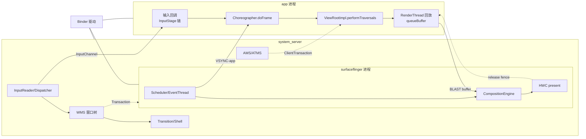

# AOSP Frameworks Wiki

> 适用版本：android17-release · 校验日期：2026-11-24 · 页面数：7 · 代码引用：730 处（全部通过 `tools/verify_refs.py` 校验）
> 语料：本仓库 `base/`（frameworks/base）与 `native/`（frameworks/native）源码

## 这个 wiki 是什么

面向"要改代码 / 要定位问题"的读者：每条链路都落到 `文件:行`，写清**谁调用谁、在哪个线程、拿哪把锁、失败退化成什么**。凡是仓库里没有的环节（kernel binder 驱动、HAL、composer、ART），页面会显式标注"本仓库外，仅有接口假设"，不编造实现。

它**不是**：AOSP 设计文档的翻译、API 使用教程、或 `../` 下 16 篇长文的替代。长文负责推导与背景（如 VSync 的线性回归模型、TouchEvent 的历史演进），wiki 负责索引与骨架——两者通过页面内的相对链接互跳。

## 页面索引

| 页面 | slug（双链格式） | 类别 | 一句话 | 页内行数 |
| --- | --- | --- | --- | --- |
| [仓库架构总览](architecture-overview.md) | `architecture-overview` | architecture | 分层、进程边界、模块地图、启动时序，以及六条链路在整个系统中的位置 | 152 |
| [Binder IPC 全链路](binder-ipc.md) | `binder-ipc` | architecture | 一次 `transact` 从 Java Proxy 到对端 Stub：JNI 桥接、libbinder 状态机、servicemanager、一次拷贝、oneway、死亡通知 | 258 |
| [AMS：进程/Activity/广播](ams-activity-broadcast.md) | `ams-activity-broadcast` | architecture | `attachApplication` → `bindApplication`、`startActivity` 全链、广播投递与 ANR 炸弹 | 239 |
| [WMS：窗口与转场](wms-transition.md) | `wms-transition` | architecture | `addWindow` → `SurfaceControl`，以及 `Transition` 与 Shell 的 leash 重父化动画 | 234 |
| [Input：事件到 View](input-dispatch.md) | `input-dispatch` | architecture | evdev → InputReader → InputDispatcher → `InputChannel` → `InputStage` 链 → `onTouchEvent`，含 5s ANR 计量 | 233 |
| [渲染：View → RenderThread → SF](render-pipeline.md) | `render-pipeline` | architecture | 遍历/录制 → RT 回放 → BufferQueue → CompositionEngine → HWC，含 fence 与三缓冲 | 250 |
| [VSync 流水线](vsync-pipeline.md) | `vsync-pipeline` | architecture | HWC 上报 → `VSyncReactor`/`VSyncDispatch` → app/sf 两相 → Choreographer/FrameTimeline | 230 |

## 可视化深挖页（HTML）

Markdown 负责索引与骨架；需要「逐行代码 + 四类图联动」时看 HTML：

| 主题 | 产物 | 内容 |
| --- | --- | --- |
| Shell Transition | [dist/shell-transition.html](../wiki_site/dist/shell-transition.html) | 42 步全流程、496 个方法全量清单、13 个 P0 函数逐行（732 条注释 / 933 行）、10 张函数卡片、四类图、降级表 |

构建与校验：`python3 docs/wiki_site/build.py && python3 docs/wiki_site/verify.py`（详见 [README](../wiki_site/README.md)）。

## 六条链路如何拼在一起

- 读 [[input-dispatch]] 时配合 [[render-pipeline]]：输入事件到达的那一刻，正是 Choreographer 下一次 `doFrame` 的起点。
- 读 [[wms-transition]] 时配合 [[render-pipeline]]：`Transition` 改的是 layer 的父链与属性，最终由 SF 在合成时体现。
- 读 [[ams-activity-broadcast]] 时配合 [[binder-ipc]]：`ClientTransaction` 就是一次 oneway Binder 调用。

## 推荐阅读路径

| 目标 | 顺序 |
| --- | --- |
| 刚接手这份代码 | `architecture-overview` → 对应子系统页的 §1/§2 → 再看 `../` 里那篇长文 |
| 跟掉帧 / 卡顿 | `vsync-pipeline` §3 → `render-pipeline` §3 → `../hwui_syncAndDrawFrame_to_surfaceflinger.md` |
| 跟点击延迟 / 无响应 | `input-dispatch` §3 → `../ANR/Input-ANR放炸弹与拆炸弹机制源码深度解析.md` |
| 跟转场动画异常 | `wms-transition` §3.5 → `../LauncherRemoteAnimation.md` |
| 跟跨进程调用不通 | `binder-ipc` §3.3（servicemanager）→ `adb shell service list` → `../BinderAnalysis.md` |

## 维护规约

1. **新增页面**：文件放 `omx_wiki/<slug>.md`，沿用九节骨架（作用与边界 / 模块与文件地图 / 核心流程 / 时序图 / 数据结构 / 线程模型 / 调试入口 / 延伸阅读 / 待补充），并在本页索引表登记。
2. **代码引用**：一律写仓库相对全路径 + 行号（`base/core/java/android/view/ViewRootImpl.java:3307`），禁止只写类名。
3. **交叉引用**：wiki 之间用双中括号 slug 形式（即本页索引表中 slug 列的值）；仓库长文用 `../xxx.md`。
4. **提交前校验**：`python3 omx_wiki/tools/verify_refs.py`，必须输出 `problems=0`。该脚本检查三项：引用文件存在且行号在文件长度内、双链目标页存在、`../` 链接存在。
5. **版本漂移**：仓库升级后行号必然偏移，校验脚本能抓"越界"，抓不到"指错代码"。升级后重跑脚本，再对改动页的 `keyFiles` 抽查。
6. **记录**：每次批量变更追加到 [log.md](log.md)。

## 与 omx CLI 的关系

wiki 技能的标准存储是 `omx_wiki/`（页面 + `index.md` + `log.md`），查询/写入走 `omx wiki wiki_query|wiki_ingest`。本机当前**未安装 `omx`**，因此本 wiki 是按该规范手写落盘的纯 Markdown：装上 omx 后可直接被 `wiki_list`/`wiki_query`/`wiki_lint` 消费，无需迁移。
