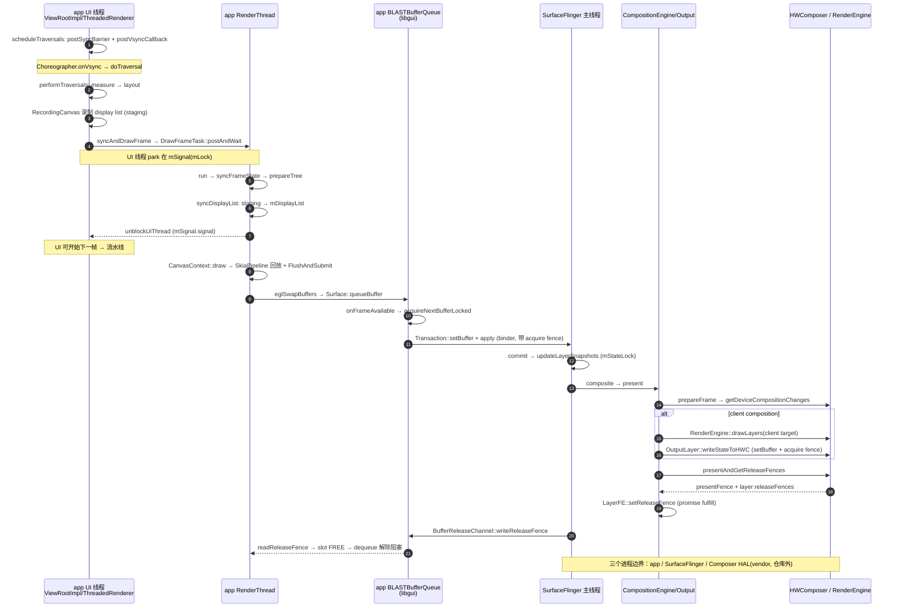
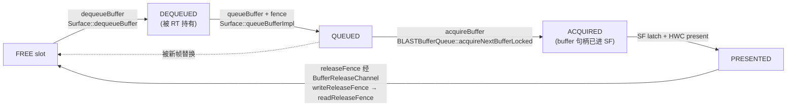

# 渲染：View → RenderThread → SurfaceFlinger

> 状态：draft · 适用版本：android17-release · 校验日期：2026-11-24
> 关联：[[architecture-overview]] · [[vsync-pipeline]] · 相关长文：[RenderThread_Analysis.md](../RenderThread_Analysis.md)、[hwui_syncAndDrawFrame_to_surfaceflinger.md](../hwui_syncAndDrawFrame_to_surfaceflinger.md)、[AOSPView渲染到显示完整流程详解.md](../AOSPView渲染到显示完整流程详解.md)

## 1. 作用与边界

本页只回答一件事：一次 `invalidate()/requestLayout()` 派生的遍历，怎样变成屏幕上的像素；每一步在哪个线程执行、在哪里跨线程/跨进程、在哪里等 fence、失败时返回什么。

一帧被切成四段，彼此用不同的同步原语衔接：

| 段 | 执行上下文 | 衔接点 | 代码事实 |
| --- | --- | --- | --- |
| 遍历与录制 | app UI 线程 | `mSignal`（UI 线程被 RT 挂起） | `base/libs/hwui/renderthread/DrawFrameTask.cpp:82` |
| 回放与 swap | app RenderThread | BufferQueue 生产者锁 | `base/libs/hwui/renderthread/CanvasContext.cpp:672` |
| buffer 交接 | app（BLAST 消费者）→ SF | binder `Transaction` + buffer handle + acquire fence | `native/libs/gui/BLASTBufferQueue.cpp:665` |
| 合成与上屏 | SF 主线程 + HWC/RE | `mStateLock`、Composer HAL | `native/services/surfaceflinger/SurfaceFlinger.cpp:2996` |

边界说明（不写会误读）：

- **进程内跨线程**：UI 线程录制 display list，RenderThread 回放。两者共享 `RenderNode`，但**没有为 display list 加锁**——靠"同步阶段 UI 线程被挂起"换来独占，见 `base/libs/hwui/renderthread/DrawFrameTask.cpp:106` 与同文件 `:124` 的注释（"From this point on anything in this is *UNSAFE TO ACCESS*"）。
- **跨进程**：app 的 BLAST BufferQueue 只把 `GraphicBuffer` handle、acquire fence 和 `ReleaseCallbackId` 塞进 `Transaction`（`native/libs/gui/BLASTBufferQueue.cpp:665`）；release fence 走反向的 `BufferReleaseChannel`（`native/services/surfaceflinger/Layer.cpp:738`）。
- **跨进程**：SF → Composer HAL（`native/services/surfaceflinger/DisplayHardware/HWComposer.cpp:681`）。HAL 实现、gralloc、kernel `sync_file` 驱动**本仓库外，仅有接口假设**；仓库里只能看到 fence fd 的传递（`native/libs/gui/Surface.cpp:1386`）与 `Fence` 封装。
- **版本差异（必读）**：本分支**不存在** `SurfaceFlinger::onMessageRefresh` / `MessageRefresh`（全仓库无此符号）。旧文与旧版 AOSP 的 `onMessageRefresh → handleMessageRefresh` 在本分支对应 `Scheduler::onFrameSignal` → `ICompositor::commit/composite`：`native/services/surfaceflinger/Scheduler/Scheduler.cpp:411`、`native/services/surfaceflinger/Scheduler/include/scheduler/interface/ICompositor.h:43`、同文件 `:47`。下文一律按新路径写。

失败面（每步都会带着它往下走）：

| 失败 | 触发条件 | 结果 |
| --- | --- | --- |
| surface 丢失 | RT 同步时 `!hasOutputTarget()` | `SyncResult::LostSurfaceRewardIfFound`，UI 线程收到后 `requestLayout()` 并强制 relayout：`base/libs/hwui/renderthread/DrawFrameTask.cpp:198`、`base/core/java/android/view/ThreadedRenderer.java:849` |
| 本帧不画 | `canDrawThisFrame == false`（无 target / context stopped / NothingToDraw） | 只 `flushAndSubmit` + `waitOnFences`，回调以 `didProduceBuffer=false` 收尾：`base/libs/hwui/renderthread/DrawFrameTask.cpp:143`、`base/libs/hwui/renderthread/CanvasContext.cpp:699` |
| swap 超时 | `mNativeSurface->getAndClearError() == TIMED_OUT` | 丢弃本帧并 `postFrameCallback(this)` 重试，swap history 置全屏脏：`base/libs/hwui/renderthread/CanvasContext.cpp:806` |
| BLAST 同步事务被替换 | 同一 layer 一帧内多次 `setBuffer` | 旧 buffer 立即 `releaseBuffer`，新 buffer 走 sync transaction：`native/libs/gui/BLASTBufferQueue.cpp:791`（见该注释块） |

## 2. 模块与文件地图

| 层 | 关键文件 | 职责（只列本页用到的） |
| --- | --- | --- |
| Java 框架 | `base/core/java/android/view/ViewRootImpl.java`、`ThreadedRenderer.java`、`View.java`、`base/graphics/java/android/graphics/HardwareRenderer.java`、`RenderNode.java`、`RecordingCanvas.java` | 遍历调度、measure/layout/draw、录制 display list、发起 `syncAndDrawFrame` |
| hwui JNI | `base/libs/hwui/jni/android_graphics_HardwareRenderer.cpp` | `nSyncAndDrawFrame` → `RenderProxy`（`:464`） |
| hwui 渲染线程 | `base/libs/hwui/renderthread/RenderThread.cpp`、`CanvasContext.cpp`、`DrawFrameTask.cpp`、`RenderProxy.cpp`、`EglManager.cpp` | 线程循环、树上同步、`draw`/`swap`、EGL surface 与 fence |
| hwui 管线 | `base/libs/hwui/pipeline/skia/SkiaPipeline.cpp`、`SkiaOpenGLPipeline.cpp`、`RenderNodeDrawable.cpp`、`base/libs/hwui/RenderNode.cpp` | 回放 display list、`FlushAndSubmit`、`eglSwapBuffersWithDamageKHR` |
| libgui | `native/libs/gui/Surface.cpp`、`BufferQueueProducer.cpp`、`BufferQueueConsumer.cpp`、`BufferQueueCore.cpp`、`BLASTBufferQueue.cpp`、`BufferReleaseChannel.cpp` | 生产者 queue/dequeue、槽位状态、BLAST 事务与释放通道 |
| SurfaceFlinger | `native/services/surfaceflinger/SurfaceFlinger.cpp`、`Scheduler/Scheduler.cpp`、`Scheduler/MessageQueue.cpp`、`Layer.cpp`、`LayerFE.cpp` | 帧驱动、事务提交与 latch、Layer 快照、release fence |
| CompositionEngine | `CompositionEngine/src/CompositionEngine.cpp`、`Output.cpp`、`Display.cpp`、`OutputLayer.cpp` | 可见性、合成策略、client target、present |
| HWC | `native/services/surfaceflinger/DisplayHardware/HWComposer.cpp` | `validate/present/getReleaseFences`（HAL 之下不在仓库） |

三条读代码的入口：UI 线程从 `ThreadedRenderer.draw` 进；RT 从 `DrawFrameTask::run` 进；SF 从 `Scheduler::onFrameSignal` 进。

## 3. 核心流程

### 3.1 UI 线程：从请求到遍历

入帧前的前置链（不计入下面的步骤编号）：`View.invalidate()`（`base/core/java/android/view/View.java:21431`）沿 parent 冒泡到 `ViewRootImpl.invalidateChildInParent`（`base/core/java/android/view/ViewRootImpl.java:2887`），末尾 `if (!mWillDrawSoon && (intersected || mIsAnimating)) scheduleTraversals();`（`:2931`）。`mWillDrawSoon` 抑制同一帧内的重复调度；`requestLayout()` 走另一条判定（`mLayoutRequested`），但同样收敛到 `scheduleTraversals`。

1. `base/core/java/android/view/ViewRootImpl.java:3307` `ViewRootImpl.scheduleTraversals` —— **UI 线程**。`mTraversalScheduled` 幂等；先 `postTraversalBarrier()`（`:3329`，内部 `mQueue.postSyncBarrier()`，见 `:3355`）把后续同步消息挡住，再 `mChoreographer.postVsyncCallback(CALLBACK_TRAVERSAL, ...)`（`:3330`）。同步屏障是 `textView.setText()` 之后 `post()` 的 Runnable 一定看到新宽度的原因（同段注释）。
2. `base/core/java/android/view/Choreographer.java:656` `Choreographer.postVsyncCallback`（**UI 线程**）—— 注册到 vsync 回调链；vsync 的产生与分发见 [[vsync-pipeline]]。`Choreographer.doFrame` 在 `base/core/java/android/view/Choreographer.java:1209` 调 `doCallbacks(CALLBACK_TRAVERSAL)`。
3. `base/core/java/android/view/ViewRootImpl.java:11445` `TraversalCallback.onVsync` → `doTraversal`（`:3347`）：清 `mTraversalScheduled`、`removeTraversalBarrier()`（`:3350`）、进 `performTraversals(frameTimeNanos)`。**仍在 UI 线程**，且在 `mTraversalBarrier` 的同步屏障被移除之后。
4. `base/core/java/android/view/ViewRootImpl.java:3924` `ViewRootImpl.performTraversals`（**UI 线程**）—— 单帧总控：relayout、measure、layout、draw 的判定都在这里。真正执行 measure 在 `:4599`（`performMeasure(...)`），layout 在 `:4638`（`performLayout(...)`），draw 在 `:4903`（`performDraw(...)`）。三条分支各自受 `mViewMeasureDeferred`、`didLayout`、`mFirst || mReportNextDraw || ...` 控制，可以整帧跳过 measure 或 layout。
5. `base/core/java/android/view/ViewRootImpl.java:5472` `performMeasure` / `:5538` `performLayout`（**UI 线程**）—— `mView.measure(...)`、`host.layout(0,0,w,h)`。`performLayout` 内置二次布局：`requestLayoutDuringLayout`（`base/core/java/android/view/ViewRootImpl.java:5519`）会把第二次 layout 期间的请求推到下一帧，避免无限循环；`mInLayout` 只在 layout 期间为 true。

### 3.2 UI 线程：录制 display list

6. `base/core/java/android/view/ViewRootImpl.java:5940` `performDraw`（**UI 线程**）—— 计算 `fullRedrawNeeded`，包 `Trace.traceBegin(TRACE_TAG_VIEW, "draw")`，调 `draw(...)`（`:5970`）。
7. `base/core/java/android/view/ViewRootImpl.java:6161` `draw`（private，**UI 线程**）—— 若硬件加速可用，走 `:6320` `mAttachInfo.mThreadedRenderer.draw(mView, mAttachInfo, this)`；否则 `drawSoftware`（`:6353`，本页不展开）。
8. `base/core/java/android/view/ThreadedRenderer.java:827` `ThreadedRenderer.draw`（**UI 线程**）—— 先 `updateRootDisplayList(view, callbacks)`（`:830`），再 `syncAndDrawFrame(frameInfo)`（`:848`）。`updateRootDisplayList`（`:730`）：
   - `updateViewTreeDisplayList`（`:721`）→ `view.updateDisplayListIfDirty()`（`base/core/java/android/view/View.java:24306`）；
   - 脏时才重建：`renderNode.beginRecording(w,h)`（`base/graphics/java/android/graphics/RenderNode.java:485`）→ `RecordingCanvas` 录制（`base/graphics/java/android/graphics/RecordingCanvas.java:63`）→ `endRecording()`（`base/graphics/java/android/graphics/RenderNode.java:518`）。`beginRecording` 重入会抛 `IllegalStateException`。
   - 根节点自己也是一张 display list：`mRootNode.beginRecording` + `canvas.drawRenderNode(view.updateDisplayListIfDirty())`（`base/core/java/android/view/ThreadedRenderer.java:770`–`:784`），窗口 inset/`onPreDraw` 在这里被烘进根节点。
   - 录制产物是 `SkiaDisplayList`，放在 `RenderNode` 的 **staging** 槽（`mStagingDisplayList`），RT 还没看见：`base/libs/hwui/RenderNode.cpp:80`（`setStagingDisplayList`）。

### 3.3 UI → RenderThread 交接

9. `base/core/java/android/view/ThreadedRenderer.java:848` `syncAndDrawFrame` → `base/graphics/java/android/graphics/HardwareRenderer.java:595` `HardwareRenderer.syncAndDrawFrame` → `:596` `nSyncAndDrawFrame` → `base/libs/hwui/jni/android_graphics_HardwareRenderer.cpp:464`（校验 `frameInfoSize == UI_THREAD_FRAME_INFO_SIZE`，拷贝 `long[]`）→ `base/libs/hwui/renderthread/RenderProxy.cpp:237` `RenderProxy::syncAndDrawFrame` → `base/libs/hwui/renderthread/DrawFrameTask.cpp:72` `DrawFrameTask::drawFrame`。除了 `run()`，整条链都在 **UI 线程**同步执行。
10. `base/libs/hwui/renderthread/DrawFrameTask.cpp:82` `DrawFrameTask::postAndWait` —— **UI 线程在这里阻塞**。`AutoMutex _lock(mLock)`；`mRenderThread->queue().post([this]{ run(); })`；`mSignal.wait(mLock)`。注意 `queue()` 的锁与 `mLock` 是两把：前者保护任务队列，后者只保护 `mSignal`。
11. `base/libs/hwui/renderthread/DrawFrameTask.cpp:89` `DrawFrameTask::run` —— **RenderThread**，入口 trace 是 `DrawFrames <vsyncId>`（`:91`）。先 `syncFrameState(info)`（`:106` 调用、`:169` 定义）：`makeCurrent()`、`unpinImages()`、`prepareTree`（`base/libs/hwui/renderthread/CanvasContext.cpp:506`）。`syncFrameState` 返回后立刻 `unblockUiThread()`（`:126`，`mSignal.signal()`），所以**UI 线程只等"同步"，不等绘制**——这是 CPU 与 GPU 流水线、也是三缓冲能被吃满的前提。

### 3.4 RenderThread：同步、回放、swap

12. `base/libs/hwui/RenderNode.cpp:431` `RenderNode::syncDisplayList` —— 在 RT 上把 `mStagingDisplayList` move 成 `mDisplayList`，并 `syncContents`。此刻 UI 线程已被唤醒，只能写 staging；RT 只读 `mDisplayList`，两者不重叠。
13. `base/libs/hwui/renderthread/CanvasContext.cpp:672` `CanvasContext::draw(bool solelyTextureViewUpdates)` —— **RT**。先看 `grContext->abandoned()`（`:672`–`:686`，device lost 直接 `LOG_ALWAYS_FATAL`）；`mDamageAccumulator.finish(&dirty)`；`markIssueDrawCommandsStart()`（`:730`）。
14. 跳过判定（**RT**）：`:699` `Properties::skipEmptyFrames && !surfaceRequiresRedraw()` → `SkippedFrameReason::NothingToDraw`，flush 后 `waitOnFences()` 并让 commit 回调以 false 收尾。property 名见 `base/libs/hwui/Properties.h:109`。
15. `base/libs/hwui/renderthread/CanvasContext.cpp:742` `mRenderPipeline->draw(...)`（**RT**）—— 传 `frame/windowDirty/dirty/layers/contentDrawBounds/mRenderNodes`。落点是 `base/libs/hwui/pipeline/skia/SkiaOpenGLPipeline.cpp:116` `SkiaOpenGLPipeline::draw`：`mEglManager.damageFrame`、`SkGrBackendRenderTargets::MakeGL`、`SkSurfaces::WrapBackendRenderTarget`（FBO 0 直接包 surface），然后 `renderFrame(...)`（`:168`）。
16. `base/libs/hwui/pipeline/skia/SkiaPipeline.cpp:340` `SkiaPipeline::renderFrame` → `:374` `renderFrameImpl`（**RT**）：先 `renderLayersImpl` 画 layer（TextureView/RenderLayer），再 `RenderNodeDrawable root(nodes[0], canvas); root.draw(canvas)`（同段），回放实现 `base/libs/hwui/pipeline/skia/RenderNodeDrawable.cpp:134` `onDraw`。多节点场景（backdrop + content + overlay）也在 `renderFrameImpl` 里分支处理。
17. `base/libs/hwui/pipeline/skia/SkiaOpenGLPipeline.cpp:182` `skgpu::ganesh::FlushAndSubmit(surface)`（**RT**，trace 名 `flush commands`）——把 Skia 的 draw op 提交给 GPU，**不等完成**；随后 `layerUpdateQueue->clear()`。
18. `base/libs/hwui/renderthread/CanvasContext.cpp:787` `mRenderPipeline->swapBuffers(...)`（**RT**）→ `base/libs/hwui/pipeline/skia/SkiaOpenGLPipeline.cpp:194`：`currentFrameInfo->markSwapBuffers()`，`*requireSwap = drawResult.success || mEglManager.damageRequiresSwap()`（`:207`），需要时 `mEglManager.swapBuffers`（`:209`）→ `base/libs/hwui/renderthread/EglManager.cpp:621` → `eglSwapBuffersWithDamageKHR`（`:629`）。这个调用内部就是 `Surface::queueBuffer`。

### 3.5 app → SurfaceFlinger：BLAST 交接

19. `native/libs/gui/Surface.cpp:1330` `Surface::queueBufferImpl` —— **RT**。持 `mMutex` 取 slot、组装 `QueueBufferInput`（含 fence），**临时放锁**调 `mGraphicBufferProducer->queueBuffer(slot, input, &output)`（`:1386`）。放锁的原因是注释里写明的重入：本地 BufferQueue 会在 `queueBuffer` 内同步触发 `onFrameAvailable`，监听者可能立刻 acquire/release 并回调 `dequeueBuffer`。
20. `native/libs/gui/BufferQueueProducer.cpp:976` `BufferQueueProducer::queueBuffer`（**RT**，持生产者锁）—— 锁内入队；队列满/超 `mMaxDequeuedBufferCount` 时在 `:347` `waitForFreeSlotThenRelock` 里等待 release（单帧内可能多次 `tryAgain`，`:536` 处重试）。
21. `native/libs/gui/BLASTBufferQueue.cpp:779` `BLASTBufferQueue::onFrameAvailable` —— **app 进程**的消费者回调，`mNumFrameAvailable++` 后决定是否走 sync transaction。`:567` `acquireNextBufferLocked` 从 BufferQueue acquire 出 `BufferItem`（拿 acquire fence），`:665` `t->setBuffer(mSurfaceControl, buffer, fence, frameNumber, producerId, releaseBufferCallback, dequeueTime)`，`:745` `t->setApplyToken(...).apply(false, true)` 把 buffer 交给 SF。
22. `native/services/surfaceflinger/SurfaceFlinger.cpp:2996` `SurfaceFlinger::commit` —— **SF 主线程**。`updateLayerSnapshots`（`:3138` 调用、`:2771` 定义）先 `collectTransactions()/flushTransactions()`，再 `:2837` `Mutex::Autolock lock(mStateLock)` 提交 display 事务并构建 `LayerSnapshotBuilder`。`Layer::setBuffer`（`native/services/surfaceflinger/Layer.cpp:921`）把 buffer 与 `mDrawingState.acquireFence`（`:960`）记进 drawing state；返回 `mustComposite`。
23. `native/services/surfaceflinger/Scheduler/Scheduler.cpp:469` `compositor.commit(...)`（**SF 主线程**）返回 false 时 SF 只 `scheduleFrame()` 等下一拍（`:469`–`:474` 的分支）；返回 true 才继续 `compositor.composite(...)`（`:488`），最后 `targeter->endFrame(*resultOpt)`。唤醒链路是 `MessageQueue::vsyncCallback`（`native/services/surfaceflinger/Scheduler/MessageQueue.cpp:59`）→ `Handler::dispatchFrame`（`:32`）→ `Handler::handleMessage`（`:44`）→ `onFrameSignal`（`:46`）；vsync 本身怎么来见 [[vsync-pipeline]]。

### 3.6 SurfaceFlinger：合成与上屏

24. `native/services/surfaceflinger/SurfaceFlinger.cpp:3330` `SurfaceFlinger::composite`（**SF 主线程**）—— 填 `CompositionRefreshArgs`：`addOutputsToRefreshArgs`（`native/services/surfaceflinger/SurfaceFlinger.cpp:3387`）、`:3392` `addLayerSnapshotsToCompositionArgs`、`:3393` `prepareLayersForComposition`；对 `mLayersWithQueuedFrames` 逐个 `attachReleaseFenceFutureToLayer`（`:3436`）——**先建 future，后填 fence**，避免合成路径上同步等 fence。
25. `native/services/surfaceflinger/CompositionEngine/src/CompositionEngine.cpp:131` `CompositionEngine::present`（**SF 主线程**）—— `preComposition` → 每个 `output->prepare`（`:144`）→ `offloadOutputs`（`:151`）→ 每个 `output->present`（`:155`，可多显示器并发）。
26. `native/services/surfaceflinger/CompositionEngine/src/Output.cpp:441` `Output::prepare`（**SF 主线程**）→ `rebuildLayerStacks`（`:446`）→ `collectVisibleLayers`（`:553`）：从后往前算 opaque/visible/covered region，决定哪些 Layer 进本输出，并 `setReleasedLayers(refreshArgs)` 标记本帧被替换掉的 layer。
27. `native/services/surfaceflinger/CompositionEngine/src/Output.cpp:450` `Output::present`（**SF 主线程**）—— 顺序固定：`updateColorProfile/updateCompositionState`、`planComposition`（`:484`）、`writeCompositionState`（`:485`）、`beginFrame`（`:487`）、`prepareFrame`（`:498`）、`finishFrame`（`:502`）、`presentFrameAndReleaseLayers`（`:514`）。
28. `native/services/surfaceflinger/CompositionEngine/src/Output.cpp:1177` `Output::prepareFrame`（**SF 主线程**）→ `:1186` `chooseCompositionStrategy` → `native/services/surfaceflinger/DisplayHardware/HWComposer.cpp:538` `HWComposer::getDeviceCompositionChanges`：HWC 返回每个 layer 用 DEVICE 还是 CLIENT。`Output::planComposition`（`:910`）在此前后把 `usesClientComposition/flipClientTarget` 定下来。
29. GPU(RE) 合成路径（**SF 主线程**，GPU 工作是 RenderEngine 的线程）：`Output::dequeueRenderBuffer`（`:1369`）拿 client target buffer，`Output::composeSurfaces` 里 `renderEngine.drawLayers(clientCompositionDisplay, clientRenderEngineLayers, tex, fd)`（`:1472`），完成后 `Output::finishFrame`（`:1312`）把 fence 交给 `mRenderSurface->queueBuffer`（`:1348`）。layer buffer 的 acquire fence 在 `OutputLayer::writeStateToHWC` 里交给 HWC：`native/services/surfaceflinger/CompositionEngine/src/OutputLayer.cpp:1072` `hwcLayer->setBuffer(slot, buffer, hwcFence)`。
30. `native/services/surfaceflinger/CompositionEngine/src/Output.cpp:1726` `presentFrameAndReleaseLayers`（**SF 主线程**）→ `presentFrame()`（`:1742`，物理显示由 `native/services/surfaceflinger/CompositionEngine/src/Display.cpp:416` 覆盖）→ `hwc.presentAndGetReleaseFences(...)`（`native/services/surfaceflinger/CompositionEngine/src/Display.cpp:432`）→ `native/services/surfaceflinger/DisplayHardware/HWComposer.cpp:658`：`hwcDisplay->present(&lastPresentFence)`（`:681`）+ `hwcDisplay->getReleaseFences(...)`（`:685`），然后 `native/services/surfaceflinger/CompositionEngine/src/Display.cpp:438` 取 present fence、`:447` 逐 layer 填 `fences.layerFences`。
31. `native/services/surfaceflinger/SurfaceFlinger.cpp:3482` `postComposition` 段的尾部：`mFrameTimeline->setSfPresent(...)`，然后进 `SurfaceFlinger::onCompositionPresented`（`:3775`），`:3869` 逐 layer `layer->onCompositionPresented(...)`、`:3872` `layer->releasePendingBuffer(presentTime.ns())`。release fence 在 `native/services/surfaceflinger/CompositionEngine/src/Output.cpp:1783` `setReleaseFence`、`:1784` `setReleasedBuffer` 就已把 future 填好。

### 3.7 release fence 回流（闭环）

32. `native/services/surfaceflinger/LayerFE.cpp:438` `LayerFE::setReleaseFence`（**SF 主线程**）—— 把 `FenceResult` 塞进 `std::promise`；`:443` 若已 `FULFILLED` 直接返回（虚拟显示同 layerStack 的竞态兜底），`:455` `set_value` 后状态转 `FULFILLED`。`createReleaseFenceFuture`（`:460`）在 `INITIALIZED` 时 `LOG_ALWAYS_FATAL`（除非 `frontend_caching_v0`），所以**一个 buffer 一次 latch 只能对应一个 promise**。
33. `native/services/surfaceflinger/Layer.cpp:711` `Layer::callReleaseBufferCallback`（**SF 主线程**，Layer 析构时也会走）→ `:738` `mBufferReleaseChannel->writeReleaseFence(callbackId, fence, currentMaxAcquiredBufferCount)`（`BufferReleaseChannel::ProducerEndpoint::writeReleaseFence`，`native/libs/gui/BufferReleaseChannel.cpp:202`）。同时若带 `listener` 还会走 `ITransactionCompletedListener::onReleaseBuffer`。
34. app 侧 `native/libs/gui/BLASTBufferQueue.cpp:1305` `BBQBufferQueueProducer::waitForBufferRelease` 在 `dequeueBuffer` 缺槽时**放掉 BufferQueue 锁**并 `readBlocking`（`:1317`）→ `:1553` `mConsumerEndpoint->readReleaseFence(...)`（`native/libs/gui/BufferReleaseChannel.cpp:136`）→ `releaseBufferCallback` 把 slot 置 FREE → 生产者 `dequeueBuffer` 醒来。`Choreographer` 侧还挂了 `onWaitForBufferRelease` 用于 buffer stuffing 恢复（`base/core/java/android/view/ViewRootImpl.java:2165`）。

### 3.8 三种"丢帧"的含义（别混着看）

- **HWUI 丢**：`DrawFrameTask::syncFrameState` 算出 `SkippedFrameReason`，`SyncResult` 带 `FrameDropped`，commit 回调收到 `didProduceBuffer=false`（`base/libs/hwui/renderthread/DrawFrameTask.cpp:212`）。buffer 没被消耗，SF 看不到这一帧。
- **BufferQueue 覆盖**：`queueBuffer` 返回的 `igbpOutput.bufferReplaced` 为真时，被替换的那帧从未上屏但 buffer 已回收（`native/libs/gui/Surface.cpp:1389`）。帧号连续，内容跳变。
- **SF 本拍不合成**：`commit` 返回 false 时只 `scheduleFrame()`（`native/services/surfaceflinger/Scheduler/Scheduler.cpp:469`），事务留在队里等下一拍；`composite` 里没被 latch 的 layer 保留在 `mLayersWithQueuedFrames`（`native/services/surfaceflinger/SurfaceFlinger.cpp:3436` 的遍历对象）。

## 4. 时序图

三缓冲在时序里的位置：`BBQ` 必须凑满 slot 才能继续生产，而 slot 只有在 `SF → BBQ` 的 release fence 到达后才 FREE。app 申请的总槽位是 `min_undequeued + 2`（`base/libs/hwui/renderthread/CanvasContext.cpp:213`），BLAST 又把未 release 的上限自限在 `mMaxAcquiredBuffers + 2`（`native/libs/gui/BLASTBufferQueue.cpp:580`）——这两个数才是"最多能提前几帧"的硬上限，见 §5 表。

## 5. 关键数据结构与状态机

| 结构 | 位置 | 关键字段/语义 |
| --- | --- | --- |
| `frameInfo` (`long[]`，JNI 侧长度常量 `UI_THREAD_FRAME_INFO_SIZE`) | `base/graphics/java/android/graphics/HardwareRenderer.java:596` 传入；`base/libs/hwui/jni/android_graphics_HardwareRenderer.cpp:464` 校验长度 | vsyncId、frameDeadline、frameInterval、inputEventId 等，RT 侧按 `FrameInfoIndex` 读写 |
| `TreeInfo` | `base/libs/hwui/renderthread/DrawFrameTask.cpp:103` 构造 | `MODE_FULL`；`out.hasAnimations/requiresUiRedraw/solelyTextureViewUpdates/skippedFrameReason` 直接把 RT 的判断回传给 UI |
| `DrawFrameTask` 的四个标量 | `base/libs/hwui/renderthread/DrawFrameTask.cpp:99`–`:108` | `canUnblockUiThread`、`canDrawThisFrame`、`solelyTextureViewUpdates`、`mSyncResult`（`SYNC_LOST_SURFACE_REWARD_IF_FOUND`/`SYNC_REDRAW_REQUESTED` 由 `ThreadedRenderer` 消费） |
| `SkiaDisplayList` 双槽 | `base/libs/hwui/RenderNode.cpp:80`(staging) / `:431`(commit) | UI 写 staging，RT 在同步阶段换槽；无锁，靠 UI 线程 park 保证互斥 |
| `Frame` + `SwapHistory` | `base/libs/hwui/renderthread/CanvasContext.cpp:664`、`:332` | `Frame` 由 pipeline 的 EGL surface 决定；swap 失败时 history 记全屏脏，下一帧整屏重画 |
| `CompositionRefreshArgs` | `native/services/surfaceflinger/SurfaceFlinger.cpp:3344`（构造） | `outputs`、`layers`、`layersWithQueuedFrames`、`frameInterval`、`updatingGeometryThisFrame` |
| `OutputCompositionState` | `native/services/surfaceflinger/CompositionEngine/include/compositionengine/impl/OutputCompositionState.h:49`（字段 `:60`/`:66`/`:164`） | `isEnabled`、`usesClientComposition`、`flipClientTarget`、`strategyPrediction`（`DISABLED/SUCCESS/FAIL`；预测路径见 `native/services/surfaceflinger/CompositionEngine/src/Output.cpp:1225` 的 `prepareFrameAsync`） |
| `LayerFE` release fence promise | `native/services/surfaceflinger/LayerFE.cpp:460` | `UNINITIALIZED → INITIALIZED → FULFILLED`；重复 fulfill 被 `:443` 吞掉，重复 create 在非 caching 模式是 fatal |

帧时间线（FrameTimeline）在本仓库里的打点顺序，排查 jank 时按它对齐：

| 打点 | 写入位置 | 含义 |
| --- | --- | --- |
| `SyncQueued` / `SyncStart` | `base/libs/hwui/renderthread/CanvasContext.cpp:544`、`:546` | UI 线程进入 `postAndWait` 的时刻 |
| `IssueDrawCommandsStart` | `base/libs/hwui/renderthread/CanvasContext.cpp:730` | RT 开始回放 + 提交 GPU 命令 |
| `SwapBuffers` | `base/libs/hwui/pipeline/skia/SkiaOpenGLPipeline.cpp:201` | `eglSwapBuffers` 前后，jank 口径的"已交换" |
| `CommandSubmissionCompleted` | `base/libs/hwui/renderthread/CanvasContext.cpp:790` | GPU 命令提交完成（不等完成） |
| `SwapBuffersCompleted` | `base/libs/hwui/renderthread/CanvasContext.cpp:861` | 本帧 swap 收尾 |

三缓冲的实际容量（三处约束共同决定）：

| 位置 | 规则 | 代码 |
| --- | --- | --- |
| app 申请 buffer 数 | `min_undequeued + 2` | `base/libs/hwui/renderthread/CanvasContext.cpp:213` |
| BLAST 消费者 | `mMaxAcquiredBuffers` 来自 SF，并 `setMaxAcquiredBufferCount` | `native/libs/gui/BLASTBufferQueue.cpp:207`、`:208` |
| BLAST 自限 | `mNumAcquired >= mMaxAcquiredBuffers + 2` 即拒绝再 acquire | `native/libs/gui/BLASTBufferQueue.cpp:580` |
| BufferQueue | `max = maxAcquired + maxDequeued (+1 async)`，默认 `maxAcquired=1` | `native/libs/gui/BufferQueueCore.cpp:120`、`:254` |
| SF 计算 | `pipelineDepth = ceil(presentLatency / vsyncPeriod)`，取 `pipelineDepth-1` 并夹在 `min/maxAcquiredBuffers` 之间 | `native/services/surfaceflinger/SurfaceFlinger.cpp:9312` |

典型稳态：1 个 `DEQUEUED`（UI/RT 正在画）+ 1 个 `QUEUED`（已 queue 等 SF latch）+ 1 个 `ACQUIRED`（HWC 正在扫出）。要第 4 个就得等 release fence，`dequeueBuffer` 在那里睡着。

## 6. 线程/进程模型与并发

| 执行上下文 | 跑的代码 | 持有什么锁 | 阻塞点 |
| --- | --- | --- | --- |
| app UI 线程 | `performTraversals` → `RecordingCanvas` 录制 | `mTraversalBarrier`（投进 app MessageQueue 的同步屏障，不是互斥锁）；View 树自身无锁 | `mSignal.wait(mLock)`（等 RT 同步完） |
| app RenderThread | `RenderProxy` → `DrawFrameTask::run` → `CanvasContext::draw` → `eglSwapBuffers` | `DrawFrameTask::mLock`、`BufferQueueProducer` 的 `mMutex` | `waitForFreeSlotThenRelock`（等 slot）、`waitOnFences`（等 GPU/上一帧 fence） |
| app BLAST 消费者 | `BLASTBufferQueue::onFrameAvailable/acquireNextBufferLocked` | `BLASTBufferQueue::mMutex` | `mCallbackCV`（sync transaction 等待）、`readBlocking` 里的 `epoll_wait` |
| SF 主线程 | `commit` → `composite` → `present` | `mStateLock`（`native/services/surfaceflinger/SurfaceFlinger.cpp:2837`）、`MODE_TRANSITION_LOCK` | `HWComposer::getDeviceCompositionChanges/present`（HAL 往返） |
| HWC / RenderEngine | `present`、`drawLayers` | 无 Android 侧锁 | HAL 内；`earliestPresentTime` 前会 `sleep_until`（`native/services/surfaceflinger/DisplayHardware/HWComposer.cpp:676`） |

- **两把"同步"锁的方向相反**：UI→RT 是 UI 线程主动 park（`base/libs/hwui/renderthread/DrawFrameTask.cpp:82`）；RT→BBQ 是 BLAST 消费者把 buffer 交给 SF 后由 SF 反向唤醒（`BufferReleaseChannel`）。不要把它们当成一次握手，中间隔着 SF 的一整帧。
- `DrawFrameTask::run` 里 `unblockUiThread()` 之后 `this` 已经"不安全"（`base/libs/hwui/renderthread/DrawFrameTask.cpp:124` 注释），后续只用局部拷贝的 `context/frameCallback/frameCompleteCallback`。改这里时若新增成员访问，必须重新确认生命周期。
- `Surface::queueBufferImpl` 明确在调 producer 前放掉 `mMutex`（`native/libs/gui/Surface.cpp:1378` 起的注释），因为本地 BufferQueue 会同步回调。任何在回调里再去拿 `Surface::mMutex` 的代码都会死锁。
- 单个 `LayerFE` 的 release promise 只允许一次 fulfill；跨显示器复用同一 layer 时，第二个 `setReleaseFence` 会被静默丢弃（`native/services/surfaceflinger/LayerFE.cpp:443`），所以合并多显示的 fence 要显式 `Fence::merge`（`native/services/surfaceflinger/CompositionEngine/src/Output.cpp:1764`–`:1780` 的两个分支）。
- buffer 数量是三方协商的结果，不是常量：SF 按 `presentLatency/vsyncPeriod` 算出 `maxAcquiredBuffers`（`native/services/surfaceflinger/SurfaceFlinger.cpp:9312`），BLAST 用它 `setMaxAcquiredBufferCount`（`native/libs/gui/BLASTBufferQueue.cpp:208`），HWUI 再按 `min_undequeued+2` 设 buffer count（`base/libs/hwui/renderthread/CanvasContext.cpp:213`）。高刷 + 高 present latency 时容量会变大；这不是泄漏。
- fence 的位置：**acquire** 从 `queueBuffer` 起随 buffer 走（`native/libs/gui/Surface.cpp:1386` → `native/services/surfaceflinger/Layer.cpp:960` → `native/services/surfaceflinger/CompositionEngine/src/OutputLayer.cpp:1072` → HWC），**release** 从 HWC `getReleaseFences` 起反向走（`native/services/surfaceflinger/DisplayHardware/HWComposer.cpp:685` → `native/services/surfaceflinger/CompositionEngine/src/Output.cpp:1783` → `native/services/surfaceflinger/Layer.cpp:738` → `native/libs/gui/BLASTBufferQueue.cpp:1553`）。GPU 合成时 release fence 还要和 client target 的 acquire fence merge（`native/services/surfaceflinger/CompositionEngine/src/Output.cpp:1780`）。
- `DrawFrameTask::postAndWait` 的 `mSignal.wait(mLock)` **没有超时**（`base/libs/hwui/renderthread/DrawFrameTask.cpp:86`）：RT 卡在 `prepareTree` 或纹理上传时，UI 线程会一直停在这里，最终以 ANR 形式暴露，而不是抛异常。看到 `nSyncAndDrawFrame` 长栈先查 RT。
- 反方向没有超时的是 app 的 `dequeueBuffer`：BLAST 把 producer 的 dequeue timeout 显式设成 `int64_t::max()`（`native/libs/gui/BLASTBufferQueue.cpp:201`），所以"卡在 dequeueBuffer"等价于"SF 一直没 release buffer"，原因在 `native/services/surfaceflinger/Layer.cpp:711` 之后或 HWC present fence，不在 BufferQueue 自身。

## 7. 调试入口

- trace tag（按出现顺序看一帧）：`Choreographer#doFrame`（`base/core/java/android/view/Choreographer.java:1110`）、`measure/layout/draw`（`base/core/java/android/view/ViewRootImpl.java:5476` 等 `Trace.TRACE_TAG_VIEW` 段）、`Record View#draw()`（`base/core/java/android/view/ThreadedRenderer.java:731`）、`DrawFrames <vsyncId>`（`base/libs/hwui/renderthread/DrawFrameTask.cpp:91`）、`Drawing <rect>`（`base/libs/hwui/renderthread/CanvasContext.cpp:736`）、`flush commands`（`base/libs/hwui/pipeline/skia/SkiaOpenGLPipeline.cpp:181`）、SF 侧 `Commit`（`native/services/surfaceflinger/SurfaceFlinger.cpp:3068`）、`Composition`（`:3332`）、`postComposition`（`:3482`）。
- 帧时间线：`dumpsys SurfaceFlinger --frametimeline` 的相关实现 `native/services/surfaceflinger/SurfaceFlinger.cpp:6758`；时间统计 `:6754`。
- HWUI 侧统计：`base/libs/hwui/renderthread/CanvasContext.cpp:1212` `dumpFrames`（`dumpsys gfxinfo` 的数据源）。
- 脏区可视化：`debug.hwui.show_dirty_regions`（`base/libs/hwui/Properties.h:103`），对应 `base/libs/hwui/renderthread/CanvasContext.cpp:736` 的 `Drawing` trace 与 `base/libs/hwui/pipeline/skia/SkiaOpenGLPipeline.cpp:174` 的 profiler 段。
- 跳过空帧：`debug.hwui.skip_empty_damage`（`base/libs/hwui/Properties.h:109`），默认 true；关掉它可以让"没内容也画"从而区分是没脏区还是没画。
- 过绘制：`debug.hwui.overdraw`（`base/libs/hwui/Properties.h:78`），走 `SkiaPipeline::renderOverdraw`（`base/libs/hwui/pipeline/skia/SkiaPipeline.cpp:558`）。
- buffer 归属：`BufferQueueCore` 的 dump 会打出 `mMaxAcquiredBufferCount/mMaxDequeuedBufferCount`（`native/libs/gui/BufferQueueCore.cpp:157`），可用来验证 §5 的容量推导；配合 `mDequeueBufferCannotBlock` 判断是阻塞还是异步模式。
- 抓"UI 线程等 RT"：在 `DrawFrameTask::postAndWait`（`base/libs/hwui/renderthread/DrawFrameTask.cpp:82`）下断点，看 UI 线程栈是否停在 `nSyncAndDrawFrame`；若长时间停在这里，问题在 RT 的 `syncFrameState`（纹理上传/`prepareTree`），而不是 GPU。
- 抓"SF 等 HWC"：`HWComposer::presentAndGetReleaseFences`（`native/services/surfaceflinger/DisplayHardware/HWComposer.cpp:658`），配合 `dumpsys SurfaceFlinger` 的 present fence 时间。

## 8. 延伸阅读

- [[architecture-overview]] —— 仓库分层与进程/服务总图，先看它再回本页。
- [[vsync-pipeline]] —— 本页第 1 步之前发生的事：vsync 如何生成、Choreographer/EventThread/Scheduler 如何对齐；本文只从 `postVsyncCallback` 接手。
- [RenderThread_Analysis.md](../RenderThread_Analysis.md) —— RenderThread 线程循环、RenderProxy、跳帧原因、FrameInfo/fence 细节最全的一篇。
- [hwui_syncAndDrawFrame_to_surfaceflinger.md](../hwui_syncAndDrawFrame_to_surfaceflinger.md) —— 从 `RenderProxy::syncAndDrawFrame` 一路到 SF `composite` 的调用链，适合对照本页 §3.3–§3.6。
- [AOSPView渲染到显示完整流程详解.md](../AOSPView渲染到显示完整流程详解.md) —— 以阶段划分讲 View 刷新、BufferQueue 四个操作、SF commit/composite/postComposition。

## 9. 待补充与不确定点

- `HWComposer::setClientTarget`（`native/services/surfaceflinger/DisplayHardware/HWComposer.cpp:525`）在本仓库中**找不到调用者**：grep 只能命中定义、mock 与测试。按上游它应在 client composition 的 Output/Display 路径被调用；本分支可能被裁剪或改走 RenderSurface 的 client target 槽位，**未验证**，故 §3.6 只写到 `RenderEngine::drawLayers` 与 `RenderSurface::queueBuffer` 为止。
- Vulkan 路径未展开：`SkiaVulkanPipeline::swapBuffers`（`base/libs/hwui/pipeline/skia/SkiaVulkanPipeline.cpp:130`）与 GL 路径的 fence 时机不同，`CanvasContext::draw` 的 `requireSwap` 语义需单独校对。
- `Output::present` 里 `mOffloadPresent` / `prepareFrameAsync`（`native/services/surfaceflinger/CompositionEngine/src/Output.cpp:1225`）的线程归属（`HwcAsyncWorker`）只按代码推断为"另一条 SF 工作线程"，未在 trace 中实证。
