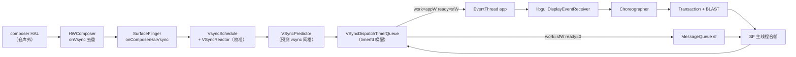
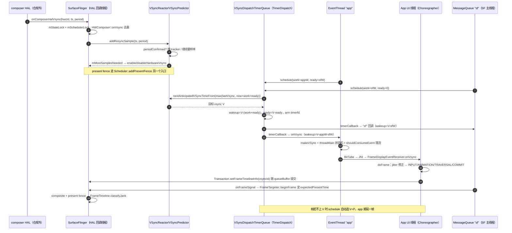

# VSync 流水线：从 HWC 上报到 app/sf 两相帧调度

> 状态：draft · 适用版本：android17-release · 校验日期：2026-11-24
> 关联：[[architecture-overview]] · [[render-pipeline]] · 相关长文：../VSYNC_Complete_Analysis.md

## 1. 作用与边界

本页只回答四个问题：硬件 VSYNC 从哪进系统、经过哪些对象、app 与 sf 两个相位怎么被加出来、谁消费 `expectedPresentTime`/`deadline` 并据此判定掉帧。预测器的线性回归与误差滤波不在本页展开，见 [VSYNC_Complete_Analysis 第 2 节](../VSYNC_Complete_Analysis.md)。

需要先纠正一个常见说法：本树里**没有第二个 EventThread 给 SF 用**。`Scheduler` 只创建一个名为 `"app"` 的 `EventThread`（`native/services/surfaceflinger/Scheduler/Scheduler.cpp:583`，构造处 `native/services/surfaceflinger/Scheduler/EventThread.cpp:311`）；SurfaceFlinger 自己作为 `MessageQueue`，在同一个 `VSyncDispatch` 上另注册一条名为 `"sf"` 的回调（`native/services/surfaceflinger/Scheduler/MessageQueue.cpp:122`）。所谓 `VSYNC-app` 与 `VSYNC-sf` 的相位差，来自两条注册各自的 `workDuration`/`readyDuration`，而不是两个线程的调度差。

| 环节 | 是否在本仓库 | 依据 |
| --- | --- | --- |
| HAL 上报 vsync 的调用线程与周期精度 | 本仓库外，仅有接口假设 | 仓库内只看到 `HWComposer::onVsync` 对回调的接收与去重 |
| composer HAL / DRM 驱动 / 面板时序 | 本仓库外 | 本页不展开 |
| 采样校准、预测模型、workDuration/相位 | 在 | `VSyncReactor`、`VSyncPredictor`、`VSyncDispatchTimerQueue`、`VsyncConfiguration` |
| app 侧唤醒与帧回调 | 在 | `EventThread` → `DisplayEventReceiver` → `Choreographer` |
| sf 侧唤醒与合帧 | 在 | `MessageQueue` 的 `"sf"` 回调 → `Scheduler::onFrameSignal` |
| 掉帧归因 | 在 | `FrameTargeter::beginFrame`、`SurfaceFrame::classifyJankLocked` |

两个语义细节，后文会反复用到：

- 发给 app 的 `DISPLAY_EVENT_VSYNC` 事件里，header 时间戳是**唤醒时刻**，不是硬件 vsync 时刻；硬件 vsync 时刻放在 `expectedPresentationTime`（`native/services/surfaceflinger/Scheduler/EventThread.cpp:478` 的 `makeVSync(displayId, wakeupTime, count, vsyncTime, readyTime)`）。
- "相位"在本树已经被折算成时长，不存在独立的 `phaseOffset` 变量参与调度；`VsyncConfig::sfOffset/appOffset` 只在换算与 mode-change 事件里出现。

## 2. 模块与文件地图

| 层 | 文件 | 关键职责 | 执行线程 |
| --- | --- | --- | --- |
| 上报 | `native/services/surfaceflinger/SurfaceFlinger.cpp:2535` | `onComposerHalVsync` 接 HAL 回调，取 `mStateLock` + `mSchedulerLock` | HAL 回调线程（仓库外决定） |
| 上报去重 | `native/services/surfaceflinger/DisplayHardware/HWComposer.cpp:155` | 丢弃重复时间戳、校验 display 连接状态、打 `HW_VSYNC_<id>` | 同上 |
| 采样/校准 | `native/services/surfaceflinger/Scheduler/VSyncReactor.cpp:201` | 周期切换确认、present fence 采样、决定是否继续要 HW vsync | 调用方线程 |
| 预测 | `native/services/surfaceflinger/Scheduler/VSyncPredictor.cpp:380` | `nextAnticipatedVSyncTimeFrom` 给出目标 vsync | 调用方线程（内部 `mMutex`） |
| 定时与相位 | `native/services/surfaceflinger/Scheduler/VSyncDispatchTimerQueue.cpp:334` | 把 (vsync, workDuration, readyDuration) 折算成 timerfd 唤醒 | `TimerDispatch` 线程 |
| app 分发 | `native/services/surfaceflinger/Scheduler/EventThread.cpp:530` | 连接管理、限流、生成 frame timeline、写 BitTube | `app` EventThread |
| sf 分发 | `native/services/surfaceflinger/Scheduler/MessageQueue.cpp:59` | 生成 vsyncId、把帧交给 SF 主线程 Looper | `TimerDispatch` → SF 主线程 |
| 相位配置 | `native/services/surfaceflinger/Scheduler/VsyncConfiguration.cpp:161`、`native/services/surfaceflinger/Scheduler/Scheduler.cpp:802` | 把 offset/时长换算成两条注册的参数 | SF 主线程 |
| app native | `native/libs/gui/DisplayEventReceiver.cpp:36` | 建连接、偷 BitTube、`requestNextVsync` | app 侧任意线程 |
| app Java | `base/core/java/android/view/Choreographer.java:1579` | `FrameDisplayEventReceiver` → `doFrame` → 五类回调 | app UI 线程 |
| 归因 | `native/services/surfaceflinger/Scheduler/FrameTimeline.cpp:829`、`native/services/surfaceflinger/Scheduler/src/FrameTargeter.cpp:99` | jank 分类、present 背压与 missed 判定 | SF 主线程 |
| 选帧率 | `native/services/surfaceflinger/Scheduler/LayerHistory.cpp:116` | 记录每层 present 时间，产生刷新率投票 | SF 主线程 |

连接面：`DisplayEventReceiver` 在构造时通过 AIDL 声明 `native/libs/gui/aidl/android/gui/ISurfaceComposer.aidl:89` 拿 `IDisplayEventConnection`，实现在 `native/services/surfaceflinger/SurfaceFlinger.cpp:9852`。注意本仓库的 `native/libs/gui/ISurfaceComposer.cpp:54` 只剩 legacy `BpSurfaceComposer`，不再承载这条 AIDL 方法；在 `.cpp` 里搜不到 `createDisplayEventConnection` 不代表链路断开。

一条 vsync 的静态分层：



## 3. 核心流程

### 3.1 硬件信号进入模型

1. **HAL 回调落地**——`native/services/surfaceflinger/SurfaceFlinger.cpp:2535` `SurfaceFlinger::onComposerHalVsync()`。线程：HAL 回调线程。先 `Mutex::Autolock mStateLock`（`:2548`），再 `REQUIRE_SCHEDULER` 取 `mSchedulerLock`（`:2530` 宏定义）；`timestamp <= 0` 直接返回（`:2541`），`HWComposer::onVsync` 返回空则整条链到此为止（`:2549`）。
2. **去重**——`native/services/surfaceflinger/DisplayHardware/HWComposer.cpp:155` `HWComposer::onVsync()`：同一时间戳重复上报被丢弃（`:172`），随后打 `HW_VSYNC_<id>`（`:181`）。这是"同一 vsync 被 HWC 报两次"的唯一防线。
3. **进校准器**——`native/services/surfaceflinger/Scheduler/Scheduler.cpp:978` `Scheduler::addResyncSample()` 校验 `VsyncTimeSource`（present fence 走另一条入口，传错直接 `LOG_ALWAYS_FATAL`），再调 `VsyncSchedule::addResyncSample`（`native/services/surfaceflinger/Scheduler/VsyncSchedule.cpp:168`）。线程：仍是 HAL 回调线程；`VsyncSchedule` 持 `mHwVsyncLock`。
4. **周期确认与样本接受**——`native/services/surfaceflinger/Scheduler/VSyncReactor.cpp:201` `VSyncReactor::addHwVsyncTimestamp()`，全程持 `mMutex`（`:205`）。`periodConfirmed`（`:166`）用 10% 容差比较 HWC 给的周期或相邻时间戳距离；未确认时把时间戳塞进 `mLastHwVsync` 并继续要样本（`:220`、`:227`）；确认后 `mTracker.setDisplayModePtr`（`:209`）并 `endPeriodTransition()`（`:218`）。`mMoreSamplesNeeded` 由 `VSyncPredictor::needsMoreSamples()` 决定（`:219`、`:233`），为 false 时关闭内部 ignore（`:241`），再由 `VsyncSchedule` 调 `enable/disableHardwareVsync`。
5. **present fence 采样**——`native/services/surfaceflinger/Scheduler/Scheduler.cpp:999` `Scheduler::addPresentFence()` → `VSyncReactor::addPresentFence`（`native/services/surfaceflinger/Scheduler/VSyncReactor.cpp:71`）。pending fence 最多 20 个（`kMaxPendingFences`，`native/services/surfaceflinger/Scheduler/VsyncSchedule.cpp:152`），超限丢最旧（`:92`–`:93`）；信号到了才真正喂给 tracker（`:53`）。**样本被拒**时置 `mMoreSamplesNeeded` + `mPeriodConfirmationInProgress` 并忽略后续 fence（`:101`–`:104`），外部表现是这段时间模型重新校准、app 侧唤醒点发生偏移。

### 3.2 相位与定时

6. **相位下发**——`native/services/surfaceflinger/Scheduler/Scheduler.cpp:802` `Scheduler::setVsyncConfig()`：
   - `setDuration(appWorkDuration, sfWorkDuration)` 给 app 的 `EventThread`（`:803`，落到 `EventThread::setDuration`，`native/services/surfaceflinger/Scheduler/EventThread.cpp:353`）；
   - `setDuration(sfWorkDuration)` 给 sf 的 `MessageQueue`（`:805`，落到 `native/services/surfaceflinger/Scheduler/MessageQueue.cpp:138`）。

   线程：SF 主线程。两条 `VSyncCallbackRegistration::update` 会立刻重算已武装的唤醒时间。启动初值来自 `configs.late`：`native/services/surfaceflinger/SurfaceFlinger.cpp:5218`（app）与 `:5225`（sf），函数为 `SurfaceFlinger::initScheduler`（`:5162`）。配置源默认是 legacy `PhaseOffsets`（`native/services/surfaceflinger/Scheduler/VsyncConfiguration.cpp:89`–`:90`，app/sf 均 1ms；高刷 `:95`/`:96` 为 2ms/1ms），`debug.sf.use_phase_offsets_as_durations` 为真时切 `WorkDuration`（`native/services/surfaceflinger/SurfaceFlingerDefaultFactory.cpp:47`）。
7. **offset 如何变成时长**——`native/services/surfaceflinger/Scheduler/VsyncConfiguration.cpp:146` `sfOffsetToDuration = P − sfOffset`，`:150` `appOffsetToDuration = P + sfOffset − appOffset`。`VsyncConfig::sfOffset/appOffset` 只参与这两处换算与被塞进 mode-change 事件（`appVsyncOffset`，`native/services/surfaceflinger/Scheduler/EventThread.cpp:167`；`presentationDeadline` 由 `Scheduler::getPresentationDeadline` 算，`native/services/surfaceflinger/Scheduler/Scheduler.h:216`），进入调度器的只有两个 `workDuration`。
8. **武装定时器**——`EventThread::threadMain` 在需要 vsync 时调 `mVsyncRegistration.schedule({workDuration, readyDuration, lastVsync, committedVsyncOpt})`（`native/services/surfaceflinger/Scheduler/EventThread.cpp:596`），`MessageQueue::scheduleFrame` 同理（`native/services/surfaceflinger/Scheduler/MessageQueue.cpp:191`）。落到 `VSyncDispatchTimerQueue::scheduleLocked`（`native/services/surfaceflinger/Scheduler/VSyncDispatchTimerQueue.cpp:414`），再由 `VSyncDispatchTimerQueueEntry::schedule`（`:90`）算三件事：
   - `nextVsync = nextAnticipatedVSyncTimeFrom(max(lastVsync, now + work + ready))`（`:93`）；
   - `wakeup = nextVsync − work − ready`（`:99`，且不早于 `now`，`:112`）；
   - `ready = nextVsync − ready`（`:114`）。

   若算出的 vsync 比已武装目标晚超过 `mMinVsyncDistance`，保留旧目标，避免"为同一拍重复唤醒"（`:101`–`:108`）；timer 即将触发时改为登记 pending workload（`:425`–`:427`），由 `timerCallback` 侧合并，避免取消一个正要跑的定时器。
9. **两条线在同一预测网格上相加**：

```text
同一目标 V（VSyncPredictor 预测的硬件 vsync）
  app : wakeup = V − appWorkDuration − sfWorkDuration
        deadline/readyTime = V − sfWorkDuration
  sf  : wakeup = V − sfWorkDuration            （readyDuration = 0）
  ⇒ app 比 sf 早唤醒 appWorkDuration；app 的 deadline 正是 sf 的唤醒点
```

   若 `lastVsync`/`now` 已经越过 `V − (work + ready)`，`nextAnticipatedVSyncTimeFrom` 返回的是再下一拍 `V + P`，这就是"赶不上就顺延一帧"的全部机制（`native/services/surfaceflinger/Scheduler/VSyncDispatchTimerQueue.cpp:93`、`native/services/surfaceflinger/Scheduler/VSyncPredictor.cpp:380`）。app 侧还通过 `committedVsyncOpt`（上次分发的 `preferredExpectedPresentationTime`）把目标钉在"已经告诉过 app 的那一拍"上（`native/services/surfaceflinger/Scheduler/EventThread.cpp:795`）。
10. **timer 线程分发**——`VSyncDispatchTimerQueue::timerCallback`（`native/services/surfaceflinger/Scheduler/VSyncDispatchTimerQueue.cpp:334`）运行在 `TimerDispatch` 线程（`native/services/surfaceflinger/Scheduler/src/Timer.cpp:40` 建线程，`:162` 命名）。持 `mMutex` 收集所有 `wakeupTime < intended + timerSlack + lag` 的 entry（`:362`），先 `executing()` 再出锁逐个 `callback()`（`:216`），回调期间 `mRunning` 为真，`unregisterCallback` 会 `ensureNotRunning` 等待（`:404`）。因此**回调函数本身跑在 timer 线程**，不允许阻塞；同一唤醒窗口内的多条 entry 共享一次 timerfd 唤醒。

### 3.3 app 侧消费

11. **EventThread 生成事件**——`createDispatchCallback` 把回调接到 `EventThread::onVsync`（`native/services/surfaceflinger/Scheduler/EventThread.cpp:895`、`:472`）。onVsync 只做三件事：更新 `mLastVsyncCallbackTime`、`makeVSync(displayId, wakeupTime, count, vsyncTime, readyTime)`（`:478`）、`mCondition.notify_all()`。线程：`TimerDispatch`；持 `EventThread::mMutex`。
12. **线程状态机选路**——`EventThread::threadMain`（`native/services/surfaceflinger/Scheduler/EventThread.cpp:530`）唤醒后统计 `vsyncRequested`，在 `Idle` / `VSync` / `SyntheticVSync` 中选一个（`:578`–`:593`，`State` 定义在 `native/services/surfaceflinger/Scheduler/EventThread.h:273`）；只有 `State::VSync` 才重新 `schedule`，否则 `cancel`（`:595`–`:604`）。屏幕关且 `no_vsyncs_on_screen_off` 时进 `Idle` 并打 `VsyncPendingScreenOn=1`（`:583`）。无事件时 `1000ms`（`SyntheticVSync` 为 `16ms`）超时会伪造一个 vsync（`:616`–`:629`），这是驱动卡死时 app 不至于冻结的兜底。
13. **按连接限流**——`shouldConsumeEvent`（`native/services/surfaceflinger/Scheduler/EventThread.cpp:637`）先看 `vsyncRequest`：`Single` 消费一次后降为 `SingleSuppressCallback`，`Periodic` 常开，`None` 丢弃，数字 rate 用 `count % rate`（`:669`–`:693`）；再对 `Single`/`Periodic` 调 `throttleVsync`（`:639`–`:650`），落到 `Scheduler::isVsyncValid` → `isVSyncInPhase`（`native/services/surfaceflinger/Scheduler/Scheduler.cpp:519`、`native/services/surfaceflinger/Scheduler/VSyncPredictor.cpp:454`）。这是"app 帧率低于屏幕帧率时只在其相位上唤醒"的实现。
14. **生成 frame timeline 并投递**——`EventThread::dispatchEvent`（`native/services/surfaceflinger/Scheduler/EventThread.cpp:769`）对每个 consumer 复制事件、按 uid 取 `frameInterval`（`Scheduler::getVsyncPeriod`，`native/services/surfaceflinger/Scheduler/Scheduler.cpp:540`），再 `generateFrameTimeline`（`native/services/surfaceflinger/Scheduler/EventThread.cpp:712`）填多个候选：第 i 个的 `expectedPresentationTime = preferred + i·P`、`deadlineTimestamp = preferredDeadline + i·P`，`vsyncId` 由 `TokenManager::generateTokenForPredictions` 产生（`:703`；实现 `native/services/surfaceflinger/Scheduler/FrameTimeline.cpp:1294`），`multiplier == 0` 记为 `preferredFrameTimelineIndex`（`:742`）。随后 `EventThreadConnection::postEvent` 写 BitTube（`:283`）；`-EAGAIN` 只告警，`EPIPE` 删连接（`:790`–`:792`）。分发完把 `preferredExpectedPresentationTime` 记为 `mLastCommittedVsyncTime` 并回调 `onExpectedPresentTimePosted`（`:795`–`:798`）。
15. **app 侧收包**——`DisplayEventReceiver` 构造时拿到 BitTube fd（`native/libs/gui/DisplayEventReceiver.cpp:36`、`:49`），JNI 侧用 `DisplayEventDispatcher` 把它挂到 app 的 Looper（`base/core/jni/android_view_DisplayEventReceiver.cpp:140`），再在 `dispatchVsync` 里调 Java（`:203`）→ `android.view.DisplayEventReceiver.dispatchVsync`（`base/core/java/android/view/DisplayEventReceiver.java:364`）→ `onVsync`（`:251`）→ `Choreographer.FrameDisplayEventReceiver.onVsync`（`base/core/java/android/view/Choreographer.java:1594`）。后者把时间戳钳到"不晚于 now"（`:1608`），再 `sendMessageAtTime` 投一条 async 消息（`:1631`）。
16. **doFrame**——`Choreographer.doFrame`（`base/core/java/android/view/Choreographer.java:1074`）先 `mFrameData.update(frameTime, vsyncEventData)`（`:1107`，实现 `:1484`），再在 `mLock` 下算 `jitter = now − frameTime`，超过一个 `frameInterval` 就把 frameTime 拉回最近的 vsync 网格并打印 `Skipped N frames`（`:1123`–`:1136`），随后把 vsyncId/deadline 写进 `mFrameInfo`（`:1183`）并依次跑 `CALLBACK_INPUT → ANIMATION → INSETS_ANIMATION → TRAVERSAL → COMMIT`（`:1202`–`:1211`）。帧过晚时用 `getLatestVsyncEventData()`（`:1517`，binder 回查 SF）换一组 timeline，这就是 `Choreographer#doFrame - resynced` 的来源。

### 3.4 回传与掉帧判定

17. **预期上屏时间回到 SF**——app 在回调里取 `getVsyncId()` / `getFrameDeadline()`（`base/core/java/android/view/Choreographer.java:958`、`:974`），随事务下发：`Transaction::setFrameTimelineInfo`（`native/libs/gui/SurfaceComposerClient.cpp:2235`），BLAST 侧在 `native/libs/gui/BLASTBufferQueue.cpp:719` 合并进 transaction；SF 在 `native/services/surfaceflinger/Layer.cpp:418` `Layer::setFrameTimelineVsyncForBufferlessTransaction` 存 `frameTimelineInfo`，并用该 token 从 `TokenManager` 取回预测，构造 `SurfaceFrame`（`native/services/surfaceflinger/Scheduler/FrameTimeline.cpp:443`、`:1357`）。
18. **sf 侧选 present time**——`MessageQueue::vsyncCallback`（`native/services/surfaceflinger/Scheduler/MessageQueue.cpp:59`）在 timer 线程生成 `VsyncId` 并把帧丢给 SF 主线程；主线程 `Scheduler::onFrameSignal`（`native/services/surfaceflinger/Scheduler/Scheduler.cpp:411`）用 `beginFrameArgs{expectedVsyncTime, sfWorkDuration, hwcMinWorkDuration}`（`:420`）调 `FrameTargeter::beginFrame`（`native/services/surfaceflinger/Scheduler/src/FrameTargeter.cpp:99`）。expected present 的选法：`expectedVsyncTime >= frameBeginTime` 时直接用（`:117`），否则顺延到下一个 vsync deadline；若 `sfWorkDuration > vsyncPeriod` 再补一个周期（`:119`–`:121`）。`computeEarliestPresentTime`（`:187`）在"可能提前上屏"时用 `上一帧 vsync − hwcMinWorkDuration` 兜底（`:191`）。
19. **掉帧判定**——三套并行判据：
   - SF 自身：`mFrameMissed = mFramePending || lastScheduledPresentTime < 实际 fence 信号时间 − P/2`（`native/services/surfaceflinger/Scheduler/src/FrameTargeter.cpp:162` 起），present fence 即将触发时有 1ms 宽限（`:140`–`:149`）。
   - FrameTimeline：`SurfaceFrame::onPresent`（`native/services/surfaceflinger/Scheduler/FrameTimeline.cpp:1052`）→ `classifyJankLocked`（`:829`）。核心量是 `presentDelay = actualPresent − predictions.presentTime`（`:727`）与 `deadlineDelta = actualEnd − predictions.endTime`（`:732`）；`OnTimePresent` 即 `None`；**`LateFinish && LatePresent` 判 `AppDeadlineMissed`**（`:822`）；present 晚但 finish 准时，按与 vsync 的倍数关系判 `SurfaceFlingerScheduling` 或 `PredictionError`（`:811`–`:816`），倍数/连续性阈值由 `impl::FrameTimeline` 的 20Hz 与 0.30 决定（`native/services/surfaceflinger/Scheduler/FrameTimeline.h:658`–`:659`）。分类结果进 `TimeStats::incrementJankyFrames` 与 `JankTracker`（`:1073`），枚举见 `native/libs/gui/include/gui/JankInfo.h:32`。
   - refresh rate：`LayerHistory::record`（`native/services/surfaceflinger/Scheduler/LayerHistory.cpp:116`）→ `LayerInfo::setLastPresentTime`（`native/services/surfaceflinger/Scheduler/LayerInfo.cpp:51`）→ `LayerHistory::summarize` 产生投票（`:172`），jank 会改变下一段刷新率与相位。

## 4. 时序图



## 5. 关键数据结构与状态机

| 结构 | 位置 | 要点 |
| --- | --- | --- |
| `VSyncDispatch::ScheduleTiming` | `native/services/surfaceflinger/Scheduler/VSyncDispatch.h:102` | `workDuration` / `readyDuration` / `lastVsync` / `committedVsyncOpt`，相位注入的唯一入口 |
| `ArmingInfo` | `native/services/surfaceflinger/Scheduler/VSyncDispatchTimerQueue.h:87` | `{actualWakeupTime, actualVsyncTime, actualReadyTime}`，一个 entry 只武装一个目标 |
| `VsyncConfig` | `native/services/surfaceflinger/Scheduler/include/scheduler/VsyncConfig.h:28` | `sfOffset`、`appOffset`、`sfWorkDuration`、`appWorkDuration`；`kEarlyLatchMaxThreshold = 100ms`（`:43`）限制 timeline 候选跨度 |
| `VsyncConfigSet` | `native/services/surfaceflinger/Scheduler/include/scheduler/VsyncConfig.h:46` | `early` / `earlyGpu` / `late` 三套 + `hwcMinWorkDuration`；由 `VsyncModulator` 依事务/刷新率切换（`native/services/surfaceflinger/Scheduler/VsyncModulator.cpp:42`、`:107`） |
| `VSyncRequest` | `native/services/surfaceflinger/Scheduler/EventThread.h:61` | `None=-2`、`Single=-1`、`SingleSuppressCallback=0`、`Periodic=1`、其余为 period |
| `EventThread::VSyncState` | `native/services/surfaceflinger/Scheduler/EventThread.h:257` | `count`、`synthetic`、`omitted`；hotplug 断开即销毁 |
| `EventThread::State` | `native/services/surfaceflinger/Scheduler/EventThread.h:273` | `Idle` / `VSync` / `SyntheticVSync` / `Quit`，只由 `updateState` 改（`native/services/surfaceflinger/Scheduler/EventThread.cpp:837`） |
| `FrameData` / `FrameTimeline` | `base/core/java/android/view/Choreographer.java:1412` | Java 侧持有候选 timeline 数组与 `preferredFrameTimelineIndex` |
| `SurfaceFrame` | `native/services/surfaceflinger/Scheduler/FrameTimeline.h:193` | 一个 buffer 一条，`mPredictions` 来自 `TokenManager`（`kMaxTokens=500`，`:487`），`onPresent` 时分类 jank |

`expectedPresentTime`/`deadline` 的四个持有者，搞混就会把时间基准对错：

| 持有者 | 字段 | 时基/含义 |
| --- | --- | --- |
| `VsyncEventData::FrameTimeline` | `expectedPresentationTime`、`deadline` | 候选上屏时刻与该帧的 app deadline（= `V − sfWorkDuration`） |
| `DisplayEventReceiver::Event` header | `timestamp` | wakeup 时刻，不是 vsync |
| `Choreographer.FrameTimeline` | `mDeadlineNanos`、`mFrameTimeNanos` | doFrame 用；迟到时会被 jitter 重算（`base/core/java/android/view/Choreographer.java:1503`） |
| `SurfaceFrame` | `mPredictions.presentTime` / `.endTime` | SF 侧判 `presentDelay` / `deadlineDelta` 的基准 |

状态机要点：

- `EventThread` 的 `Idle→VSync` 由"有连接请求 + 有 `mVSyncState`"驱动，`mVSyncState` 只在 hotplug `CONNECTED` 时 `emplace`（`native/services/surfaceflinger/Scheduler/EventThread.cpp:543`）；断开后所有 vsync 请求被忽略并告警（`:591`）。
- `VSyncReactor` 的过渡态由 `mPeriodConfirmationInProgress` / `mModeChangeInProgress` / `mMoreSamplesNeeded` 三个布尔描述（`native/services/surfaceflinger/Scheduler/VSyncReactor.cpp:128`、`:141`、`:241`）；模式切换期间 present fence 被整体忽略（`:84`–`:88`），避免拿旧模式的 fence 污染新模型。
- `VSyncDispatchTimerQueueEntry` 的 `mArmedInfo` 是"已武装/未武装"二态，`executing()` 取走目标并 `disarm()`（`native/services/surfaceflinger/Scheduler/VSyncDispatchTimerQueue.cpp:210`），`mLastDispatchTime` 用于阻止同一拍二次分发（`:134`）。

## 6. 线程/进程模型与并发

| 线程 | 谁创建 | 优先级/策略 | 在此线程上跑的 VSync 代码 |
| --- | --- | --- | --- |
| composer HAL 回调线程 | HWC/HAL（仓库外） | 仓库外 | `onComposerHalVsync`、`HWComposer::onVsync`、`addResyncSample` |
| SF 主线程（scheduler） | SurfaceFlinger | 普通 | `initScheduler`、`setVsyncConfig`、`onFrameSignal`、`FrameTargeter`、`composite` |
| `TimerDispatch` | `Timer::Timer`（`native/services/surfaceflinger/Scheduler/src/Timer.cpp:40`） | `SCHED_FIFO` 2（`:155`） | `VSyncDispatchTimerQueue::timerCallback` 与两条回调本体 |
| `app` EventThread | `EventThread` 构造（`native/services/surfaceflinger/Scheduler/EventThread.cpp:324`） | `SCHED_FIFO` 2（`:334`）+ `SP_FOREGROUND` | `threadMain`、`dispatchEvent`、`postEvent` |
| app UI 线程 | app | 普通 | `FrameDisplayEventReceiver.onVsync`、`doFrame`、所有回调 |

| 锁 | 保护对象 | 冲突点 |
| --- | --- | --- |
| `VSyncReactor::mMutex` | tracker 样本、`mUnfiredFences`、过渡态布尔 | 持锁期间调 predictor，粒度较大 |
| `VsyncSchedule::mHwVsyncLock` | `mHwVsyncState`、`mController` 调用 | `enableHardwareVsync` 会经 `mRequestHardwareVsync` 回调 SF，注意不要在持锁时再取 `mStateLock` 的反向顺序 |
| `VSyncDispatchTimerQueue::mMutex` | `mCallbacks`、`mIntendedWakeupTime` | 回调出锁执行，但 `unregisterCallback` 要等 `mRunning` 归零（`:404`） |
| `EventThread::mMutex` | 连接表、pending 事件、`mState` | `dispatchEvent` 持锁写 BitTube；`onVsync` 从 timer 线程抢同一把锁 |
| `EventThreadConnection::mLock` | BitTube | 只保护 channel 本身（`native/services/surfaceflinger/Scheduler/EventThread.cpp:247`） |
| `Scheduler::mDisplayLock` / `mVsyncConfigLock` / `mChoreographerLock` | display 表、相位配置、choreographer 连接 | `getVsyncConfigsForRefreshRate` 与 `updatePhaseConfiguration` 会嵌套 |

并发上的四个坑与对应失败模式：

1. 回调替换必须"出锁析构"：`EventThread::onNewVsyncSchedule` 先把旧 `VSyncCallbackRegistration` 存局部变量再释放（`native/services/surfaceflinger/Scheduler/EventThread.cpp:860`）；`MessageQueue` 的注释写明若不这样会与正在跑的 timer 回调互等（`native/services/surfaceflinger/Scheduler/MessageQueue.cpp:101`）。失败表现：SF 在 mode change 时卡死。
2. `schedule()` 返回空 = 注册已失效，`EventThread` 直接 `LOG_ALWAYS_FATAL`（`native/services/surfaceflinger/Scheduler/EventThread.cpp:601`）。改注册逻辑时要保留这个语义，否则会退化成"静默不刷新"。
3. app 侧连接是弱引用：`EventThread` 不持有 `EventThreadConnection` 强引用，靠 `onFirstRef` 注册（`native/services/surfaceflinger/Scheduler/EventThread.cpp:242`），对象死亡后由 `threadMain` 清理（`:569`）。失败表现：`postEvent` 返回 `EPIPE`，连接被摘除，app 侧只剩 `DisplayEventReceiver` 的 `initCheck` 报错。
4. `requestNextVsync` 是异步 binder（`native/services/surfaceflinger/Scheduler/EventThread.h:81`），且先 `mCallback.resync(RequestNextVsync)`（`native/services/surfaceflinger/Scheduler/EventThread.cpp:418`）——"app 请求下一帧"本身触发一次与硬件 vsync 的重同步。高频滥用会让模型不断重置，反而拉大唤醒抖动。

## 7. 调试入口

- `adb shell dumpsys SurfaceFlinger --vsync`：入口 `native/services/surfaceflinger/SurfaceFlinger.cpp:6682` → `:6798` → `Scheduler::dumpVsync`（`native/services/surfaceflinger/Scheduler/Scheduler.cpp:1311`），输出 `VsyncSchedule`、`VsyncReactor`（`native/services/surfaceflinger/Scheduler/VSyncReactor.cpp:275`）、`VSyncDispatch` 每个 entry 的 `workDuration/readyDuration/lastVsync/committedVsync` 与 armed 信息（`native/services/surfaceflinger/Scheduler/VSyncDispatchTimerQueue.cpp:477`），以及 `VsyncModulator` 当前配置。
- `adb shell dumpsys SurfaceFlinger --frametimeline -jank`（`-all` 看全部；参数解析在 `native/services/surfaceflinger/Scheduler/FrameTimeline.cpp:2257`，入口 `native/services/surfaceflinger/SurfaceFlinger.cpp:6671`）看单帧 predictions/actuals 与 jank；`--latency`（`:6675`）看 layer 的 present 直方图。
- Perfetto/trace 标记：`HW_VSYNC_<displayId>`（`native/services/surfaceflinger/DisplayHardware/HWComposer.cpp:181`）、`VSYNC-app`（`native/services/surfaceflinger/Scheduler/EventThread.cpp:317`）、`VSYNC-predicted`（`native/services/surfaceflinger/Scheduler/VsyncSchedule.cpp:55`）、`VsyncPendingScreenOn`（`native/services/surfaceflinger/Scheduler/EventThread.cpp:583`）、`Choreographer#onVsync <vsyncId>`（`base/core/java/android/view/Choreographer.java:1599`）与 `Choreographer#doFrame <vsyncId>`（`:1110`）、`EventThreadState-app` 的 async 轨道（`native/services/surfaceflinger/Scheduler/EventThread.cpp:843`）。
- 相位相关 sysprop：`debug.sf.use_phase_offsets_as_durations`（`native/services/surfaceflinger/SurfaceFlingerDefaultFactory.cpp:47`）、`debug.sf.early_phase_offset_ns`、`debug.sf.high_fps_late_app_phase_offset_ns`、`debug.sf.hwc.min.duration`（`native/services/surfaceflinger/Scheduler/VsyncConfiguration.cpp:91`–`:108`），以及默认 offset 的 `sysprop::vsync_event_phase_offset_ns(1000000)` / `vsync_sf_event_phase_offset_ns(1000000)`（`:89`–`:90`）。
- Java 侧现场：`Choreographer.getVsyncId()`、`getFrameDeadline()`（`base/core/java/android/view/Choreographer.java:958`、`:974`），`DEBUG_JANK` 打开后可见 `Missed vsync by …`、`Skipped N frames`（`:1138`、`:1133`）。
- 判定"是 app 慢还是 SF 慢"：先看 `SurfaceFrame` 的 `deadlineDelta`（app 预算）再看 `presentDelay`（是否被 SF 排到下一拍），两者都超时才看 `FrameTargeter::mFrameMissed` 与 present fence pending。

## 8. 延伸阅读

- [VSYNC_Complete_Analysis](../VSYNC_Complete_Analysis.md)：信号类型、线性回归模型、相位差推导与历史实现，本页刻意不复述其数学。
- [Model/vsync-pipeline/README](../Model/vsync-pipeline/README.md)：可交互的相位模型（`SF = present − sfWorkDuration`、`APP = SF − appWorkDuration`）与"默认 PhaseOffsets 是 1ms/1ms"的对照说明；直接打开 [index.html](../Model/vsync-pipeline/index.html)。
- [Model/app-vsync-traversal](../Model/app-vsync-traversal/index.html)：从 `ViewRootImpl` 到 traversal 的那一段，正好接本页第 3.3 节。
- [hwui_syncAndDrawFrame_to_surfaceflinger](../hwui_syncAndDrawFrame_to_surfaceflinger.md)：`syncAndDrawFrame` 之后 RenderThread 与 BLAST 的接力，本页只写到 `doFrame` 交出控制权为止。
- 相邻 wiki 页：[[architecture-overview]] 给进程/模块边界；[[render-pipeline]] 给一帧从 measure 到 present 的全景，本页只负责其中的时钟与相位。

## 9. 待补充与不确定点

- HWC 上报 vsync 的**回调线程来源与抖动特性**不在本仓库：`onComposerHalVsync` 只保证"被调用时已持 `mStateLock`"，谁在什么优先级上调用它、vendor 是否用同一个线程上报 vsync 与 present fence，本仓库无法确认，仅有"回调会带 monotonic 时间戳"的接口假设。
- `JankClassificationThresholds` 的 `deadlineThreshold` / `presentThreshold` 由 SurfaceFlinger 构造参数注入，本仓库未给出默认数值，本页只按"阈值比较"的语义描述，不做数值承诺。
- `WorkDuration` 模式下 `early/earlyGpu/late` 三套配置的实际取值依赖设备 overlay/`DisplayModeSpecs`；本仓库只保留构造函数与换算（`native/services/surfaceflinger/Scheduler/VsyncConfiguration.cpp:289`），真机默认值需 `dumpsys SurfaceFlinger --vsync` 现场确认。
