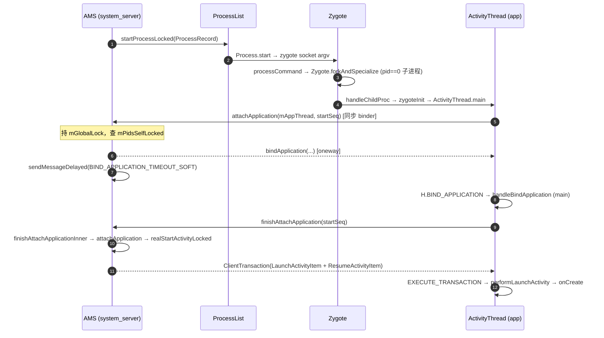
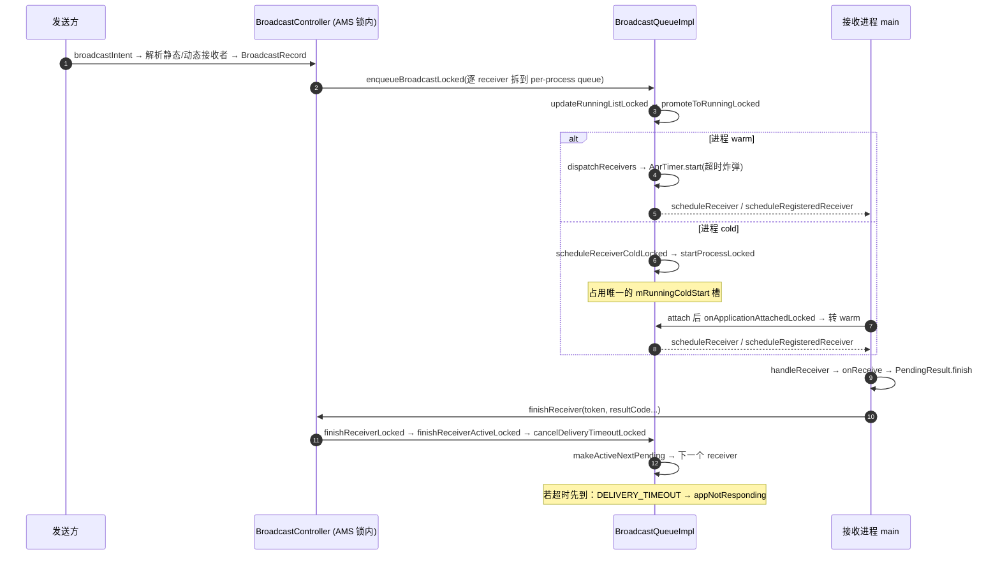
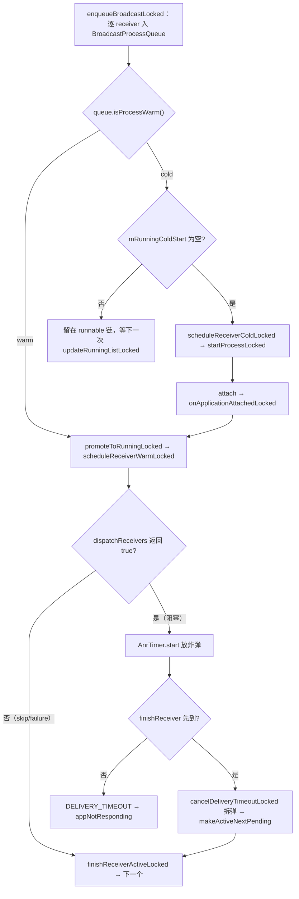

# AMS：进程启动、Activity 启动与广播

> 状态：draft · 适用版本：android17-release · 校验日期：2026-11-24
> 关联：[[architecture-overview]] · [[wms-transition]] · 相关长文：../docs/aosp-ams-service-source-study-analysis.md · ../docs/aosp-ams-broadcast-source-study-analysis.md · ../docs/ANR/Broadcast-ANR放炸弹与拆炸弹机制源码深度解析.md

## 1. 作用与边界

system_server 里的 AMS/ATMS 是"应用进程 + 四大组件"的唯一裁决者：进程该不该存在、哪个 Activity 该在前台、某条广播该投给谁，全部由它算出结果，再编码成 Binder 调用或 `ClientTransaction` 推给 app。三条链路共享同一个契约：

- 状态推进只发生在 system_server，且在 `mGlobalLock`（就是 AMS 对象自身）保护下：`base/services/core/java/com/android/server/am/ActivityManagerService.java:782`。
- 对 app 的调用走 `IApplicationThread`，该 AIDL 接口整体声明为 `oneway`：`base/core/java/android/app/IApplicationThread.aidl:72`。所以 AMS 不会被应用侧反压卡住，代价是"调用发出"与"app 真正执行"之间必须靠回调（`finishAttachApplication` / `finishReceiver`）或超时再次对齐。
- app 侧真正干活的位置只有三处：`ActivityThread.main` 的 main looper、`H` 消息处理、`ClientTransaction` 的 item 序列。

本页不覆盖（本仓库外，仅有接口假设）：kernel 的 binder 驱动与 `fork()` 系统调用实现（仓库内最远只到 `base/core/jni/com_android_internal_os_Zygote.cpp:2532` 的 `fork()` 调用点）、HAL/vendor 进程、SurfaceFlinger 合成，以及 `SCHED_FIFO` 主线程优先级（同文件 `:2535`）的实际调度效果。

四个必须钉死的名字/事实（社区文章常写错）：

| 常见误写 | 本分支事实 |
| --- | --- |
| `am/ActivityStarter.java` | 在 wm 包：`base/services/core/java/com/android/server/wm/ActivityStarter.java:837` |
| `ApplicationThread.java` | 是内部类，不是独立文件：`base/core/java/android/app/ActivityThread.java:1202` |
| `BroadcastQueue.processNextBroadcast` | 代码中已无此符号（只有 `base/services/art-profile-boot:597` 这类历史 profile 残留方法名）。`BroadcastQueue` 已是抽象基类：`base/services/core/java/com/android/server/am/BroadcastQueue.java:45`；派发循环拆成 `updateRunningListLocked` + `scheduleReceiverWarmLocked`：`base/services/core/java/com/android/server/am/BroadcastQueueImpl.java:168` |
| `setBroadcastTimeout` / `broadcastTimeoutLocked` | 全仓无此符号。等价实现是 `startDeliveryTimeoutLocked`（`base/services/core/java/com/android/server/am/BroadcastQueueImpl.java:1398`）→ `BroadcastAnrTimer`（同文件 `:1461`）→ `deliveryTimeoutLocked`（同文件 `:1455`） |

## 2. 模块与文件地图

| 层 | 文件 | 关键位置 | 角色 | 线程 |
| --- | --- | --- | --- | --- |
| 进程 | `base/services/core/java/com/android/server/am/ActivityManagerService.java` | `:5192` attach、`:18604` startProcess、`:15226` broadcast、`:782`/`:820` 锁 | 全部生命周期的收敛点 | 调用者线程 |
| 进程 | `base/services/core/java/com/android/server/am/ProcessList.java` | `:2745` 入口、`:2668` `Process.start` | fork 前最后的 system_server 侧状态 | AMS 锁内 |
| 进程 | `base/core/java/android/os/Process.java` / `ZygoteProcess.java` | `:769` / `:593`、`:786` | 通过 socket 向 zygote 递 argv | 任意持锁线程 |
| 进程 | `base/core/java/com/android/internal/os/ZygoteInit.java` / `ZygoteConnection.java` | `:824`、`:926` / `:120`、`:250` | zygote 侧收命令、fork、子进程初始化 | zygote 主线程 |
| 进程 | `base/core/java/com/android/internal/os/RuntimeInit.java` | `:398`、`:327` | 反射调起 `ActivityThread.main` | 子进程主线程 |
| app | `base/core/java/android/app/ActivityThread.java` | `:1202` ApplicationThread、`:9465` main、`:7974` bind、`:4733` launch | app 侧唯一执行体 | main + binder 线程 |
| Activity | `base/services/core/java/com/android/server/wm/ActivityTaskManagerService.java` | `:1289` 入口、`:5885` startProcessAsync、`:7653` attachApplication | ATMS 对外壳 | binder / 主 handler |
| Activity | `base/services/core/java/com/android/server/wm/ActivityStarter.java` | `:837` execute、`:1087`、`:2015` | 一次 start 的决策与 Task 落位 | 持 WM 锁 |
| Activity | `base/services/core/java/com/android/server/wm/ActivityTaskSupervisor.java` | `:809`、`:996`、`:1171` | 真正生成 `ClientTransaction` 的地方 | 持 WM 锁 |
| Activity | `base/services/core/java/com/android/server/wm/RootWindowContainer.java` | `:1875` | attach 后补发首个 Activity | 持 WM 锁 |
| Activity | `base/services/core/java/com/android/server/wm/ClientLifecycleManager.java` | `:73`、`:144` | 事务打包与下发 | 持 WM 锁 |
| Activity | `base/core/java/android/app/servertransaction/ClientTransaction.java` / `LaunchActivityItem.java` | `:243` / `:216` | 跨进程的生命周期载荷 | app 主线程执行 |
| 广播 | `base/services/core/java/com/android/server/am/BroadcastController.java` | `:862`、`:1737`、`:1887` | 接收者解析、建记录、收 finish | AMS 锁内 |
| 广播 | `base/services/core/java/com/android/server/am/BroadcastQueueImpl.java` | `:831`、`:496`、`:1163`、`:1487` | per-process 队列入队与派发 | `mService` 锁内 |
| 广播 | `base/services/core/java/com/android/server/am/BroadcastProcessQueue.java` | `:316`、`:714`、`:1247` | 单进程的就绪/运行/阻塞 | `mService` 锁内 |
| 广播 | `base/services/core/java/com/android/server/am/BroadcastRecord.java` | `:119`、`:120`、`:194`、`:654` | 广播本身的不可变描述 + 逐接收者状态 | 只读为主 |
| 服务 | `base/services/core/java/com/android/server/am/ActiveServices.java` | `:7445`、`:7475` | attach 时捞起待启动 Service | AMS 锁内 |

## 3. 核心流程

### 3.1 (a) 应用进程启动与绑定

1. 发起：`ActivityManagerService.startProcessLocked`（`base/services/core/java/com/android/server/am/ActivityManagerService.java:3496`，`@GuardedBy("this")`）→ `ProcessList.startProcessLocked`（`base/services/core/java/com/android/server/am/ProcessList.java:2745`）。此时还没有进程，只有 `ProcessRecord` 和 `HostingRecord`。线程：持有 AMS 锁的任意线程——Activity 起点是 ATMS 的 `mH`（跑在 `android.display` 线程：looper 来自 `base/services/core/java/com/android/server/am/ActivityManagerService.java:2674` 的 `DisplayThread`，装进 `base/services/core/java/com/android/server/wm/ActivityTaskManagerService.java:1025`），广播起点在 `BroadcastQueueImpl` 的 `mService` 锁内。
2. 组参并跨进程：`base/services/core/java/com/android/server/am/ProcessList.java:2668` 调 `Process.start(...)` → `base/core/java/android/os/Process.java:769` → `ZygoteProcess.startViaZygote`（`base/core/java/android/os/ZygoteProcess.java:593`）→ `zygoteSendArgsAndGetResult`（同文件 `:786`）。通道是 local socket，不是 binder。
3. zygote 收命令：`base/core/java/com/android/internal/os/ZygoteInit.java:824` 的 `main` 已在 `runSelectLoop`（同文件 `:926`）里等待 → `ZygoteConnection.processCommand`（`base/core/java/com/android/internal/os/ZygoteConnection.java:120`）。
4. fork：`base/core/java/com/android/internal/os/ZygoteConnection.java:250` 调 `Zygote.forkAndSpecialize`（`base/core/java/com/android/internal/os/Zygote.java:376`）→ native 声明（同文件 `:407`）→ `base/core/jni/com_android_internal_os_Zygote.cpp:2532` 的 `fork()`。父进程把 pid 经 socket 回给 `ZygoteProcess`；`pid==0` 的子进程继续走下一步。
5. 子进程初始化：`ZygoteConnection.handleChildProc`（`base/core/java/com/android/internal/os/ZygoteConnection.java:507`）→ `ZygoteInit.zygoteInit`（同文件 `:531` → `base/core/java/com/android/internal/os/ZygoteInit.java:983`）→ `RuntimeInit.applicationInit`（`base/core/java/com/android/internal/os/RuntimeInit.java:398`）→ `findStaticMain` 反射取 `main`（同文件 `:327`）→ `base/core/java/android/app/ActivityThread.java:9465`。
6. app 主线程就绪：`Looper.prepareMainLooper()`（`base/core/java/android/app/ActivityThread.java:9507`）→ `thread.attach(false, startSeq)`（同文件 `:9510`）→ `mgr.attachApplication(mAppThread, startSeq)`（同文件 `:9288`）。这是同步 binder：要等 `attachApplicationLocked` 整个跑完才返回，但它并不等 bind 完成——bind 是 oneway，完成与否靠第 10 步的回调或超时。
7. AMS 收 attach：`ActivityManagerService.attachApplication`（`base/services/core/java/com/android/server/am/ActivityManagerService.java:5550`）在 `synchronized (mGlobalLock)`（同文件 `:5554`）内调 `attachApplicationLocked`（同文件 `:5192`）。先用 pid 查 `mPidsSelfLocked`（同文件 `:5202`）；`startSeq` 对不上就 `Slog.wtf` 并清掉旧记录（同文件 `:5205`）；查不到 `ProcessRecord` 则 `killProcessQuiet(pid)` 后返回（同文件 `:5246`）——进程白起的唯一出口。
8. 下发 bind：`thread.bindApplication(...)`（`base/services/core/java/com/android/server/am/ActivityManagerService.java:5451`）是 oneway，立即返回；紧接着 `sendMessageDelayed(BIND_APPLICATION_TIMEOUT_SOFT_MSG)`（同文件 `:5485`）并撤掉 `PROC_START_TIMEOUT_MSG`（同文件 `:5489`）。顺序关键：先 bind，再 `app.makeActive`（同文件 `:5504`），避免 app 在 bind 完成前就收到 Activity 请求。
9. app 执行 bind：`ApplicationThread.bindApplication`（`base/core/java/android/app/ActivityThread.java:1425`）只搬数据，`sendMessage(H.BIND_APPLICATION, data)`（同文件 `:1543`）后 binder 线程返回；真正逻辑在 main 线程：`H.handleMessage`（同文件 `:2754`）→ `handleBindApplication`（同文件 `:2761`，定义 `:7974`）。其中 `makeApplicationInner`（同文件 `:8260`）创建 Application，`installContentProviders`（同文件 `:8293`）先于 `callApplicationOnCreate`（同文件 `:8308`）——ContentProvider 早于 `Application.onCreate` 是硬顺序。
10. 收尾对账：app 回 `finishAttachApplication`（`base/core/java/android/app/ActivityThread.java:8360`）→ `ActivityManagerService.finishAttachApplication`（`base/services/core/java/com/android/server/am/ActivityManagerService.java:5739`）→ `finishAttachApplicationInner`（同文件 `:5581`）：先推 Activity（`:5625`，`mAtmInternal.attachApplication`）、再 Service（`:5637`）、再 Broadcast（`:5649`）。若 `Flags.expediteActivityLaunchOnColdStart()` 为真，Activity 那步提前到 `:5528`。
11. 失败面：bind 抛异常 → `app.killLocked("error during bind")`（`base/services/core/java/com/android/server/am/ActivityManagerService.java:5543`）；attach 超时 → `mBroadcastQueue.onApplicationTimeoutLocked`（同文件 `:5162`）后 `killLocked("start timeout")`（同文件 `:5165`）。

### 3.2 (b) startActivity

1. app 侧入口：`Instrumentation.execStartActivity`（`base/core/java/android/app/Instrumentation.java:2229`）→ `ActivityTaskManager.getService().startActivityAsUser(...)`（同文件 `:2270`）。同步 binder，结果码由 `checkStartActivityResult` 判定成败。
2. ATMS 收口：`ActivityTaskManagerService.startActivityAsUser`（`base/services/core/java/com/android/server/wm/ActivityTaskManagerService.java:1289`→`:1302`）→ `getActivityStartController().obtainStarter(...).execute()`（同文件 `:1337`、`:1349`）。
3. 前置检查：`ActivityStarter.execute`（`base/services/core/java/com/android/server/wm/ActivityStarter.java:837`）在 `synchronized (mService.mGlobalLock)`（同文件 `:857`）里解析 caller，必要时 `resolveActivity`（同文件 `:875`）。
4. 建记录：`new ActivityRecord.Builder(mService)...build()`（`base/services/core/java/com/android/server/wm/ActivityStarter.java:1540`）；`executeRequest`（同文件 `:1087`）做权限、launchMode、后台启动限制判定，失败直接返回 `START_*` 错误码。
5. 真正启动：`startActivityUnchecked`（`base/services/core/java/com/android/server/wm/ActivityStarter.java:1770`）→ `startActivityInner`（同文件 `:1798` 调用、`:2015` 定义）。
6. Task 归属：`getOrCreateRootTask`（`base/services/core/java/com/android/server/wm/ActivityStarter.java:3525`）拿到或新建 `Task`；`setNewTask`（同文件 `:3332`）或 `addOrReparentStartingActivity`（同文件 `:3362`）把 `ActivityRecord` 挂上去；随后 `mTargetRootTask.startActivityLocked(...)`（同文件 `:2214`）。
7. 求 resume：`mRootWindowContainer.resumeFocusedTasksTopActivities(...)`（`base/services/core/java/com/android/server/wm/ActivityStarter.java:2247`）→ `ActivityTaskSupervisor.startSpecificActivity`（`base/services/core/java/com/android/server/wm/ActivityTaskSupervisor.java:1171`）。这是"决策"与"投递"的分界。
8. 进程已在：`realStartActivityLocked`（`base/services/core/java/com/android/server/wm/ActivityTaskSupervisor.java:1179`，定义 `:809`）→ `tryRealStartActivityInner`（同文件 `:996`）：`pauseConfigurationDispatch`（同文件 `:843`）把 config 下发压进事务、`new LaunchActivityItem`（同文件 `:1050`）、`ResumeActivityItem`（同文件 `:1063`）、`scheduleTransactionItems(..., shouldDispatchImmediately=true)`（同文件 `:1079`）。
9. 进程不在：`mService.startProcessAsync(...)`（`base/services/core/java/com/android/server/wm/ActivityTaskSupervisor.java:1204`）→ `ActivityTaskManagerService.startProcessAsync`（`base/services/core/java/com/android/server/wm/ActivityTaskManagerService.java:5885`）用 `mH` 投 `mAmInternal::startProcess`（同文件 `:5905`），注释写明"避免持 ATMS 锁调 AMS"（同文件 `:5903`）。链路回到 3.1；进程 attach 后由 `RootWindowContainer.attachApplication`（`base/services/core/java/com/android/server/wm/RootWindowContainer.java:1875`）在 `:1898` 调 `realStartActivityLocked` 补发，`mStartingProcessActivities` 就是这条"欠账"。
10. 下发事务：`ClientLifecycleManager.scheduleTransactionItems`（`base/services/core/java/com/android/server/wm/ClientLifecycleManager.java:144`）→ `scheduleTransaction`（同文件 `:73`）→ `ClientTransaction.schedule`（`base/core/java/android/app/servertransaction/ClientTransaction.java:243`）→ `mClient.scheduleTransaction(this)`（同文件 `:245`）。
11. app 收事务：`ApplicationThread.scheduleTransaction`（`base/core/java/android/app/ActivityThread.java:2394`）→ `ClientTransactionHandler.scheduleTransaction`（`base/core/java/android/app/ClientTransactionHandler.java:57`）：`preExecute` 后 `sendMessage(H.EXECUTE_TRANSACTION)`（同文件 `:59`）。binder 线程只入队；main 线程在 `base/core/java/android/app/ActivityThread.java:3026` 取出 → `mTransactionExecutor.execute`（同文件 `:3032`）→ `TransactionExecutor.executeTransactionItems`（`base/core/java/android/app/servertransaction/TransactionExecutor.java:95`）→ `LaunchActivityItem.execute`（`base/core/java/android/app/servertransaction/LaunchActivityItem.java:216`）→ `client.handleLaunchActivity(...)`（同文件 `:224`）。
12. 创建 Activity：`handleLaunchActivity`（`base/core/java/android/app/ActivityThread.java:4733`）→ `performLaunchActivity`（同文件 `:4781`，定义 `:4414`）：`mInstrumentation.newActivity`（同文件 `:4471`）→ `activity.attach`（同文件 `:4528`）→ `mInstrumentation.callActivityOnCreate`（同文件 `:4557`，`base/core/java/android/app/Instrumentation.java:1541`）。RESUMED 由同一事务里的 `ResumeActivityItem` 完成；返回 null 则 `finishActivity(...)` 告知 AMS（`base/core/java/android/app/ActivityThread.java:4796`）。

### 3.3 (c) 广播

1. 入口：`ActivityManagerService.broadcastIntentWithFeature`（`base/services/core/java/com/android/server/am/ActivityManagerService.java:15256`）→ `BroadcastController.broadcastIntentLocked`（`base/services/core/java/com/android/server/am/BroadcastController.java:862`）→ `broadcastIntentLockedTraced`（同文件 `:925`）。
2. 静态接收者：`collectReceiverComponents`（`base/services/core/java/com/android/server/am/BroadcastController.java:1596`）→ `mPackageManagerInt.queryIntentReceivers(...)`（同文件 `:2065`），即 manifest `<receiver>`，由 PMS 解析并做 alias 替换。
3. 动态接收者：`mReceiverResolver.queryIntent(...)`（`base/services/core/java/com/android/server/am/BroadcastController.java:1622`），数据源是 `mRegisteredReceivers`（同文件 `:206`），登记发生在 `registerReceiverWithFeature`（同文件 `:282`）并封装为 `BroadcastFilter`（同文件 `:590`）。
4. 合并排序：`base/services/core/java/com/android/server/am/BroadcastController.java:1650` 起按 priority 把 `BroadcastFilter` 插进 `ResolveInfo` 列表（同文件 `:1702`）。"有序广播串行"的预算是 `BroadcastRecord.calculateBlockedUntilBeyondCount`（`base/services/core/java/com/android/server/am/BroadcastRecord.java:790`），判定是 `isBlocked(index)`（同文件 `:654`）。
5. 建记录入队：`new BroadcastRecord(...)`（`base/services/core/java/com/android/server/am/BroadcastController.java:1737`，`receivers` 是 `List<Object>`：动态=`BroadcastFilter`、静态=`ResolveInfo`，见 `base/services/core/java/com/android/server/am/BroadcastRecord.java:119`）→ `queue.enqueueBroadcastLocked(r)`（同文件 `:1749`）。
6. 拆到 per-process 队列：`BroadcastQueueImpl.enqueueBroadcastLocked`（`base/services/core/java/com/android/server/am/BroadcastQueueImpl.java:831`）打 `enqueueTime`（同文件 `:905`），对每个 receiver 取/建 `BroadcastProcessQueue`（同文件 `:924`）并 `enqueueOrReplaceBroadcast`（同文件 `:937`），随后 `updateRunnableList(queue)` + `enqueueUpdateRunningList()`（同文件 `:942`、`:943`）。
7. 选谁跑：`updateRunningListLocked`（`base/services/core/java/com/android/server/am/BroadcastQueueImpl.java:496`，`@GuardedBy("mService")`；`updateRunningList` 外面还套了 `synchronized (mService)`，同文件 `:483`）。容量上限来自 `mRunning.length`（同文件 `:505`）；warm 进程可并行多个（`MAX_RUNNING_PROCESS_QUEUES`，同文件 `:533`），cold start 全局只留一个槽 `mRunningColdStart`（同文件 `:570`）。`promoteToRunningLocked`（同文件 `:588`）后分流。
8. warm 派发：`scheduleReceiverWarmLocked`（`base/services/core/java/com/android/server/am/BroadcastQueueImpl.java:1163`）→ `dispatchReceivers`（同文件 `:1249`）。先放炸弹（同文件 `:1258` → `:1262` `startDeliveryTimeoutLocked`），再按类型下发：动态走 `thread.scheduleRegisteredReceiver(...)`（同文件 `:1312`），静态走 `thread.scheduleReceiver(...)`（同文件 `:1328`）。返回 `true` 表示阻塞式派发，于是 `scheduleReceiverWarmLocked` `return false`（同文件 `:1186`），队列停在 active。
9. 有序串行：`dispatchReceivers` 返回 `true` 后同一队列不再推进；下一个 receiver 必须等 `finishReceiverLocked` 里 `queue.makeActiveNextPending()`（`base/services/core/java/com/android/server/am/BroadcastQueueImpl.java:1528`）。跨进程时 `isBlocked` 把该队列的 `runnableAt` 顶成 `Long.MAX_VALUE`（`base/services/core/java/com/android/server/am/BroadcastProcessQueue.java:1257`），直到 `beyondCount` 追平 `blockedUntilBeyondCount[index]`；无序广播该值全为 -1，可直接并行（`base/services/core/java/com/android/server/am/BroadcastRecord.java:800`）。
10. app 执行：`scheduleReceiver`（`base/core/java/android/app/ActivityThread.java:1253`）投 `H.RECEIVER`（同文件 `:1265`），或 `scheduleRegisteredReceiver`（同文件 `:1654`）；main 线程 `H.handleMessage`（同文件 `:2786`）→ `handleReceiver`（同文件 `:5329`）：`receiver.setPendingResult(data)`（同文件 `:5385`）→ `onReceive(...)`（同文件 `:5386`）→ `data.finish()`（同文件 `:5404`）。若 `QueuedWork` 有未完成工作，`sendFinished` 会延后（`base/core/java/android/content/BroadcastReceiver.java:271`）。
11. 拆弹：`BroadcastReceiver.sendFinished`（`base/core/java/android/content/BroadcastReceiver.java:310`）→ `am.finishReceiver(...)`（同文件 `:329`，只在 `!mAssumeDeliveredHint` 时发，同文件 `:327`）→ `ActivityManagerService.finishReceiver`（`base/services/core/java/com/android/server/am/ActivityManagerService.java:15272`）→ `BroadcastController.finishReceiver`（`base/services/core/java/com/android/server/am/BroadcastController.java:1887`，`synchronized (mService)` 在 `:1898`）→ `mBroadcastQueue.finishReceiverLocked`（同文件 `:1905`）→ `BroadcastQueueImpl.finishReceiverLocked`（`base/services/core/java/com/android/server/am/BroadcastQueueImpl.java:1487`）：有序结果回写（同文件 `:1498`）、`finishReceiverActiveLocked(DELIVERY_DELIVERED)`（同文件 `:1510`）、`resultAbort` 时把后续 receiver 全标 SKIPPED（同文件 `:1515`）、`cancelDeliveryTimeoutLocked`（同文件 `:1598`）→ 再 `scheduleReceiverWarmLocked`（同文件 `:1530`）。
12. 炸弹爆炸：`BroadcastAnrTimer`（`base/services/core/java/com/android/server/am/BroadcastQueueImpl.java:1461`，`AnrTimer` 子类，消息 `MSG_DELIVERY_TIMEOUT`）→ 本地回调（同文件 `:346`）→ `deliveryTimeout`（同文件 `:1446`）→ `deliveryTimeoutLocked`（同文件 `:1455`）→ `finishReceiverActiveLocked(DELIVERY_TIMEOUT)`（同文件 `:1571`）：`r.anrCount++`（同文件 `:1587`）、`mAnrTimer.accept`（同文件 `:1593`）、`mService.appNotResponding`（同文件 `:1594`）；进程在调试则 `discard`（同文件 `:1596`）。正常拆弹走 `cancelDeliveryTimeoutLocked`（同文件 `:1406` → `AnrTimer.cancel`，`base/services/core/java/com/android/server/utils/AnrTimer.java:840`）。
13. 冷启动接收者：`scheduleReceiverColdLocked`（`base/services/core/java/com/android/server/am/BroadcastQueueImpl.java:1086`）对动态 `BroadcastFilter` 直接 skip（同文件 `:1097`），只有静态接收者才 `mService.startProcessLocked(...)`（同文件 `:1135`）；进程 attach 后 `onApplicationAttachedLocked`（同文件 `:697`）收回冷启动槽并转 warm 派发（同文件 `:732`）。进程死/超时则 `onApplicationCleanupLocked`（同文件 `:762`）把在途广播判 `DELIVERY_FAILURE`（同文件 `:780`）。
14. 超时参数：fg/bg 两套 `BroadcastConstants.TIMEOUT`（`base/services/core/java/com/android/server/am/BroadcastConstants.java:111`，默认 10s × `Build.HW_TIMEOUT_MULTIPLIER`，同文件 `:63`）；`BroadcastAnrTimer` 打开 `.extend(true)`（`base/services/core/java/com/android/server/am/BroadcastQueueImpl.java:1468`），高负载按比例延长；50% 处先发 ANR warning（`base/services/core/java/com/android/server/utils/AnrTimer.java:210` 的 split point），warning 回调落在 `handleAnrWarning`（`base/services/core/java/com/android/server/am/BroadcastQueueImpl.java:1414`）。

### 3.4 失败、超时与重试对照

| 场景 | 触发点 | 后果 |
| --- | --- | --- |
| `ProcessRecord` 查不到或 `startSeq` 不匹配 | `base/services/core/java/com/android/server/am/ActivityManagerService.java:5205`、`:5246` | `Slog.wtf` + `killProcessQuiet(pid)`，进程白起，不进入 attach |
| bind 过程中抛异常 | 同文件 `:5543` | `killLocked("error during bind")` + `handleAppDiedLocked`，按死亡处理 |
| 进程始终不 attach | 同文件 `:5162`、`:5165` | `onApplicationTimeoutLocked` 让广播判失败，再 `killLocked("start timeout")` |
| app 收到 bind 却迟迟不完成初始化 | 同文件 `:5766`、`:5786` | soft 超时按 `cpuDelayTime` 只延长一次（`:5772`），仍不够则 hard 超时 `appNotResponding("failed to complete startup")`（`:5792`） |
| Activity 启动时目标进程已死 | `base/services/core/java/com/android/server/wm/ActivityTaskSupervisor.java:1181`、`:1204` | `RemoteException` → `knownToBeDead=true`，摘掉旧 `WindowProcessController` 后 `startProcessAsync` 重开 |
| `ClientTransaction` 下发失败 | `base/services/core/java/com/android/server/wm/ClientLifecycleManager.java:74`、`base/services/core/java/com/android/server/wm/ActivityTaskSupervisor.java:1085` | 返回 false / 抛 `DeadObjectException`，上层转入"进程已死"分支 |
| 广播下发时 binder 直接失败 | `base/services/core/java/com/android/server/am/BroadcastQueueImpl.java:1340`、`:1346` | `killLocked("Can't deliver broadcast")`；静态接收者另抛 `BroadcastRetryException` 重新入队 |
| 接收者超时 | 同文件 `:1593`、`:1594` | `DELIVERY_TIMEOUT` + `anrCount++` + `appNotResponding`；进程在调试则 `discard`（`:1596`） |
| 投递过程中进程死亡 | 同文件 `:780` | 在途广播判 `DELIVERY_FAILURE`，队列被降级出 running |
| 广播无人接收 | `base/services/core/java/com/android/server/am/BroadcastController.java:1750` | 不进队列，只记统计；只有"记录已建但全被 skip"才走 `base/services/core/java/com/android/server/am/BroadcastQueueImpl.java:957`–`:960` 的 `scheduleResultTo` + `notifyFinishBroadcast` |

bind 的 soft/hard 两级超时与广播 `AnrTimer` 是同一套设计语言：都先按"进程可运行但没被调度"的时间延长一次，避免把 CPU 饥饿误判成 app 卡死。

## 4. 时序图

## 5. 关键数据结构与状态机

| 结构 | 关键字段 | 写入者 | 状态含义 |
| --- | --- | --- | --- |
| `ProcessRecord` | `getStartSeq()`、`getThread()`、`getPid()` | AMS/ProcessList | `mPendingStarts` → `mPidsSelfLocked` → `makeActive`（`base/services/core/java/com/android/server/am/ActivityManagerService.java:5504`）→ `finishAttachApplicationInner`（同文件 `:5612`） |
| `ActivityRecord` / `Task` | `launchCount`、`mState` | ActivityStarter / ActivityTaskSupervisor | `RESUMED`/`PAUSED`/`STOPPING` 在 `base/services/core/java/com/android/server/wm/ActivityTaskSupervisor.java:957`、`:966`、`:971` 由事务结果反推 |
| `ClientTransaction` | `mTransactionItems`、lifecycle request | ClientLifecycleManager | `preExecute` → binder → `TransactionExecutor` 逐 item 执行（`base/core/java/android/app/servertransaction/TransactionExecutor.java:95`） |
| `BroadcastRecord` | `receivers`、`delivery[]`、`blockedUntilBeyondCount[]`、`beyondCount`、`anrCount` | BroadcastController / BroadcastQueueImpl | 每个 receiver 一个 `DELIVERY_*` 槽，见下 |
| `BroadcastProcessQueue` | `mActive`/`mActiveIndex`、`runnableAt`、`mRunning` | BroadcastQueueImpl | runnable（待跑）→ running（占用槽位）→ idle；cold 时 `runnableAt` 无效 |

逐接收者状态机（`base/services/core/java/com/android/server/am/BroadcastRecord.java:194`）：

- `DELIVERY_PENDING`(0) 初始；`DELIVERY_SCHEDULED`(4) 已下发；`DELIVERY_DEFERRED`(6) 因进程 cached 被推迟。
- 终态四种：`DELIVERY_DELIVERED`(1)、`DELIVERY_SKIPPED`(2)、`DELIVERY_TIMEOUT`(3)、`DELIVERY_FAILURE`(5)，判定函数 `isDeliveryStateTerminal`（`base/services/core/java/com/android/server/am/BroadcastRecord.java:237`）。
- 只有终态（和 deferred）会推进 `beyondCount`，`isDeliveryStateBeyond`（同文件 `:253`），这正是有序广播"前一个跑完才解锁后一个"的计数器。
- 集合里同时装了两种接收者对象：`BroadcastFilter`（动态注册）与 `ResolveInfo`（manifest 静态注册），见 `base/services/core/java/com/android/server/am/BroadcastRecord.java:119`；派发时靠 `instanceof` 分流（`base/services/core/java/com/android/server/am/BroadcastQueueImpl.java:1310` 与 `:1326`），冷启动时只有 `ResolveInfo` 值得拉进程（同文件 `:1097`）。

## 6. 线程/进程模型与并发

| 线程 | 跑什么 | 持有什么锁 |
| --- | --- | --- |
| app main（`base/core/java/android/app/ActivityThread.java:9465`、`:9507`） | `handleBindApplication`、`handleLaunchActivity`、`onCreate`、`onReceive` | 无系统锁，只有 app 自己的 `mResourcesManager`/`synchronized(this)` |
| app binder 线程 | `ApplicationThread.bindApplication`/`scheduleTransaction`/`scheduleReceiver`，只入队 | 无 |
| system_server binder 线程 | `AMS.attachApplication`（`base/services/core/java/com/android/server/am/ActivityManagerService.java:5550`）、`AMS.finishReceiver`（同文件 `:15272`）、`ATMS.startActivityAsUser`（`base/services/core/java/com/android/server/wm/ActivityTaskManagerService.java:1289`） | `mGlobalLock`（AMS）、ATMS 的 `mGlobalLock` |
| `ActivityManager` ServiceThread（`base/services/core/java/com/android/server/am/ActivityManagerService.java:2652`、`:2655`） | 各类超时消息、`BroadcastQueueImpl.mLocalHandler` 的 `MSG_DELIVERY_TIMEOUT`、`appNotResponding` | `synchronized (mService)` |
| `ActivityManager:procStart`（`base/services/core/java/com/android/server/am/ActivityManagerService.java:2658`） | proc start 相关消息，避免与主 handler 互堵 | 各自锁 |
| `android.display`（`base/services/core/java/com/android/server/wm/ActivityTaskManagerService.java:1025`，线程名见 `base/services/core/java/com/android/server/DisplayThread.java:38`） | ATMS 的 `mH`：`startProcessAsync` 把 `startProcess` 投给 AMS（`:5905`–`:5910`） | 投递时持 ATMS 的 `mGlobalLock`，投完即放，故不构成 AMS→ATMS 的反向锁序 |

- 锁序：`mGlobalLock` 在 `mProcLock` 之上（`base/services/core/java/com/android/server/am/ActivityManagerService.java:812`–`:816` 的注释明确"避免持 `mProcLock` 再去拿 `mGlobalLock`"）。`attachApplicationLocked` 的注解是 `@GuardedBy("this")`（同文件 `:5191`），`BroadcastQueueImpl` 全类基本是 `@GuardedBy("mService")`。
- oneway 的代价：`bindApplication`、`scheduleTransaction`、`scheduleReceiver` 都不返回结果，所以"app 收到没有"只能靠 `finishAttachApplication` / `finishReceiver` 或定时器判定；这也是广播 ANR 与 bind 超时都必须在 system_server 侧计时的原因。
- 刻意规避死锁：ATMS 不持锁调 AMS，而是 `mH.sendMessage`（`base/services/core/java/com/android/server/wm/ActivityTaskManagerService.java:5903`–`:5910`）；AMS 反过来在 `:5625`/`:5637`/`:5649` 依次回调 ATMS、ActiveServices、BroadcastQueue，顺序固定。
- 事务可能被延迟：`ClientLifecycleManager` 的 pending 版本要等 `performSurfacePlacement` 统一下发（`base/services/core/java/com/android/server/wm/ClientLifecycleManager.java:108`–`:110`），因此"WM 侧决策完成"不等于"app 已收到"。
- 冷启动串行化：`mRunningColdStart` 只允许一个进程在启动中（`base/services/core/java/com/android/server/am/BroadcastQueueImpl.java:570`），这是"广播把系统拉爆"和"广播吞吐"之间的硬取舍。

## 7. 调试入口

| 目的 | 入口 | 关注点 |
| --- | --- | --- |
| 看广播队列与 in-flight 记录 | `adb shell dumpsys activity broadcasts`（`base/services/core/java/com/android/server/am/ActivityManagerService.java:11609`、`:11488`）→ `dumpBroadcastsLocked`（同文件 `:11227`） | `delivery[]` 每槽状态、`beyondCount`、`anrCount` |
| 看进程与 attach 状态 | `adb shell dumpsys activity processes`（`base/services/core/java/com/android/server/am/ActivityManagerService.java:11513`） | `mPendingStarts`、pid 与 startSeq 是否配对 |
| 复现启动 | `adb shell am start -W -n pkg/.Act` | 结果码直接来自 `ActivityStarter.executeRequest` |
| 复现广播 | `adb shell am broadcast --user 0 -a X`（可加 `--async` / `--receiver-permission`，见 `base/services/core/java/com/android/server/am/ActivityManagerShellCommand.java:5031`） | 是否走 fg 超时只取决于 intent 是否带 `FLAG_RECEIVER_FOREGROUND`（`base/services/core/java/com/android/server/am/BroadcastRecord.java:688`） |
| Perfetto/atrace | slice：`bindApplication`（`base/core/java/android/app/ActivityThread.java:2755`）、`activityStart`（`base/core/java/android/app/servertransaction/LaunchActivityItem.java:218`）、`clientTransactionExecuted`（`base/core/java/android/app/servertransaction/TransactionExecutor.java:78`）、`startProcess:<name>`（`base/services/core/java/com/android/server/am/ActivityManagerService.java:18609`）、`attachApplication:<name>`（`base/services/core/java/com/android/server/wm/ActivityTaskManagerService.java:7656`）、`updateRunningList`（`base/services/core/java/com/android/server/am/BroadcastQueueImpl.java:508`）、`deliveryTimeout`（同文件 `:1447`）、`finishReceiver`（同文件 `:1578`） | tag 为 `TRACE_TAG_ACTIVITY_MANAGER` / `TRACE_TAG_WINDOW_MANAGER` |
| logcat | `logcat -s BroadcastQueue`（tag 定义 `base/services/core/java/com/android/server/am/BroadcastQueue.java:46`）、`-s ActivityTaskManager`、`-s ActivityManager` | skip 原因、`BroadcastRetryException` |
| ANR 归因 | trace 里 `Broadcast of ...` 由 `TimeoutRecord.forBroadcastReceiver`（`base/core/java/com/android/internal/os/TimeoutRecord.java:115`、`:124`）生成 | 与 `DELIVERY_TIMEOUT` 的 `anrCount` 对齐 |
| EventLog | `am_proc_bound`（`base/services/core/java/com/android/server/am/ActivityManagerService.java:5295`）、`wm_create_activity`（`base/services/core/java/com/android/server/wm/ActivityStarter.java:2209`） | 时间线对齐 |

## 8. 延伸阅读

- [[architecture-overview]]：仓库分层与体量，理解本页三个子系统在整体中的位置。
- [[wms-transition]]：`resumeFocusedTasksTopActivities` 之后窗口如何配合，以及 `ClientTransaction` 与 Surface/transition 的交接。
- [AMS Service 源码分析](../docs/aosp-ams-service-source-study-analysis.md)：`ActiveServices` 的 `ServiceRecord`/绑定超时/前台服务状态机，本页只在 attach 处与它相交。
- [AMS Broadcast 源码分析](../docs/aosp-ams-broadcast-source-study-analysis.md)：`updateRunningListLocked` 的完整调度推导与 runnable/running 分离的收益分析。
- [Broadcast ANR 放炸弹与拆炸弹机制](../docs/ANR/Broadcast-ANR放炸弹与拆炸弹机制源码深度解析.md)：`AnrTimer` 抽象、`.extend(true)` 与 50% warning 的逐行解释。

## 9. 待补充与不确定点

- `Flags.expediteActivityLaunchOnColdStart()` 为真/为假会改变 attach 后推 Activity 的时机（`base/services/core/java/com/android/server/am/ActivityManagerService.java:5526` vs `:5625`），本仓库没有 aconfig 默认值来源，无法断定 android17-release 设备上的实际顺序。
- 有序广播 `beyondCount` 推进后由谁唤醒被阻塞队列，只追到 `isBlocked`/`runnableAt = MAX_VALUE`（`base/services/core/java/com/android/server/am/BroadcastProcessQueue.java:1257`），`setDeliveryState` 到 `enqueueUpdateRunningList` 之间的完整唤醒链未逐行跟完。
- USAP（`ZygoteProcess.attemptUsapSendArgsAndGetResult`，`base/core/java/android/os/ZygoteProcess.java:459`）与 `Zygote.forkSimpleApps`（`base/core/java/com/android/internal/os/ZygoteConnection.java:285`）两条加速路径未展开，其 fork 位置可能不在主 zygote 进程内。
