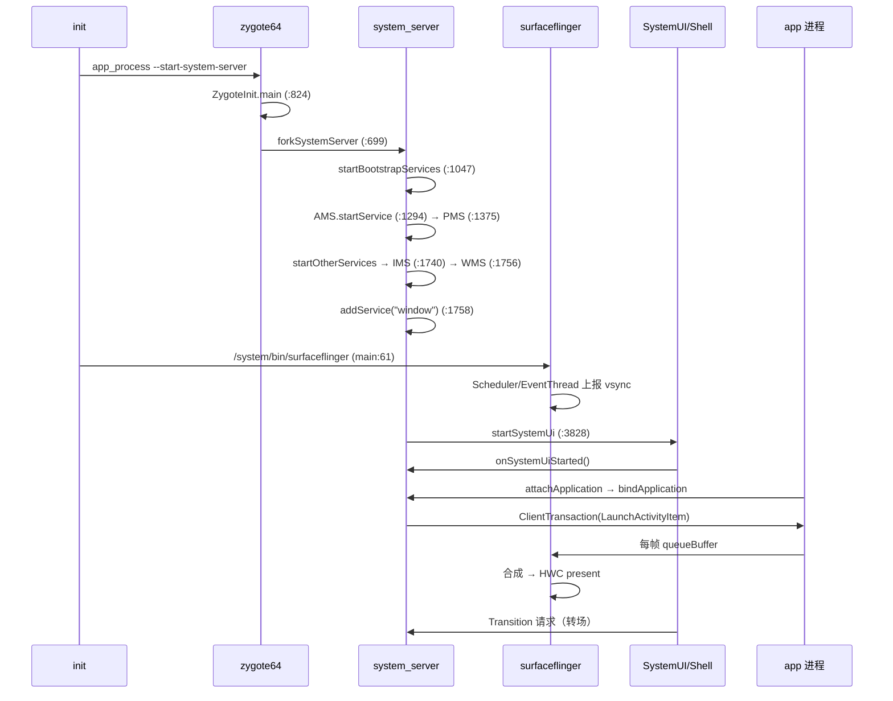

# 仓库架构总览：AOSP Frameworks（android17-release）

> 状态：draft · 适用版本：android17-release · 校验日期：2026-11-24
> 关联：[[binder-ipc]] · [[ams-activity-broadcast]] · [[wms-transition]] · [[input-dispatch]] · [[render-pipeline]] · [[vsync-pipeline]]

## 1. 作用与边界

本仓库是 AOSP 框架层的**源码子集**，由两部分组成：

| 目录 | 对应上游仓库 | 体量 | 编译产物 |
| --- | --- | --- | --- |
| `base/` | `frameworks/base` | 1.8 GB | `framework.jar`、`services.jar`、`SystemUI.apk` |
| `native/` | `frameworks/native` | 55 MB | `libbinder`、`libgui`、`libinputflinger`、`surfaceflinger` |

仓库里**有**的：应用可用的 Java 框架 API（`base/core/java/android/*`）、系统服务实现（`base/services/core/java/com/android/server/*`）、SystemUI（`base/packages/SystemUI`）、Shell 转场库（`base/libs/WindowManager/Shell`）、hwui 渲染引擎（`base/libs/hwui`）、Binder/GUI/Input 的 Native 实现（`native/libs/*`）、SurfaceFlinger 与 InputFlinger（`native/services/*`）。

仓库里**没有**的：Linux kernel（含 binder 驱动 `/dev/binder`）、HAL/HIDL/AIDL HAL 实现、ART/zygote 的 C++ 主体（只保留 `app_process` 启动壳）、Soong/Ninja 构建系统、大多数系统应用（Settings、Launcher 只有接口假设）。凡是分析踩到这些边界，各页会显式标注"本仓库外"。

阅读前提：本 wiki 只描述**代码事实**与**调用关系**，不重复上游设计文档那套"为什么这么设计"的叙事；需要深度推导的数学与历史背景，链接到 `../docs/` 下已有的 16 篇中文长文。

## 2. 模块与文件地图

统计口径：`find <dir> -name '*.java' -o -name '*.cpp' -o -name '*.h'` 的文件数与总行数，实测于 2026-11-24。

| 模块 | 路径 | 文件数 | 行数 | 职责 |
| --- | --- | --- | --- | --- |
| View 体系 | `base/core/java/android/view` | 369 | 250,534 | View/ViewRootImpl/WindowManager.LayoutParams、输入事件接收端、Choreographer |
| Application 框架 | `base/core/java/android/app` | 553 | 275,465 | ActivityThread、Activity/Service 生命周期、ClientTransaction、Instrumentation |
| OS 基础设施 | `base/core/java/android/os` | 291 | 127,640 | Binder（Java 侧）、Parcel、Handler/Looper、Process |
| system_server 服务 | `base/services/core/java/com/android/server` | 2,581 | 1,252,255 | 全部系统服务；`am/`(164 文件/132k 行) 与 `wm/`(280 文件/189k 行) 是两个最大子域 |
| AMS | `base/services/core/java/com/android/server/am` | 164 | 132,379 | 进程/四大组件/OOM adj/ANR |
| WMS | `base/services/core/java/com/android/server/wm` | 280 | 188,773 | 窗口、DisplayContent、Transition、ActivityTaskManagerService |
| Input 服务端 | `base/services/core/java/com/android/server/input` | 42 | 22,139 | InputManagerService（JNI 到 native InputManager） |
| SystemUI | `base/packages/SystemUI` | 1,603 | 447,974 | 系统 UI 进程；Shell（`base/libs/WindowManager`）在它内部运行 |
| hwui | `base/libs/hwui` | 496 | 89,780 | RenderThread、CanvasContext、Skia pipeline、RenderNode |
| Binder native | `native/libs/binder` | 298 | 74,141 | ProcessState/IPCThreadState/BpBinder/Parcel |
| GUI native | `native/libs/gui` | 225 | 68,158 | Surface/BufferQueue/DisplayEventReceiver/ISurfaceComposer |
| SurfaceFlinger | `native/services/surfaceflinger` | 568 | 177,638 | 合成器主进程、CompositionEngine、Scheduler |
| InputFlinger | `native/services/inputflinger` | 254 | 101,584 | InputReader/InputDispatcher/InputFilter |

`base/graphics/java/android/graphics` 只剩 5 个文件（1,514 行），GraphicsCore 的绝大部分已从 `base/core` 拆到 `base/graphics`，看 `HardwareRenderer`、`RenderNode` 一类代码要往 `base/graphics/java/android/graphics/` 找，不要在 `base/core` 里扑空。

## 3. 核心流程

### 3.1 系统启动：zygote → system_server → 各服务

1. `init` 拉起 `app_process`，`AppRuntime` 在 `base/cmds/app_process/app_main.cpp:185` 构造，`base/cmds/app_process/app_main.cpp:336` 以 `com.android.internal.os.ZygoteInit` 为主类启动 ART。
2. `ZygoteInit.main`（`base/core/java/com/android/internal/os/ZygoteInit.java:824`）判定 `--start-system-server` 后进入 `forkSystemServer`（`base/core/java/com/android/internal/os/ZygoteInit.java:699`），fork 出 `system_server` 进程；zygote 自身转入 `runSelectLoop`（`base/core/java/com/android/internal/os/ZygoteInit.java:926`）等待应用进程请求。
3. `SystemServer` 主流程分四段，顺序固定：`startBootstrapServices` / `startCoreServices` / `startOtherServices` / `startApexServices`（`base/services/java/com/android/server/SystemServer.java:1047-1050`）。
4. Bootstrap 段先起 AMS：`ActivityManagerService.Lifecycle.startService`（`base/services/java/com/android/server/SystemServer.java:1294`），再起 PackageManagerService（`base/services/java/com/android/server/SystemServer.java:1375`）——顺序不能反，AMS 初始化依赖 PMS 的 `PackageManagerInternal`。
5. Other 段起输入与窗口：`InputManagerService`（`base/services/java/com/android/server/SystemServer.java:1740`）、`WindowManagerService.main`（`base/services/java/com/android/server/SystemServer.java:1756`），随后把 WMS 发布到 servicemanager：`ServiceManager.addService(Context.WINDOW_SERVICE, wm, ...)`（`base/services/java/com/android/server/SystemServer.java:1758`）。
6. 服务名与注册点：AMS 注册为 `activity`（`base/services/core/java/com/android/server/am/ActivityManagerService.java:2129`）；ATMS 注册为 `activity_task`（`base/services/core/java/com/android/server/wm/ActivityTaskManagerService.java:1221`）；IMS 注册为 `input`（`base/services/core/java/com/android/server/input/InputManagerService.java:4032`）。
7. SystemUI 进程由 `startSystemUi`（`base/services/java/com/android/server/SystemServer.java:3828`）通过 `startServiceAsUser` 拉起，启动后回调 `windowManager.onSystemUiStarted()`——Shell 的转场能力依赖这个回调落地。

### 3.2 进程边界：谁在哪个进程里

| 进程 | 入口 | 内含 | 说明 |
| --- | --- | --- | --- |
| `zygote64` | `base/cmds/app_process/app_main.cpp:185` | ART runtime | 所有 Java 进程的模板 |
| `system_server` | `ZygoteInit.forkSystemServer` | AMS、ATMS、WMS、PMS、IMS(Java)、**native InputReader/InputDispatcher** | 单进程多线程 |
| `com.android.systemui` | `SystemServer.startSystemUi` | SystemUI、Shell(`libs/WindowManager`)、Transitions | 转场动画的真正执行者 |
| `surfaceflinger` | `native/services/surfaceflinger/main_surfaceflinger.cpp:61` | SurfaceFlinger、Scheduler、CompositionEngine | 独立 native 进程 |
| 应用进程 | zygote fork + `ActivityThread.main` | View 体系、Choreographer、RenderThread | 每个 app 一个进程 |

**InputFlinger 不是独立进程**：`InputManager` 在 system_server 进程内构造（`base/services/core/jni/com_android_server_input_InputManagerService.cpp:657`），InputReader/InputDispatcher 是该进程里的两个线程。分析输入问题时，"inputflinger 进程"这种说法是错的。

Binder 有三个域，`servicemanager` 通过命令行参数选择驱动（`native/cmds/servicemanager/main.cpp:150-153`，默认 `/dev/binder`）：`/dev/binder`（框架）、`/dev/hwbinder`（HIDL）、`/dev/vndbinder`（vendor）。三个域的 service manager 互不相通，这是"service list 看不到某个服务"的最常见原因。

## 4. 时序图

## 5. 关键数据结构与状态机

| 结构 | 位置 | 作用 |
| --- | --- | --- |
| `ActivityRecord` | `base/services/core/java/com/android/server/wm/ActivityRecord.java` | 一次 Activity 实例在服务端的全部状态（生命周期、Task、窗口、进程） |
| `WindowState` | `base/services/core/java/com/android/server/wm/WindowState.java` | 一个窗口（一个 Surface）在服务端的状态 |
| `DisplayContent` | `base/services/core/java/com/android/server/wm/DisplayContent.java` | 一块屏幕的窗口树根，遍历/布局/绘制的入口 |
| `ClientTransaction` | `base/core/java/android/app/servertransaction/ClientTransaction.java` | 服务端→客户端的状态变更批处理单元 |
| `BroadcastRecord` | `base/services/core/java/com/android/server/am/BroadcastRecord.java` | 一条广播的所有接收者与投递进度 |
| `Transition` | `base/services/core/java/com/android/server/wm/Transition.java` | 一次转场（打开/关闭/切换）的参与者与动画状态 |
| `InputWindowHandle` | `base/core/java/android/view/InputWindowHandle.java` | WMS 交给 InputDispatcher 的窗口命中信息 |
| `SurfaceFrame` | `native/services/surfaceflinger/Scheduler/FrameTimeline.h:193` | 一帧的时间戳与 deadline，掉帧判定的依据 |

## 6. 线程/进程模型与并发

| 线程名 | 归属 | 创建点 | 职责 |
| --- | --- | --- | --- |
| `main` | 任意 Java 进程 | zygote | UI 线程 / 服务主循环（system_server 的 main 不跑 UI） |
| `android.display` | system_server | `base/services/core/java/com/android/server/DisplayThread.java:38` | 优先级 DISPLAY+1，窗口动画与显示管理 |
| `android.ui` | system_server | `base/services/core/java/com/android/server/UiThread.java:38` | 系统对话框、ANR 弹窗 |
| `binder:<pid>_N` | 任意进程 | `native/libs/binder/ProcessState.cpp` | 处理跨进程调用，上限受线程池约束 |
| `RenderThread` | app 进程 | `base/libs/hwui/renderthread/RenderThread.cpp` | 执行 display list 回放与 GPU 提交 |
| `surfaceflinger` | SF 进程 | `native/services/surfaceflinger/main_surfaceflinger.cpp:61` | 合成主循环（MessageQueue::REFRESH） |
| `InputReader` / `InputDispatcher` | system_server | `base/services/core/jni/com_android_server_input_InputManagerService.cpp:657` | 读事件 / 分发事件 |

锁的层次：WMS 的全局锁在 `WindowManagerService.mGlobalLock`（`base/services/core/java/com/android/server/wm/WindowManagerService.java:647`），AMS 的锁在 `ActivityManagerService.mProcLock`（`base/services/core/java/com/android/server/am/ActivityManagerService.java:820`）。跨 AMS↔WMS 调用必须清楚当前持锁状态，`docs/RootWindowContainerAnalysis.md` 与 `docs/aosp-ams-service-source-study-analysis.md` 都踩过这块。

## 7. 调试入口

| 目标 | 命令 |
| --- | --- |
| 看所有服务名 | `adb shell service list` |
| 看窗口树 | `adb shell dumpsys window windows` / `dumpsys window tokens` |
| 看 Activity 栈 | `adb shell dumpsys activity activities` |
| 看合成状态 | `adb shell dumpsys SurfaceFlinger` |
| 看输入状态 | `adb shell dumpsys input` |
| 抓帧时间线 | `adb shell dumpsys SurfaceFlinger --timestats`、`--latency` |
| trace 分类 | `atrace gfx view wm input binder binder_driver sf sched freq` |

## 8. 延伸阅读

- 进程与组件：[[ams-activity-broadcast]] · `../docs/aosp-ams-service-source-study-analysis.md` · `../docs/aosp-ams-broadcast-source-study-analysis.md`
- IPC：[[binder-ipc]] · `../docs/BinderAnalysis.md` · `../docs/BinderLearningGuide.md`
- 窗口与转场：[[wms-transition]] · `../docs/WindowManagerShellTransitionAnalysis.md` · `../docs/LauncherRemoteAnimation.md`
- 输入：[[input-dispatch]] · `../docs/InputEventFlowAnalysis.md` · `../docs/TouchEvent_Dispatch_Analysis1.md`
- 渲染：[[render-pipeline]] · `../docs/RenderThread_Analysis.md` · `../docs/hwui_syncAndDrawFrame_to_surfaceflinger.md`
- VSync：[[vsync-pipeline]] · `../docs/VSYNC_Complete_Analysis.md`
- ANR：`../docs/ANR/ANRAnalysis.md` 与同目录下按组件拆分的四篇

## 9. 待补充与不确定点

1. 未覆盖 `base/media`、`base/telephony`、`base/packages/SettingsProvider` 等服务，仓库里这些模块体量大但与六条主链路无关。
2. `base/graphics` 拆分后的完整模块边界没有逐一核对，只按 `HardwareRenderer`/`RenderNode` 的实际位置做了指引。
3. `native/cmds/installd`、`surfaceflinger` 的 GPU 后端（RE/SkiaVk）选择逻辑未展开。
4. 章节内的行号在 android17-release 上校验；升级分支后需按 `log.md` 的复核流程重跑一遍引用校验。
