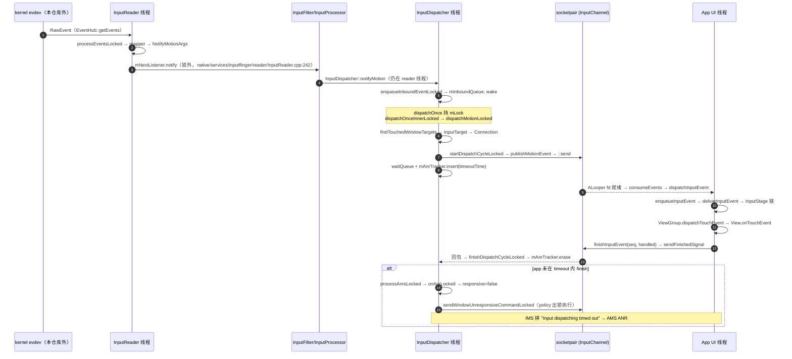
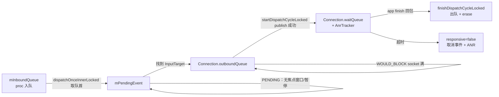

# Input：从内核事件到 View 分发（android17-release）

> 状态：draft · 适用版本：android17-release · 校验日期：2026-11-24
> 关联：[[architecture-overview]] · [[ams-activity-broadcast]] · 相关长文：../docs/InputEventFlowAnalysis.md

## 1. 作用与边界

本页描述**一条链路**：`/dev/input/event*` 上的原始 evdev 事件如何变成 `MotionEvent`/`KeyEvent`，跨进程投递到某个窗口的 `InputChannel`，最终落到 `View.onTouchEvent`，以及这条链路上“应用迟迟不 finish”如何被计量成 ANR。

本页覆盖的代码段（按线程切分）：
- `InputReader` 线程：evdev 读取 → mapper 解析 → `NotifyMotionArgs`/`NotifyKeyArgs`。
- `InputFilter`/`PointerChoreographer`/`InputProcessor` 等 listener 阶段：过滤、指针编排、分类。
- `InputDispatcher` 线程：入队、找窗口、构造 `InputTarget`、发布到 socketpair、超时计量、ANR 通知。
- 应用进程 UI 线程：`NativeInputEventReceiver` 消费 → `ViewRootImpl` 的 `InputStage` 链 → `ViewGroup`/`View` 分发。
- `system_server`：`InputManagerService` 的 native 回调入口与 `AnrController` 的 ANR 落地。

**本仓库外，仅有接口假设**的部分：
- kernel 的 evdev 驱动与 `/dev/input` 事件格式（本仓库只看到 `EventHub` 打开设备与 `read()` 侧封装，见 `native/services/inputflinger/reader/EventHub.cpp:2445`）。
- binder 驱动、HAL/vendor 输入驱动、`/dev/uinput` 的 kernel 侧实现。
- ANR 弹窗与进程处理（`ActivityRecord.inputDispatchingTimedOut` 之后的部分）。
- 设备的 `EVIOCG*` 能力查询与键位布局文件解析：`EventHub` 侧只看到配置读取与 `KeyLayoutMap` 的使用点，配置语法不在本页范围。

本分支与常见 AOSP 描述的三处偏差，读源码时最容易踩：
1. **没有 `InputClassifier` 类**：inputflinger 目录下只剩 fuzzer 里一处字样（`native/services/inputflinger/tests/fuzzers/InputClassifierFuzzer.cpp:78`），分类职责在 `InputProcessor`（`native/services/inputflinger/InputProcessor.h:152` 注释提到 MotionClassifier 标记事件流）。
2. **没有 `InputDispatcher::dispatchTimeoutLocked`**：本分支改为 `processAnrsLocked()` + `AnrTracker`（见 §3.5 步骤 21）。
3. **没有 `findFocusedWindowTargets`**：单数版本 `findFocusedWindowTargetLocked` 才是本分支焦点目标的唯一入口。

输入/输出契约：进入本链路的是 `RawEvent`（evdev 三元组 + `deviceId`/`when`），离开本链路的是应用线程里同步执行的 `View` 回调 + 回写的 `finishInputEvent(seq, handled)`。

## 2. 模块与文件地图

| 层 | 关键文件:行 | 职责 | 线程 |
| --- | --- | --- | --- |
| 设备采集 | `native/services/inputflinger/reader/EventHub.cpp:2016` | `getEvents()`：epoll 拿可读设备并读 evdev（`epoll_wait` 在 `:2202`） | InputReader |
| 事件解析 | `native/services/inputflinger/reader/InputReader.cpp:172` | `loopOnce()`：算 timeout、取事件、持锁解析、出锁 flush | InputReader |
| 解析入口 | `native/services/inputflinger/reader/InputReader.cpp:261` | `processEventsLocked()`：按 deviceId 批量切分，处理 DEVICE_ADDED/REMOVED | 持 `InputReader::mLock` |
| 设备/映射器 | `native/services/inputflinger/reader/InputDevice.cpp:497` | `process()`：逐事件交给各 mapper，SYN_DROPPED 后丢弃到下一次 SYN_REPORT | 持锁 |
| 触摸映射 | `native/services/inputflinger/reader/mapper/TouchInputMapper.cpp:1305` | `process()` → `dispatchMotion()` → 在 `:2324` 组装 `NotifyMotionArgs` | 持锁 |
| 按键映射 | `native/services/inputflinger/reader/mapper/KeyboardInputMapper.cpp:367` | 组装 `NotifyKeyArgs` | 持锁 |
| listener 组装 | `native/services/inputflinger/InputManager.cpp:122` | 注释给出完整管道顺序；构造函数在 `:132` 逆序拼装 | 无 |
| 无障碍过滤 | `native/services/inputflinger/InputFilter.cpp:73`（key）/`:81`（motion） | key 走 Rust 过滤器，motion 直接下传（见 §9） | InputReader |
| 分发核心 | `native/services/inputflinger/dispatcher/InputDispatcher.cpp:983` | `dispatchOnce()`：持 `mLock` 跑一轮分发 + ANR 检查 + poll | InputDispatcher |
| 找窗口 | `native/services/inputflinger/dispatcher/InputDispatcher.cpp:2441` / `:2534` | `findFocusedWindowTargetLocked` / `DispatcherTouchState::findTouchedWindowTargets` | 持 `mLock` |
| 投递 | `native/libs/input/InputTransport.cpp:588` / `:388` | `publishMotionEvent` → `InputChannel::sendMessage`（socketpair `::send`） | 持 `mLock`，非阻塞 |
| 通道创建 | `native/libs/input/InputTransport.cpp:359` | `openInputChannelPair()`，`:363` 的 `socketpair(AF_UNIX, SOCK_SEQPACKET)` | 调用线程 |
| 应用侧接收 | `base/core/jni/android_view_InputEventReceiver.cpp:455` | `NativeInputEventReceiver::consumeEvents()` | UI 线程 |
| 应用侧分发 | `base/core/java/android/view/ViewRootImpl.java:7889` | `InputStage` 基类；链在 `:1920`–`:1932` 拼装 | UI 线程 |
| 服务侧 | `base/services/core/java/com/android/server/input/InputManagerService.java:949` | `createInputChannel()`，窗口通道由 WMS 申请 | binder 线程 |
| 超时/ANR | `native/services/inputflinger/dispatcher/InputDispatcher.cpp:1143` + `base/services/core/java/com/android/server/input/InputManagerService.java:4661` | 判定在 native，**文案与 ANR 落地在 Java** | 见 §6 |

listener 管道的准确顺序（`native/services/inputflinger/InputManager.cpp:122` 起的注释）：`InputReader → UnwantedInteractionBlocker → InputFilter → PointerChoreographer → InputProcessor → InputDeviceMetricsCollector → InteractionReporter → InputDispatcher`。注意 `InputDeviceMetricsCollector` 受 `ENABLE_INPUT_DEVICE_USAGE_METRICS` 编译开关控制（`native/services/inputflinger/InputManager.cpp:158`）。

窗口通道的申请链：`base/services/core/java/com/android/server/wm/WindowManagerService.java:1910` → `base/services/core/java/com/android/server/wm/WindowState.java:2680` `openInputChannel()` → `base/services/core/java/com/android/server/input/InputManagerService.java:949` → `InputManager::createInputChannel`（`native/services/inputflinger/InputManager.cpp:279`，仅 SHELL/ROOT 或内部调用）→ dispatcher 分配 socketpair 的一端，token 记到 `base/services/core/java/com/android/server/wm/WindowState.java:2686` 的 `mInputChannelToken`。这个 token 就是后续 ANR 反查窗口的 key。

同一条 `dispatchOnceInnerLocked` 对不同事件走不同查找路径，这张表决定“该看哪个函数”：

| 事件 | 查找入口 | 目标来源 |
| --- | --- | --- |
| 指针类 MOTION（触摸/鼠标/hover） | `DispatcherTouchState::findTouchedWindowTargets`（`native/services/inputflinger/dispatcher/InputDispatcher.cpp:2534`） | `TouchState` + 窗口 z-order + spy 窗口 |
| 非指针 MOTION、KEY | `findFocusedWindowTargetLocked`（`:2441`） | `mFocusResolver` 的焦点窗口 |
| KEY 且 policy 要求 fallback | `findAndDispatchFallbackEvent`（`:2069`） | 焦点窗口 + fallback 处理 |
| DRAG | `dispatchDragLocked`（`:2287`） | `DragState` 记下的窗口 token |
| FOCUS / TOUCH_MODE_CHANGED | `dispatchFocusLocked` / `dispatchTouchModeChangeLocked` | 目标固定，不做命中测试 |

## 3. 核心流程

线程上下文标注：**[R]** InputReader 线程、**[D]** InputDispatcher 线程、**[U]** 应用 UI 线程、**[S]** system_server binder 线程。

### 3.1 采集与解析

1. **[R] 采集原始事件** — `EventHub::getEvents`（`native/services/inputflinger/reader/EventHub.cpp:2016`）。它用 `epoll_wait`（`:2202`）等设备可读，把每个 `/dev/input/eventN` 的 `struct input_event` 摊成 `RawEvent`（带 `deviceId`/`when`）。kernel 侧实现**本仓库外，仅有接口假设**。
2. **[R] 一轮 loopOnce** — `InputReader::loopOnce`（`native/services/inputflinger/reader/InputReader.cpp:172`）。先在 `mLock` 内算 `timeoutMillis`（配置变更 → 0，`:183`–`:193`），**锁外**调 `mEventHub->getEvents`（`:196`），再重新持锁解析。锁被拆成两段，是为了让 `getEvents` 阻塞时不挡 `getScanCodeState` 之类的回调。
3. **[R] 解析成 NotifyArgs** — `InputReader::processEventsLocked`（`native/services/inputflinger/reader/InputReader.cpp:261`，`:203` 处调用）按 `deviceId` 把连续事件切批，进 `processEventsForDeviceLocked` → `InputDevice::process`（`native/services/inputflinger/reader/InputDevice.cpp:497`），后者 `for_each_mapper_in_subdevice` 逐个 mapper 处理，结果累加进 `mPendingArgs`。`SYN_DROPPED` 会置 `mDropUntilNextSync`，直到下一个 `SYN_REPORT` 才 `reset()` 恢复——这是“事件缓冲区溢出后事件整段丢失”的根源。
4. **[R] mapper 生成 NotifyMotionArgs** — `TouchInputMapper::process`（`native/services/inputflinger/reader/mapper/TouchInputMapper.cpp:1305`）在消抖/手势判定后调 `dispatchMotion`，最终在 `:2324` 构造 `NotifyMotionArgs`（含 `policyFlags`、`displayId`、`MotionClassification::NONE`、`downTime`、`readTime`）。按键侧对应 `native/services/inputflinger/reader/mapper/KeyboardInputMapper.cpp:367`。结构定义见 `native/services/inputflinger/include/NotifyArgs.h:74`（motion）与 `:44`（key）。

### 3.2 出 reader 线程、进入 dispatcher 队列

5. **[R] 锁外 flush** — `native/services/inputflinger/reader/InputReader.cpp:242` 的 `mNextListener.notify(args)` 循环。此循环**必须在锁外执行**：listener 链里最下游是 `InputDispatcher`，它会回调 WMS，WMS 又可能回调 `InputReader`（如 `getScanCodeState`），持锁调用必然死锁（源码注释就在 `:229`–`:241` 这段区间）。同一函数末尾还会通知 policy 设备变更（`:249`）与手写笔手势开始（`:256`）。
6. **[R] 过滤链** — `InputFilter::notifyMotion`（`native/services/inputflinger/InputFilter.cpp:81`）无条件 `mNextListener.notify`；`notifyKey`（`:73`）在无障碍过滤启用时把事件灌进 Rust 过滤器后**直接 return**，不再下传（`:76` 的 `return`），后续回注路径见 §9。
7. **[R] 入队** — `InputDispatcher::notifyMotion`（`native/services/inputflinger/dispatcher/InputDispatcher.cpp:4679`）：先让 policy `filterInputEvent`（可吞事件，`:4785`），否则构造 `MotionEntry` 并 `enqueueInboundEventLocked`（`:1426`）。后者把 entry 塞进 `mInboundQueue`，若队列原本为空就返回 `needWake=true`，末尾 `mLooper->wake()` 唤醒 dispatcher。**按键**走 `notifyKey`（`:4576`）：它在本线程同步调用 `mPolicy.interceptKeyBeforeQueueing`（`:4624`，跨 binder 进 system_server），耗时超 `SLOW_INTERCEPTION_THRESHOLD` 会打 `Excessive delay in interceptKeyBeforeQueueing`。
8. **[R]** `enqueueInboundEventLocked` 对 MOTION 会调 `shouldPruneInboundQueueLocked`（`native/services/inputflinger/dispatcher/InputDispatcher.cpp:1380`，调用点在 `:1466`）：若当前处于“等焦点窗口”ANR 状态，而用户点到了**另一个应用**的窗口，就把之前积压的事件全部剪掉（`ALOGI("Pruning input queue ...")`），这是“卡住后点别的应用立刻响应”的机制来源。

### 3.3 dispatcher 线程内分发

9. **[D] 一轮 dispatchOnce** — `InputDispatcher::dispatchOnce`（`native/services/inputflinger/dispatcher/InputDispatcher.cpp:983`）：持 `mLock`，无待执行 command 时跑 `dispatchOnceInnerLocked`（`:1207`），然后 `runCommandsLockedInterruptable`，再把 `nextWakeupTime` 与 `processPreAnrsLocked`、`processAnrsLocked`（`:1143`）取最小，出锁后 `mLooper->pollOnce(timeoutMillis)`。dispatcher 线程名即 `"InputDispatcher"`（`:967`）。
10. **[D] 取事件** — `dispatchOnceInnerLocked`（`:1207`）：`mDispatchFrozen` 时直接返回；否则从 `mInboundQueue` 取队首到 `mPendingEvent`（`:1238`），并按 `policyFlags`/`mDispatchEnabled` 判 `DropReason`。MOTION 的 stale 判定（`isStaleEvent`，`:1372`）只在**没有正在触摸/悬停的指针**时才允许丢（`:1321`–`:1326`），否则宁可发过期事件也要把当前手势补完。
11. **[D] 找触摸目标** — `dispatchMotionLocked`（`:2175`）→ 指针源事件走 `mTouchStates.findTouchedWindowTargets`（`:2211` 调用，`:2534` 定义）：把当前 `TouchState` 拷成 `tempTouchState`，按 z-order 找命中窗口、处理 split touch、hover、outside、spy（`findTouchedSpyWindowsAt`）。`canWindowReceiveMotion`（`:5557`）会因 `connection->responsive == false` 直接拒发（`:5591`），即“ANR 后不再给它送触摸”。
12. **[D] 找焦点目标** — 非指针源（或 trackball 等）走 `findFocusedWindowTargetLocked`（`:2441`）+ `addWindowTargetLocked`（`:3058`）。焦点链在 `dispatchKeyLocked`（`:1936`）里先让 policy 拦截（`postCommandLocked` + `doInterceptKeyBeforeDispatchingCommand`，`result == TRY_AGAIN_LATER` 时返回 `false` 等下一次 wakeup），再取 `mFocusResolver` 的焦点窗口。
13. **[D] 无焦点窗口的等待窗口** — `findFocusedWindowTargetLocked` 在“有 focused application 但没有 focused window”时设置 `mNoFocusedWindowAnrState` 并返回 `PENDING`（`:2468`–`:2498`），事件停在 `mPendingEvent` 不重新入队；窗口一旦出现就 `resetNoFocusedWindowTimeoutLocked()`（`:2498`，定义在 `:2374`）。`PAUSE_DISPATCHING` 配置与 key 需要等前序事件完成（`shouldWaitToSendKeyLocked`）同样返回 `PENDING`。
14. **[D] 构造 InputTarget 并发布** — `addWindowTargetLocked`（`:3058`）用 window token 从 `mConnectionManager` 取 `Connection`，取不到只打 `ALOGW("Not creating InputTarget for %s, no input channel")` 并跳过。`dispatchEventLocked`（`:2328`）对每个 target 调 `prepareDispatchCycleLocked`（`:3446`）→ `enqueueDispatchEntryAndStartDispatchCycleLocked`（`:3512`，仅当 outboundQueue 原本为空才真正启动）→ `startDispatchCycleLocked`（`:3893`）：把 `deliveryTime` 设为 now、`timeoutTime = now + getDispatchingTimeoutLocked(connection)`（`:3905`），再 `publishMotionEvent`（`:3851` → `native/libs/input/InputTransport.cpp:588`）→ `InputChannel::sendMessage`（`native/libs/input/InputTransport.cpp:388`）里一次非阻塞 `::send(MSG_DONTWAIT)`。
    - 失败处理：`WOULD_BLOCK`（socket 满）→ entry 留在 `outboundQueue` 等 app finish 后再发；`DEAD_OBJECT`/`EPIPE` → `abortBrokenDispatchCycleLocked(notify=true)`，通道被标记断开。发布成功后 entry 从 `outboundQueue` 移到 `waitQueue`，并在 `connection->responsive` 时 `mAnrTracker.insert(timeoutTime, token)`（`native/services/inputflinger/dispatcher/InputDispatcher.cpp:4031`）。

### 3.4 应用进程接收与 View 分发

15. **[U] 收包** — fd 就绪触发 ALooper 回调 `NativeInputEventReceiver::handleEvent`（`base/core/jni/android_view_InputEventReceiver.cpp:418`）→ `consumeEvents`（`:455`）→ `InputConsumer::consume`（`native/libs/input/InputConsumer.cpp:231`）从**同一个 socketpair** 读 `InputMessage` 并就地还原成 `MotionEvent`/`KeyEvent`，再 `CallVoidMethod(dispatchInputEvent, seq, event)`（JNI 侧调用点在 `:634`，方法签名在 `:863` 获取）→ `InputEventReceiver.dispatchInputEvent`（`base/core/java/android/view/InputEventReceiver.java:279`，先把 `event.getSequenceNumber() → seq` 存进 `mSeqMap`）→ `onInputEvent`（`:151`）。
16. **[U] 进 ViewRootImpl** — `WindowInputEventReceiver.onInputEvent`（`base/core/java/android/view/ViewRootImpl.java:11466`）→ `processRawInputEvent`（`:11660`，先过 `mInputCompatHandler` 兼容层）→ `enqueueInputEvent`（`:11210`）把事件串到 `mPendingInputEvent` 链表，再 `scheduleProcessInputEvents`（`:11257`，发一条 **asynchronous** 的 `MSG_PROCESS_INPUT_EVENTS`，message code 定义在 `:7296`）或立即 `doProcessInputEvents`（`:11266`）。
17. **[U] 选责任链起点** — `deliverInputEvent`（`:11293`）：手写笔合成事件走 `mSyntheticInputStage`（`:9003`）；指针事件在 `shouldSkipIme()` 且未带 `FLAG_SKIP_IME` 时直接跳到 `mFirstPostImeInputStage`（`:1932` = `EarlyPostIme`）；否则从 `mFirstInputStage`（`:1931` = `NativePreIme`）进链。链的拼装顺序在 `:1920`–`:1932`（由内向外构造，`mFirstInputStage` 是 `NativePreIme`）：`NativePreIme`(`:8216`) → `ViewPreIme`(`:8336`) → `Ime`(`:8364`) → `EarlyPostIme`(`:8402`) → `NativePostIme`(`:8510`) → `ViewPostIme`(`:8539`) → `Synthetic`(`:9003`)。
18. **[U] 责任链语义** — `InputStage.deliver`（`:7909`，基类在 `:7889`）返回三种结果：`FORWARD`/`FINISH_HANDLED`/`FINISH_NOT_HANDLED`（`:7892`–`:7894`）。进入前先过 `shouldDropInputEvent`（`:7998`）：root view 已移除、无焦点（非 pointer/back）、`mStopped`、ambient mode、转场暂停都会拦；terminal 事件（UP/CANCEL）不丢弃而是改写成 `ACTION_CANCEL`。`AsyncInputStage`（`:8074`）允许把事件**暂存并乱序完成**，IME 段就是靠它在等输入连接时先放行后续事件。
19. **[U] 进 View 树** — `ViewPostImeInputStage.onProcess`（`:8545`）→ `processPointerEvent`（`:8780`）→ `mView.dispatchPointerEvent(event)`（`:8800`）→ `View.dispatchPointerEvent`（`base/core/java/android/view/View.java:17290`）→ `dispatchTouchEvent`（`base/core/java/android/view/View.java:16932`）→ `ViewGroup.dispatchTouchEvent`（`base/core/java/android/view/ViewGroup.java:2756`）：DOWN 时先 `cancelAndClearTouchTargets` + `resetTouchState`，`FLAG_DISALLOW_INTERCEPT` 未置位才问 `onInterceptTouchEvent`（`:3421`）；不拦截就 `dispatchTransformedTouchEvent`（`:3215`）按 pointerId 裁剪后交给子 View，叶子节点落到 `View.onTouchEvent`（`base/core/java/android/view/View.java:18447`）。
20. **[U] 回写完成** — 链尾 `InputStage.onDeliverToNext` 调 `finishInputEvent(q)`（`:11347`）→ `q.mReceiver.finishInputEvent(q.mEvent, handled)`（`:11367`）→ `InputEventReceiver.finishInputEvent`（`base/core/java/android/view/InputEventReceiver.java:220`，按 sequence 取回 seq，取不到只 `Log.w`）→ native `NativeInputEventReceiver::finishInputEvent`（`base/core/jni/android_view_InputEventReceiver.cpp:274`）→ `InputConsumer::sendFinishedSignal`（`native/libs/input/InputConsumer.cpp:746`）。**[D]** 侧 dispatcher 的 looper 收到回包后走 `finishDispatchCycleLocked`（`native/services/inputflinger/dispatcher/InputDispatcher.cpp:4076`）：出 `waitQueue`、`mAnrTracker.erase(timeoutTime, token)`（`:6744`），并对先前 unresponsive 的连接复查 `isConnectionResponsive`（`:544`）→ `processConnectionResponsiveLocked`（`:6955`）。

### 3.5 超时与 ANR

21. **[D] 每轮都查** — `processAnrsLocked`（`native/services/inputflinger/dispatcher/InputDispatcher.cpp:1143`）在每次 `dispatchOnce` 里跑：先查 `mNoFocusedWindowAnrState` 是否到期（到期 → `processNoFocusedWindowAnrLocked`，`:1034`），再取 `mAnrTracker.firstTimeout()` 与当前时间比；到期就把该 connection 的 `responsive` 置 false、从 tracker 里删掉、调 `onAnrLocked(connection)`（`:6792`）。5s 基线的来源是 `native/libs/input/android/os/IInputConstants.aidl:26`（`UNMULTIPLIED_DEFAULT_DISPATCHING_TIMEOUT_MILLIS = 5000`）乘 `HwTimeoutMultiplier()`，见 `native/services/inputflinger/dispatcher/InputDispatcher.cpp:127`；窗口可通过 `WindowInfo.dispatchingTimeout` 覆盖（`getDispatchingTimeoutLocked`，`:1195`）。
22. **[D] 生成原因串** — `onAnrLocked` 用 `waitQueue.front()` 的 `deliveryTime` 算 `currentWait`，拼 `"%s is not responding. Waited %dms for %s"`（`:6818`），随后 `processConnectionUnresponsiveLocked`（`:6930`）→ `sendWindowUnresponsiveCommandLocked`（`:6905`）把“窗口不响应”投给 policy（出锁执行）。同时 `updateLastAnrStateLocked`（`:6861`）把当前 dispatcher 队列快照写进 `mLastAnrState`（`dumpsys input` 里的 `ANR:` 段）。**“Input dispatching timed out”这个字符串不在 native**，它在 `base/services/core/java/com/android/server/input/InputManagerService.java:4661` 的 `timeoutMessage()` 里拼（`:4664` 无 reason、`:4665` 带 reason）。
23. **[S] 落到 AMS** — native 回调 `InputManagerService.notifyWindowUnresponsive`（`base/services/core/java/com/android/server/input/InputManagerService.java:2672`）→ `TimeoutRecord.forInputDispatchWindowUnresponsive` → `mWindowManagerCallbacks.notifyWindowUnresponsive` → `base/services/core/java/com/android/server/wm/InputManagerCallback.java:112` → `AnrController.notifyWindowUnresponsive`（`base/services/core/java/com/android/server/wm/AnrController.java:247`）→ 持 `mGlobalLock` 用 input token 反查 `InputTarget`/`WindowState`（`:271`–`:300`，`getInputTargetFromToken` 在 `:284`，日志 `"ANR in " + target + ". Reason:" + reason`）→ `ActivityRecord.inputDispatchingTimedOut`，无 host window 时退到 `mAmInternal.inputDispatchingTimedOut(pid, aboveSystem, timeoutRecord)`。**“ANR token”指的就是 connection token**，即 `WindowState.mInputChannelToken`（`base/services/core/java/com/android/server/wm/WindowState.java:2686`）。

### 3.6 失败路径速查

| 失败点 | 直接后果 | 代码位置 |
| --- | --- | --- |
| 无 focused window 也无 focused application | 事件被丢，`FAILED`，不产生 ANR | `native/services/inputflinger/dispatcher/InputDispatcher.cpp:2452` |
| 有 focused application、无 focused window | `PENDING`，起 `mNoFocusedWindowAnrState`，超时后报 "does not have a focused window" ANR | `:2475`、`:6835` |
| 窗口没有 InputChannel | 只打 `Not creating InputTarget for %s, no input channel`，该窗口收不到，其他 target 照发 | `:3075` |
| socket 写满（`WOULD_BLOCK`） | entry 滞留 `outboundQueue`，不同步等待、不丢弃，等 app finish 后继续 | `:4012` |
| 通道断开（`DEAD_OBJECT`/`EPIPE`） | `abortBrokenDispatchCycleLocked(notify=true)`，连接作废并通知 policy | `:4020` |
| app 未 finish 超时 | `responsive=false`，合成 CANCEL，报 ANR，后续触摸不再投给该窗口 | `:1175`、`:2346`、`:5592` |
| app 侧 `shouldDropInputEvent` 命中 | 非 terminal 事件被丢；terminal 事件改写成 `ACTION_CANCEL` | `base/core/java/android/view/ViewRootImpl.java:7998` |
| app 侧 seq 对不上 | 只打 `Attempted to finish an input event that is not in progress.`，不 ACK | `base/core/java/android/view/InputEventReceiver.java:220` |

## 4. 时序图

队列视角的状态流转，是理解“卡在哪一环”的最短路径：

## 5. 关键数据结构与状态机

| 结构 | 定义 | 关键字段 / 语义 |
| --- | --- | --- |
| `NotifyMotionArgs` | `native/services/inputflinger/include/NotifyArgs.h:74` | reader 层产物：`eventTime`/`readTime`/`deviceId`/`displayId`/`policyFlags`/`action`/`pointerProperties`/`pointerCoords`/`downTime` |
| `NotifyKeyArgs` | `native/services/inputflinger/include/NotifyArgs.h:44` | 同上，键位相关（`keyCode`/`scanCode`/`metaState`/`repeatCount` 恒为 0，重复由 dispatcher 生成） |
| `MotionEntry` / `KeyEntry` | `native/services/inputflinger/dispatcher/Entry.h` | dispatcher 的入站 entry，带 `dispatchInProgress`、`traceTracker`，`KeyEntry` 还有 `interceptKeyResult` 状态机 |
| `DispatchEntry` | `native/services/inputflinger/dispatcher/Entry.h:217` | 出站条目：`seq`、`deliveryTime`、`timeoutTime`（`:229`） |
| `InputTarget` | `native/services/inputflinger/dispatcher/InputTarget.h:68` | `connection`（`:68`）+ `dispatchMode`（`:74`，AS_IS/OUTSIDE/HOVER_ENTER/HOVER_EXIT/SLIPPERY_*）+ flags + 坐标变换 |
| `Connection` | `native/services/inputflinger/dispatcher/Connection.h:57` | `inputPublisher`、`responsive`（`:63`）、`outboundQueue`（`:66`）、`waitQueue`（`:70`）、`status` |
| `TouchState` | `native/services/inputflinger/dispatcher/TouchState.h` | 每个 display+device 的手势状态（正在触摸/悬停的 pointer 与窗口），`findTouchedWindowTargets` 拷贝后改写 |
| `AnrTracker` | `native/services/inputflinger/dispatcher/AnrTracker.h:29` | `multiset<timeoutTime, token>`，`firstTimeout()` 给出最近到期者 |
| `QueuedInputEvent` | `base/core/java/android/view/ViewRootImpl.java:11109` | app 侧队列节点：`mEvent`/`mReceiver`/`mFlags`（`FLAG_FINISHED`、`FLAG_FINISHED_HANDLED`、`FLAG_SKIP_IME`） |

两条关键状态机：
- **连接状态**：`responsive == true` 才能收到新手势（`canWindowReceiveMotion`，`native/services/inputflinger/dispatcher/InputDispatcher.cpp:5591`）；变 false 后 `cancelEventsForAnrLocked`（`:2346`）会合成 CANCEL，等 app 真正 finish 掉积压事件才由 `isConnectionResponsive`（`:544`）翻回 true 并 `processConnectionResponsiveLocked`（`:6955`）。
- **焦点等待状态**：`mNoFocusedWindowAnrState` 有值 ⇒ 新指针 DOWN 可能触发剪队（`shouldPruneInboundQueueLocked`，`:1380`，调用点 `:1466`）；到期由 `processNoFocusedWindowAnrLocked`（`:1034`）收口。

补充两个容易误读的字段组：
- `InputTarget::Flags`（`native/services/inputflinger/dispatcher/InputTargetFlags.h:24`–`:50`）：`FOREGROUND`、`WINDOW_IS_OBSCURED`/`WINDOW_IS_PARTIALLY_OBSCURED`（会翻成 `AMOTION_EVENT_FLAG_WINDOW_IS_*`）、`SPLIT`（一个手势被拆给多个窗口，改写 `firstDownTimeInTarget`）、`ZERO_COORDS`（配合 outside 屏蔽坐标）、`NO_FOCUS_CHANGE`。
- `InputTarget::DispatchMode`（`native/services/inputflinger/dispatcher/InputTarget.h:39`）：`AS_IS` / `OUTSIDE` / `HOVER_ENTER` / `HOVER_EXIT` / `SLIPPERY_EXIT` / `SLIPPERY_ENTER`——同一个 `MotionEntry` 会按 target 被**改写成不同的 action**，这是“为什么日志里一条 MOVE 在不同窗口变成 DOWN/OUTSIDE/HOVER_ENTER”的原因。

时间常量（全部在本仓库可查）：`DEFAULT_INPUT_DISPATCHING_TIMEOUT = 5000ms × HwTimeoutMultiplier()`（`native/services/inputflinger/dispatcher/InputDispatcher.cpp:127`）、`DEFAULT_PRE_ANR_TIMEOUT_WINDOW = 2000ms × multiplier`（`:131`，用于预 ANR 通知）、`STALE_EVENT_TIMEOUT = 10s`（`:139`）、`SLOW_EVENT_PROCESSING_WARNING_TIMEOUT = 2s`（`:142`）、`SLOW_INTERCEPTION_THRESHOLD = 50ms`（`:145`）。

## 6. 线程/进程模型与并发

| 执行体 | 名字 / 位置 | 持锁 | 阻塞风险 |
| --- | --- | --- | --- |
| InputReader | `"InputReader"`（`native/services/inputflinger/reader/InputReader.cpp:157`，`isInCriticalPath=true` 见 `native/services/inputflinger/InputThread.cpp:63`） | `InputReader::mLock` 只在解析期间；`getEvents` 与 `notify` 都在锁外 | `mNextListener.notify` 会同步进 `InputDispatcher::notifyKey` 并 binder 调 policy（`native/services/inputflinger/dispatcher/InputDispatcher.cpp:4624`） |
| InputDispatcher | `"InputDispatcher"`（`native/services/inputflinger/dispatcher/InputDispatcher.cpp:967`） | `dispatchOnce` 全程持 `mLock`（`:985`–`:1020`），找窗口、publish 都在锁内 | publish 是 `MSG_DONTWAIT` 非阻塞；阻塞动作一律转成 `postCommandLocked` 出锁执行 |
| inputflinger binder 线程 | `InputManager::createInputChannel`（`native/services/inputflinger/InputManager.cpp:279`） | 内部进 dispatcher `mLock` | 建通道时与 WMS 的 `mGlobalLock` 无嵌套 |
| system_server binder 线程 | `InputManagerService` native 回调（`:2654`/`:2672`） | 不持 input 锁；ANR 路径才进 WMS `mGlobalLock`（`base/services/core/java/com/android/server/wm/AnrController.java:283`） | 反查不到 `InputTarget` 时直接 `return false` 放弃 ANR |
| App UI 线程 | `WindowInputEventReceiver` 建在 `Looper.myLooper()`（`base/core/java/android/view/ViewRootImpl.java:1898`） | 无 native 锁 | `InputStage` 链同步执行；`AsyncInputStage` 只延后完成，不换线程 |

并发要点：
- **reader 与 dispatcher 是两条独立线程**，交界是 `mInboundQueue` + `mLooper->wake()`，不是队列满就阻塞的生产者。
- **dispatcher 的全部状态只在 `mLock` 下改**；policy 回调（`filterInputEvent`、`interceptKeyBeforeQueueing`、`notifyWindowUnresponsive`）必须出锁，`scoped_unlock`/`postCommandLocked` 就是为此存在（`onAnrLocked(application)` 里 `scoped_unlock` 后调 `mPolicy.notifyNoFocusedWindowAnr`，`native/services/inputflinger/dispatcher/InputDispatcher.cpp:6835` 起）。
- **应用侧只有一个 Looper 线程在消费**，且 `mSeqMap` 用 `event.getSequenceNumber()` 反查 seq（`base/core/java/android/view/InputEventReceiver.java:279`/`:220`），事件 recycle 后再 finish 会只打 warning，不会误 ACK 别的事件。
- **批处理**：`consumeEvents(consumeBatches=true, frameTime, ...)` 的调用点在 `base/core/jni/android_view_InputEventReceiver.cpp:812`（渲染帧边界），此时 `InputConsumer::consumeBatch`（`native/libs/input/InputConsumer.cpp:426`）把批量 MOVE 压成一条；`onBatchedInputEventPending`（`base/core/java/android/view/ViewRootImpl.java:11470`）决定立刻消费还是等下一帧。

## 7. 调试入口

- `adb shell dumpsys input`：入口 `InputManager::dump`（`native/services/inputflinger/InputManager.cpp:259`），依次 dump reader/blocker/choreographer/processor/filter/dispatcher。dispatcher 段里的 `ANR:` 块来自 `updateLastAnrStateLocked`（`native/services/inputflinger/dispatcher/InputDispatcher.cpp:6861`），含超时时刻、reason、窗口名与完整队列快照——判断“事件卡在 outboundQueue 还是 waitQueue”最快的证据。
- `adb shell dumpsys window`：`WindowState.mInputChannelToken`（`base/services/core/java/com/android/server/wm/WindowState.java:2686`）把窗口与 input token 对上，配合 `AnrController` 的 `"ANR in " + target` 日志定位是哪个窗口。
- logcat：tag `InputManager`（`base/services/core/java/com/android/server/input/InputManagerService.java:199`）；native 侧关键字 `Window %s is unresponsive: %s`（`native/services/inputflinger/dispatcher/InputDispatcher.cpp:6941`）、`Pruning input queue`（`:1399` 起）、`Not sending touch to %s because it is not responsive`（`:5592`）、`Waiting because no window has focus`（`:2481`）。
- ANR 报告里的 `"Input dispatching timed out (…)"`：文案在 `base/services/core/java/com/android/server/input/InputManagerService.java:4665`，括号内是 native 的 `reason`（`<channel name> is not responding. Waited Nms for <event>`）。
- atrace/systrace：应用侧 `deliverInputEvent`（`base/core/java/android/view/ViewRootImpl.java:11293` 起的 `Trace.asyncTraceBegin`）、各 stage 的计数器名 `aq:native-pre-ime:<title>` / `aq:ime:<title>`（`:1923`–`:1929`）；native 侧 `onAnrLocked(inputChannel=…, id=0x…)`（`native/services/inputflinger/dispatcher/InputDispatcher.cpp:6813`）、`startDispatchCycleLocked(inputChannel=…)`（`:3896`）。
- event log：`INPUT_INTERACTION=62000` / `INPUT_FOCUS=62001` / `INPUT_CANCEL=62003`（`native/services/inputflinger/dispatcher/InputDispatcher.cpp:155`–`:157`，定义在 `native/services/inputflinger/dispatcher/EventLogTags.logtags`）。
- `dumpsys input` 的 `Connections:` 段直接印 `responsive=`、`OutboundQueue: length=`、`WaitQueue: length=`（`native/services/inputflinger/dispatcher/InputDispatcher.cpp:7695` 起），是区分“卡在发布前”还是“已发未 ACK”的唯一一眼可见证据。
- 想确认事件是否已经到 reader：`adb shell getevent -lt` 与 `dumpsys input` 的 device 段对照；若 getevent 有而 app 没有，问题在 §3 步骤 6–14，不必再查 evdev。

## 8. 延伸阅读

- 全链路叙述（含 EventHub/InputReader/InputDispatcher 分段与 ANR 小节）：`../docs/InputEventFlowAnalysis.md`
- 组件分工与线程模型概览：`../docs/AOSP_Input事件源码深度分析.md`
- ViewGroup/View 分发细节（U 型图、TouchTarget、onIntercept）：`../docs/TouchEvent_Dispatch_Analysis1.md`
- 系统层到应用层的衔接：`../docs/TouchEvent_Dispatch_Analysis2.md`（注意其 §5.1 把通道说成 Binder，本仓库实际是 `native/libs/input/InputTransport.cpp:363` 的 socketpair，读时以此更正）
- 拖放复用同一 dispatcher/InputChannel：`../docs/DragAndDropAnalysis.md`
- finish/ACK 超时的时间轴交互模型（教学时间，非实测）：`../docs/Model/input-dispatch-timeout-anr/index.html`
- ANR 从 IMS 到 AMS 的落地：`../docs/ANR/Input-ANR放炸弹与拆炸弹机制源码深度解析.md`
- wiki：[[architecture-overview]] · [[ams-activity-broadcast]]

## 9. 待补充与不确定点

- **无障碍 InputFilter 的回注路径未逐行确认**：`InputFilter::notifyKey`（`native/services/inputflinger/InputFilter.cpp:73`）在过滤启用时把事件交给 Rust（`native/services/inputflinger/rust/input_filter.rs:97`）后 `return`，不再 `mNextListener.notify`。过滤后的事件是否经 `injectInputEvent` 回到 `mInboundQueue`，本仓库的 Rust 侧只看到 `notifyKey` 入口，未追到回注点，故本页只标“过滤期间 key 不直接下传”。
- **evdev 解析细节未展开**：`EventHub::getEvents` 之上还有设备打开、`ABS_MT_*` 槽位、`TouchInputMapper::process` 内的消抖/手势判定（`SlopController`）等大量逻辑，本页只给入口行号，未逐函数展开。
- **超时常量的真实取值依赖运行时**：`HwTimeoutMultiplier()` 与窗口自定义 `dispatchingTimeout` 的具体来源（SurfaceControl 侧 `setInputWindowInfo` 的输入窗口信息）未在设备上验证；本页只能确认乘法与覆盖点在 `native/services/inputflinger/dispatcher/InputDispatcher.cpp:127` 与 `:1195`。
