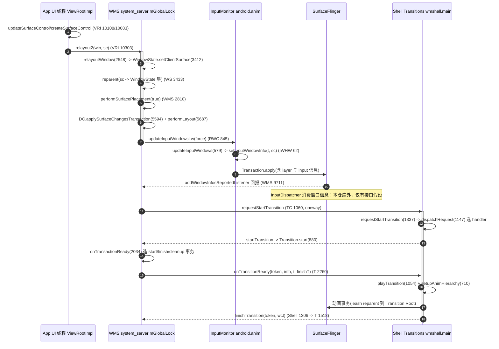
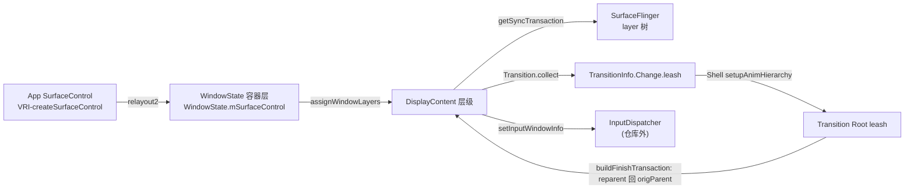
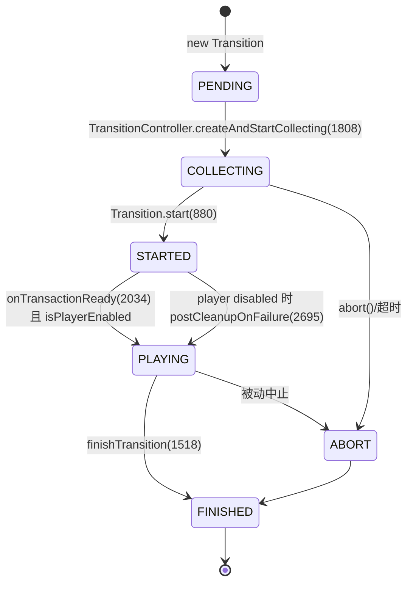

# WMS：窗口、Surface 与 Shell Transition

> 状态：draft · 适用版本：android17-release · 校验日期：2026-11-24
> 关联：[[architecture-overview]] · [[render-pipeline]] · 相关长文：../docs/WindowManagerShellTransitionAnalysis.md

## 1. 作用与边界

本页跟两条栈：控件面（`addWindow` → `WindowState` → `SurfaceControl` → SurfaceFlinger layer）和动画面（`Transition` → Shell `Transitions` → leash 重父化 → 上屏动画）。两条栈在"提交"处合一：同一个 `SurfaceControl.Transaction` 既携带 layer 状态，也携带 input 窗口信息（`Transaction#setInputWindowInfo`，`base/core/java/android/view/SurfaceControl.java:3875`），由 `DisplayContent` 的 sync transaction 合并后交给 SurfaceFlinger。

三条必须先站住的前提：

- 本分支 `WindowManager.useClientSurface()` 为真（`base/core/java/android/view/WindowManager.java:7246`），**服务端不再为窗口创建 surface**：`WindowStateAnimator.createSurfaceLocked()` 第一行就判定并返回 null（`base/services/core/java/com/android/server/wm/WindowStateAnimator.java:288`）。surface 由 App 进程的 `ViewRootImpl` 创建，经 `relayout2` / `relayoutAsync2` 随 Binder 交给 WMS，由 WMS reparent 到该窗口的容器层。读 AOSP 13 及更早的分析文档（服务端建 surface、回传 outSurfaceControl）必须对此打折。
- 本分支已没有 framework 侧 `AppTransition` 类：`DisplayContent.executeAppTransition()` 退化成 `mTransitionController.setReady(this)`（`base/services/core/java/com/android/server/wm/DisplayContent.java:6065`）。所谓 "legacy 转场"只剩两条残迹：无 `TransitionPlayer` 时 WMS 立即 apply+finish，以及面向老 `AppTransitionListener` 的回调，详见 §3.6。
- 不在本仓库：kernel binder 驱动、composer/display HAL、SurfaceFlinger 本体、InputDispatcher 本体。`native/` 只有 `libs/input` 的回环与工具类（`native/libs/input/` 下无 `InputDispatcher.cpp`），所以"窗口信息如何被 InputDispatcher 消费"只能写到接口假设。凡此均标注"本仓库外，仅有接口假设"。

layer 层级（从下到上，决定了 reparent 的合法目标）：`DisplayContent`（容器层，`configureSurfaces` 在 `base/services/core/java/com/android/server/wm/DisplayContent.java:1638` 建）→ `DisplayArea`/`Task` → `ActivityRecord` → `WindowToken` → `WindowState`。每个 `WindowContainer` 的容器层由 `WindowContainer.makeSurface()`（`base/services/core/java/com/android/server/wm/WindowContainer.java:2565`）产生并在 `701` `setInitialSurfaceControlProperties(makeSurface())` 时建出；`makeAnimationLeash()`（`2955`）只是"同一种容器层 + 作为动画 leash 使用"。记住这条链，§3.5 的 reparent 才有落点。

## 2. 模块与文件地图

| 文件 | 角色 | 关键方法与行 |
| --- | --- | --- |
| `base/core/java/android/view/ViewRootImpl.java` | 客户端建 surface、发起 relayout | `relayoutWindow`（`10194` 起客户端 surface 分支）、`updateSurfaceControl`（`10108`）、`createSurfaceControl`（`10083`）、`relayout2`（`10303`） |
| `base/services/core/java/com/android/server/wm/WindowManagerService.java` | 窗口 API 入口、全局锁、焦点仲裁 | `addWindow`（`1672`）、`addWindowInner`（`2044`）、`relayoutWindow`（`2548`）、`updateFocusedWindowLocked`（`6987`）、`syncInputTransactions`（`9698`） |
| `base/services/core/java/com/android/server/wm/WindowState.java` | 单窗口状态；接管客户端 surface | `setClientSurface`（`3412`）、`mInputWindowHandle` 初始化（`1089`） |
| `base/services/core/java/com/android/server/wm/WindowStateAnimator.java` | 绘制状态机；服务端建 surface 旧路径 | `createSurfaceLocked`（`287`）、`mSurfaceControl` 字段（`102`） |
| `base/services/core/java/com/android/server/wm/DisplayContent.java` | 单屏布局与事务合并、焦点落地、input monitor 归属 | `applySurfaceChangesTransaction`（`5594`）、`performLayout`（`5687`）、`mApplySurfaceChangesTransaction`（`1135`）、`updateFocusedWindowLocked`（`4394`）、`executeAppTransition`（`6065`） |
| `base/services/core/java/com/android/server/wm/RootWindowContainer.java` | 全局 placement 循环 | `performSurfacePlacement`（`739`）、`applySurfaceChangesTransaction`（`859`） |
| `base/services/core/java/com/android/server/wm/InputMonitor.java` | 焦点与 input 窗口写入事务 | `setInputFocusLw`（`378`）、`updateInputWindowsLw`（`344`）、`updateInputWindowsImmediately`（`366`）、`updateInputWindows`（`579`） |
| `base/services/core/java/com/android/server/wm/TransitionController.java` | 请求/采集/ready 调度、player 注册表 | `requestTransitionIfNeeded`（`910`）、`requestStartTransition`（`996`）、`createAndStartCollecting`（`1808`）、`registerTransitionPlayer`（`452`） |
| `base/services/core/java/com/android/server/wm/Transition.java` | 一次转场的状态机、提交事务与还原事务 | `start`（`880`）、`collect`（`903`）、`setReady`（`1233`）、`onTransactionReady`（`2034`）、`finishTransition`（`1518`） |
| `base/libs/WindowManager/Shell/src/com/android/wm/shell/transition/Transitions.java` | Shell 侧播放器与 handler 派发 | `requestStartTransition`（`1337`）、`onTransitionReady`（`737`）、`playTransition`（`1054`）、`TransitionPlayerImpl`（`2037`） |
| `base/services/core/java/com/android/server/wm/WindowSurfacePlacer.java` | placement 的调度与重复布局循环 | `performSurfacePlacementIfScheduled`（`106`）、`performSurfacePlacement(boolean)`（`116`）、`performSurfacePlacementLoop`（`130`） |
| `base/services/core/java/com/android/server/wm/WindowContainer.java` | 容器层 surface 与事务所有权 | `getSyncTransaction`（`2852`）、`getPendingTransaction`（`2864`）、`makeSurface`（`2565`）、`makeAnimationLeash`（`2955`） |
| `base/services/core/java/com/android/server/wm/InputWindowHandleWrapper.java` | input handle 的脏标记与批量下发 | `applyChangesToSurface`（`62`，内部 `setInputWindowInfo` 在 `63`） |
| `base/libs/WindowManager/Shell/src/com/android/wm/shell/transition/tracing/PerfettoTransitionTracer.java` | 转场结构化事件写入 perfetto | `TracePacket.SHELL_TRANSITION`（`87`） |

读这张表的正确姿势：WMS 是唯一的状态所有者，Shell 是唯一的动画作者。Shell 只能通过两种东西影响 WMS 状态——请求阶段的 `WindowContainerTransaction`（`Transitions.requestStartTransition` 返回，`1337` 起）和 finish 阶段的 `finishTransition(token, wct)`（`1306`），其它一律是 `SurfaceControl.Transaction` 的直接操作，绕过 WMS 状态。因此"Shell 动画结束但窗口状态没变"几乎总是 WCT 没带对，而不是动画代码错。

## 3. 核心流程

### 3.1 阶段 A：客户端建 Surface，`addWindow` 只做登记

1. App UI 线程，`ViewRootImpl.relayoutWindow` 在 `WindowManager.useClientSurface()` 为真且非 locally-managed 时先调 `updateSurfaceControl(viewVisibility)`（`base/core/java/android/view/ViewRootImpl.java:10194`、`10108`）；无有效 surface 时由 `createSurfaceControl()` 建 `VRI-<title>`，flags 含 `SurfaceControl.NOT_ADD_TO_ROOT`（`10083`）。线程：App UI 线程；此时不持任何 WMS 锁。
2. 同一函数取 `getSurfaceControlForRelayout(viewVisibility)`（`10074`）后走同步 `relayout2`（`10303`）或异步 `relayoutAsync2`（`10285`），把 `SurfaceControl` 作为 Binder 参数带进 system_server。
3. WMS 侧从 Binder 线程进入 `WindowManagerService.addWindow`（`base/services/core/java/com/android/server/wm/WindowManagerService.java:1672`），在 `1691` 取 `mGlobalLock`；`1892` `new WindowState(...)`；`1910` `win.openInputChannel()` 生成本窗口的 `InputChannel`，其 token 后续成为 `InputWindowHandle.token`（`base/services/core/java/com/android/server/wm/WindowState.java:2687`）。失败语义：`checkAddPermission` 早退、token 校验失败返回 `ADD_BAD_APP_TOKEN`，都发生在 `WindowState` 创建之前或锁内直接 return，不会留下半初始化窗口。
4. `addWindowInner`（`2044`）把窗口挂进 `WindowToken`，`2113` 置 `setUpdateInputWindowsNeededLw()`，`2103` 置 `winAnimator.mEnterAnimationPending = true`（进入动画在首次 show 时被 `WindowStateAnimator` 消费）；若窗口可获焦，`2117` 调 `updateFocusedWindowLocked(UPDATE_FOCUS_WILL_ASSIGN_LAYERS, false)`——注意传 `false`，这一轮**不**刷新 input 窗口，留到 placement 之后。
5. relayout：`WindowManagerService.relayoutWindow`（`2548`）在同一把 `mGlobalLock` 内，`2768` 调 `win.setClientSurface(outSurfaceControl)`。过期 relayout 会被丢弃：`win.mRelayoutSeq > seq` 时直接 `return 0`（`2586`），客户端拿到的是上一帧结果而不是新 surface——调试"relayout 没有生效"时先看这里的 seq 与 `mRelayoutSeq`。
6. `WindowState.setClientSurface`（`base/services/core/java/com/android/server/wm/WindowState.java:3412`）在 `3433` 执行 `getPendingTransaction().reparent(surface, mSurfaceControl)`——把 App 的 surface 反挂到本窗口容器层；`3436` `mInputWindowHandle.forceChange()` 保证下一次 input 事务必然重发。这一步是"SurfaceControl 归属于 WMS 层级、buffer 归属于 App 进程"的分界点。`SurfaceSession`：服务端已无每窗口 session，`SurfaceSession` 类型仍在（`base/core/java/android/view/SurfaceSession.java:38`），但 WM 生产路径不再 `new`，旧的服务端建面路径在 `base/services/core/java/com/android/server/wm/WindowStateAnimator.java:287`~`325` 只作历史遗留。
7. relayout 尾部 `mWindowPlacerLocked.performSurfacePlacement(true)`（`base/services/core/java/com/android/server/wm/WindowManagerService.java:2810`）把控制权交给 placement 循环。

### 3.2 阶段 B：placement → 布局 → 提交（WMS 主导）

8. `WindowSurfacePlacer.performSurfacePlacement`（`base/services/core/java/com/android/server/wm/WindowSurfacePlacer.java:116`）→ `performSurfacePlacementLoop`（`130`）→ `RootWindowContainer.performSurfacePlacement`（`base/services/core/java/com/android/server/wm/RootWindowContainer.java:739`）。进入时若 `mFocusMayChange`，先重跑 `updateFocusedWindowLocked(UPDATE_FOCUS_WILL_PLACE_SURFACES, false)`。线程：system_server 的 WMS 线程，**全程持 `mGlobalLock`**。
9. `RootWindowContainer.performSurfacePlacement` 在 `762` 开 trace `applySurfaceChanges`，调私有 `applySurfaceChangesTransaction`（`859`）：先给 watermark/strictmode 等系统层定位，再对每个 `DisplayContent` 调 `dc.applySurfaceChangesTransaction()`（`880`），把各屏 `getSyncTransaction()` 收进 `mDisplayTransactions`，最后 `mDisplayManagerInternal.performTraversal(t, mDisplayTransactions)`（`886`）——这一步把 WMS 事务交进 DisplayManager/Display 层，再往下到 SurfaceFlinger 已属本仓库外。
10. `DisplayContent.applySurfaceChangesTransaction`（`base/services/core/java/com/android/server/wm/DisplayContent.java:5594`）按固定顺序做四件事：`adjustWallpaperWindows()` → `performLayout(true, false)`（`5687`，重新计算 frame/insets）→ trace `applyPostLayoutPolicy`（`5620`）下逐窗口跑 `DisplayPolicy.applyPostLayoutPolicyLw` → trace `applyWindowSurfaceChanges`（`5632`）下 `forAllWindows(mApplySurfaceChangesTransaction, true)`（`5634`）。
11. 逐窗口 consumer 在 `1135`：先 `commitFinishDrawingLocked()`（`1138`，把 client 已完成的 draw 状态转成可见），再计算 `obscured` / `displayHasContent` / keep-screen-on / refresh rate。窗口的 buffer 是否被显示由这一步定稿，而 layer 顺序由 `assignWindowLayers`（trace 在 `base/services/core/java/com/android/server/wm/DisplayContent.java:4550`）负责。
12. 回到 `RootWindowContainer`，`845` 对每屏 `dc.getInputMonitor().updateInputWindowsLw(true)`：**只有在 layer 与可见性定稿之后**，input 窗口列表才允许生成，这是"输入命中区域与画面一致"的时序保证。
13. `InputMonitor.updateInputWindowsLw`（`base/services/core/java/com/android/server/wm/InputMonitor.java:344`）无 force 时看脏标记，然后投递到 `mAnimationHandler`（`base/services/core/java/com/android/server/wm/InputMonitor.java:150`，即 `WindowManagerService.mAnimationHandler`，绑 `AnimationThread`，`base/services/core/java/com/android/server/wm/WindowManagerService.java:803`）；同步路径走 `updateInputWindowsImmediately`（`366`），由 `WindowManagerService.syncInputTransactions`（`9698`）在 `9707` 调用，并用 `addWindowInfosReportedListener` + `CountDownLatch` 等 SurfaceFlinger 回报（`9711`）。
14. consumer `updateInputWindows`（`base/services/core/java/com/android/server/wm/InputMonitor.java:579`）开 trace `updateInputWindows`（`580`），遍历顶层到底层窗口：`populateInputWindowHandle`（`253`）填 touchableRegion/scale/type，`setInputWindowInfoIfNeeded`（`679`）在脏时调 `InputWindowHandleWrapper.applyChangesToSurface`（`base/services/core/java/com/android/server/wm/InputWindowHandleWrapper.java:62`），后者执行 `t.setInputWindowInfo(sc, mHandle)`（`:63`）。

placement 是循环而不是一次调用：`WindowSurfacePlacer.performSurfacePlacementLoop`（`base/services/core/java/com/android/server/wm/WindowSurfacePlacer.java:130`）带重入保护（`mInLayout` 为真说明递归调用，打 `Slog.w` 后返回，`131`~`137`），并在 `defaultDisplay.mWaitingForConfig` 时整轮跳过（`141`~`148`，旋转未完成时不布局）。一次 placement 里若产生新的 layout 需求，`RootWindowContainer` 会把 `pendingLayoutChanges` 回灌并再次进入，直到稳定；`displayHasContent` 变化在这一轮里同步给 `DisplayManagerInternal.setDisplayProperties`（`base/services/core/java/com/android/server/wm/DisplayContent.java:5641`）。

### 3.3 阶段 C：焦点窗口 → input 目标窗口

15. `WindowManagerService.updateFocusedWindowLocked`（`base/services/core/java/com/android/server/wm/WindowManagerService.java:6987`，trace `wmUpdateFocus` 在 `6988`）→ `DisplayContent.updateFocusedWindowLocked`（`base/services/core/java/com/android/server/wm/DisplayContent.java:4394`）算出 `mCurrentFocus`，`4462` 调 `getInputMonitor().setInputFocusLw(newFocus, updateInputWindows)`。
16. `InputMonitor.setInputFocusLw`（`base/services/core/java/com/android/server/wm/InputMonitor.java:378`）只比较 token（`382`）：变了才置脏，`updateInputWindows=false` 时把刷新推迟到下一次 placement（`addWindow` 的 `UPDATE_FOCUS_WILL_ASSIGN_LAYERS` 就是这条）。
17. 在 consumer 收尾的 `updateInputFocusRequest`（`422`）：焦点窗口必须有 surface 且 `isFocusable()`，否则清空 `mInputFocus` 并从事务里移除焦点；满足条件时 `requestFocus`（`517`）→ `mInputTransaction.setFocusedWindow(mInputFocus, windowName, displayId)`（`524`，对应 `base/core/java/android/view/SurfaceControl.java:4902`）。Recents 动画期间焦点可被 input consumer 顶替，同一函数里对 `mActiveRecentsTask` / `isActivityTypeHomeOrRecents()` 做了特判。
18. 下发：焦点与窗口列表都随 surface 事务提交，`InputDispatcher` 侧通过 `WindowInfosListener#onWindowInfosChanged`（`base/core/java/android/window/WindowInfosListener.java:53`）与事务提交回调取到 `InputWindowHandle[]`。**本分支已无 `InputManagerService.setInputWindows`**：仓库内只剩两处注释提及（`base/services/core/java/com/android/server/wm/InputMonitor.java:160`、`base/core/java/android/view/SurfaceControl.java:3900`），真实推送是 `Transaction#setInputWindowInfo`。InputDispatcher 收到之后如何建 `InputTarget`、如何做 occlusion/focus 判定，在本仓库外，仅有接口假设。

### 3.4 阶段 D：Transition 采集与播放

19. 触发（例：Activity 启动/关闭）：`DisplayContent` 侧发起 `requestTransitionAndLegacyPrepare`（`base/services/core/java/com/android/server/wm/DisplayContent.java:6059`）→ `TransitionController.requestTransitionIfNeeded`（`base/services/core/java/com/android/server/wm/TransitionController.java:910`）建 `Transition` 并 `createAndStartCollecting`（`1808`）→ `Transition.collect`（`base/services/core/java/com/android/server/wm/Transition.java:903`）把 `WindowContainer` 加入 BLAST SyncSet、快照起始状态。线程：WMS 线程，持 `mGlobalLock`。
20. 请求播放：`TransitionController.requestStartTransition`（`996`）组装 `TransitionRequestInfo`，`1060` 调 `getTransitionPlayer().requestStartTransition(...)`。`ITransitionPlayer` 是 `oneway`（`base/core/java/android/window/ITransitionPlayer.aidl:42`），WMS 不阻塞等 Shell。Shell 侧 `Transitions.requestStartTransition`（`base/libs/WindowManager/Shell/src/com/android/wm/shell/transition/Transitions.java:1337`）在 `wmshell.main` 线程（`base/libs/WindowManager/Shell/src/com/android/wm/shell/dagger/WMShellConcurrencyModule.java:102`）上 `dispatchRequest`（`1147`）挑 handler 并返回 `WindowContainerTransaction`；随后 shell 回调 `IWindowOrganizerController.startTransition`，WMS 侧 `Transition.start`（`base/services/core/java/com/android/server/wm/Transition.java:880`）把状态推到 `STATE_STARTED`。
21. 汇合：SyncSet 全部绘制完成 → `Transition.onTransactionReady`（`base/services/core/java/com/android/server/wm/Transition.java:2034`）。它先 `commitVisibleActivities`（`2748`）/`commitVisibleWallpapers`（`2763`）提交可见性，再 `buildFinishTransaction`（`1313`）与 `buildCleanupTransaction` 造出"还原事务"。
22. 交给 Shell 播放：`2252` 判断 `!mController.isFlushing() && mIsPlayerEnabled`，成立时 `2260` 调 `mController.getTransitionPlayer().onTransitionReady(mToken, info, transaction, mFinishTransaction)`，并 `asyncTraceBegin("playing")`（`2263`，常量定义在 `163`）。`mIsPlayerEnabled` 缺省真（`355`），display 未 enable 时在 `base/services/core/java/com/android/server/wm/TransitionController.java:999` 被置假。
23. leash 构造：`TransitionInfo` 每个 `Change` 的 leash 来自 `getLeashSurface`（`base/services/core/java/com/android/server/wm/Transition.java:3292`）——DisplayContent 取 `getWindowingLayer()`，fixed-rotation 取 token leash，其余取 `wc.getSurfaceControl()`；根 leash 由 `createAndAddRootLeash`（`3390`）用 `makeAnimationLeash()`（`3394`，底层 `DisplayContent.makeAnimationLeash`，`base/services/core/java/com/android/server/wm/DisplayContent.java:5845`）建成 `"Transition Root: <name>"` 并 `addRootLeash`（`3406`）。
24. Shell 播放：`TransitionPlayerImpl.onTransitionReady`（`base/libs/WindowManager/Shell/src/com/android/wm/shell/transition/Transitions.java:2037`）把回调切到 `wmshell.main`，`onTransitionReady`（`737`）→ `onTransitionReadyInner`（`746`）→ `dispatchReady`（`798`）→ `playTransition`（`1054`）。`1062` 先 `setupAnimHierarchy`（`710`，show 根 leash），再把 startAnimation 先给 request 阶段选中的 handler，消费不掉才 `dispatchTransition` 轮询其余 handler。
25. 收尾：动画结束回调 `onFinish`（`base/libs/WindowManager/Shell/src/com/android/wm/shell/transition/Transitions.java:1242`）→ `1306` `mOrganizer.finishTransition(token, wct)`（AIDL 到 `IWindowOrganizerController`）→ WMS `Transition.finishTransition`（`base/services/core/java/com/android/server/wm/Transition.java:1518`）：`mTransitionTracer.logFinishedTransition`、关闭 start/finish 事务、`apply` cleanup 事务。若 Shell 抛 `RemoteException`，`2265` 的 catch 直接调 `postCleanupOnFailure`（`2268`，定义在 `2695`），WMS 自己 apply+finish，动画丢失但不漏事务。

并发转场的三条规则（都发生在 Shell 的 `wmshell.main` 单线程上）：

- 排队：每个 `Track`（`base/libs/WindowManager/Shell/src/com/android/wm/shell/transition/Transitions.java:311`，容器 `mTracks` 在 `335`）同一时刻只有一个 active transition，ready 但未播的进 `mReadyTransitions`，由 `processReadyQueue`（`928`）按顺序放行。多 track 用于互不相关的显示/任务。
- 合并：已在播的转场可以吸收后到的 ready，`logMergeRequested`（`988`）/`logMerged`（`1037`）会落到 perfetto；被合并方不再单独播放，其 finish 事务合并进主动画。
- 中止：`onAbort`（`1161`）标记 `mAborted`，通知 handler `onTransitionConsumed(..., aborted=true)` 并释放 anim surfaces；仍按队列顺序 finish，保证 finish 顺序与 ready 顺序一致。

### 3.5 Surface 的重父化（reparent）方向：谁挂上去，谁挂回来

- **挂上去**在 Shell 动画侧：`base/libs/WindowManager/Shell/src/com/android/wm/shell/transition/DefaultTransitionHandler.java:648` 为孤立 Activity 建 `"Transition ActivityWrap"` 容器层并 `startTransaction.reparent(change.getLeash(), leash)`；`base/libs/WindowManager/Shell/src/com/android/wm/shell/transition/TransitionAnimationHelper.java:311` 为动画背景建以 `rootLeash` 为父的 color layer；`TransitionLeashManager.kt:65` 把参与者挂到父 `Change` 的 leash。即"动画期间的父子关系由播放器决定"。
- **挂回来**在 WMS 侧：`buildFinishTransaction`（`base/services/core/java/com/android/server/wm/Transition.java:1313`）逐 target `t.reparent(targetLeash, origParent)`（`1321`）、重置 layer/crop/corner/alpha，最后把根 leash `reparent(..., null)`（`1345`）；`buildCleanupTransaction` 里再对 snapshot / 根 leash 做一次 `reparent(..., null)`（`1381`、`1394`）。Shell 必须在 `finishTransition` 之前 apply 这份 finishT（`ITransitionPlayer.aidl` 的注释写明"apply after playing, before finish"）。
- 转场期间发生的真实 reparent 由 `Transition.collectReparentChange`（`1096`）登记，用于动画结束把窗口挂到新父而非旧父。

### 3.6 legacy 转场 vs shell 转场（本分支实况）

- 判定开关是 `TransitionController.isShellTransitionsEnabled()`（`base/services/core/java/com/android/server/wm/TransitionController.java:509`）：有注册 player 或 `Flags.fallbackTransitionPlayer()` 为真即算 shell 转场。
- 没有 Shell（早期开机、shell 崩溃恢复）：`FallbackPlayer`（`2142`）顶上，`requestStartTransition` 里直接 `startTransition` 而不做动画（`2187`）；`mIsPlayerEnabled=false` 或 flushing 时走 `base/services/core/java/com/android/server/wm/Transition.java:2278` 的 else 分支——"Apply and finish immediately"（`2284` 调 `postCleanupOnFailure`），只保证状态正确。
- 兼容旧 listener：`dispatchLegacyAppTransitionStarting`（`base/services/core/java/com/android/server/wm/TransitionController.java:1666`）在 ready 时通知 `WindowManagerInternal.AppTransitionListener`；`legacyRestoreNavigationBarFromApp`（`base/services/core/java/com/android/server/wm/Transition.java:2878`）处理 nav bar 归位。这两个是"legacy"在本分支唯一还活着的语义。
- 旧的 `AppTransition`（prepare/execute 一对、`mAppTransition` 待播放队列）在仓库内已不存在，`executeAppTransition` 只是 `setReady`（`base/services/core/java/com/android/server/wm/DisplayContent.java:6065`）。因此"legacy 转场 vs shell 转场"在本分支的正确说法是：**同一套 Transition 机制，区别只在有没有 player 播动画**，而非两套并存实现。

### 3.7 失败与降级对照

| 失败点 | 行为 | 证据 |
| --- | --- | --- |
| 客户端 surface `build()` OOM | 返回无效 `SurfaceControl`，WMS 侧 `setClientSurface` 直接 return，窗口可登记但无画面 | `base/core/java/android/view/ViewRootImpl.java:10101`、`base/services/core/java/com/android/server/wm/WindowState.java:3426` |
| Shell 未注册 / `fallbackTransitionPlayer` | 用 `FallbackPlayer` 直接 `startTransition`，无动画但状态机照常走完 | `base/services/core/java/com/android/server/wm/TransitionController.java:2142`、`509` |
| Shell 调 `onTransitionReady` 抛 `RemoteException` | `postCleanupOnFailure` 自行 apply+finish，转场结束 | `base/services/core/java/com/android/server/wm/Transition.java:2265`、`2268`、`2695` |
| 采集超时 | SyncSet 强制 finish，降级为直接 apply | `base/services/core/java/com/android/server/wm/TransitionController.java:447` |
| 过期 relayout | `mRelayoutSeq > seq` 直接 return 0，surface 不变 | `base/services/core/java/com/android/server/wm/WindowManagerService.java:2586` |
| 窗口无 surface 却想获焦 | 焦点不下发，`updateInputFocusRequest` 清空 `mInputFocus` | `base/services/core/java/com/android/server/wm/InputMonitor.java:422` |

## 4. 时序图

## 5. 关键数据结构与状态机

| 结构 | 关键字段 | 语义 |
| --- | --- | --- |
| `WindowState` | `mSurfaceControl`（继承自 `base/services/core/java/com/android/server/wm/WindowContainer.java:186`）、`mInputWindowHandle`（`base/services/core/java/com/android/server/wm/WindowState.java:1089`）、`mInputChannelToken` | 窗口身份；surface 由客户端注入后即 WMS 层级的子节点 |
| `WindowStateAnimator` | `mSurfaceControl`（`102`）、drawState | 本分支只持有 surface 引用做动画/裁剪，不再创建 |
| `InputWindowHandleWrapper` | `mHandle`、`mChanged` | 脏标记 + `applyChangesToSurface`（`62`）批量刷事务，避免每次 traversal 重发 |
| `TransitionInfo` / `Change` | leash、mode、flags、`mEndParent`、endAbsBounds | Shell 唯一的输入：一份 `TransitionInfo` + start/finish 两个事务 |
| `Transition` | `mState`、`mSyncId`、`mStartTransaction`/`mFinishTransaction`/`mCleanupTransaction`、`mIsPlayerEnabled`（`355`） | 一次转场的事务与生命周期 |
| `TransitionController` | `mCollectingTransition`（`224`）、`mFinishingTransition`（`177`）、`mTransitionPlayers`（`126`） | 同一时刻至多一个在采集、一个在收尾；player 是栈而非单值 |

`Transition.mState` 状态机（常量在 `base/services/core/java/com/android/server/wm/Transition.java:166`~`191`）：

超时：`createAndStartCollecting` 用 `CHANGE_TIMEOUT_MS`/`DEFAULT_TIMEOUT_MS` 起 `Transition.startCollecting(timeoutMs)`（`base/services/core/java/com/android/server/wm/TransitionController.java:447`），超时后 SyncSet 强制 `finishNow`，转场降级为"直接 apply"，动画丢失但不会卡死后续转场。

`Change` 的两个字段决定动画形态：`mode` 来自 `info.getTransitMode(target)`（`base/services/core/java/com/android/server/wm/Transition.java:3453`，即 `TRANSIT_OPEN`/`TO_FRONT`/`CLOSE`/`TO_BACK`/`CHANGE`），Shell 的 handler 按它区分开/关/换；`FLAG_IS_OCCLUDED`（`3465`）表示该 change 在终点被上层不透明窗口遮住，加这个 flag 是为了防止被遮住的 change 也播 open 动画（否则会看到"底下任务闪一下"）。

事务所有权（读代码时最容易混的一处，四个事务各归各的阶段）：

| 事务 | 生产者 | 消费者 | 生命周期 |
| --- | --- | --- | --- |
| `pendingTransaction`（per `WindowContainer`，`base/services/core/java/com/android/server/wm/WindowContainer.java:2864`） | WMS 各处状态修改（reparent/alpha/show…） | 下一次 traversal 合并进 display | 单次事务，读到即失效 |
| `syncTransaction`（`base/services/core/java/com/android/server/wm/WindowContainer.java:2852`） | 需要与绘制同步的修改（含 `setClientSurface` 的 reparent） | `DisplayContent.applySurfaceChangesTransaction` 收集后 `performTraversal`（`base/services/core/java/com/android/server/wm/RootWindowContainer.java:886`） | 随 BLAST sync 一起提交 |
| `Transition.mStartTransaction`/`mFinishTransaction` | `Transition.onTransactionReady`（`2034`） | Shell 的 handler（`startAnimation` 拿到） | finish 前必须 apply，`finishTransition` 里 close（`1532`、`1533`） |
| `Transition.mCleanupTransaction` | 同上 | WMS 在 `finishTransition` 内 `apply`（`1536`） | 转场结束即销毁 |

## 6. 线程/进程模型与并发

- **WMS 侧**：`WindowManagerService` 的 `mH`（`base/services/core/java/com/android/server/wm/WindowManagerService.java:796`）绑在构造它的线程 Looper 上；所有窗口状态在 `mGlobalLock`（`WindowManagerGlobalLock`）下变更。`addWindow`（`1691`）、`relayoutWindow` 都在锁内，Binder 线程一进入就会被串行化。
- **InputMonitor**：`mAnimationHandler`（`base/services/core/java/com/android/server/wm/InputMonitor.java:150` → `base/services/core/java/com/android/server/wm/WindowManagerService.java:803`）绑 `AnimationThread`；`updateInputWindowsLw` 只是 `post`，因此 input 列表的刷新发生在锁外，但事务内容在 post 时已攥住 `mInputTransaction`/`mDisplayContent`。
- **Shell 侧**：`wmshell.main`（`base/libs/WindowManager/Shell/src/com/android/wm/shell/dagger/WMShellConcurrencyModule.java:102`，`THREAD_PRIORITY_DISPLAY`）串行处理所有 transition 回调；`Transitions.requestStartTransition`、`onTransitionReady`、`playTransition`、`onFinish` 都在这一条线程上，因此 Shell 内部的 handler 选择与 track 队列无需额外锁。Shell **不持** `mGlobalLock`，跨进程交互只有两条：`ITransitionPlayer`（WMS→Shell，oneway，`:42`）与 `IWindowOrganizerController`（Shell→WMS）。
- **顺序与一致性**：input 信息不单独 RPC，而是挂在 surface 事务上，靠"事务提交顺序"保证与 layer 顺序一致；需要强同步时用 `addWindowInfosReportedListener`（`base/core/java/android/view/SurfaceControl.java:3905`）等 SF 回报（`base/services/core/java/com/android/server/wm/WindowManagerService.java:9711`），有 `SYNC_INPUT_TRANSACTIONS_TIMEOUT_MS` 上限。
- **失败语义**：客户端 surface `build()` 抛 `OutOfResourcesException` 时返回无效 `SurfaceControl`（`base/core/java/android/view/ViewRootImpl.java:10101`），`setClientSurface` 对 invalid surface 直接 return（`base/services/core/java/com/android/server/wm/WindowState.java:3426`），窗口进入"有 WindowState 无 surface"状态，后续 `populateOverlayInputInfo` 把该 handle 标成不可聚焦、不可触摸（`base/services/core/java/com/android/server/wm/InputMonitor.java:689`）；转场侧 Shell 死亡则 `removeStartingWindow`/`onTransitionReady` 抛 `RemoteException`，WMS 走 `postCleanupOnFailure`。
- **锁顺序**：禁止在持 `mGlobalLock` 时同步调用 Shell。`TransitionController.requestStartTransition` 用的是 oneway AIDL（`base/core/java/android/window/ITransitionPlayer.aidl:42`），失败只捕获 `RemoteException` 后自己 `transition.start()`（`base/services/core/java/com/android/server/wm/TransitionController.java:1064`~`1066`）；反向 Shell→WMS 的 `IWindowOrganizerController` 调用会回到 WMS 线程再取锁，因此不能与 `mGlobalLock` 构成嵌套等待环。
- **事务与锁的边界**：`Transaction` 对象在锁内构造/merge（如 `WindowState.setClientSurface` 的 `reparent`，`3433`），`apply()` 可能在锁外（`InputMonitor` post 到 `AnimationThread`；Shell 在 `wmshell.main` apply startT/finishT）。因此"WMS 状态改了但屏幕上还是旧的"通常意味着事务还在路上，而不是状态错。
- **异常兜底**：`RootWindowContainer.performSurfacePlacement` 把 `applySurfaceChangesTransaction()` 包在 `try/catch (RuntimeException)` 里，只 `Slog.wtf("Unhandled exception in Window Manager")`（`base/services/core/java/com/android/server/wm/RootWindowContainer.java:766`）后继续走 `handleResizingWindows`（`893`）等收尾。也就是说 placement 内抛异常不会立刻杀 system_server，但这一轮 layer/input 状态会不完整——现场看到 "Unhandled exception in Window Manager" 就必须当作状态污染处理，而不是无害日志。

## 7. 调试入口

- `adb shell dumpsys window -a`：包含全部服务端状态（`base/services/core/java/com/android/server/wm/WindowManagerService.java:7604` 的 help 文本），配合 `--proto` 走 `dumpDebugLocked(proto, WindowTracingLogLevel.ALL)`（`7615`）导出 proto，适合脚本 diff 两次状态。
- `adb shell dumpsys window`：全量，含 `mCurrentFocus`/`mFocusedApp`/`mTopFocusedDisplayId`；子命令在 `base/services/core/java/com/android/server/wm/WindowManagerService.java:7644`（`displays`/`d`）、`7649`（`tokens`/`t`）、`7654`（`windows`/`w`）解析。`dumpsys window windows` 打印每个 `WindowState` 的 frame/`mHasSurface`/`mWinAnimator`/input handle 摘要，是核对"窗口有没有真的拿到 surface"的最快入口；`dumpsys window displays` 打印 `DisplayContent` 层级与 `mCurrentFocus`；`dumpsys window tokens` 打印 `WindowToken` 及其窗口列表。
- `adb shell dumpsys activity activities`：`base/services/core/java/com/android/server/am/ActivityManagerService.java:11485` 的 `activities` 分支，看 `ActivityRecord` 的 `nowVisible`/`mVisibleRequested`/`state`，与 `dumpsys window` 交叉验证"Activity 说可见但窗口没 surface"这类错位。
- Trace tag：`TRACE_TAG_WINDOW_MANAGER`，atrace 类别 `wm`（`base/services/core/java/com/android/server/wm/Transition.java:30` 的 import 即该 tag）。可抓的关键 slice：`applySurfaceChanges`（`base/services/core/java/com/android/server/wm/RootWindowContainer.java:762`）、`applyPostLayoutPolicy`（`base/services/core/java/com/android/server/wm/DisplayContent.java:5620`）、`applyWindowSurfaceChanges`（`5632`）、`performLayout`（`5688`）、`assignWindowLayers`（`4550`）、`updateInputWindows`（`base/services/core/java/com/android/server/wm/InputMonitor.java:580`）、`wmUpdateFocus`（`base/services/core/java/com/android/server/wm/WindowManagerService.java:6988`）、异步 slice `playing`（`base/services/core/java/com/android/server/wm/Transition.java:163`、`2263`）、`playTransition: <type>`（Shell `base/libs/WindowManager/Shell/src/com/android/wm/shell/transition/Transitions.java:1045`）、`dispatchRequest: <type>`（`base/libs/WindowManager/Shell/src/com/android/wm/shell/transition/Transitions.java:1129`）。
- Perfetto 结构化转场事件：`PerfettoTransitionTracer` 以 `TracePacket.SHELL_TRANSITION` 写入（`base/libs/WindowManager/Shell/src/com/android/wm/shell/transition/tracing/PerfettoTransitionTracer.java:87`），track 上可直接读转场类型、dispatch 到哪个 handler、merge/abort。
- `adb shell cmd window tracing`：命令存在（`base/services/core/java/com/android/server/wm/WindowManagerShellCommand.java:111` 分发到 `mInternal.mWindowTracing.onShellCommand`），但本分支实现是 Perfetto 数据源，`onShellCommand` 只打印 "Shell commands are ignored. Any type of action should be performed through perfetto."（`base/services/core/java/com/android/server/wm/WindowTracingPerfetto.java:79`~`85`）。因此实际用法是 perfetto 配置 data source，而不是 `tracing start`。
- 开关：`persist.wm.debug.start_shell_transition` / `persist.wm.debug.finish_shell_transition`（`base/libs/WindowManager/Shell/src/com/android/wm/shell/transition/Transitions.java:149`、`151`），用于在开机早期/shell 未就绪时定位"转场到底有没有起来"。
- Shell 侧日志不在 `dumpsys window` 里：`WindowManagerShellCommand` 对 WMShell 的 ProtoLog 明确提示改用 `dumpsys activity service SystemUIService WMShell`（`base/services/core/java/com/android/server/wm/WindowManagerShellCommand.java:122`~`124`）。转场相关问题（handler 没接、merge 后动画丢）优先看这条通道，而不是 WMS 的 dumpsys。
- 组合排查顺序建议：`dumpsys window windows` 确认 `mHasSurface` 与 frame → `dumpsys activity activities` 确认 `nowVisible` → perfetto 的 `wm` tag 看 `applySurfaceChanges`/`updateInputWindows` 是否成对出现 → perfetto 的 `SHELL_TRANSITION` packet 看转场是否 ready、被哪个 handler 消费。

## 8. 延伸阅读

- ../docs/WindowManagerShellTransitionAnalysis.md —— Shell transition 的架构总览、Track 管理与远程转场，配合本页 §3.4/§3.6 读。
- ../docs/LauncherRemoteAnimation.md —— `RemoteTransition`/`TransitionFilter`/`OneShotRemoteHandler` 的匹配与一次性 handler 语义，是 §3.4 第 24 步里 handler 选择的展开。
- ../docs/RootWindowContainerAnalysis.md —— `RootWindowContainer` 侧 startHome 与任务栈操作，解释"转场是谁发起的"。
- ../docs/RecentTaskViewAnalysis.md —— Recents/TaskView 组件结构，对应 §3.3 里 recents input consumer 顶替焦点的场景。
- ../docs/RecentAnimationCommunicationAnalysis.md —— 系统端与 Launcher 端的动画通信协议，补足 `ITransitionPlayer` 之外的 recents 通道。
- 相邻 wiki：[[architecture-overview]]（分层与进程边界）、[[render-pipeline]]（App 侧绘制到 SF 合成的另外半段）。

## 9. 待补充与不确定点

- **InputDispatcher 的消费路径未逐行核实**：本仓库无 `native/libs/input/InputDispatcher.cpp`，`setInputWindowInfo` 之后 InputDispatcher 如何建 `InputTarget`、何时做 occlusion/focus 判定，只能依赖 AOSP 公共知识，属"本仓库外，仅有接口假设"。需要 `frameworks/native` 完整树才能落实。
- **`Flags.useClientSurface()` 的 aconfig 默认值不在仓库**：`base/core/java/android/view/WindowManager.java:7246` 只暴露调用点，`com.android.window.flags.Flags` 是构建生成物。本页按 android17-release 默认开启叙述；若某个设备 overlay 关掉该 flag，§3.1 第 1、6 步要改回服务端 `createSurfaceLocked` 路径（`base/services/core/java/com/android/server/wm/WindowStateAnimator.java:325`）。
- **`WindowManagerService.mH` 的 Looper 归属**：`796` 处 `new H()` 不显式传 Looper，实际绑构造线程；WMS 由 SystemServer 构造，故推断为 SystemServer main。未找到本仓库内的显式断言，若要精确到线程名需设备侧 `/proc/<pid>/task` 或 trace 佐证。
